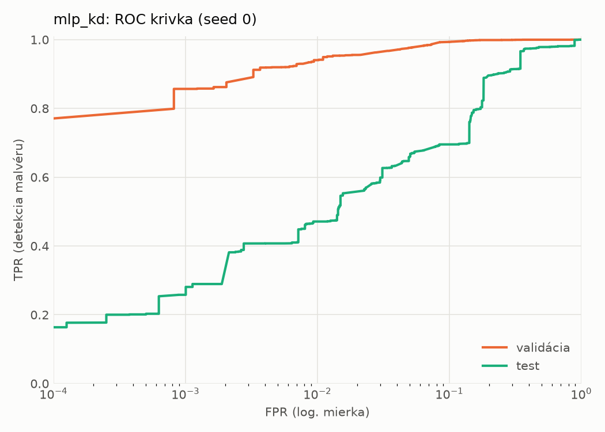
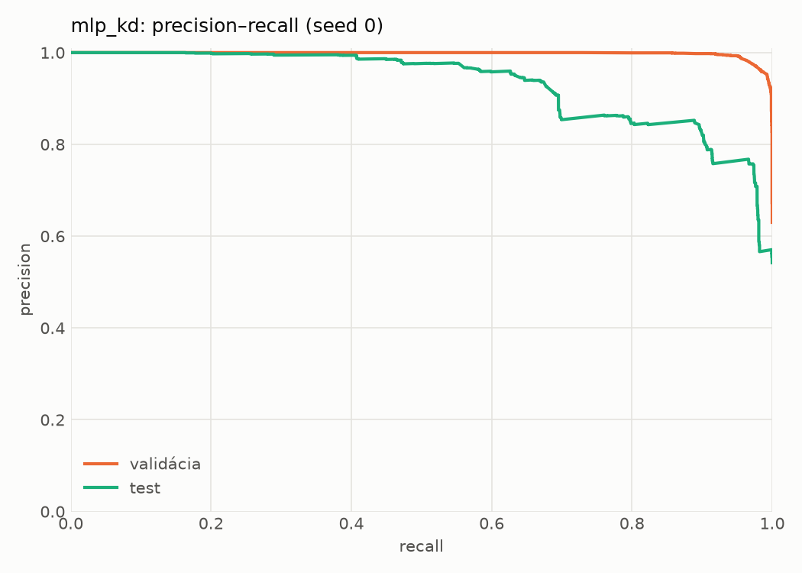
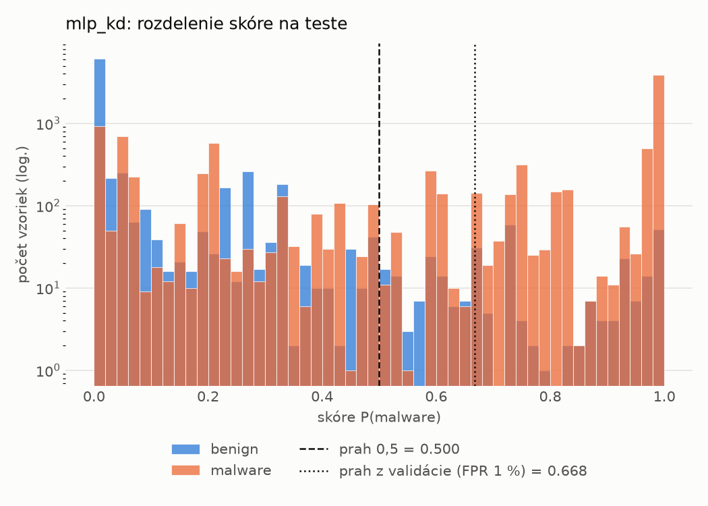
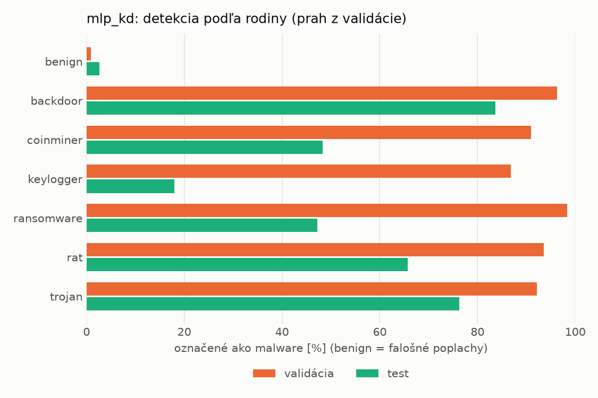
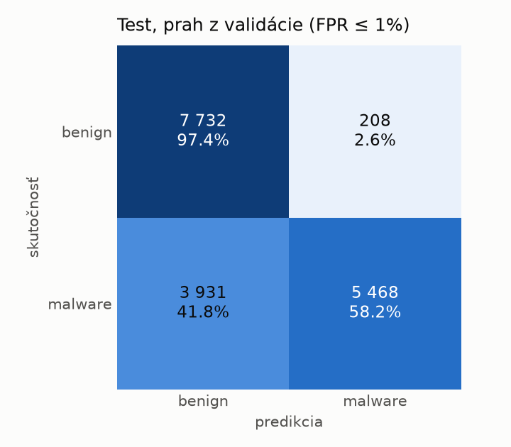
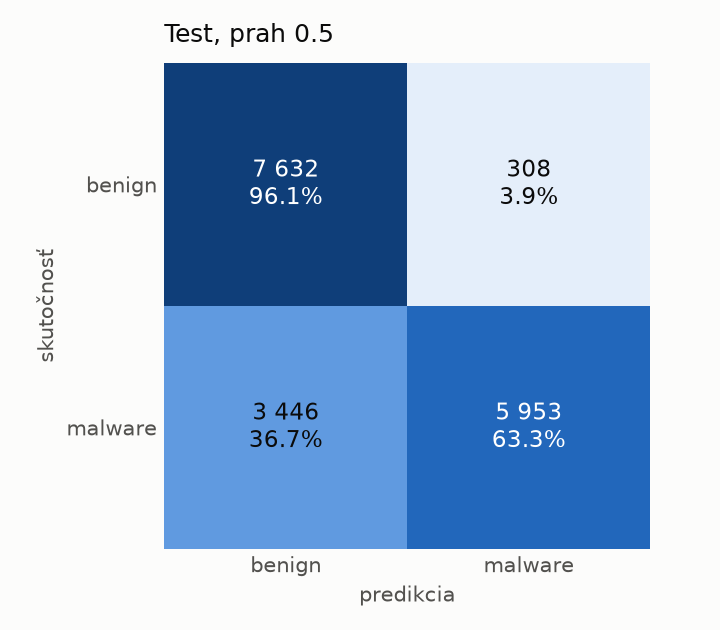
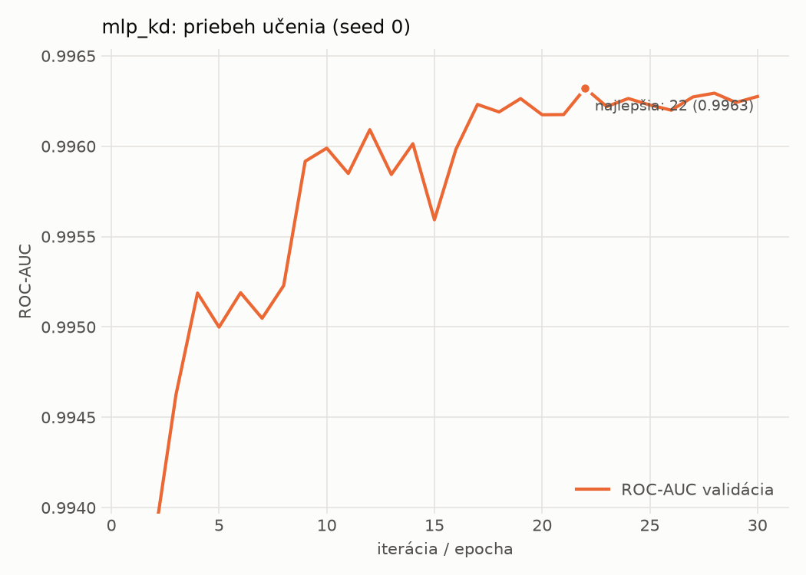

# dynamic/mlp_kd – beh `20261104-034323`

> Automaticky generované (`src/training/run_tabular.py`). Konfigurácia: `config.yaml`, protokol: `protocol.yaml`.

- **Model:** `mlp` – študent – malé MLP učené destiláciou z hybridného učiteľa
- **Ladenie:** bez ladenia – hyperparametre prevzaté z `runs_final/students_dynamic/mlp_kd/20261102-212132`
- **Finálne modely:** seedy [0, 1, 2]; hodnoty sú priemer ± smerodajná odchýlka cez seedy
- **Najlepšie hyperparametre:** `{"hidden_layers": 1, "max_epochs": 100, "patience": 8, "hidden_width": 32, "dropout": 0.14978534481914754, "lr": 0.0015794492400712224, "weight_decay": 1.2553588001973222e-06, "batch_size": 512, "kd_alpha": 0.7118939371172979, "kd_temperature": 1.298431487079528}`

## Detekčná kvalita (bez prahu)
| metrika | train (podvzorka) | validácia | test |
|---|---|---|---|
| ROC-AUC | 0.9976 ± 0.0001 | 0.9964 ± 0.0001 | 0.9159 ± 0.0023 |
| PR-AUC | 0.9985 ± 0.0000 | 0.9979 ± 0.0000 | 0.9332 ± 0.0012 |
| TPR pri FPR 1 % | 0.9519 ± 0.0006 | 0.9373 ± 0.0033 | 0.4174 ± 0.0466 |
| TPR pri FPR 0,1 % | 0.9129 ± 0.0052 | 0.8586 ± 0.0108 | 0.2722 ± 0.0167 |
| log loss | 0.0623 ± 0.0011 | 0.0780 ± 0.0003 | 0.7333 ± 0.0097 |
| Brier skóre | 0.0197 ± 0.0003 | 0.0234 ± 0.0001 | 0.1750 ± 0.0009 |

Rozdiel ROC-AUC train − validácia: **0.0011** (veľký rozdiel = preučenie).

## Pri prahu z validácie (FPR ≤ 1% na validácii)
| metrika | train (podvzorka) | validácia | test |
|---|---|---|---|
| accuracy | 0.9614 ± 0.0013 | 0.9570 ± 0.0020 | 0.7453 ± 0.0142 |
| balanced accuracy | 0.9680 ± 0.0009 | 0.9639 ± 0.0016 | 0.7630 ± 0.0131 |
| precision | 0.9969 ± 0.0006 | 0.9941 ± 0.0001 | 0.9611 ± 0.0020 |
| recall (TPR) | 0.9406 ± 0.0026 | 0.9373 ± 0.0033 | 0.5525 ± 0.0262 |
| FPR | 0.0047 ± 0.0010 | 0.0096 ± 0.0002 | 0.0264 ± 0.0006 |
| F1 | 0.9680 ± 0.0011 | 0.9649 ± 0.0017 | 0.7014 ± 0.0215 |
| MCC | 0.9219 ± 0.0024 | 0.9122 ± 0.0039 | 0.5660 ± 0.0212 |

## Pri pevnom prahu 0.5
| metrika | train (podvzorka) | validácia | test |
|---|---|---|---|
| accuracy | 0.9690 ± 0.0004 | 0.9650 ± 0.0005 | 0.7833 ± 0.0025 |
| balanced accuracy | 0.9720 ± 0.0002 | 0.9679 ± 0.0003 | 0.7967 ± 0.0023 |
| precision | 0.9903 ± 0.0005 | 0.9873 ± 0.0002 | 0.9458 ± 0.0044 |
| recall (TPR) | 0.9594 ± 0.0010 | 0.9567 ± 0.0011 | 0.6367 ± 0.0057 |
| FPR | 0.0154 ± 0.0008 | 0.0209 ± 0.0004 | 0.0432 ± 0.0039 |
| F1 | 0.9746 ± 0.0003 | 0.9718 ± 0.0004 | 0.7610 ± 0.0035 |
| MCC | 0.9356 ± 0.0008 | 0.9264 ± 0.0010 | 0.6142 ± 0.0043 |

## Výpočtové nároky (seed 0, testovacia množina)
| meranie | hodnota |
|---|---|
| tréning finálneho modelu | 8.2 s (priemer cez seedy) |
| ladenie spolu | 0 s |
| počet parametrov / uzlov | 64 129 |
| veľkosť modelu na disku | 0.31 MB |
| transformácia vstupu – latencia (1 vlákno) | 0.034 ms |
| transformácia vstupu – priepustnosť | 43 024 vzoriek/s |
| CPU latencia modelu (batch 1, 1 vlákno) | 0.067 ms (p95 0.075) |
| CPU priepustnosť (24 vlákien) | 140 079 vzoriek/s |
| GPU latencia (batch 1) | 0.290 ms (p95 0.353) |
| GPU priepustnosť | 94 043 vzoriek/s |
| GPU špičková pamäť | 687 MB |

## Grafy
| | |
|---|---|
|  |  |
|  |  |
|  |  |
|  |  |

## Súbory
`metrics.json` (všetky metriky po seedoch vrátane rodín), `timing.json`, `hpo_trials.csv`,
`predictions/<časť>_seed<N>.parquet` (sha256, family, label, score), `model/seed_<N>/`, `log.txt`.
