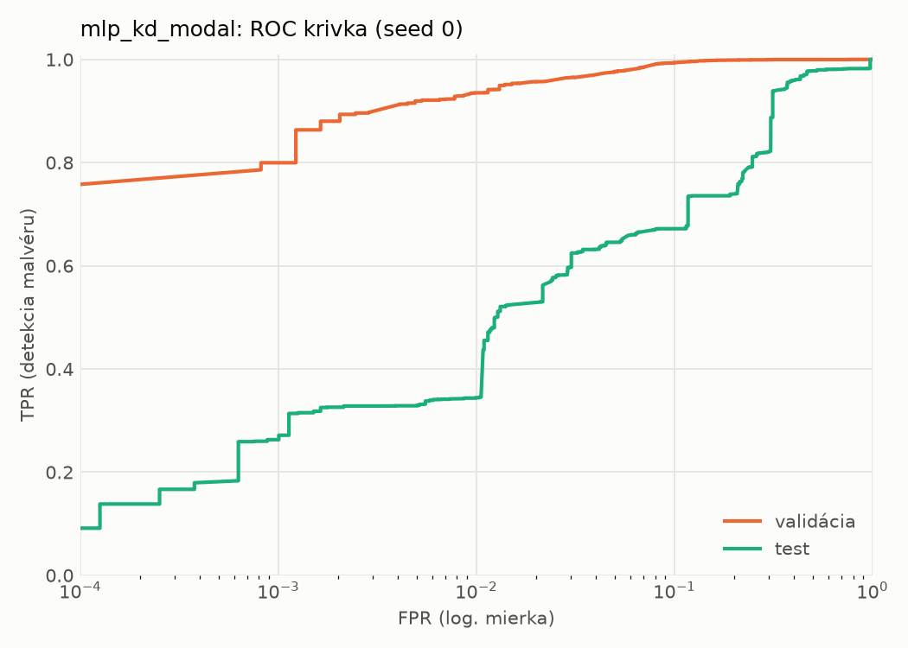
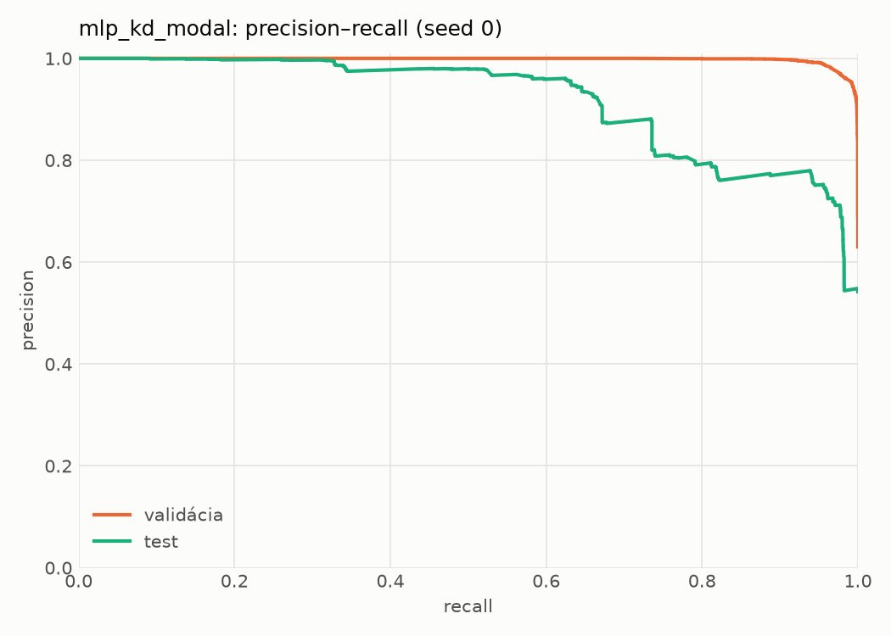
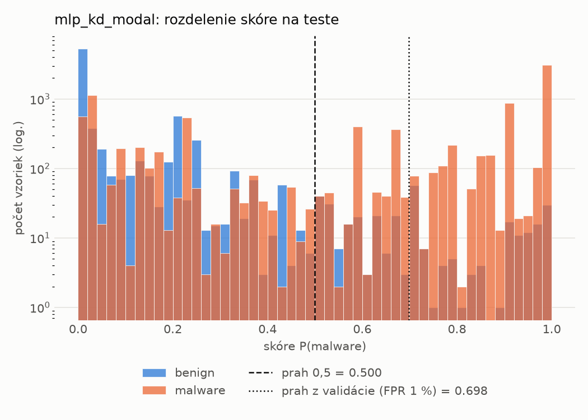
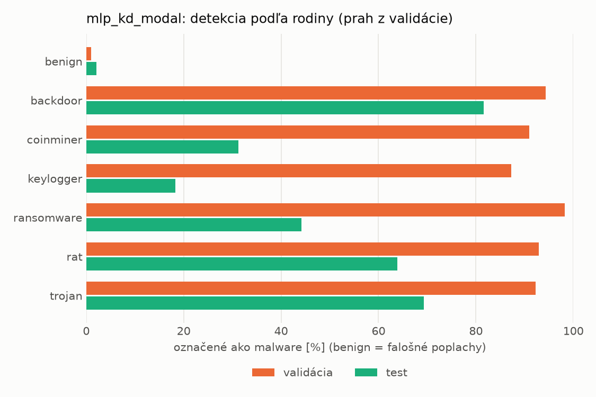
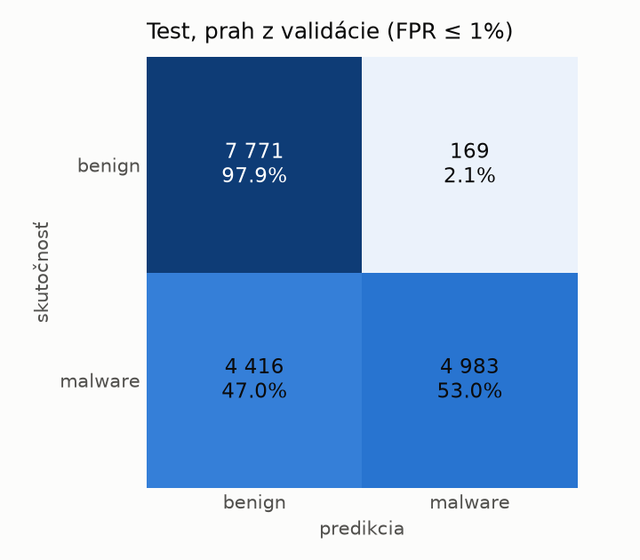
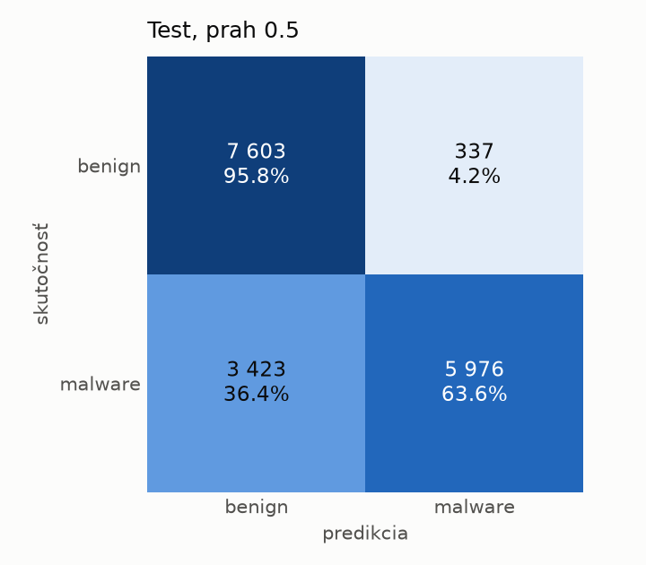
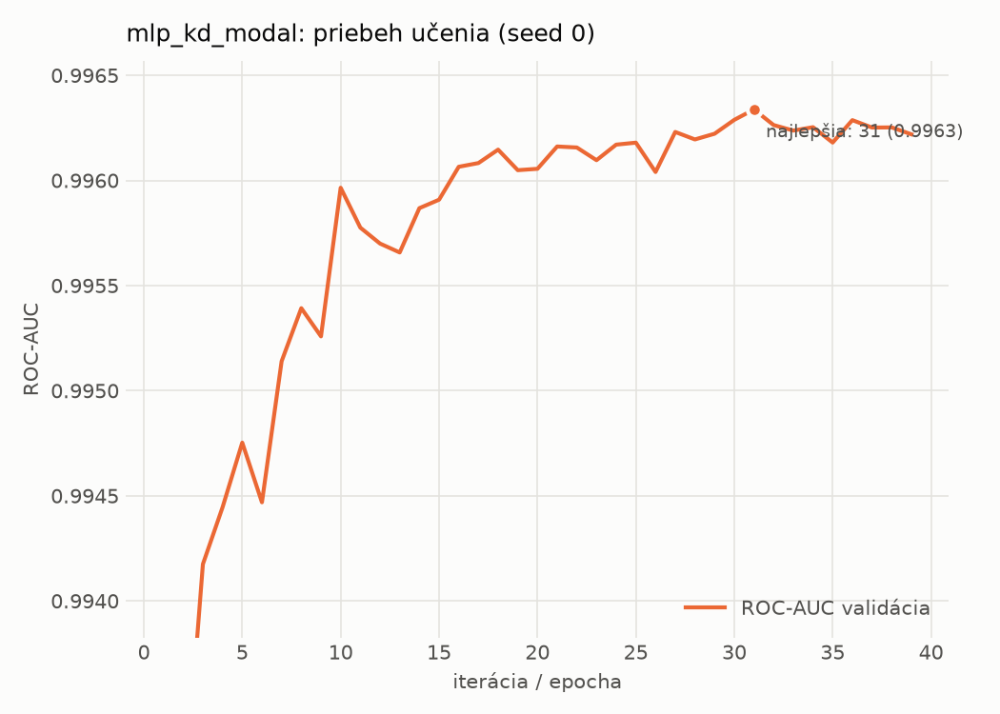

# dynamic/mlp_kd_modal – beh `20261104-034420`

> Automaticky generované (`src/training/run_tabular.py`). Konfigurácia: `config.yaml`, protokol: `protocol.yaml`.

- **Model:** `mlp` – študent – malé MLP učené destiláciou z učiteľa rovnakej modality (variant A)
- **Ladenie:** bez ladenia – hyperparametre prevzaté z `runs_final/students_dynamic/mlp_kd_modal/20261102-212954`
- **Finálne modely:** seedy [0, 1, 2]; hodnoty sú priemer ± smerodajná odchýlka cez seedy
- **Najlepšie hyperparametre:** `{"hidden_layers": 1, "max_epochs": 100, "patience": 8, "hidden_width": 32, "dropout": 0.14040860994340293, "lr": 0.00037778352941027736, "weight_decay": 1.149514965975221e-06, "batch_size": 512, "kd_alpha": 0.8818461482523741, "kd_temperature": 1.583698009756735}`

## Detekčná kvalita (bez prahu)
| metrika | train (podvzorka) | validácia | test |
|---|---|---|---|
| ROC-AUC | 0.9976 ± 0.0000 | 0.9964 ± 0.0001 | 0.8944 ± 0.0067 |
| PR-AUC | 0.9985 ± 0.0000 | 0.9978 ± 0.0000 | 0.9192 ± 0.0056 |
| TPR pri FPR 1 % | 0.9527 ± 0.0003 | 0.9347 ± 0.0006 | 0.4042 ± 0.0757 |
| TPR pri FPR 0,1 % | 0.8896 ± 0.0038 | 0.7840 ± 0.0145 | 0.2520 ± 0.0204 |
| log loss | 0.0627 ± 0.0006 | 0.0769 ± 0.0004 | 0.7453 ± 0.0213 |
| Brier skóre | 0.0197 ± 0.0001 | 0.0235 ± 0.0001 | 0.1806 ± 0.0046 |

Rozdiel ROC-AUC train − validácia: **0.0012** (veľký rozdiel = preučenie).

## Pri prahu z validácie (FPR ≤ 1% na validácii)
| metrika | train (podvzorka) | validácia | test |
|---|---|---|---|
| accuracy | 0.9594 ± 0.0004 | 0.9553 ± 0.0003 | 0.7396 ± 0.0108 |
| balanced accuracy | 0.9665 ± 0.0003 | 0.9625 ± 0.0002 | 0.7582 ± 0.0100 |
| precision | 0.9975 ± 0.0003 | 0.9940 ± 0.0001 | 0.9685 ± 0.0026 |
| recall (TPR) | 0.9369 ± 0.0008 | 0.9347 ± 0.0006 | 0.5370 ± 0.0189 |
| FPR | 0.0039 ± 0.0004 | 0.0097 ± 0.0002 | 0.0207 ± 0.0011 |
| F1 | 0.9662 ± 0.0003 | 0.9634 ± 0.0003 | 0.6908 ± 0.0163 |
| MCC | 0.9182 ± 0.0007 | 0.9088 ± 0.0006 | 0.5611 ± 0.0165 |

## Pri pevnom prahu 0.5
| metrika | train (podvzorka) | validácia | test |
|---|---|---|---|
| accuracy | 0.9688 ± 0.0007 | 0.9650 ± 0.0003 | 0.7737 ± 0.0152 |
| balanced accuracy | 0.9719 ± 0.0008 | 0.9680 ± 0.0003 | 0.7872 ± 0.0155 |
| precision | 0.9902 ± 0.0010 | 0.9877 ± 0.0012 | 0.9334 ± 0.0238 |
| recall (TPR) | 0.9592 ± 0.0011 | 0.9564 ± 0.0016 | 0.6274 ± 0.0118 |
| FPR | 0.0155 ± 0.0016 | 0.0203 ± 0.0020 | 0.0531 ± 0.0194 |
| F1 | 0.9745 ± 0.0006 | 0.9718 ± 0.0003 | 0.7504 ± 0.0160 |
| MCC | 0.9353 ± 0.0015 | 0.9266 ± 0.0005 | 0.5947 ± 0.0330 |

## Výpočtové nároky (seed 0, testovacia množina)
| meranie | hodnota |
|---|---|
| tréning finálneho modelu | 9.0 s (priemer cez seedy) |
| ladenie spolu | 0 s |
| počet parametrov / uzlov | 64 129 |
| veľkosť modelu na disku | 0.31 MB |
| transformácia vstupu – latencia (1 vlákno) | 0.034 ms |
| transformácia vstupu – priepustnosť | 45 838 vzoriek/s |
| CPU latencia modelu (batch 1, 1 vlákno) | 0.068 ms (p95 0.076) |
| CPU priepustnosť (24 vlákien) | 139 710 vzoriek/s |
| GPU latencia (batch 1) | 0.343 ms (p95 0.366) |
| GPU priepustnosť | 102 087 vzoriek/s |
| GPU špičková pamäť | 687 MB |

## Grafy
| | |
|---|---|
|  |  |
|  |  |
|  |  |
|  |  |

## Súbory
`metrics.json` (všetky metriky po seedoch vrátane rodín), `timing.json`, `hpo_trials.csv`,
`predictions/<časť>_seed<N>.parquet` (sha256, family, label, score), `model/seed_<N>/`, `log.txt`.
