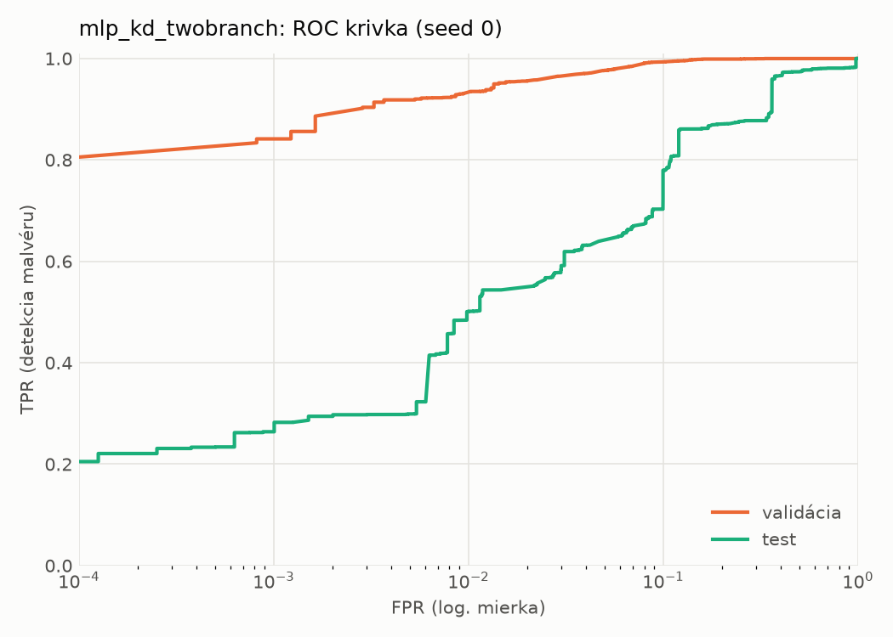
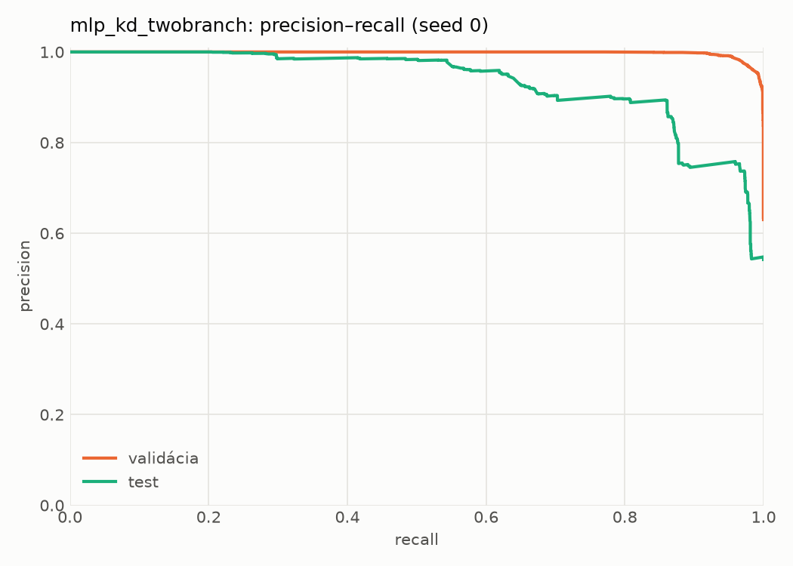
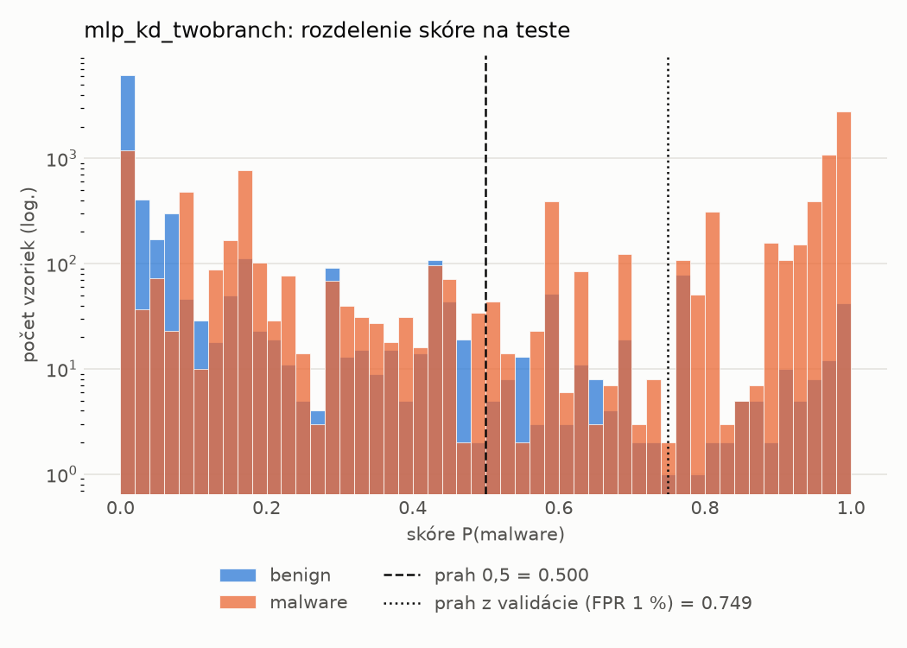
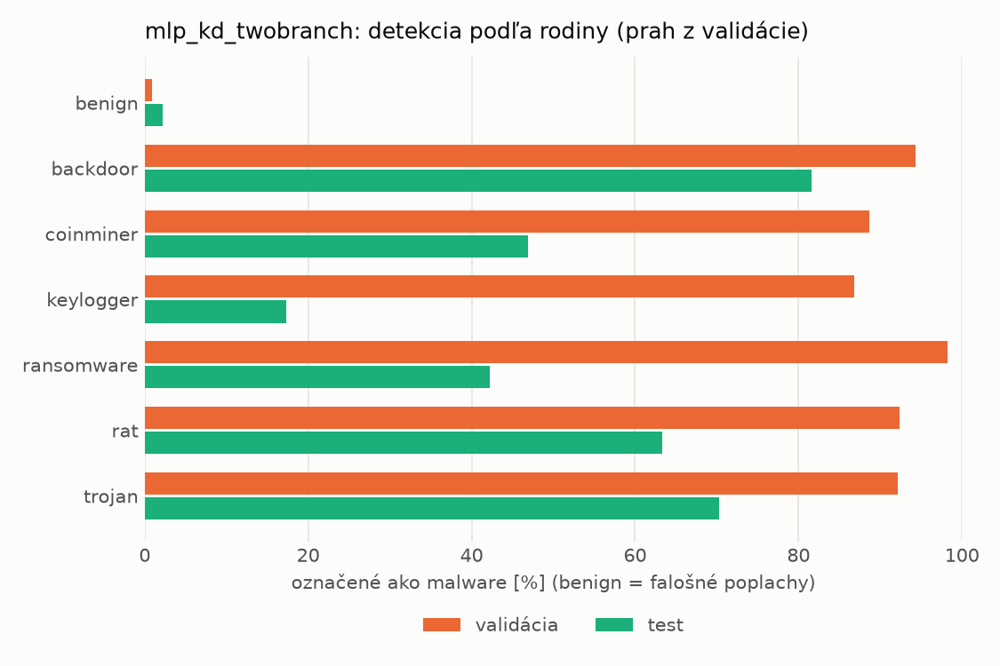
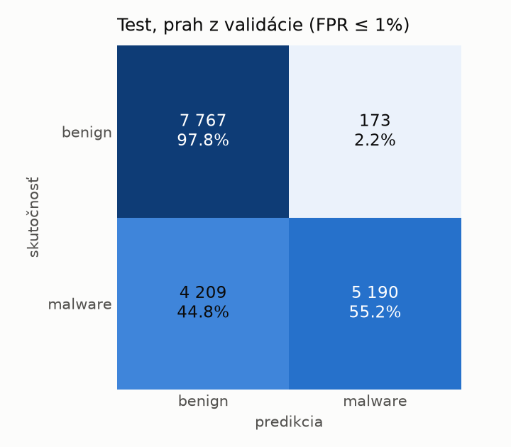
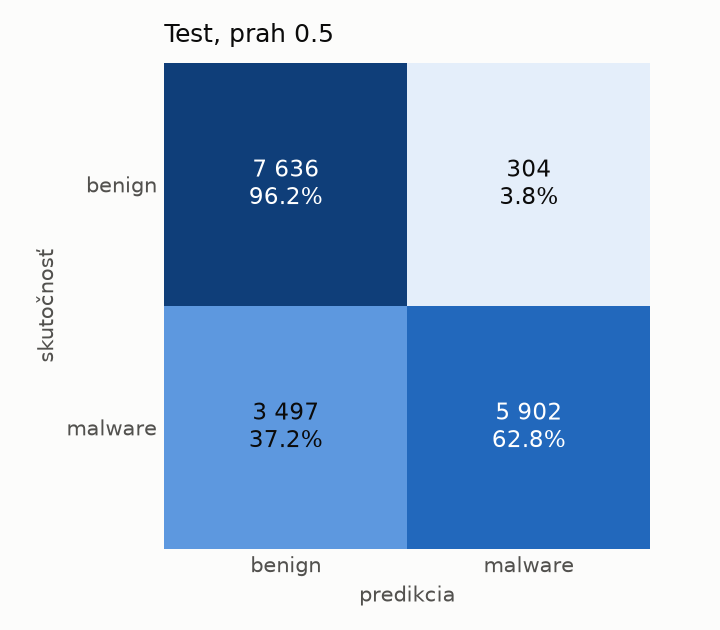
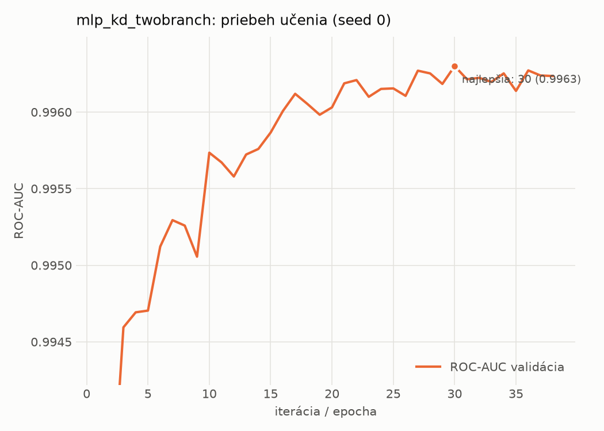

# dynamic/mlp_kd_twobranch – beh `20261104-034455`

> Automaticky generované (`src/training/run_tabular.py`). Konfigurácia: `config.yaml`, protokol: `protocol.yaml`.

- **Model:** `mlp` – študent – malé MLP učené destiláciou z dvojvetvovej siete (V2)
- **Ladenie:** bez ladenia – hyperparametre prevzaté z `runs_v2/full/students_dynamic/mlp_kd_twobranch/20261103-210509`
- **Finálne modely:** seedy [0, 1, 2]; hodnoty sú priemer ± smerodajná odchýlka cez seedy
- **Najlepšie hyperparametre:** `{"hidden_layers": 1, "max_epochs": 100, "patience": 8, "hidden_width": 32, "dropout": 0.20072105080128874, "lr": 0.0007693195243892695, "weight_decay": 5.480532660403751e-05, "batch_size": 512, "kd_alpha": 0.8408369066096718, "kd_temperature": 1.578549465607724}`

## Detekčná kvalita (bez prahu)
| metrika | train (podvzorka) | validácia | test |
|---|---|---|---|
| ROC-AUC | 0.9975 ± 0.0002 | 0.9963 ± 0.0001 | 0.9078 ± 0.0124 |
| PR-AUC | 0.9984 ± 0.0001 | 0.9978 ± 0.0000 | 0.9291 ± 0.0087 |
| TPR pri FPR 1 % | 0.9478 ± 0.0083 | 0.9310 ± 0.0011 | 0.4475 ± 0.0668 |
| TPR pri FPR 0,1 % | 0.9096 ± 0.0091 | 0.8455 ± 0.0205 | 0.2681 ± 0.0037 |
| log loss | 0.0644 ± 0.0024 | 0.0812 ± 0.0011 | 0.8699 ± 0.0865 |
| Brier skóre | 0.0205 ± 0.0008 | 0.0245 ± 0.0006 | 0.1885 ± 0.0099 |

Rozdiel ROC-AUC train − validácia: **0.0012** (veľký rozdiel = preučenie).

## Pri prahu z validácie (FPR ≤ 1% na validácii)
| metrika | train (podvzorka) | validácia | test |
|---|---|---|---|
| accuracy | 0.9574 ± 0.0005 | 0.9530 ± 0.0007 | 0.7296 ± 0.0176 |
| balanced accuracy | 0.9651 ± 0.0003 | 0.9608 ± 0.0006 | 0.7492 ± 0.0158 |
| precision | 0.9980 ± 0.0005 | 0.9941 ± 0.0000 | 0.9721 ± 0.0065 |
| recall (TPR) | 0.9332 ± 0.0013 | 0.9310 ± 0.0011 | 0.5162 ± 0.0367 |
| FPR | 0.0030 ± 0.0008 | 0.0094 ± 0.0000 | 0.0177 ± 0.0052 |
| F1 | 0.9646 ± 0.0005 | 0.9615 ± 0.0006 | 0.6737 ± 0.0300 |
| MCC | 0.9147 ± 0.0008 | 0.9047 ± 0.0013 | 0.5487 ± 0.0223 |

## Pri pevnom prahu 0.5
| metrika | train (podvzorka) | validácia | test |
|---|---|---|---|
| accuracy | 0.9677 ± 0.0009 | 0.9644 ± 0.0005 | 0.7741 ± 0.0139 |
| balanced accuracy | 0.9709 ± 0.0011 | 0.9675 ± 0.0006 | 0.7885 ± 0.0131 |
| precision | 0.9900 ± 0.0014 | 0.9877 ± 0.0007 | 0.9480 ± 0.0061 |
| recall (TPR) | 0.9576 ± 0.0003 | 0.9554 ± 0.0004 | 0.6169 ± 0.0228 |
| FPR | 0.0158 ± 0.0023 | 0.0203 ± 0.0013 | 0.0400 ± 0.0034 |
| F1 | 0.9735 ± 0.0007 | 0.9712 ± 0.0004 | 0.7473 ± 0.0187 |
| MCC | 0.9330 ± 0.0019 | 0.9253 ± 0.0011 | 0.6016 ± 0.0231 |

## Výpočtové nároky (seed 0, testovacia množina)
| meranie | hodnota |
|---|---|
| tréning finálneho modelu | 7.7 s (priemer cez seedy) |
| ladenie spolu | 0 s |
| počet parametrov / uzlov | 64 129 |
| veľkosť modelu na disku | 0.31 MB |
| transformácia vstupu – latencia (1 vlákno) | 0.034 ms |
| transformácia vstupu – priepustnosť | 43 646 vzoriek/s |
| CPU latencia modelu (batch 1, 1 vlákno) | 0.067 ms (p95 0.092) |
| CPU priepustnosť (24 vlákien) | 140 206 vzoriek/s |
| GPU latencia (batch 1) | 0.280 ms (p95 0.314) |
| GPU priepustnosť | 103 817 vzoriek/s |
| GPU špičková pamäť | 1216 MB |

## Grafy
| | |
|---|---|
|  |  |
|  |  |
|  |  |
|  |  |

## Súbory
`metrics.json` (všetky metriky po seedoch vrátane rodín), `timing.json`, `hpo_trials.csv`,
`predictions/<časť>_seed<N>.parquet` (sha256, family, label, score), `model/seed_<N>/`, `log.txt`.
