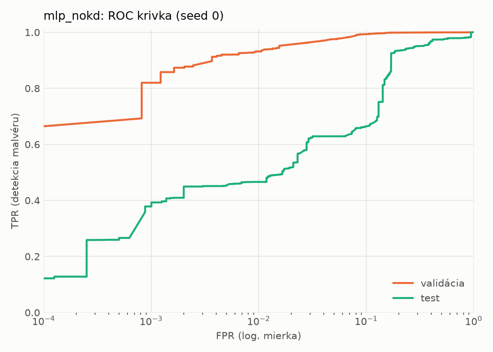
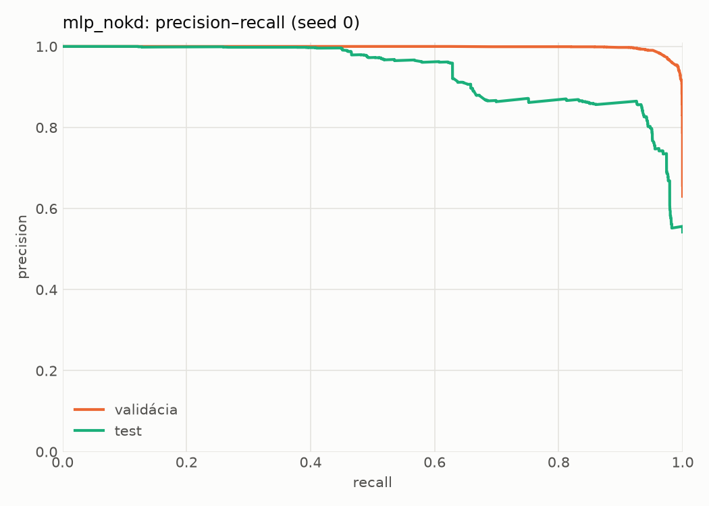
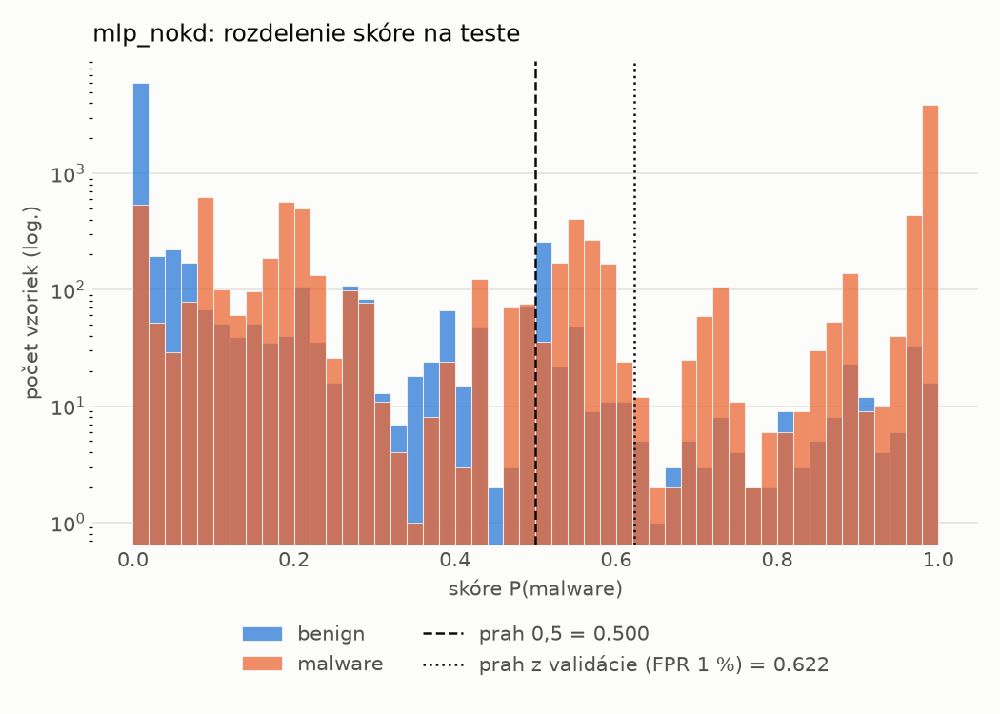
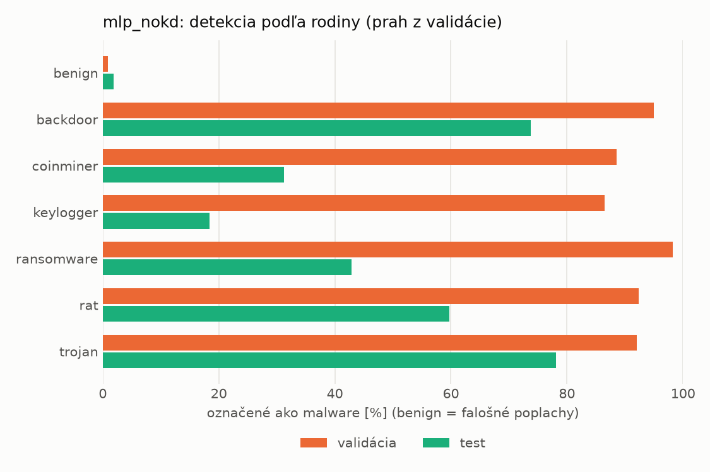
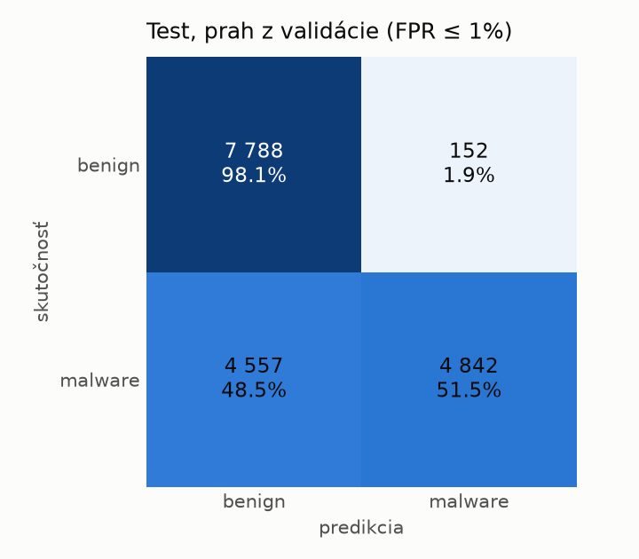
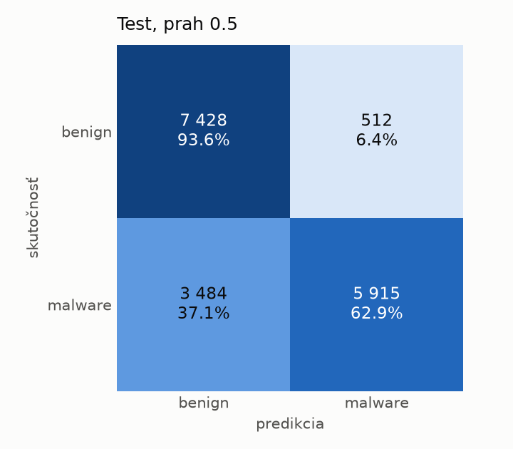
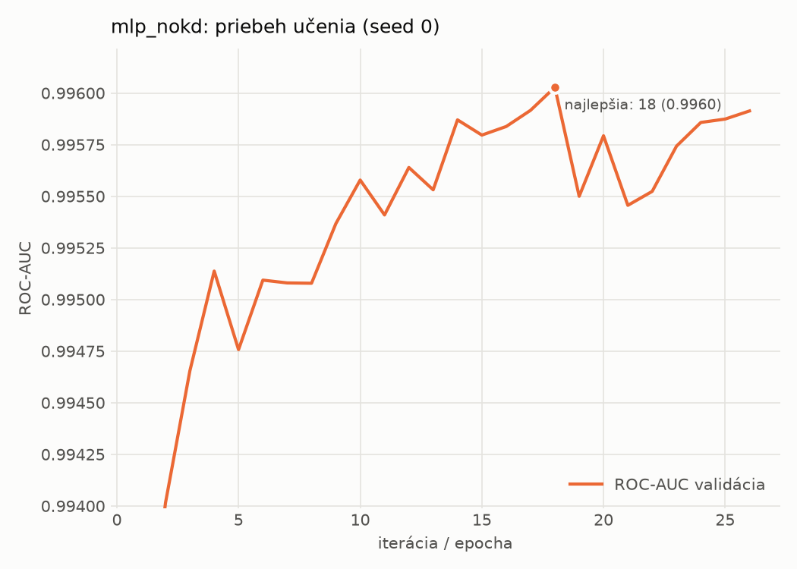

# dynamic/mlp_nokd – beh `20261104-034356`

> Automaticky generované (`src/training/run_tabular.py`). Konfigurácia: `config.yaml`, protokol: `protocol.yaml`.

- **Model:** `mlp` – kontrola – rovnaké malé MLP bez destilácie (iba skutočné označenia)
- **Ladenie:** bez ladenia – hyperparametre prevzaté z `runs_final/students_dynamic/mlp_nokd/20261102-212647`
- **Finálne modely:** seedy [0, 1, 2]; hodnoty sú priemer ± smerodajná odchýlka cez seedy
- **Najlepšie hyperparametre:** `{"hidden_layers": 1, "max_epochs": 100, "patience": 8, "hidden_width": 32, "dropout": 0.27854460554056926, "lr": 0.002048574130711367, "weight_decay": 5.911733622585913e-06, "batch_size": 512}`

## Detekčná kvalita (bez prahu)
| metrika | train (podvzorka) | validácia | test |
|---|---|---|---|
| ROC-AUC | 0.9974 ± 0.0001 | 0.9961 ± 0.0001 | 0.9177 ± 0.0008 |
| PR-AUC | 0.9983 ± 0.0001 | 0.9977 ± 0.0001 | 0.9356 ± 0.0017 |
| TPR pri FPR 1 % | 0.9446 ± 0.0011 | 0.9343 ± 0.0023 | 0.4474 ± 0.0483 |
| TPR pri FPR 0,1 % | 0.8941 ± 0.0220 | 0.7822 ± 0.0328 | 0.3350 ± 0.0472 |
| log loss | 0.0650 ± 0.0021 | 0.0807 ± 0.0012 | 0.7131 ± 0.0397 |
| Brier skóre | 0.0207 ± 0.0006 | 0.0241 ± 0.0003 | 0.1721 ± 0.0030 |

Rozdiel ROC-AUC train − validácia: **0.0013** (veľký rozdiel = preučenie).

## Pri prahu z validácie (FPR ≤ 1% na validácii)
| metrika | train (podvzorka) | validácia | test |
|---|---|---|---|
| accuracy | 0.9595 ± 0.0011 | 0.9550 ± 0.0013 | 0.7303 ± 0.0058 |
| balanced accuracy | 0.9666 ± 0.0006 | 0.9623 ± 0.0010 | 0.7494 ± 0.0052 |
| precision | 0.9974 ± 0.0008 | 0.9939 ± 0.0001 | 0.9639 ± 0.0050 |
| recall (TPR) | 0.9372 ± 0.0025 | 0.9343 ± 0.0023 | 0.5220 ± 0.0128 |
| FPR | 0.0040 ± 0.0013 | 0.0097 ± 0.0002 | 0.0232 ± 0.0037 |
| F1 | 0.9664 ± 0.0009 | 0.9632 ± 0.0011 | 0.6772 ± 0.0100 |
| MCC | 0.9184 ± 0.0018 | 0.9084 ± 0.0025 | 0.5458 ± 0.0075 |

## Pri pevnom prahu 0.5
| metrika | train (podvzorka) | validácia | test |
|---|---|---|---|
| accuracy | 0.9681 ± 0.0004 | 0.9651 ± 0.0007 | 0.7839 ± 0.0132 |
| balanced accuracy | 0.9703 ± 0.0008 | 0.9672 ± 0.0004 | 0.7969 ± 0.0131 |
| precision | 0.9870 ± 0.0022 | 0.9853 ± 0.0019 | 0.9402 ± 0.0181 |
| recall (TPR) | 0.9613 ± 0.0023 | 0.9589 ± 0.0030 | 0.6423 ± 0.0171 |
| FPR | 0.0207 ± 0.0037 | 0.0244 ± 0.0033 | 0.0484 ± 0.0150 |
| F1 | 0.9740 ± 0.0004 | 0.9719 ± 0.0007 | 0.7631 ± 0.0153 |
| MCC | 0.9334 ± 0.0009 | 0.9264 ± 0.0013 | 0.6127 ± 0.0264 |

## Výpočtové nároky (seed 0, testovacia množina)
| meranie | hodnota |
|---|---|
| tréning finálneho modelu | 5.3 s (priemer cez seedy) |
| ladenie spolu | 0 s |
| počet parametrov / uzlov | 64 129 |
| veľkosť modelu na disku | 0.31 MB |
| transformácia vstupu – latencia (1 vlákno) | 0.034 ms |
| transformácia vstupu – priepustnosť | 48 258 vzoriek/s |
| CPU latencia modelu (batch 1, 1 vlákno) | 0.066 ms (p95 0.075) |
| CPU priepustnosť (24 vlákien) | 95 923 vzoriek/s |
| GPU latencia (batch 1) | 0.452 ms (p95 0.477) |
| GPU priepustnosť | 104 993 vzoriek/s |
| GPU špičková pamäť | 1216 MB |

## Grafy
| | |
|---|---|
|  |  |
|  |  |
|  |  |
|  |  |

## Súbory
`metrics.json` (všetky metriky po seedoch vrátane rodín), `timing.json`, `hpo_trials.csv`,
`predictions/<časť>_seed<N>.parquet` (sha256, family, label, score), `model/seed_<N>/`, `log.txt`.
