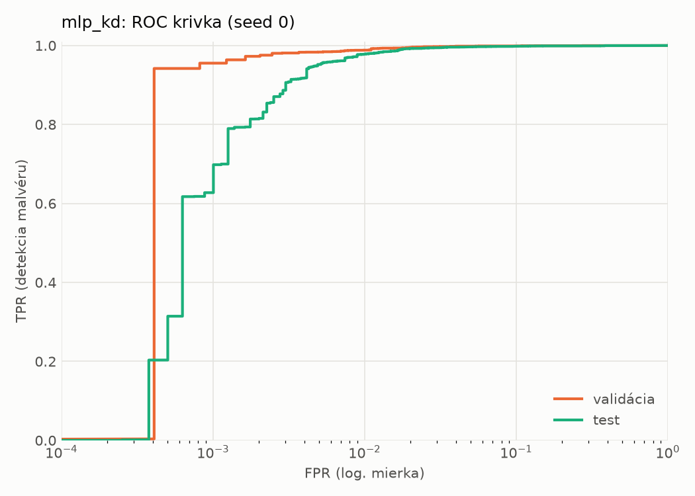
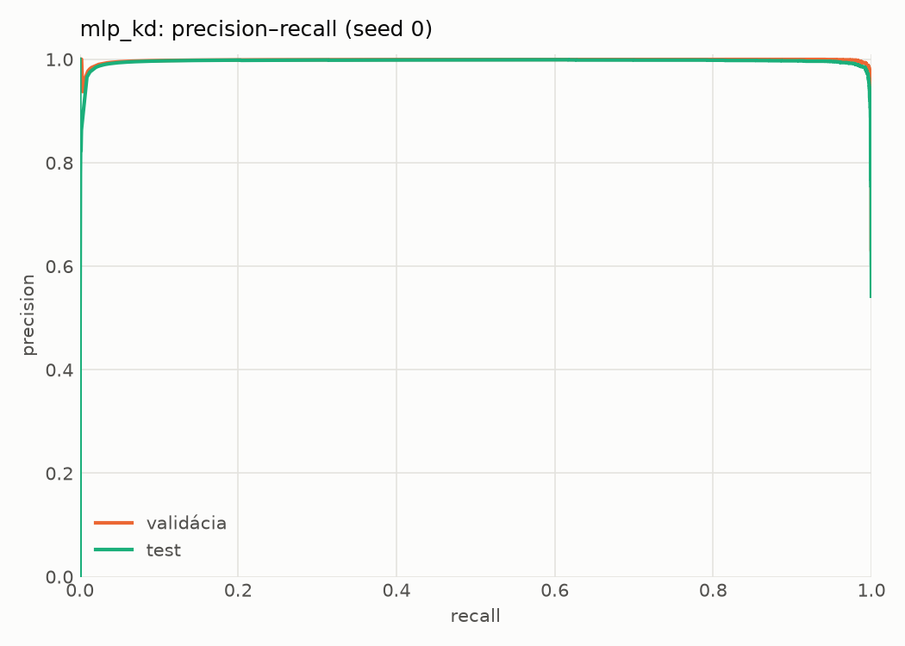
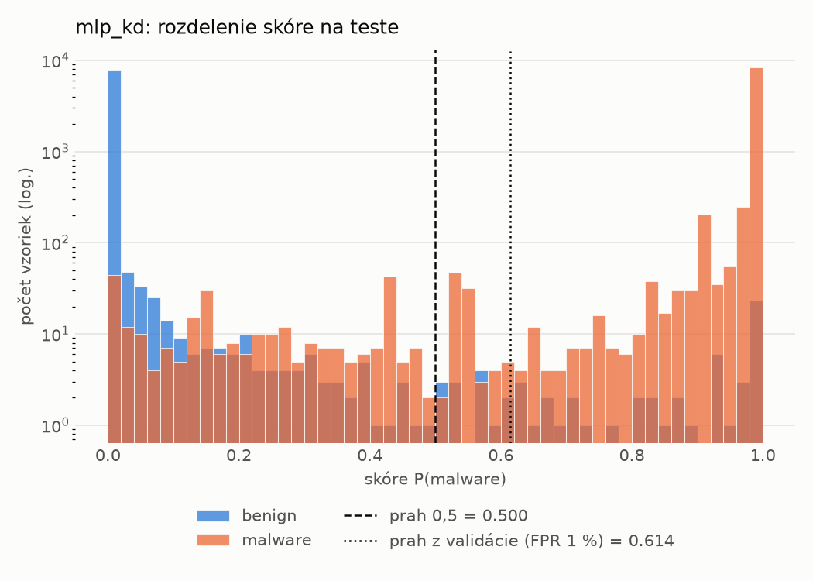
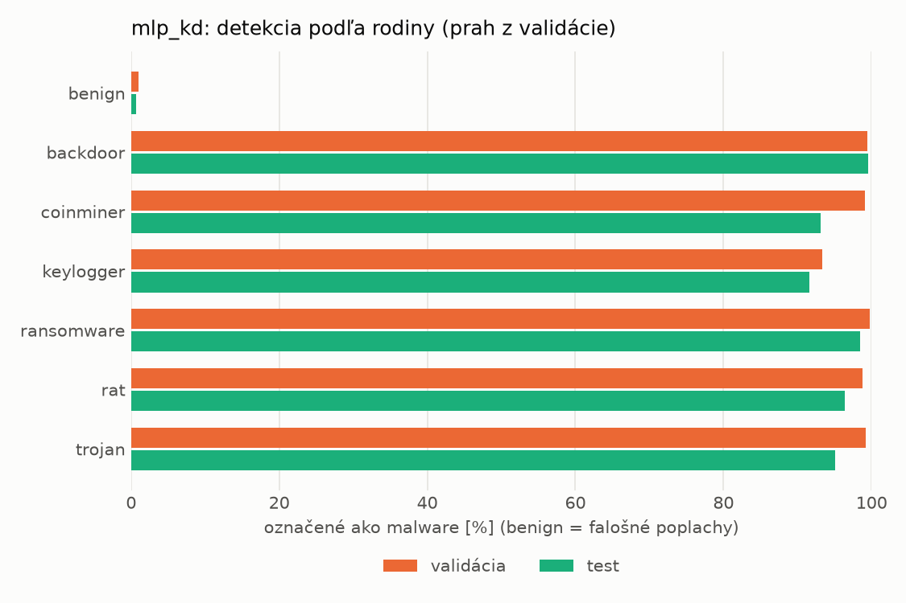
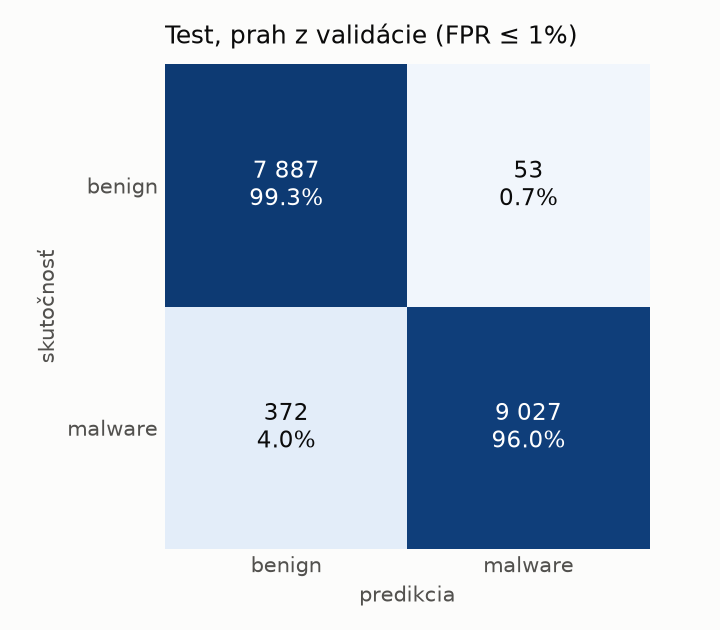
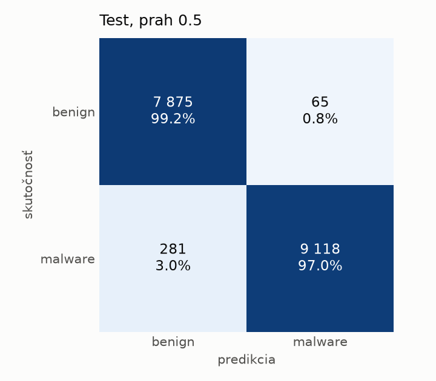
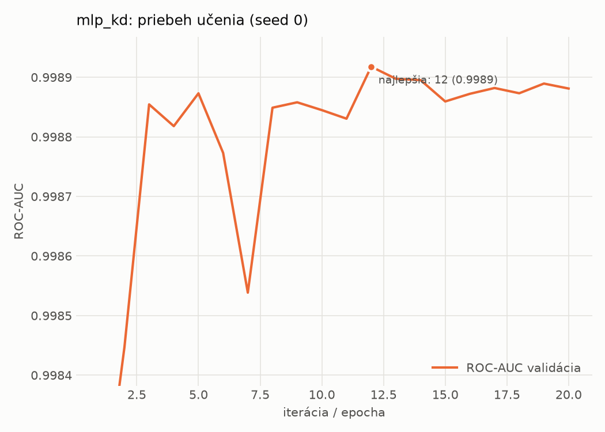

# static/mlp_kd – beh `20261104-034134`

> Automaticky generované (`src/training/run_tabular.py`). Konfigurácia: `config.yaml`, protokol: `protocol.yaml`.

- **Model:** `mlp` – študent – malé MLP učené destiláciou z hybridného učiteľa
- **Ladenie:** bez ladenia – hyperparametre prevzaté z `runs_final/students_static/mlp_kd/20261102-211333`
- **Finálne modely:** seedy [0, 1, 2]; hodnoty sú priemer ± smerodajná odchýlka cez seedy
- **Najlepšie hyperparametre:** `{"hidden_layers": 1, "max_epochs": 100, "patience": 8, "hidden_width": 32, "dropout": 0.0997633477545663, "lr": 0.0015427581570995174, "weight_decay": 0.00017559733451057006, "batch_size": 256, "kd_alpha": 0.604033962068706, "kd_temperature": 6.472658522077935}`

## Detekčná kvalita (bez prahu)
| metrika | train (podvzorka) | validácia | test |
|---|---|---|---|
| ROC-AUC | 0.9998 ± 0.0001 | 0.9989 ± 0.0001 | 0.9978 ± 0.0000 |
| PR-AUC | 0.9999 ± 0.0000 | 0.9981 ± 0.0003 | 0.9957 ± 0.0006 |
| TPR pri FPR 1 % | 0.9969 ± 0.0007 | 0.9873 ± 0.0009 | 0.9747 ± 0.0033 |
| TPR pri FPR 0,1 % | 0.9734 ± 0.0049 | 0.9060 ± 0.0509 | 0.7058 ± 0.0687 |
| log loss | 0.0178 ± 0.0023 | 0.0343 ± 0.0018 | 0.0620 ± 0.0012 |
| Brier skóre | 0.0047 ± 0.0005 | 0.0081 ± 0.0003 | 0.0152 ± 0.0001 |

Rozdiel ROC-AUC train − validácia: **0.0009** (veľký rozdiel = preučenie).

## Pri prahu z validácie (FPR ≤ 1% na validácii)
| metrika | train (podvzorka) | validácia | test |
|---|---|---|---|
| accuracy | 0.9915 ± 0.0014 | 0.9884 ± 0.0004 | 0.9736 ± 0.0016 |
| balanced accuracy | 0.9924 ± 0.0012 | 0.9889 ± 0.0003 | 0.9752 ± 0.0015 |
| precision | 0.9976 ± 0.0004 | 0.9944 ± 0.0003 | 0.9947 ± 0.0005 |
| recall (TPR) | 0.9888 ± 0.0018 | 0.9873 ± 0.0009 | 0.9564 ± 0.0035 |
| FPR | 0.0040 ± 0.0007 | 0.0096 ± 0.0005 | 0.0060 ± 0.0006 |
| F1 | 0.9931 ± 0.0011 | 0.9908 ± 0.0004 | 0.9752 ± 0.0016 |
| MCC | 0.9821 ± 0.0029 | 0.9753 ± 0.0009 | 0.9479 ± 0.0031 |

## Pri pevnom prahu 0.5
| metrika | train (podvzorka) | validácia | test |
|---|---|---|---|
| accuracy | 0.9942 ± 0.0006 | 0.9902 ± 0.0008 | 0.9806 ± 0.0009 |
| balanced accuracy | 0.9937 ± 0.0009 | 0.9893 ± 0.0011 | 0.9814 ± 0.0008 |
| precision | 0.9948 ± 0.0013 | 0.9918 ± 0.0014 | 0.9920 ± 0.0008 |
| recall (TPR) | 0.9958 ± 0.0002 | 0.9926 ± 0.0004 | 0.9721 ± 0.0024 |
| FPR | 0.0084 ± 0.0021 | 0.0141 ± 0.0023 | 0.0093 ± 0.0010 |
| F1 | 0.9953 ± 0.0005 | 0.9922 ± 0.0006 | 0.9820 ± 0.0009 |
| MCC | 0.9876 ± 0.0014 | 0.9789 ± 0.0016 | 0.9613 ± 0.0018 |

## Výpočtové nároky (seed 0, testovacia množina)
| meranie | hodnota |
|---|---|
| tréning finálneho modelu | 7.5 s (priemer cez seedy) |
| ladenie spolu | 0 s |
| počet parametrov / uzlov | 74 337 |
| veľkosť modelu na disku | 0.36 MB |
| transformácia vstupu – latencia (1 vlákno) | 0.041 ms |
| transformácia vstupu – priepustnosť | 41 456 vzoriek/s |
| CPU latencia modelu (batch 1, 1 vlákno) | 0.068 ms (p95 0.075) |
| CPU priepustnosť (24 vlákien) | 109 747 vzoriek/s |
| GPU latencia (batch 1) | 0.448 ms (p95 0.473) |
| GPU priepustnosť | 60 660 vzoriek/s |
| GPU špičková pamäť | 794 MB |

## Grafy
| | |
|---|---|
|  |  |
|  |  |
|  |  |
|  |  |

## Súbory
`metrics.json` (všetky metriky po seedoch vrátane rodín), `timing.json`, `hpo_trials.csv`,
`predictions/<časť>_seed<N>.parquet` (sha256, family, label, score), `model/seed_<N>/`, `log.txt`.
