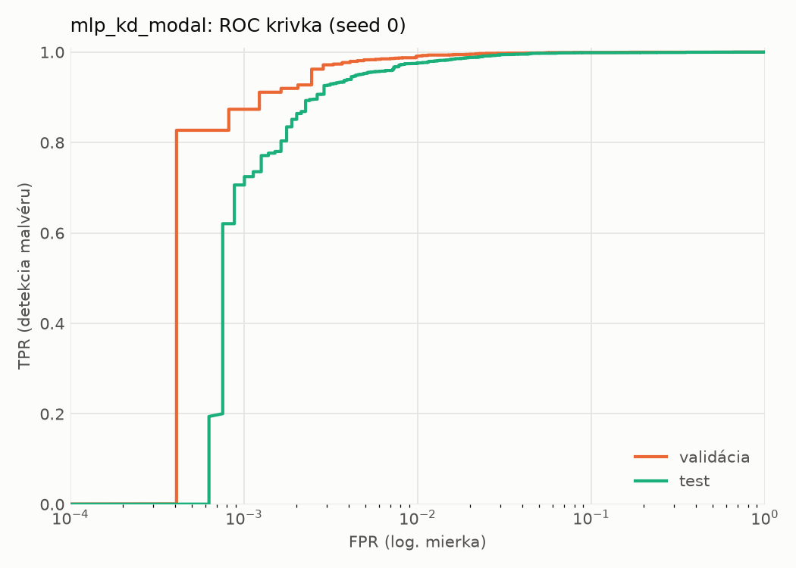
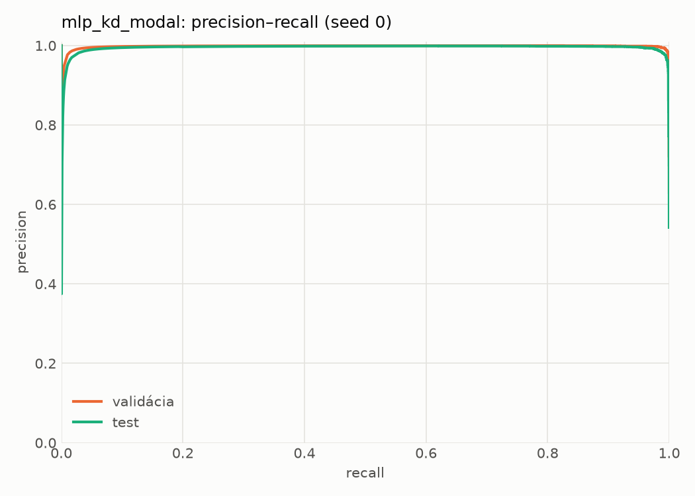
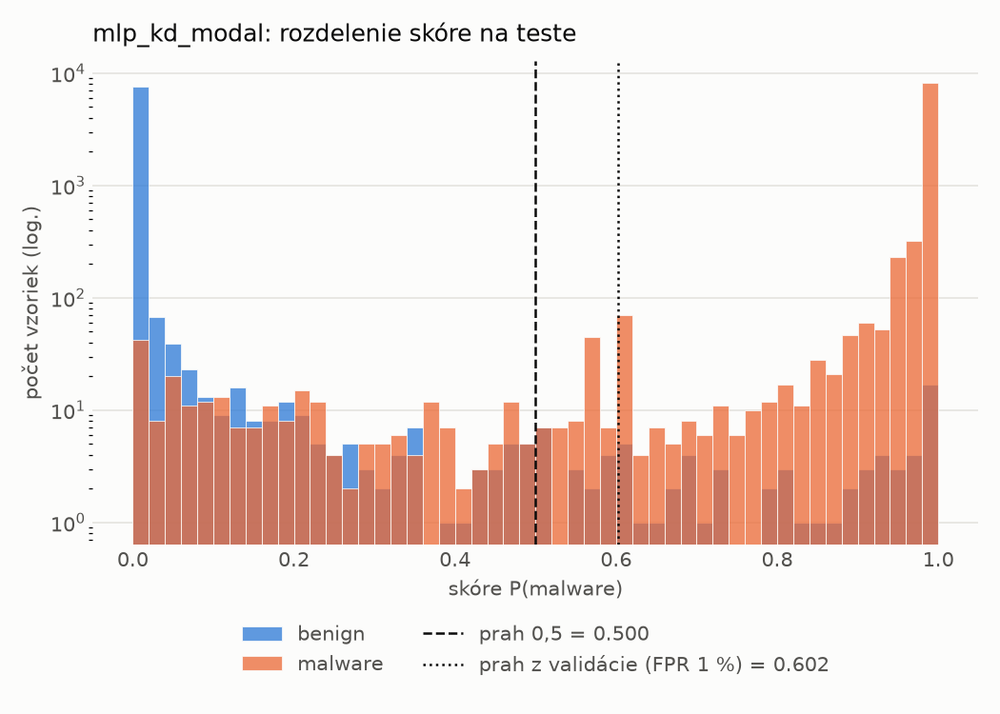
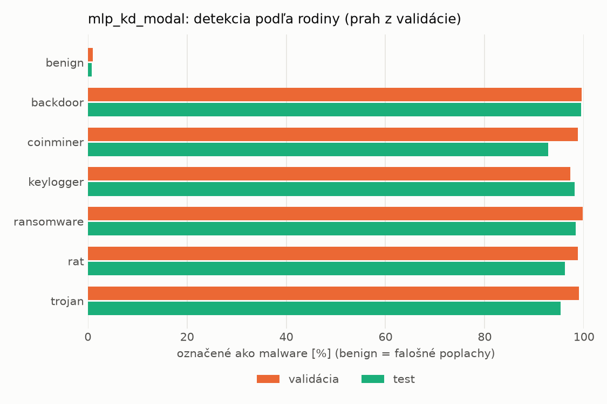
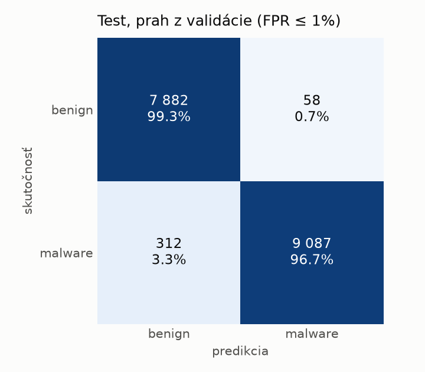
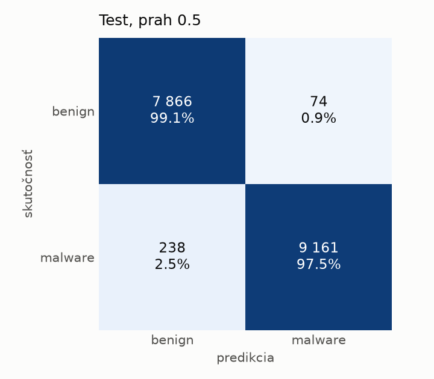
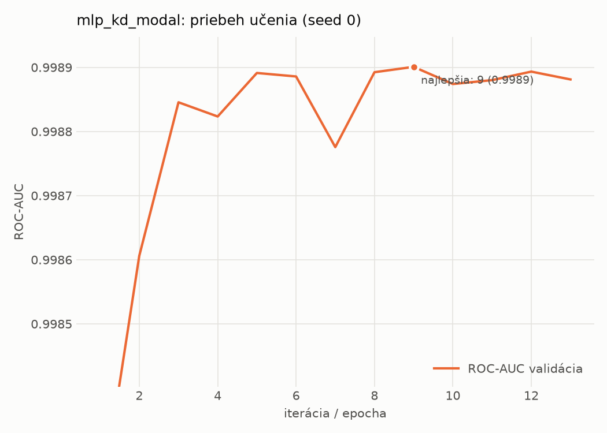

# static/mlp_kd_modal – beh `20261104-034223`

> Automaticky generované (`src/training/run_tabular.py`). Konfigurácia: `config.yaml`, protokol: `protocol.yaml`.

- **Model:** `mlp` – študent – malé MLP učené destiláciou z učiteľa rovnakej modality (variant A)
- **Ladenie:** bez ladenia – hyperparametre prevzaté z `runs_final/students_static/mlp_kd_modal/20261102-211832`
- **Finálne modely:** seedy [0, 1, 2]; hodnoty sú priemer ± smerodajná odchýlka cez seedy
- **Najlepšie hyperparametre:** `{"hidden_layers": 1, "max_epochs": 100, "patience": 8, "hidden_width": 32, "dropout": 0.15602040635334324, "lr": 0.00105640764164036, "weight_decay": 3.5856126103453987e-06, "batch_size": 256, "kd_alpha": 0.815861880342119, "kd_temperature": 5.185299851677596}`

## Detekčná kvalita (bez prahu)
| metrika | train (podvzorka) | validácia | test |
|---|---|---|---|
| ROC-AUC | 0.9998 ± 0.0001 | 0.9989 ± 0.0001 | 0.9979 ± 0.0004 |
| PR-AUC | 0.9999 ± 0.0000 | 0.9980 ± 0.0000 | 0.9964 ± 0.0013 |
| TPR pri FPR 1 % | 0.9975 ± 0.0002 | 0.9885 ± 0.0023 | 0.9762 ± 0.0009 |
| TPR pri FPR 0,1 % | 0.9757 ± 0.0021 | 0.8924 ± 0.0200 | 0.5727 ± 0.2939 |
| log loss | 0.0157 ± 0.0016 | 0.0323 ± 0.0012 | 0.0585 ± 0.0019 |
| Brier skóre | 0.0043 ± 0.0003 | 0.0076 ± 0.0003 | 0.0144 ± 0.0005 |

Rozdiel ROC-AUC train − validácia: **0.0009** (veľký rozdiel = preučenie).

## Pri prahu z validácie (FPR ≤ 1% na validácii)
| metrika | train (podvzorka) | validácia | test |
|---|---|---|---|
| accuracy | 0.9924 ± 0.0017 | 0.9891 ± 0.0014 | 0.9755 ± 0.0030 |
| balanced accuracy | 0.9929 ± 0.0012 | 0.9893 ± 0.0011 | 0.9769 ± 0.0027 |
| precision | 0.9971 ± 0.0009 | 0.9942 ± 0.0000 | 0.9944 ± 0.0008 |
| recall (TPR) | 0.9905 ± 0.0037 | 0.9885 ± 0.0023 | 0.9602 ± 0.0063 |
| FPR | 0.0047 ± 0.0015 | 0.0098 ± 0.0000 | 0.0064 ± 0.0010 |
| F1 | 0.9938 ± 0.0014 | 0.9913 ± 0.0012 | 0.9770 ± 0.0029 |
| MCC | 0.9839 ± 0.0036 | 0.9767 ± 0.0031 | 0.9514 ± 0.0057 |

## Pri pevnom prahu 0.5
| metrika | train (podvzorka) | validácia | test |
|---|---|---|---|
| accuracy | 0.9951 ± 0.0005 | 0.9909 ± 0.0005 | 0.9825 ± 0.0005 |
| balanced accuracy | 0.9944 ± 0.0005 | 0.9900 ± 0.0006 | 0.9831 ± 0.0004 |
| precision | 0.9949 ± 0.0005 | 0.9921 ± 0.0011 | 0.9916 ± 0.0003 |
| recall (TPR) | 0.9972 ± 0.0003 | 0.9934 ± 0.0011 | 0.9760 ± 0.0012 |
| FPR | 0.0083 ± 0.0008 | 0.0135 ± 0.0019 | 0.0097 ± 0.0004 |
| F1 | 0.9961 ± 0.0004 | 0.9928 ± 0.0004 | 0.9837 ± 0.0005 |
| MCC | 0.9896 ± 0.0010 | 0.9804 ± 0.0010 | 0.9650 ± 0.0010 |

## Výpočtové nároky (seed 0, testovacia množina)
| meranie | hodnota |
|---|---|
| tréning finálneho modelu | 6.3 s (priemer cez seedy) |
| ladenie spolu | 0 s |
| počet parametrov / uzlov | 74 337 |
| veľkosť modelu na disku | 0.36 MB |
| transformácia vstupu – latencia (1 vlákno) | 0.042 ms |
| transformácia vstupu – priepustnosť | 38 037 vzoriek/s |
| CPU latencia modelu (batch 1, 1 vlákno) | 0.068 ms (p95 0.078) |
| CPU priepustnosť (24 vlákien) | 61 347 vzoriek/s |
| GPU latencia (batch 1) | 0.304 ms (p95 0.329) |
| GPU priepustnosť | 57 867 vzoriek/s |
| GPU špičková pamäť | 794 MB |

## Grafy
| | |
|---|---|
|  |  |
|  |  |
|  |  |
|  |  |

## Súbory
`metrics.json` (všetky metriky po seedoch vrátane rodín), `timing.json`, `hpo_trials.csv`,
`predictions/<časť>_seed<N>.parquet` (sha256, family, label, score), `model/seed_<N>/`, `log.txt`.
