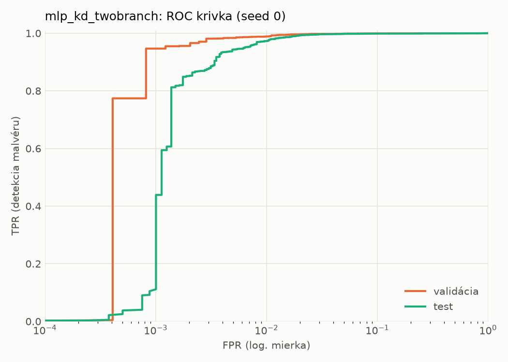
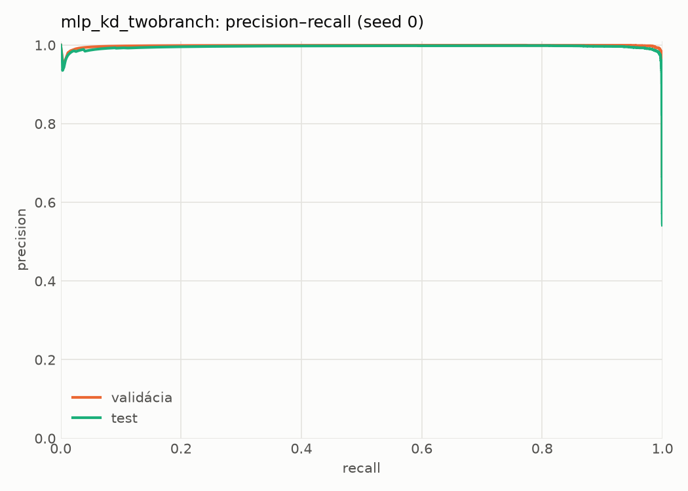
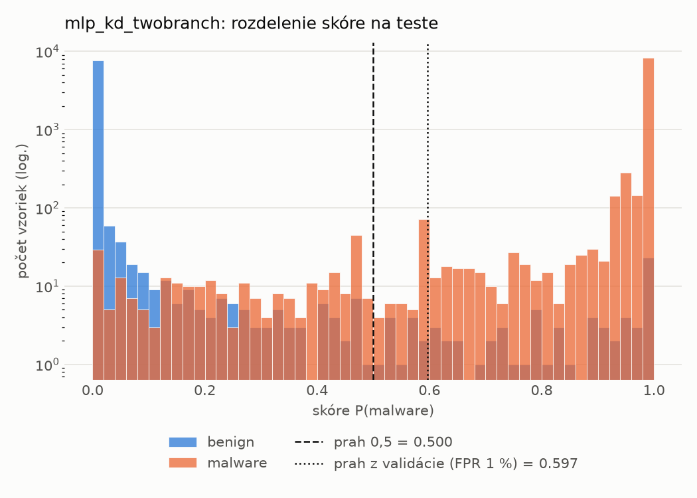
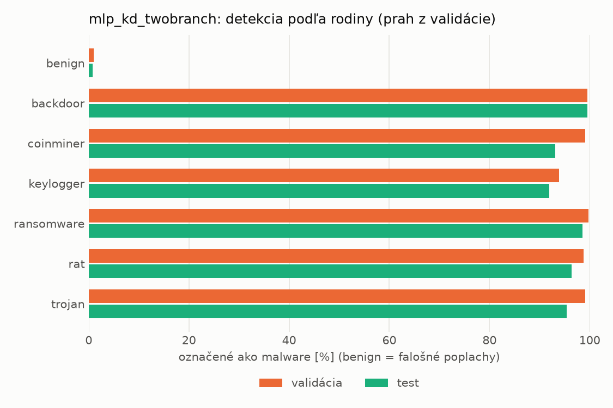
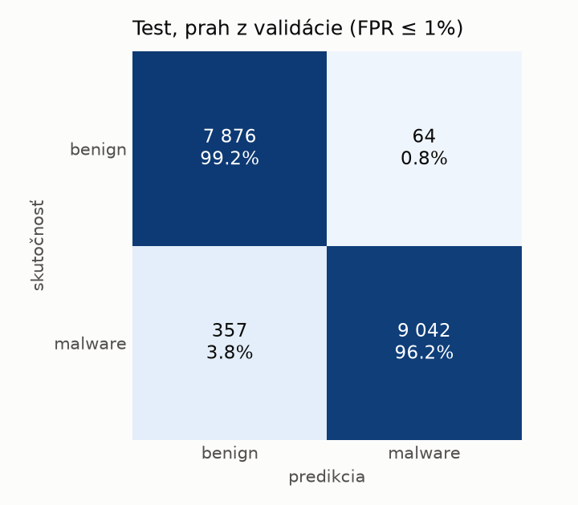
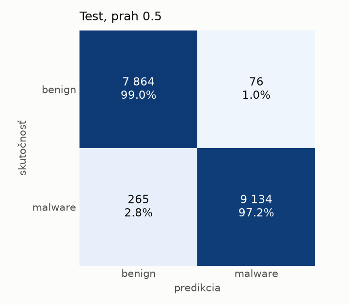
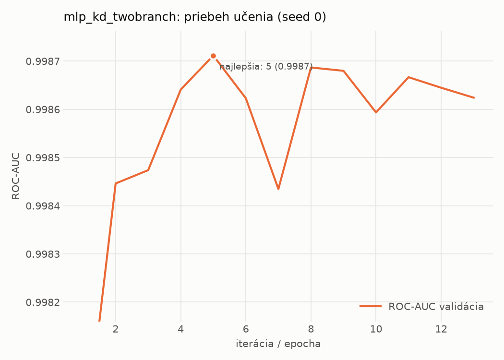

# static/mlp_kd_twobranch – beh `20261104-034252`

> Automaticky generované (`src/training/run_tabular.py`). Konfigurácia: `config.yaml`, protokol: `protocol.yaml`.

- **Model:** `mlp` – študent – malé MLP učené destiláciou z dvojvetvovej siete (V2)
- **Ladenie:** bez ladenia – hyperparametre prevzaté z `runs_v2/full/students_static/mlp_kd_twobranch/20261103-210128`
- **Finálne modely:** seedy [0, 1, 2]; hodnoty sú priemer ± smerodajná odchýlka cez seedy
- **Najlepšie hyperparametre:** `{"hidden_layers": 1, "max_epochs": 100, "patience": 8, "hidden_width": 32, "dropout": 0.11907530604839062, "lr": 0.0013122016832935236, "weight_decay": 1.6321051677063922e-05, "batch_size": 256, "kd_alpha": 0.8749635763069835, "kd_temperature": 3.9893325789148495}`

## Detekčná kvalita (bez prahu)
| metrika | train (podvzorka) | validácia | test |
|---|---|---|---|
| ROC-AUC | 0.9999 ± 0.0000 | 0.9988 ± 0.0001 | 0.9976 ± 0.0002 |
| PR-AUC | 0.9999 ± 0.0000 | 0.9983 ± 0.0000 | 0.9953 ± 0.0007 |
| TPR pri FPR 1 % | 0.9987 ± 0.0003 | 0.9885 ± 0.0009 | 0.9793 ± 0.0059 |
| TPR pri FPR 0,1 % | 0.9786 ± 0.0057 | 0.9557 ± 0.0079 | 0.2490 ± 0.1446 |
| log loss | 0.0132 ± 0.0014 | 0.0312 ± 0.0005 | 0.0564 ± 0.0035 |
| Brier skóre | 0.0037 ± 0.0002 | 0.0072 ± 0.0002 | 0.0133 ± 0.0011 |

Rozdiel ROC-AUC train − validácia: **0.0011** (veľký rozdiel = preučenie).

## Pri prahu z validácie (FPR ≤ 1% na validácii)
| metrika | train (podvzorka) | validácia | test |
|---|---|---|---|
| accuracy | 0.9933 ± 0.0008 | 0.9895 ± 0.0003 | 0.9765 ± 0.0024 |
| balanced accuracy | 0.9939 ± 0.0008 | 0.9899 ± 0.0005 | 0.9777 ± 0.0021 |
| precision | 0.9977 ± 0.0007 | 0.9949 ± 0.0010 | 0.9933 ± 0.0009 |
| recall (TPR) | 0.9915 ± 0.0007 | 0.9885 ± 0.0009 | 0.9632 ± 0.0051 |
| FPR | 0.0038 ± 0.0012 | 0.0086 ± 0.0018 | 0.0077 ± 0.0010 |
| F1 | 0.9946 ± 0.0006 | 0.9917 ± 0.0002 | 0.9780 ± 0.0023 |
| MCC | 0.9858 ± 0.0017 | 0.9777 ± 0.0006 | 0.9534 ± 0.0045 |

## Pri pevnom prahu 0.5
| metrika | train (podvzorka) | validácia | test |
|---|---|---|---|
| accuracy | 0.9949 ± 0.0010 | 0.9906 ± 0.0014 | 0.9819 ± 0.0028 |
| balanced accuracy | 0.9947 ± 0.0004 | 0.9900 ± 0.0010 | 0.9825 ± 0.0025 |
| precision | 0.9961 ± 0.0012 | 0.9928 ± 0.0004 | 0.9918 ± 0.0003 |
| recall (TPR) | 0.9957 ± 0.0028 | 0.9922 ± 0.0026 | 0.9746 ± 0.0054 |
| FPR | 0.0063 ± 0.0021 | 0.0123 ± 0.0007 | 0.0096 ± 0.0004 |
| F1 | 0.9959 ± 0.0008 | 0.9925 ± 0.0011 | 0.9831 ± 0.0026 |
| MCC | 0.9893 ± 0.0021 | 0.9798 ± 0.0030 | 0.9637 ± 0.0055 |

## Výpočtové nároky (seed 0, testovacia množina)
| meranie | hodnota |
|---|---|
| tréning finálneho modelu | 6.1 s (priemer cez seedy) |
| ladenie spolu | 0 s |
| počet parametrov / uzlov | 74 337 |
| veľkosť modelu na disku | 0.36 MB |
| transformácia vstupu – latencia (1 vlákno) | 0.041 ms |
| transformácia vstupu – priepustnosť | 40 300 vzoriek/s |
| CPU latencia modelu (batch 1, 1 vlákno) | 0.068 ms (p95 0.077) |
| CPU priepustnosť (24 vlákien) | 110 048 vzoriek/s |
| GPU latencia (batch 1) | 0.305 ms (p95 0.337) |
| GPU priepustnosť | 80 349 vzoriek/s |
| GPU špičková pamäť | 1407 MB |

## Grafy
| | |
|---|---|
|  |  |
|  |  |
|  |  |
|  |  |

## Súbory
`metrics.json` (všetky metriky po seedoch vrátane rodín), `timing.json`, `hpo_trials.csv`,
`predictions/<časť>_seed<N>.parquet` (sha256, family, label, score), `model/seed_<N>/`, `log.txt`.
