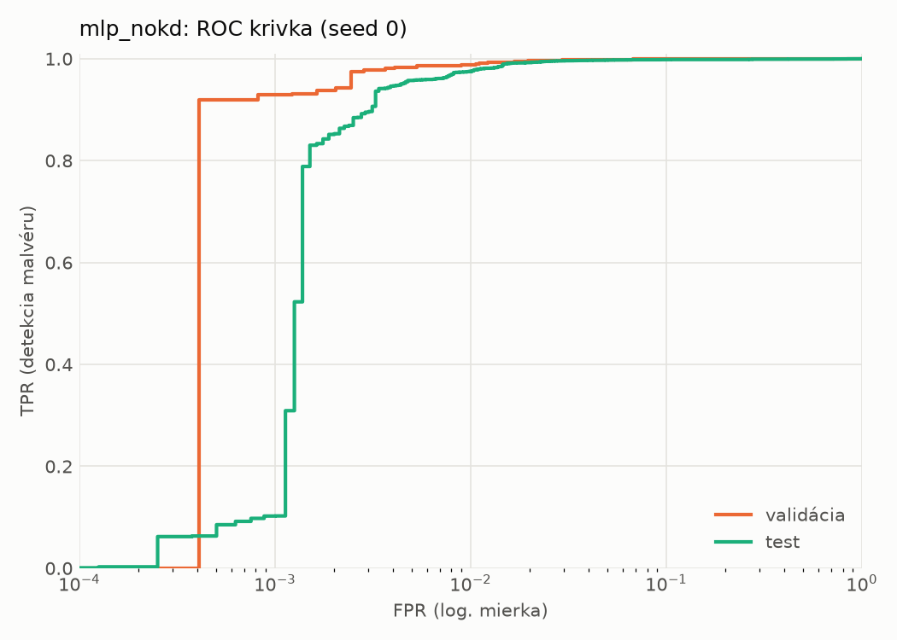
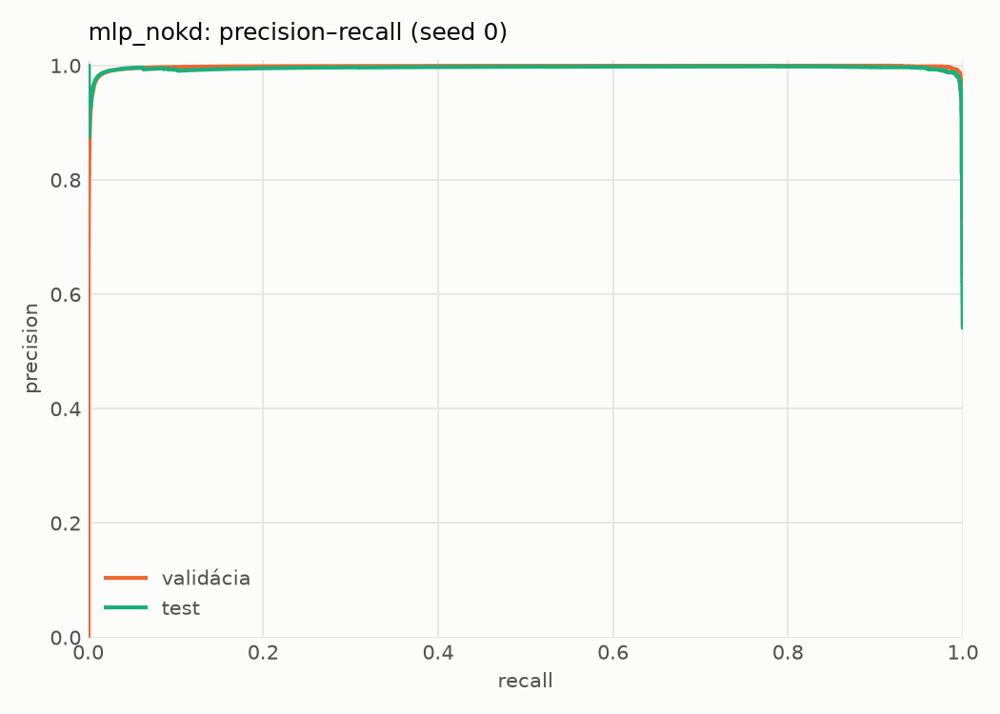
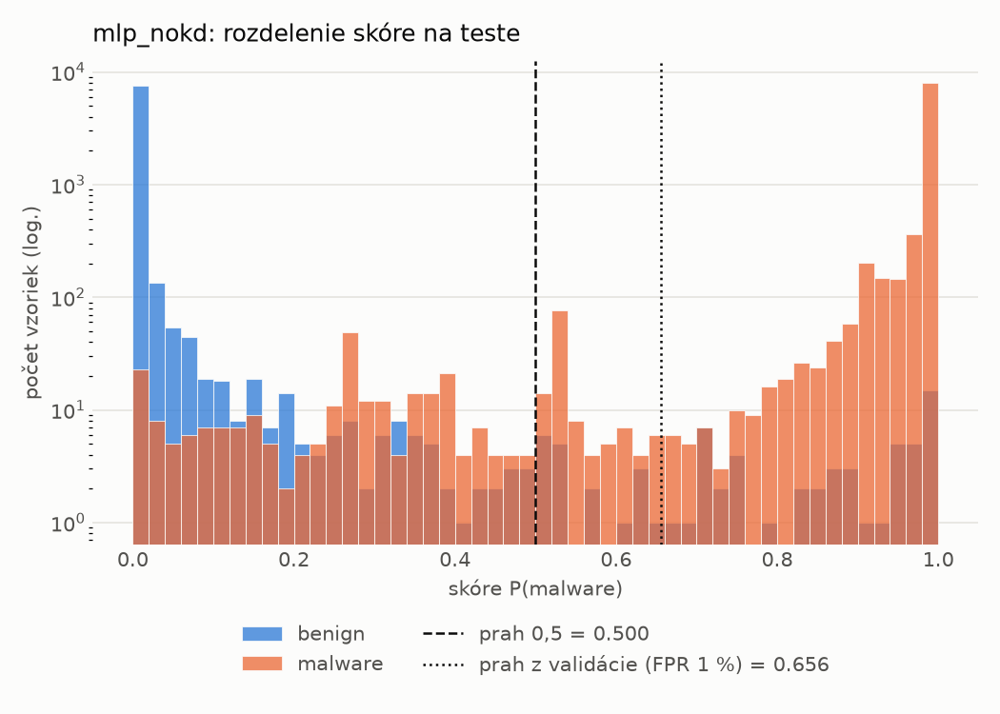
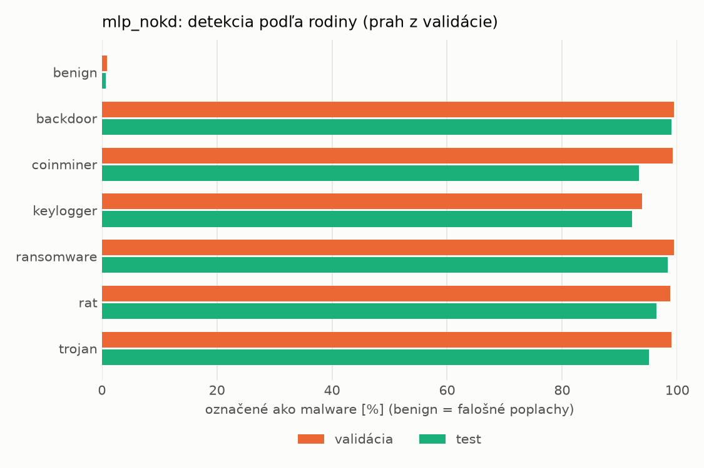
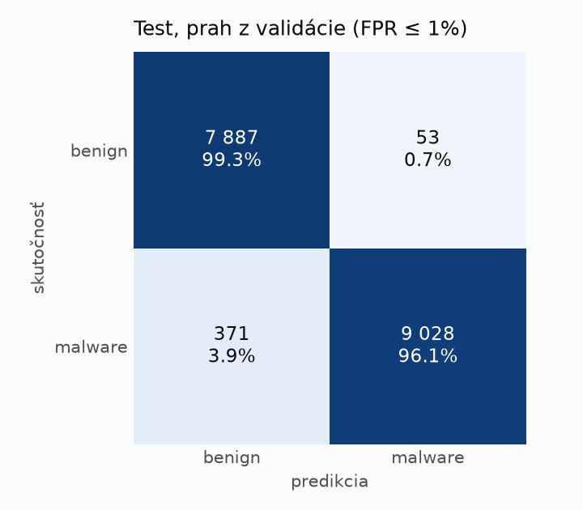
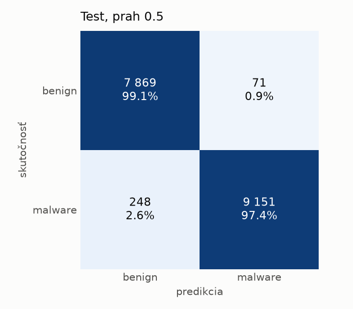
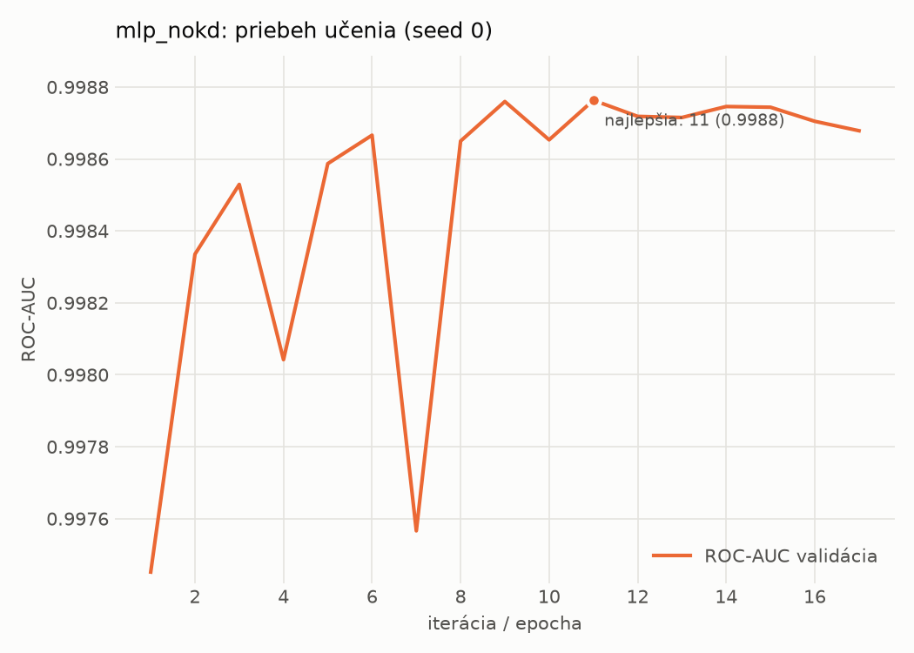

# static/mlp_nokd – beh `20261104-034206`

> Automaticky generované (`src/training/run_tabular.py`). Konfigurácia: `config.yaml`, protokol: `protocol.yaml`.

- **Model:** `mlp` – kontrola – rovnaké malé MLP bez destilácie (iba skutočné označenia)
- **Ladenie:** bez ladenia – hyperparametre prevzaté z `runs_final/students_static/mlp_nokd/20261102-211710`
- **Finálne modely:** seedy [0, 1, 2]; hodnoty sú priemer ± smerodajná odchýlka cez seedy
- **Najlepšie hyperparametre:** `{"hidden_layers": 1, "max_epochs": 100, "patience": 8, "hidden_width": 32, "dropout": 0.137657909519708, "lr": 0.0007042503153050794, "weight_decay": 1.207246112223234e-05, "batch_size": 512}`

## Detekčná kvalita (bez prahu)
| metrika | train (podvzorka) | validácia | test |
|---|---|---|---|
| ROC-AUC | 0.9999 ± 0.0001 | 0.9987 ± 0.0001 | 0.9972 ± 0.0002 |
| PR-AUC | 0.9999 ± 0.0000 | 0.9977 ± 0.0001 | 0.9948 ± 0.0010 |
| TPR pri FPR 1 % | 0.9983 ± 0.0007 | 0.9889 ± 0.0032 | 0.9734 ± 0.0022 |
| TPR pri FPR 0,1 % | 0.9762 ± 0.0080 | 0.9206 ± 0.0135 | 0.1040 ± 0.0367 |
| log loss | 0.0209 ± 0.0068 | 0.0363 ± 0.0040 | 0.0621 ± 0.0068 |
| Brier skóre | 0.0042 ± 0.0010 | 0.0078 ± 0.0005 | 0.0154 ± 0.0015 |

Rozdiel ROC-AUC train − validácia: **0.0011** (veľký rozdiel = preučenie).

## Pri prahu z validácie (FPR ≤ 1% na validácii)
| metrika | train (podvzorka) | validácia | test |
|---|---|---|---|
| accuracy | 0.9936 ± 0.0020 | 0.9895 ± 0.0020 | 0.9766 ± 0.0037 |
| balanced accuracy | 0.9939 ± 0.0016 | 0.9897 ± 0.0015 | 0.9779 ± 0.0034 |
| precision | 0.9970 ± 0.0014 | 0.9944 ± 0.0003 | 0.9933 ± 0.0007 |
| recall (TPR) | 0.9926 ± 0.0036 | 0.9889 ± 0.0032 | 0.9634 ± 0.0069 |
| FPR | 0.0048 ± 0.0023 | 0.0096 ± 0.0005 | 0.0076 ± 0.0008 |
| F1 | 0.9948 ± 0.0016 | 0.9916 ± 0.0016 | 0.9781 ± 0.0035 |
| MCC | 0.9865 ± 0.0041 | 0.9775 ± 0.0041 | 0.9536 ± 0.0071 |

## Pri pevnom prahu 0.5
| metrika | train (podvzorka) | validácia | test |
|---|---|---|---|
| accuracy | 0.9956 ± 0.0006 | 0.9909 ± 0.0007 | 0.9807 ± 0.0010 |
| balanced accuracy | 0.9952 ± 0.0007 | 0.9904 ± 0.0007 | 0.9814 ± 0.0010 |
| precision | 0.9961 ± 0.0008 | 0.9933 ± 0.0004 | 0.9917 ± 0.0007 |
| recall (TPR) | 0.9967 ± 0.0004 | 0.9922 ± 0.0007 | 0.9726 ± 0.0012 |
| FPR | 0.0063 ± 0.0014 | 0.0115 ± 0.0007 | 0.0097 ± 0.0008 |
| F1 | 0.9964 ± 0.0005 | 0.9927 ± 0.0006 | 0.9820 ± 0.0010 |
| MCC | 0.9906 ± 0.0013 | 0.9804 ± 0.0015 | 0.9614 ± 0.0021 |

## Výpočtové nároky (seed 0, testovacia množina)
| meranie | hodnota |
|---|---|
| tréning finálneho modelu | 2.6 s (priemer cez seedy) |
| ladenie spolu | 0 s |
| počet parametrov / uzlov | 74 337 |
| veľkosť modelu na disku | 0.36 MB |
| transformácia vstupu – latencia (1 vlákno) | 0.042 ms |
| transformácia vstupu – priepustnosť | 38 976 vzoriek/s |
| CPU latencia modelu (batch 1, 1 vlákno) | 0.068 ms (p95 0.081) |
| CPU priepustnosť (24 vlákien) | 109 275 vzoriek/s |
| GPU latencia (batch 1) | 0.267 ms (p95 0.312) |
| GPU priepustnosť | 79 925 vzoriek/s |
| GPU špičková pamäť | 1407 MB |

## Grafy
| | |
|---|---|
|  |  |
|  |  |
|  |  |
|  |  |

## Súbory
`metrics.json` (všetky metriky po seedoch vrátane rodín), `timing.json`, `hpo_trials.csv`,
`predictions/<časť>_seed<N>.parquet` (sha256, family, label, score), `model/seed_<N>/`, `log.txt`.
