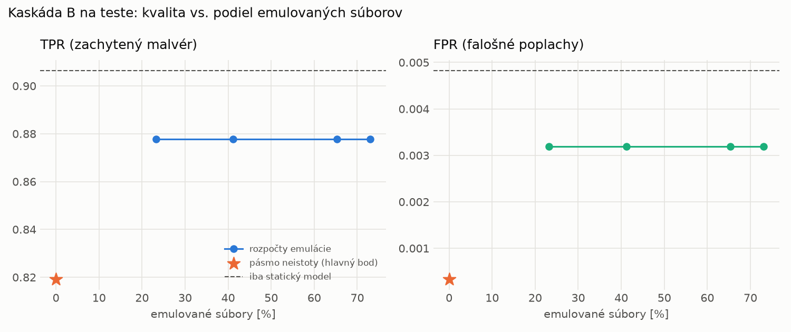

# Kaskáda B `b_baselines` – beh `20261104-055006`

> Generované `src/cascade/evaluate_b.py` (2026-11-04T05:50:06+01:00). Seedy: [0, 1, 2]; hodnoty = priemer ± sm. odchýlka.
> Všetky prahy a pásmo neistoty sú z validácie; test sa na nič nenastavuje. Postup: `docs/09_plan_v2.md`.

| rola | beh |
|---|---|
| static | `runs_v2/lofo/keylogger/static/lightgbm/20261104-034747` |
| dynamic | `runs_v2/lofo/keylogger/dynamic/lightgbm/20261104-040254` |
| hybrid | `runs_v2/lofo/keylogger/hybrid/lightgbm/20261104-043557` |

Druhý stupeň: **dynamic**. Pásmo neistoty statického modelu: FPR ≤ 0.1% nad `hi`,
najviac 1% malvéru validácie pod `lo` (seed 0: lo = 0.9470, hi = 0.9470, seed 1: lo = 0.9731, hi = 0.9731, seed 2: lo = 0.9651, hi = 0.9651).

## Test
| prístup | accuracy | balanced_accuracy | precision | recall_tpr | fpr | f1 | mcc |
|---|---|---|---|---|---|---|---|
| kaskáda B | 0.9018 ± 0.0122 | 0.9094 ± 0.0113 | 0.9997 ± 0.0001 | 0.8192 ± 0.0226 | 0.0003 ± 0.0001 | 0.9004 ± 0.0137 | 0.8212 ± 0.0202 |
| statický | 0.9471 ± 0.0013 | 0.9508 ± 0.0012 | 0.9955 ± 0.0008 | 0.9065 ± 0.0031 | 0.0048 ± 0.0008 | 0.9489 ± 0.0014 | 0.8985 ± 0.0023 |
| dynamický | 0.8325 ± 0.0059 | 0.8435 ± 0.0052 | 0.9713 ± 0.0024 | 0.7120 ± 0.0130 | 0.0249 ± 0.0026 | 0.8216 ± 0.0078 | 0.6996 ± 0.0081 |
| hybrid (každá vzorka) | 0.9318 ± 0.0015 | 0.9368 ± 0.0013 | 0.9963 ± 0.0006 | 0.8775 ± 0.0032 | 0.0038 ± 0.0007 | 0.9331 ± 0.0016 | 0.8714 ± 0.0024 |

- **emulované súbory: 0.00%** (ostatné rozhodne iba statický model); na hybrid ide 0.00% súborov
- chyby pri istom rozhodnutí statického modelu (seed 0): 1593
- validácia: emulované 0.00%, na hybrid 0.00%

## Validácia
| prístup | accuracy | balanced_accuracy | precision | recall_tpr | fpr | f1 | mcc |
|---|---|---|---|---|---|---|---|
| kaskáda B | 0.9942 ± 0.0004 | 0.9954 ± 0.0003 | 0.9997 ± 0.0001 | 0.9914 ± 0.0005 | 0.0005 ± 0.0002 | 0.9955 ± 0.0003 | 0.9873 ± 0.0008 |
| statický | 0.9954 ± 0.0002 | 0.9943 ± 0.0003 | 0.9951 ± 0.0003 | 0.9978 ± 0.0002 | 0.0093 ± 0.0006 | 0.9964 ± 0.0001 | 0.9897 ± 0.0004 |
| dynamický | 0.9746 ± 0.0002 | 0.9782 ± 0.0002 | 0.9946 ± 0.0000 | 0.9663 ± 0.0003 | 0.0098 ± 0.0000 | 0.9803 ± 0.0002 | 0.9454 ± 0.0004 |
| hybrid (každá vzorka) | 0.9954 ± 0.0004 | 0.9945 ± 0.0004 | 0.9955 ± 0.0003 | 0.9974 ± 0.0002 | 0.0085 ± 0.0006 | 0.9964 ± 0.0003 | 0.9897 ± 0.0008 |

## Januárové vzorky vynechanej rodiny (iba malvér → TPR)
| prístup | TPR |
|---|---|
| kaskáda B | 0.3100 ± 0.0034 |
| statický | 0.4291 ± 0.0045 |
| dynamický | 0.3671 ± 0.0004 |
| hybrid (každá vzorka) | 0.3950 ± 0.0089 |

Podiel emulovaných: 0.00%

## Krivka rozpočtu emulácie (test, priemer cez seedy)
| budget_val | emulation_rate | hybrid_rate | recall_tpr | fpr | f1 |
|---|---|---|---|---|---|
| 0.1000 | 0.2325 | 0.0412 | 0.8777 | 0.0032 | 0.9335 |
| 0.2000 | 0.4117 | 0.0607 | 0.8777 | 0.0032 | 0.9335 |
| 0.3000 | 0.6531 | 0.0910 | 0.8777 | 0.0032 | 0.9335 |
| 0.4000 | 0.7303 | 0.0984 | 0.8777 | 0.0032 | 0.9335 |

## Výpočtové nároky
Emulácia (Speakeasy) sa nedá zmerať (dataset neobsahuje PE súbory). **Predpoklad** 60 s na súbor
(limit z `speakeasy-config.json`): kaskáda B ≈ 0.0 s na súbor v priemere, dynamický/hybridný model
a kaskáda A 60 s (emulujú každý súbor).

_Chýba benchmark niektorého komponentu (v zero-day behoch sa nemeria)._

