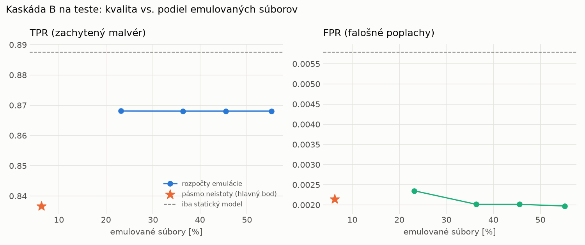

# Kaskáda B `b_main` – beh `20261104-055001`

> Generované `src/cascade/evaluate_b.py` (2026-11-04T05:50:01+01:00). Seedy: [0, 1, 2]; hodnoty = priemer ± sm. odchýlka.
> Všetky prahy a pásmo neistoty sú z validácie; test sa na nič nenastavuje. Postup: `docs/09_plan_v2.md`.

| rola | beh |
|---|---|
| static | `runs_v2/lofo/keylogger/students_static/mlp_kd/20261104-054525` |
| dynamic | `runs_v2/lofo/keylogger/students_dynamic/mlp_kd/20261104-054737` |
| hybrid | `runs_v2/lofo/keylogger/hybrid/lightgbm/20261104-043557` |

Druhý stupeň: **dynamic**. Pásmo neistoty statického modelu: FPR ≤ 0.1% nad `hi`,
najviac 1% malvéru validácie pod `lo` (seed 0: lo = 0.9241, hi = 0.9960, seed 1: lo = 0.9304, hi = 0.9968, seed 2: lo = 0.9303, hi = 0.9978).

## Test
| prístup | accuracy | balanced_accuracy | precision | recall_tpr | fpr | f1 | mcc |
|---|---|---|---|---|---|---|---|
| kaskáda B | 0.9105 ± 0.0041 | 0.9173 ± 0.0037 | 0.9978 ± 0.0002 | 0.8367 ± 0.0076 | 0.0021 ± 0.0003 | 0.9102 ± 0.0045 | 0.8351 ± 0.0068 |
| statický | 0.9364 ± 0.0059 | 0.9409 ± 0.0054 | 0.9945 ± 0.0006 | 0.8876 ± 0.0111 | 0.0058 ± 0.0007 | 0.9380 ± 0.0061 | 0.8792 ± 0.0104 |
| dynamický | 0.7281 ± 0.0056 | 0.7481 ± 0.0051 | 0.9772 ± 0.0009 | 0.5102 ± 0.0105 | 0.0141 ± 0.0006 | 0.6704 ± 0.0091 | 0.5487 ± 0.0080 |
| hybrid (každá vzorka) | 0.9318 ± 0.0015 | 0.9368 ± 0.0013 | 0.9963 ± 0.0006 | 0.8775 ± 0.0032 | 0.0038 ± 0.0007 | 0.9331 ± 0.0016 | 0.8714 ± 0.0024 |

- **emulované súbory: 6.24%** (ostatné rozhodne iba statický model); na hybrid ide 3.90% súborov
- chyby pri istom rozhodnutí statického modelu (seed 0): 1415
- validácia: emulované 1.53%, na hybrid 0.74%

## Validácia
| prístup | accuracy | balanced_accuracy | precision | recall_tpr | fpr | f1 | mcc |
|---|---|---|---|---|---|---|---|
| kaskáda B | 0.9929 ± 0.0002 | 0.9942 ± 0.0003 | 0.9990 ± 0.0003 | 0.9901 ± 0.0001 | 0.0018 ± 0.0005 | 0.9946 ± 0.0002 | 0.9846 ± 0.0005 |
| statický | 0.9929 ± 0.0001 | 0.9923 ± 0.0002 | 0.9949 ± 0.0001 | 0.9942 ± 0.0001 | 0.0096 ± 0.0002 | 0.9946 ± 0.0001 | 0.9843 ± 0.0003 |
| dynamický | 0.9602 ± 0.0021 | 0.9672 ± 0.0016 | 0.9945 ± 0.0000 | 0.9443 ± 0.0032 | 0.0098 ± 0.0000 | 0.9688 ± 0.0017 | 0.9165 ± 0.0041 |
| hybrid (každá vzorka) | 0.9954 ± 0.0004 | 0.9945 ± 0.0004 | 0.9955 ± 0.0003 | 0.9974 ± 0.0002 | 0.0085 ± 0.0006 | 0.9964 ± 0.0003 | 0.9897 ± 0.0008 |

## Januárové vzorky vynechanej rodiny (iba malvér → TPR)
| prístup | TPR |
|---|---|
| kaskáda B | 0.3561 ± 0.0131 |
| statický | 0.4061 ± 0.0020 |
| dynamický | 0.3374 ± 0.0209 |
| hybrid (každá vzorka) | 0.3950 ± 0.0089 |

Podiel emulovaných: 8.35%

## Krivka rozpočtu emulácie (test, priemer cez seedy)
| budget_val | emulation_rate | hybrid_rate | recall_tpr | fpr | f1 |
|---|---|---|---|---|---|
| 0.1000 | 0.2317 | 0.1067 | 0.8681 | 0.0024 | 0.9284 |
| 0.2000 | 0.3637 | 0.1567 | 0.8681 | 0.0020 | 0.9285 |
| 0.3000 | 0.4554 | 0.1695 | 0.8681 | 0.0020 | 0.9285 |
| 0.4000 | 0.5518 | 0.2015 | 0.8681 | 0.0020 | 0.9285 |

## Výpočtové nároky
Emulácia (Speakeasy) sa nedá zmerať (dataset neobsahuje PE súbory). **Predpoklad** 60 s na súbor
(limit z `speakeasy-config.json`): kaskáda B ≈ 3.7 s na súbor v priemere, dynamický/hybridný model
a kaskáda A 60 s (emulujú každý súbor).

_Chýba benchmark niektorého komponentu (v zero-day behoch sa nemeria)._

