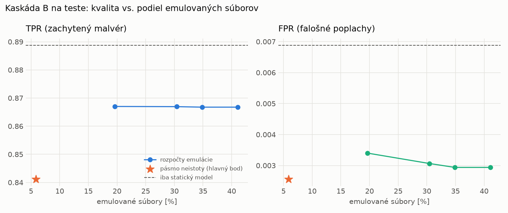

# Kaskáda B `b_nokd` – beh `20261104-055008`

> Generované `src/cascade/evaluate_b.py` (2026-11-04T05:50:08+01:00). Seedy: [0, 1, 2]; hodnoty = priemer ± sm. odchýlka.
> Všetky prahy a pásmo neistoty sú z validácie; test sa na nič nenastavuje. Postup: `docs/09_plan_v2.md`.

| rola | beh |
|---|---|
| static | `runs_v2/lofo/keylogger/students_static/mlp_nokd/20261104-054616` |
| dynamic | `runs_v2/lofo/keylogger/students_dynamic/mlp_nokd/20261104-054815` |
| hybrid | `runs_v2/lofo/keylogger/hybrid/lightgbm/20261104-043557` |

Druhý stupeň: **dynamic**. Pásmo neistoty statického modelu: FPR ≤ 0.1% nad `hi`,
najviac 1% malvéru validácie pod `lo` (seed 0: lo = 0.8264, hi = 0.9595, seed 1: lo = 0.8483, hi = 0.9762, seed 2: lo = 0.7305, hi = 0.9704).

## Test
| prístup | accuracy | balanced_accuracy | precision | recall_tpr | fpr | f1 | mcc |
|---|---|---|---|---|---|---|---|
| kaskáda B | 0.9127 ± 0.0024 | 0.9193 ± 0.0022 | 0.9974 ± 0.0001 | 0.8412 ± 0.0046 | 0.0026 ± 0.0001 | 0.9127 ± 0.0026 | 0.8387 ± 0.0041 |
| statický | 0.9366 ± 0.0030 | 0.9409 ± 0.0027 | 0.9935 ± 0.0008 | 0.8888 ± 0.0062 | 0.0069 ± 0.0009 | 0.9382 ± 0.0031 | 0.8792 ± 0.0052 |
| dynamický | 0.7379 ± 0.0053 | 0.7570 ± 0.0049 | 0.9757 ± 0.0012 | 0.5297 ± 0.0093 | 0.0156 ± 0.0006 | 0.6866 ± 0.0081 | 0.5620 ± 0.0080 |
| hybrid (každá vzorka) | 0.9318 ± 0.0015 | 0.9368 ± 0.0013 | 0.9963 ± 0.0006 | 0.8775 ± 0.0032 | 0.0038 ± 0.0007 | 0.9331 ± 0.0016 | 0.8714 ± 0.0024 |

- **emulované súbory: 5.85%** (ostatné rozhodne iba statický model); na hybrid ide 3.84% súborov
- chyby pri istom rozhodnutí statického modelu (seed 0): 1444
- validácia: emulované 2.49%, na hybrid 1.13%

## Validácia
| prístup | accuracy | balanced_accuracy | precision | recall_tpr | fpr | f1 | mcc |
|---|---|---|---|---|---|---|---|
| kaskáda B | 0.9925 ± 0.0004 | 0.9937 ± 0.0005 | 0.9987 ± 0.0004 | 0.9898 ± 0.0004 | 0.0025 ± 0.0008 | 0.9942 ± 0.0003 | 0.9835 ± 0.0008 |
| statický | 0.9929 ± 0.0002 | 0.9924 ± 0.0001 | 0.9952 ± 0.0002 | 0.9939 ± 0.0006 | 0.0090 ± 0.0004 | 0.9946 ± 0.0002 | 0.9843 ± 0.0005 |
| dynamický | 0.9611 ± 0.0017 | 0.9680 ± 0.0012 | 0.9947 ± 0.0001 | 0.9455 ± 0.0027 | 0.0096 ± 0.0002 | 0.9695 ± 0.0014 | 0.9183 ± 0.0033 |
| hybrid (každá vzorka) | 0.9954 ± 0.0004 | 0.9945 ± 0.0004 | 0.9955 ± 0.0003 | 0.9974 ± 0.0002 | 0.0085 ± 0.0006 | 0.9964 ± 0.0003 | 0.9897 ± 0.0008 |

## Januárové vzorky vynechanej rodiny (iba malvér → TPR)
| prístup | TPR |
|---|---|
| kaskáda B | 0.3384 ± 0.0083 |
| statický | 0.3878 ± 0.0211 |
| dynamický | 0.3304 ± 0.0143 |
| hybrid (každá vzorka) | 0.3950 ± 0.0089 |

Podiel emulovaných: 5.38%

## Krivka rozpočtu emulácie (test, priemer cez seedy)
| budget_val | emulation_rate | hybrid_rate | recall_tpr | fpr | f1 |
|---|---|---|---|---|---|
| 0.1000 | 0.1964 | 0.1114 | 0.8670 | 0.0034 | 0.9273 |
| 0.2000 | 0.3045 | 0.1485 | 0.8669 | 0.0031 | 0.9274 |
| 0.3000 | 0.3488 | 0.1549 | 0.8668 | 0.0029 | 0.9274 |
| 0.4000 | 0.4107 | 0.1652 | 0.8668 | 0.0029 | 0.9274 |

## Výpočtové nároky
Emulácia (Speakeasy) sa nedá zmerať (dataset neobsahuje PE súbory). **Predpoklad** 60 s na súbor
(limit z `speakeasy-config.json`): kaskáda B ≈ 3.5 s na súbor v priemere, dynamický/hybridný model
a kaskáda A 60 s (emulujú každý súbor).

_Chýba benchmark niektorého komponentu (v zero-day behoch sa nemeria)._

