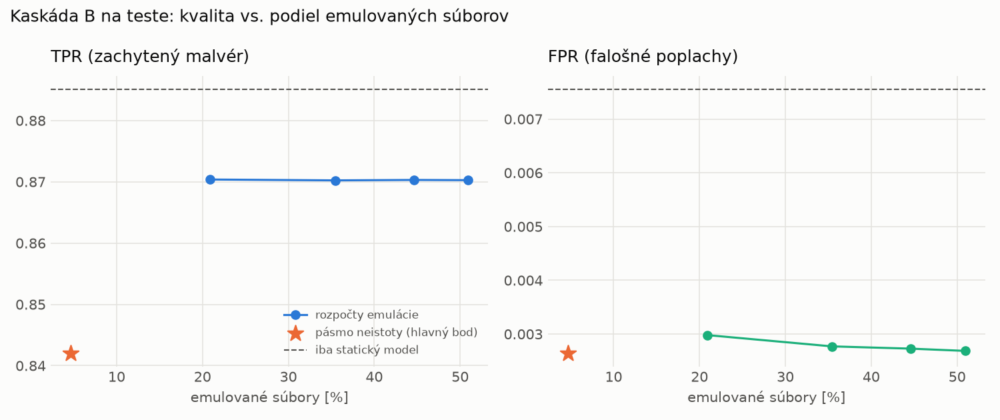

# Kaskáda B `b_twobranch` – beh `20261104-055010`

> Generované `src/cascade/evaluate_b.py` (2026-11-04T05:50:10+01:00). Seedy: [0, 1, 2]; hodnoty = priemer ± sm. odchýlka.
> Všetky prahy a pásmo neistoty sú z validácie; test sa na nič nenastavuje. Postup: `docs/09_plan_v2.md`.

| rola | beh |
|---|---|
| static | `runs_v2/lofo/keylogger/students_static/mlp_kd_twobranch/20261104-054705` |
| dynamic | `runs_v2/lofo/keylogger/students_dynamic/mlp_kd_twobranch/20261104-054917` |
| hybrid | `runs_v2/lofo/keylogger/hybrid/lightgbm/20261104-043557` |

Druhý stupeň: **dynamic**. Pásmo neistoty statického modelu: FPR ≤ 0.1% nad `hi`,
najviac 1% malvéru validácie pod `lo` (seed 0: lo = 0.8737, hi = 0.9959, seed 1: lo = 0.8592, hi = 0.9856, seed 2: lo = 0.9394, hi = 0.9889).

## Test
| prístup | accuracy | balanced_accuracy | precision | recall_tpr | fpr | f1 | mcc |
|---|---|---|---|---|---|---|---|
| kaskáda B | 0.9132 ± 0.0040 | 0.9197 ± 0.0037 | 0.9974 ± 0.0003 | 0.8420 ± 0.0075 | 0.0026 ± 0.0003 | 0.9131 ± 0.0044 | 0.8394 ± 0.0068 |
| statický | 0.9343 ± 0.0078 | 0.9388 ± 0.0072 | 0.9928 ± 0.0002 | 0.8851 ± 0.0143 | 0.0076 ± 0.0001 | 0.9359 ± 0.0081 | 0.8750 ± 0.0139 |
| dynamický | 0.7134 ± 0.0308 | 0.7346 ± 0.0283 | 0.9763 ± 0.0022 | 0.4830 ± 0.0576 | 0.0139 ± 0.0015 | 0.6449 ± 0.0530 | 0.5277 ± 0.0440 |
| hybrid (každá vzorka) | 0.9318 ± 0.0015 | 0.9368 ± 0.0013 | 0.9963 ± 0.0006 | 0.8775 ± 0.0032 | 0.0038 ± 0.0007 | 0.9331 ± 0.0016 | 0.8714 ± 0.0024 |

- **emulované súbory: 4.66%** (ostatné rozhodne iba statický model); na hybrid ide 3.30% súborov
- chyby pri istom rozhodnutí statického modelu (seed 0): 1394
- validácia: emulované 2.20%, na hybrid 0.92%

## Validácia
| prístup | accuracy | balanced_accuracy | precision | recall_tpr | fpr | f1 | mcc |
|---|---|---|---|---|---|---|---|
| kaskáda B | 0.9927 ± 0.0004 | 0.9938 ± 0.0006 | 0.9986 ± 0.0006 | 0.9901 ± 0.0001 | 0.0026 ± 0.0010 | 0.9943 ± 0.0003 | 0.9839 ± 0.0010 |
| statický | 0.9938 ± 0.0004 | 0.9931 ± 0.0003 | 0.9951 ± 0.0003 | 0.9954 ± 0.0006 | 0.0093 ± 0.0006 | 0.9952 ± 0.0003 | 0.9863 ± 0.0008 |
| dynamický | 0.9539 ± 0.0092 | 0.9624 ± 0.0070 | 0.9945 ± 0.0001 | 0.9346 ± 0.0142 | 0.0097 ± 0.0002 | 0.9636 ± 0.0076 | 0.9044 ± 0.0176 |
| hybrid (každá vzorka) | 0.9954 ± 0.0004 | 0.9945 ± 0.0004 | 0.9955 ± 0.0003 | 0.9974 ± 0.0002 | 0.0085 ± 0.0006 | 0.9964 ± 0.0003 | 0.9897 ± 0.0008 |

## Januárové vzorky vynechanej rodiny (iba malvér → TPR)
| prístup | TPR |
|---|---|
| kaskáda B | 0.3452 ± 0.0081 |
| statický | 0.4023 ± 0.0116 |
| dynamický | 0.3221 ± 0.0032 |
| hybrid (každá vzorka) | 0.3950 ± 0.0089 |

Podiel emulovaných: 13.33%

## Krivka rozpočtu emulácie (test, priemer cez seedy)
| budget_val | emulation_rate | hybrid_rate | recall_tpr | fpr | f1 |
|---|---|---|---|---|---|
| 0.1000 | 0.2090 | 0.1103 | 0.8704 | 0.0030 | 0.9294 |
| 0.2000 | 0.3545 | 0.1709 | 0.8702 | 0.0028 | 0.9295 |
| 0.3000 | 0.4460 | 0.2036 | 0.8703 | 0.0027 | 0.9295 |
| 0.4000 | 0.5093 | 0.2132 | 0.8703 | 0.0027 | 0.9295 |

## Výpočtové nároky
Emulácia (Speakeasy) sa nedá zmerať (dataset neobsahuje PE súbory). **Predpoklad** 60 s na súbor
(limit z `speakeasy-config.json`): kaskáda B ≈ 2.8 s na súbor v priemere, dynamický/hybridný model
a kaskáda A 60 s (emulujú každý súbor).

_Chýba benchmark niektorého komponentu (v zero-day behoch sa nemeria)._

