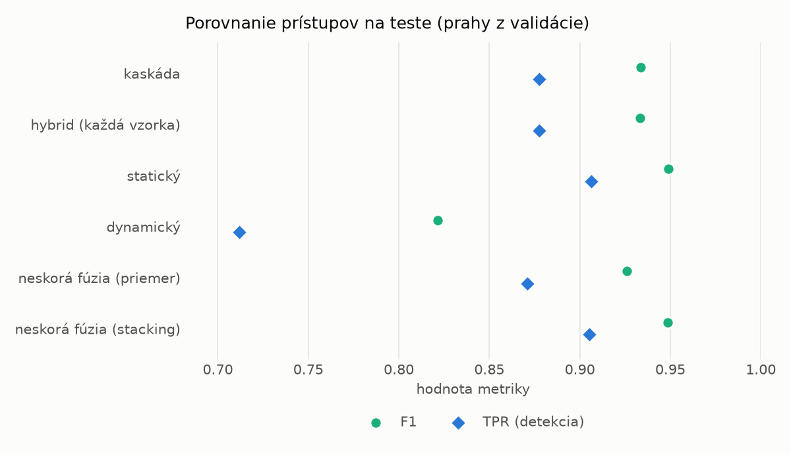
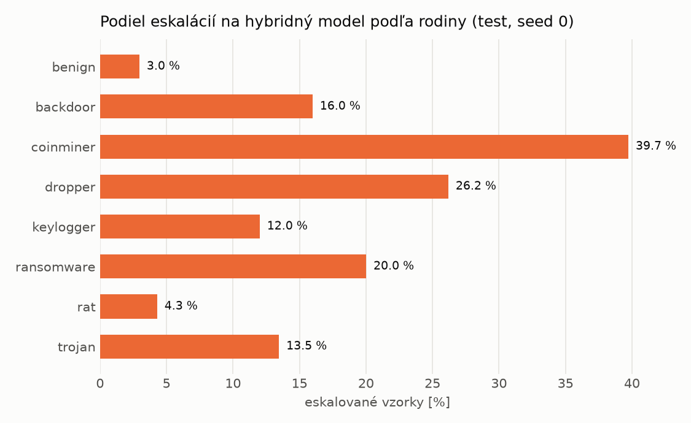

# Kaskáda `baselines` – beh `20261104-054957`

> Generované `src/cascade/evaluate.py` (2026-11-04T05:49:57+01:00). Seedy: [0, 1, 2]; hodnoty = priemer ± sm. odchýlka.
> Všetky prahy sú určené na validácii (FPR ≤ 1 %); test sa na nič nenastavuje.

| rola | beh |
|---|---|
| static | `runs_v2/lofo/keylogger/static/lightgbm/20261104-034747` |
| dynamic | `runs_v2/lofo/keylogger/dynamic/lightgbm/20261104-040254` |
| hybrid | `runs_v2/lofo/keylogger/hybrid/lightgbm/20261104-043557` |

## Test
| prístup | accuracy | balanced_accuracy | precision | recall_tpr | fpr | f1 | mcc |
|---|---|---|---|---|---|---|---|
| kaskáda | 0.9323 ± 0.0008 | 0.9373 ± 0.0007 | 0.9969 ± 0.0001 | 0.8777 ± 0.0014 | 0.0032 ± 0.0001 | 0.9335 ± 0.0008 | 0.8723 ± 0.0013 |
| hybrid (každá vzorka) | 0.9318 ± 0.0015 | 0.9368 ± 0.0013 | 0.9963 ± 0.0006 | 0.8775 ± 0.0032 | 0.0038 ± 0.0007 | 0.9331 ± 0.0016 | 0.8714 ± 0.0024 |
| statický | 0.9471 ± 0.0013 | 0.9508 ± 0.0012 | 0.9955 ± 0.0008 | 0.9065 ± 0.0031 | 0.0048 ± 0.0008 | 0.9489 ± 0.0014 | 0.8985 ± 0.0023 |
| dynamický | 0.8325 ± 0.0059 | 0.8435 ± 0.0052 | 0.9713 ± 0.0024 | 0.7120 ± 0.0130 | 0.0249 ± 0.0026 | 0.8216 ± 0.0078 | 0.6996 ± 0.0081 |
| neskorá fúzia (priemer) | 0.9245 ± 0.0004 | 0.9294 ± 0.0004 | 0.9882 ± 0.0001 | 0.8712 ± 0.0008 | 0.0123 ± 0.0001 | 0.9260 ± 0.0004 | 0.8567 ± 0.0007 |
| neskorá fúzia (stacking) | 0.9466 ± 0.0002 | 0.9504 ± 0.0002 | 0.9958 ± 0.0002 | 0.9053 ± 0.0003 | 0.0045 ± 0.0002 | 0.9484 ± 0.0002 | 0.8978 ± 0.0004 |

## Validácia
| prístup | accuracy | balanced_accuracy | precision | recall_tpr | fpr | f1 | mcc |
|---|---|---|---|---|---|---|---|
| kaskáda | 0.9958 ± 0.0001 | 0.9951 ± 0.0001 | 0.9963 ± 0.0000 | 0.9972 ± 0.0001 | 0.0070 ± 0.0000 | 0.9968 ± 0.0001 | 0.9907 ± 0.0002 |
| hybrid (každá vzorka) | 0.9954 ± 0.0004 | 0.9945 ± 0.0004 | 0.9955 ± 0.0003 | 0.9974 ± 0.0002 | 0.0085 ± 0.0006 | 0.9964 ± 0.0003 | 0.9897 ± 0.0008 |
| statický | 0.9954 ± 0.0002 | 0.9943 ± 0.0003 | 0.9951 ± 0.0003 | 0.9978 ± 0.0002 | 0.0093 ± 0.0006 | 0.9964 ± 0.0001 | 0.9897 ± 0.0004 |
| dynamický | 0.9746 ± 0.0002 | 0.9782 ± 0.0002 | 0.9946 ± 0.0000 | 0.9663 ± 0.0003 | 0.0098 ± 0.0000 | 0.9803 ± 0.0002 | 0.9454 ± 0.0004 |
| neskorá fúzia (priemer) | 0.9942 ± 0.0002 | 0.9934 ± 0.0002 | 0.9950 ± 0.0000 | 0.9962 ± 0.0003 | 0.0094 ± 0.0000 | 0.9956 ± 0.0002 | 0.9872 ± 0.0005 |
| neskorá fúzia (stacking) | 0.9955 ± 0.0004 | 0.9946 ± 0.0004 | 0.9954 ± 0.0004 | 0.9977 ± 0.0003 | 0.0086 ± 0.0007 | 0.9966 ± 0.0003 | 0.9902 ± 0.0008 |

## Správanie kaskády (test, seed 0)
- podiel eskalácií na hybrid: **11.73%** (2033 vzoriek)
- chyby pri zhode študentov (kaskáda ich nemôže opraviť): **889**
  (5.808% zo zhôd; FP 3, FN 886)
- úspešnosť na eskalovaných vzorkách: hybrid 0.8657156910969012, statický 0.9729463846532218,
  dynamický 0.02705361534677816  → prínos hybridu pri nezhode

## Výpočtové nároky (odhad z benchmarkov komponentov)
_Chýba benchmark niektorého komponentu (`python -m src.evaluation.benchmark`)._

