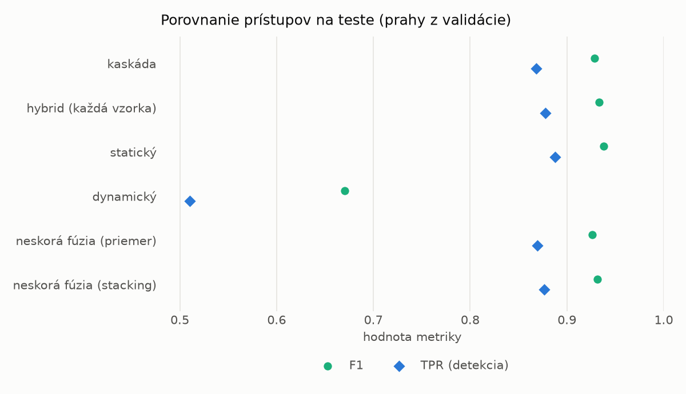
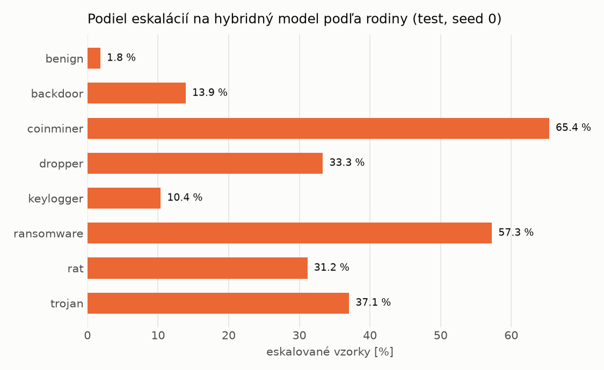

# Kaskáda `main` – beh `20261104-054948`

> Generované `src/cascade/evaluate.py` (2026-11-04T05:49:49+01:00). Seedy: [0, 1, 2]; hodnoty = priemer ± sm. odchýlka.
> Všetky prahy sú určené na validácii (FPR ≤ 1 %); test sa na nič nenastavuje.

| rola | beh |
|---|---|
| static | `runs_v2/lofo/keylogger/students_static/mlp_kd/20261104-054525` |
| dynamic | `runs_v2/lofo/keylogger/students_dynamic/mlp_kd/20261104-054737` |
| hybrid | `runs_v2/lofo/keylogger/hybrid/lightgbm/20261104-043557` |

## Test
| prístup | accuracy | balanced_accuracy | precision | recall_tpr | fpr | f1 | mcc |
|---|---|---|---|---|---|---|---|
| kaskáda | 0.9277 ± 0.0005 | 0.9332 ± 0.0005 | 0.9984 ± 0.0003 | 0.8681 ± 0.0008 | 0.0017 ± 0.0003 | 0.9287 ± 0.0005 | 0.8647 ± 0.0009 |
| hybrid (každá vzorka) | 0.9318 ± 0.0015 | 0.9368 ± 0.0013 | 0.9963 ± 0.0006 | 0.8775 ± 0.0032 | 0.0038 ± 0.0007 | 0.9331 ± 0.0016 | 0.8714 ± 0.0024 |
| statický | 0.9364 ± 0.0059 | 0.9409 ± 0.0054 | 0.9945 ± 0.0006 | 0.8876 ± 0.0111 | 0.0058 ± 0.0007 | 0.9380 ± 0.0061 | 0.8792 ± 0.0104 |
| dynamický | 0.7281 ± 0.0056 | 0.7481 ± 0.0051 | 0.9772 ± 0.0009 | 0.5102 ± 0.0105 | 0.0141 ± 0.0006 | 0.6704 ± 0.0091 | 0.5487 ± 0.0080 |
| neskorá fúzia (priemer) | 0.9250 ± 0.0022 | 0.9301 ± 0.0022 | 0.9909 ± 0.0027 | 0.8697 ± 0.0019 | 0.0094 ± 0.0028 | 0.9264 ± 0.0021 | 0.8582 ± 0.0045 |
| neskorá fúzia (stacking) | 0.9303 ± 0.0004 | 0.9353 ± 0.0004 | 0.9943 ± 0.0007 | 0.8765 ± 0.0007 | 0.0059 ± 0.0007 | 0.9317 ± 0.0004 | 0.8683 ± 0.0007 |

## Validácia
| prístup | accuracy | balanced_accuracy | precision | recall_tpr | fpr | f1 | mcc |
|---|---|---|---|---|---|---|---|
| kaskáda | 0.9951 ± 0.0005 | 0.9953 ± 0.0004 | 0.9978 ± 0.0002 | 0.9947 ± 0.0005 | 0.0041 ± 0.0004 | 0.9963 ± 0.0004 | 0.9893 ± 0.0010 |
| hybrid (každá vzorka) | 0.9954 ± 0.0004 | 0.9945 ± 0.0004 | 0.9955 ± 0.0003 | 0.9974 ± 0.0002 | 0.0085 ± 0.0006 | 0.9964 ± 0.0003 | 0.9897 ± 0.0008 |
| statický | 0.9929 ± 0.0001 | 0.9923 ± 0.0002 | 0.9949 ± 0.0001 | 0.9942 ± 0.0001 | 0.0096 ± 0.0002 | 0.9946 ± 0.0001 | 0.9843 ± 0.0003 |
| dynamický | 0.9602 ± 0.0021 | 0.9672 ± 0.0016 | 0.9945 ± 0.0000 | 0.9443 ± 0.0032 | 0.0098 ± 0.0000 | 0.9688 ± 0.0017 | 0.9165 ± 0.0041 |
| neskorá fúzia (priemer) | 0.9933 ± 0.0001 | 0.9927 ± 0.0001 | 0.9951 ± 0.0001 | 0.9946 ± 0.0000 | 0.0091 ± 0.0002 | 0.9948 ± 0.0001 | 0.9852 ± 0.0002 |
| neskorá fúzia (stacking) | 0.9937 ± 0.0002 | 0.9929 ± 0.0002 | 0.9948 ± 0.0000 | 0.9956 ± 0.0004 | 0.0098 ± 0.0000 | 0.9952 ± 0.0002 | 0.9862 ± 0.0005 |

## Správanie kaskády (test, seed 0)
- podiel eskalácií na hybrid: **21.50%** (3728 vzoriek)
- chyby pri zhode študentov (kaskáda ich nemôže opraviť): **1158**
  (8.508% zo zhôd; FP 3, FN 1155)
- úspešnosť na eskalovaných vzorkách: hybrid 0.9718347639484979, statický 0.9833690987124464,
  dynamický 0.016630901287553648  → prínos hybridu pri nezhode

## Výpočtové nároky (odhad z benchmarkov komponentov)
_Chýba benchmark niektorého komponentu (`python -m src.evaluation.benchmark`)._

