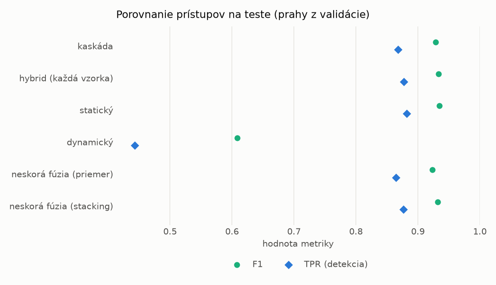
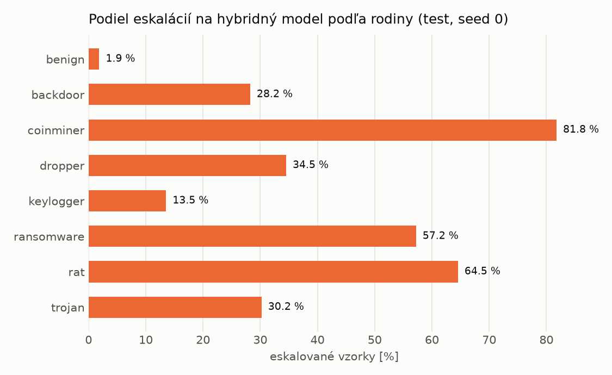

# Kaskáda `modal` – beh `20261104-054953`

> Generované `src/cascade/evaluate.py` (2026-11-04T05:49:53+01:00). Seedy: [0, 1, 2]; hodnoty = priemer ± sm. odchýlka.
> Všetky prahy sú určené na validácii (FPR ≤ 1 %); test sa na nič nenastavuje.

| rola | beh |
|---|---|
| static | `runs_v2/lofo/keylogger/students_static/mlp_kd_modal/20261104-054633` |
| dynamic | `runs_v2/lofo/keylogger/students_dynamic/mlp_kd_modal/20261104-054838` |
| hybrid | `runs_v2/lofo/keylogger/hybrid/lightgbm/20261104-043557` |

## Test
| prístup | accuracy | balanced_accuracy | precision | recall_tpr | fpr | f1 | mcc |
|---|---|---|---|---|---|---|---|
| kaskáda | 0.9277 ± 0.0002 | 0.9332 ± 0.0002 | 0.9981 ± 0.0003 | 0.8682 ± 0.0004 | 0.0019 ± 0.0003 | 0.9287 ± 0.0002 | 0.8646 ± 0.0003 |
| hybrid (každá vzorka) | 0.9318 ± 0.0015 | 0.9368 ± 0.0013 | 0.9963 ± 0.0006 | 0.8775 ± 0.0032 | 0.0038 ± 0.0007 | 0.9331 ± 0.0016 | 0.8714 ± 0.0024 |
| statický | 0.9329 ± 0.0061 | 0.9376 ± 0.0056 | 0.9938 ± 0.0008 | 0.8817 ± 0.0113 | 0.0065 ± 0.0008 | 0.9344 ± 0.0063 | 0.8728 ± 0.0108 |
| dynamický | 0.6922 ± 0.0244 | 0.7151 ± 0.0226 | 0.9760 ± 0.0032 | 0.4430 ± 0.0446 | 0.0128 ± 0.0006 | 0.6086 ± 0.0422 | 0.4976 ± 0.0359 |
| neskorá fúzia (priemer) | 0.9222 ± 0.0065 | 0.9275 ± 0.0056 | 0.9909 ± 0.0052 | 0.8646 ± 0.0166 | 0.0095 ± 0.0055 | 0.9233 ± 0.0074 | 0.8534 ± 0.0100 |
| neskorá fúzia (stacking) | 0.9303 ± 0.0006 | 0.9352 ± 0.0006 | 0.9941 ± 0.0006 | 0.8766 ± 0.0006 | 0.0061 ± 0.0006 | 0.9317 ± 0.0006 | 0.8682 ± 0.0013 |

## Validácia
| prístup | accuracy | balanced_accuracy | precision | recall_tpr | fpr | f1 | mcc |
|---|---|---|---|---|---|---|---|
| kaskáda | 0.9949 ± 0.0005 | 0.9949 ± 0.0005 | 0.9973 ± 0.0003 | 0.9948 ± 0.0005 | 0.0051 ± 0.0006 | 0.9961 ± 0.0004 | 0.9887 ± 0.0011 |
| hybrid (každá vzorka) | 0.9954 ± 0.0004 | 0.9945 ± 0.0004 | 0.9955 ± 0.0003 | 0.9974 ± 0.0002 | 0.0085 ± 0.0006 | 0.9964 ± 0.0003 | 0.9897 ± 0.0008 |
| statický | 0.9930 ± 0.0010 | 0.9925 ± 0.0010 | 0.9951 ± 0.0005 | 0.9942 ± 0.0011 | 0.0093 ± 0.0009 | 0.9946 ± 0.0008 | 0.9845 ± 0.0022 |
| dynamický | 0.9516 ± 0.0113 | 0.9606 ± 0.0086 | 0.9944 ± 0.0001 | 0.9311 ± 0.0173 | 0.0098 ± 0.0000 | 0.9617 ± 0.0093 | 0.9000 ± 0.0214 |
| neskorá fúzia (priemer) | 0.9938 ± 0.0007 | 0.9933 ± 0.0008 | 0.9956 ± 0.0006 | 0.9950 ± 0.0004 | 0.0083 ± 0.0012 | 0.9953 ± 0.0005 | 0.9864 ± 0.0015 |
| neskorá fúzia (stacking) | 0.9942 ± 0.0004 | 0.9935 ± 0.0003 | 0.9953 ± 0.0001 | 0.9958 ± 0.0005 | 0.0089 ± 0.0002 | 0.9955 ± 0.0003 | 0.9871 ± 0.0008 |

## Správanie kaskády (test, seed 0)
- podiel eskalácií na hybrid: **26.90%** (4665 vzoriek)
- chyby pri zhode študentov (kaskáda ich nemôže opraviť): **983**
  (7.756% zo zhôd; FP 3, FN 980)
- úspešnosť na eskalovaných vzorkách: hybrid 0.942550911039657, statický 0.9871382636655949,
  dynamický 0.012861736334405145  → prínos hybridu pri nezhode

## Výpočtové nároky (odhad z benchmarkov komponentov)
_Chýba benchmark niektorého komponentu (`python -m src.evaluation.benchmark`)._

