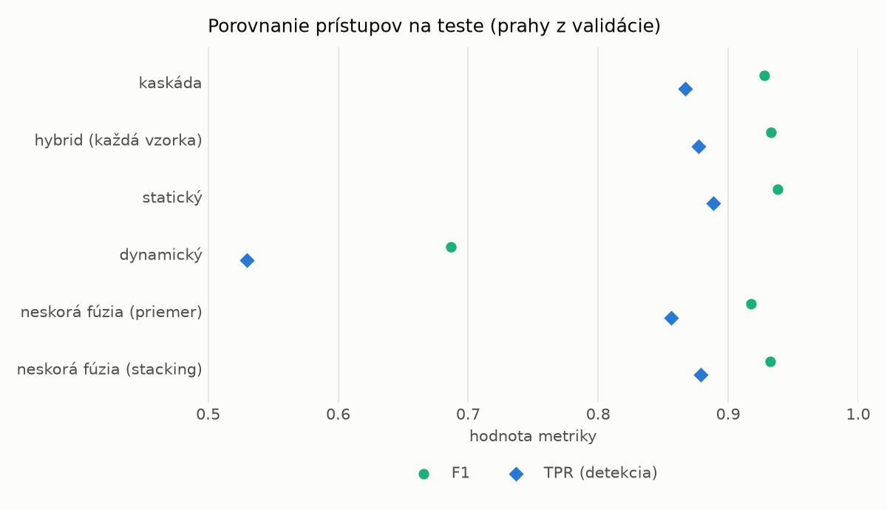
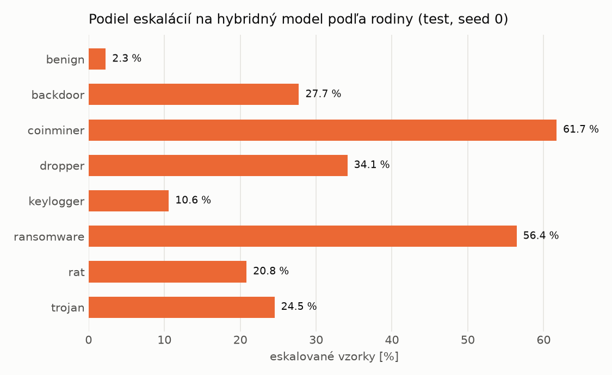

# Kaskáda `nokd` – beh `20261104-054950`

> Generované `src/cascade/evaluate.py` (2026-11-04T05:49:51+01:00). Seedy: [0, 1, 2]; hodnoty = priemer ± sm. odchýlka.
> Všetky prahy sú určené na validácii (FPR ≤ 1 %); test sa na nič nenastavuje.

| rola | beh |
|---|---|
| static | `runs_v2/lofo/keylogger/students_static/mlp_nokd/20261104-054616` |
| dynamic | `runs_v2/lofo/keylogger/students_dynamic/mlp_nokd/20261104-054815` |
| hybrid | `runs_v2/lofo/keylogger/hybrid/lightgbm/20261104-043557` |

## Test
| prístup | accuracy | balanced_accuracy | precision | recall_tpr | fpr | f1 | mcc |
|---|---|---|---|---|---|---|---|
| kaskáda | 0.9268 ± 0.0030 | 0.9323 ± 0.0027 | 0.9980 ± 0.0002 | 0.8667 ± 0.0057 | 0.0021 ± 0.0003 | 0.9277 ± 0.0032 | 0.8630 ± 0.0051 |
| hybrid (každá vzorka) | 0.9318 ± 0.0015 | 0.9368 ± 0.0013 | 0.9963 ± 0.0006 | 0.8775 ± 0.0032 | 0.0038 ± 0.0007 | 0.9331 ± 0.0016 | 0.8714 ± 0.0024 |
| statický | 0.9366 ± 0.0030 | 0.9409 ± 0.0027 | 0.9935 ± 0.0008 | 0.8888 ± 0.0062 | 0.0069 ± 0.0009 | 0.9382 ± 0.0031 | 0.8792 ± 0.0052 |
| dynamický | 0.7379 ± 0.0053 | 0.7570 ± 0.0049 | 0.9757 ± 0.0012 | 0.5297 ± 0.0093 | 0.0156 ± 0.0006 | 0.6866 ± 0.0081 | 0.5620 ± 0.0080 |
| neskorá fúzia (priemer) | 0.9169 ± 0.0058 | 0.9225 ± 0.0050 | 0.9890 ± 0.0047 | 0.8562 ± 0.0146 | 0.0113 ± 0.0050 | 0.9178 ± 0.0065 | 0.8436 ± 0.0090 |
| neskorá fúzia (stacking) | 0.9311 ± 0.0013 | 0.9359 ± 0.0011 | 0.9930 ± 0.0009 | 0.8792 ± 0.0026 | 0.0073 ± 0.0009 | 0.9326 ± 0.0013 | 0.8694 ± 0.0022 |

## Validácia
| prístup | accuracy | balanced_accuracy | precision | recall_tpr | fpr | f1 | mcc |
|---|---|---|---|---|---|---|---|
| kaskáda | 0.9952 ± 0.0001 | 0.9953 ± 0.0001 | 0.9977 ± 0.0003 | 0.9949 ± 0.0003 | 0.0042 ± 0.0005 | 0.9963 ± 0.0001 | 0.9895 ± 0.0002 |
| hybrid (každá vzorka) | 0.9954 ± 0.0004 | 0.9945 ± 0.0004 | 0.9955 ± 0.0003 | 0.9974 ± 0.0002 | 0.0085 ± 0.0006 | 0.9964 ± 0.0003 | 0.9897 ± 0.0008 |
| statický | 0.9929 ± 0.0002 | 0.9924 ± 0.0001 | 0.9952 ± 0.0002 | 0.9939 ± 0.0006 | 0.0090 ± 0.0004 | 0.9946 ± 0.0002 | 0.9843 ± 0.0005 |
| dynamický | 0.9611 ± 0.0017 | 0.9680 ± 0.0012 | 0.9947 ± 0.0001 | 0.9455 ± 0.0027 | 0.0096 ± 0.0002 | 0.9695 ± 0.0014 | 0.9183 ± 0.0033 |
| neskorá fúzia (priemer) | 0.9935 ± 0.0007 | 0.9928 ± 0.0006 | 0.9951 ± 0.0003 | 0.9949 ± 0.0011 | 0.0093 ± 0.0006 | 0.9950 ± 0.0006 | 0.9856 ± 0.0016 |
| neskorá fúzia (stacking) | 0.9942 ± 0.0001 | 0.9933 ± 0.0001 | 0.9949 ± 0.0001 | 0.9963 ± 0.0002 | 0.0097 ± 0.0002 | 0.9956 ± 0.0001 | 0.9872 ± 0.0002 |

## Správanie kaskády (test, seed 0)
- podiel eskalácií na hybrid: **21.26%** (3687 vzoriek)
- chyby pri zhode študentov (kaskáda ich nemôže opraviť): **922**
  (6.754% zo zhôd; FP 4, FN 918)
- úspešnosť na eskalovaných vzorkách: hybrid 0.9213452671548684, statický 0.9679956604285327,
  dynamický 0.03200433957146732  → prínos hybridu pri nezhode

## Výpočtové nároky (odhad z benchmarkov komponentov)
_Chýba benchmark niektorého komponentu (`python -m src.evaluation.benchmark`)._

