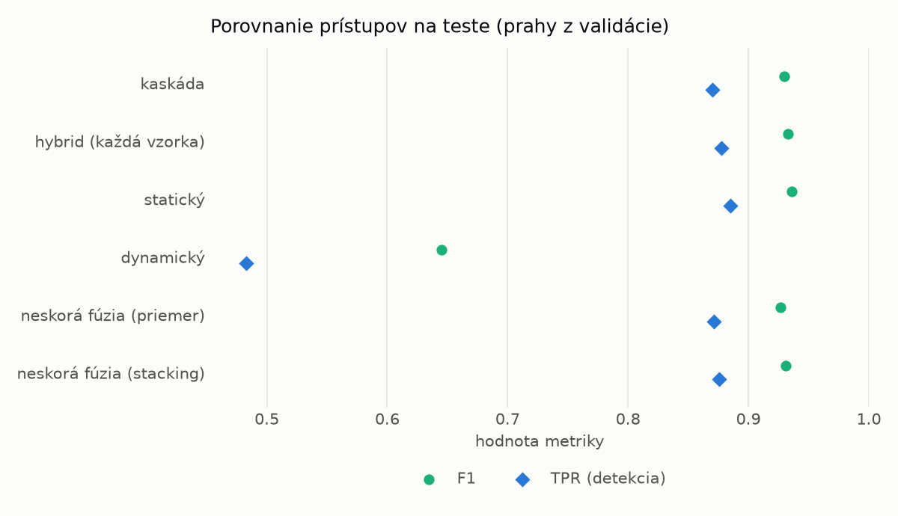
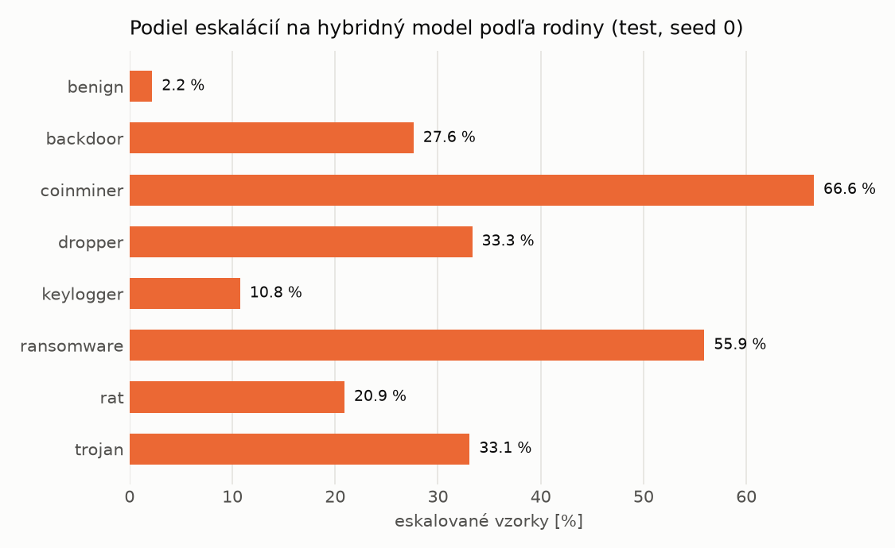

# Kaskáda `twobranch` – beh `20261104-054959`

> Generované `src/cascade/evaluate.py` (2026-11-04T05:49:59+01:00). Seedy: [0, 1, 2]; hodnoty = priemer ± sm. odchýlka.
> Všetky prahy sú určené na validácii (FPR ≤ 1 %); test sa na nič nenastavuje.

| rola | beh |
|---|---|
| static | `runs_v2/lofo/keylogger/students_static/mlp_kd_twobranch/20261104-054705` |
| dynamic | `runs_v2/lofo/keylogger/students_dynamic/mlp_kd_twobranch/20261104-054917` |
| hybrid | `runs_v2/lofo/keylogger/hybrid/lightgbm/20261104-043557` |

## Test
| prístup | accuracy | balanced_accuracy | precision | recall_tpr | fpr | f1 | mcc |
|---|---|---|---|---|---|---|---|
| kaskáda | 0.9288 ± 0.0016 | 0.9342 ± 0.0015 | 0.9982 ± 0.0001 | 0.8702 ± 0.0031 | 0.0018 ± 0.0001 | 0.9298 ± 0.0017 | 0.8666 ± 0.0028 |
| hybrid (každá vzorka) | 0.9318 ± 0.0015 | 0.9368 ± 0.0013 | 0.9963 ± 0.0006 | 0.8775 ± 0.0032 | 0.0038 ± 0.0007 | 0.9331 ± 0.0016 | 0.8714 ± 0.0024 |
| statický | 0.9343 ± 0.0078 | 0.9388 ± 0.0072 | 0.9928 ± 0.0002 | 0.8851 ± 0.0143 | 0.0076 ± 0.0001 | 0.9359 ± 0.0081 | 0.8750 ± 0.0139 |
| dynamický | 0.7134 ± 0.0308 | 0.7346 ± 0.0283 | 0.9763 ± 0.0022 | 0.4830 ± 0.0576 | 0.0139 ± 0.0015 | 0.6449 ± 0.0530 | 0.5277 ± 0.0440 |
| neskorá fúzia (priemer) | 0.9253 ± 0.0015 | 0.9302 ± 0.0016 | 0.9898 ± 0.0024 | 0.8711 ± 0.0007 | 0.0107 ± 0.0025 | 0.9267 ± 0.0015 | 0.8583 ± 0.0033 |
| neskorá fúzia (stacking) | 0.9293 ± 0.0026 | 0.9342 ± 0.0024 | 0.9930 ± 0.0002 | 0.8757 ± 0.0047 | 0.0073 ± 0.0002 | 0.9307 ± 0.0027 | 0.8662 ± 0.0045 |

## Validácia
| prístup | accuracy | balanced_accuracy | precision | recall_tpr | fpr | f1 | mcc |
|---|---|---|---|---|---|---|---|
| kaskáda | 0.9957 ± 0.0005 | 0.9957 ± 0.0006 | 0.9977 ± 0.0005 | 0.9957 ± 0.0003 | 0.0042 ± 0.0009 | 0.9967 ± 0.0004 | 0.9906 ± 0.0011 |
| hybrid (každá vzorka) | 0.9954 ± 0.0004 | 0.9945 ± 0.0004 | 0.9955 ± 0.0003 | 0.9974 ± 0.0002 | 0.0085 ± 0.0006 | 0.9964 ± 0.0003 | 0.9897 ± 0.0008 |
| statický | 0.9938 ± 0.0004 | 0.9931 ± 0.0003 | 0.9951 ± 0.0003 | 0.9954 ± 0.0006 | 0.0093 ± 0.0006 | 0.9952 ± 0.0003 | 0.9863 ± 0.0008 |
| dynamický | 0.9539 ± 0.0092 | 0.9624 ± 0.0070 | 0.9945 ± 0.0001 | 0.9346 ± 0.0142 | 0.0097 ± 0.0002 | 0.9636 ± 0.0076 | 0.9044 ± 0.0176 |
| neskorá fúzia (priemer) | 0.9937 ± 0.0009 | 0.9931 ± 0.0010 | 0.9954 ± 0.0007 | 0.9950 ± 0.0010 | 0.0087 ± 0.0013 | 0.9952 ± 0.0007 | 0.9861 ± 0.0021 |
| neskorá fúzia (stacking) | 0.9941 ± 0.0005 | 0.9933 ± 0.0003 | 0.9949 ± 0.0001 | 0.9961 ± 0.0009 | 0.0096 ± 0.0002 | 0.9955 ± 0.0004 | 0.9870 ± 0.0011 |

## Správanie kaskády (test, seed 0)
- podiel eskalácií na hybrid: **22.18%** (3846 vzoriek)
- chyby pri zhode študentov (kaskáda ich nemôže opraviť): **917**
  (6.796% zo zhôd; FP 4, FN 913)
- úspešnosť na eskalovaných vzorkách: hybrid 0.9248569942797712, statický 0.9732189287571503,
  dynamický 0.026781071242849713  → prínos hybridu pri nezhode

## Výpočtové nároky (odhad z benchmarkov komponentov)
_Chýba benchmark niektorého komponentu (`python -m src.evaluation.benchmark`)._

