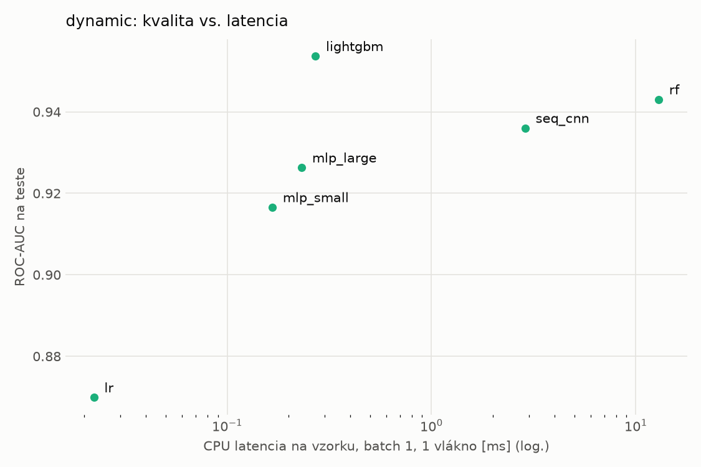
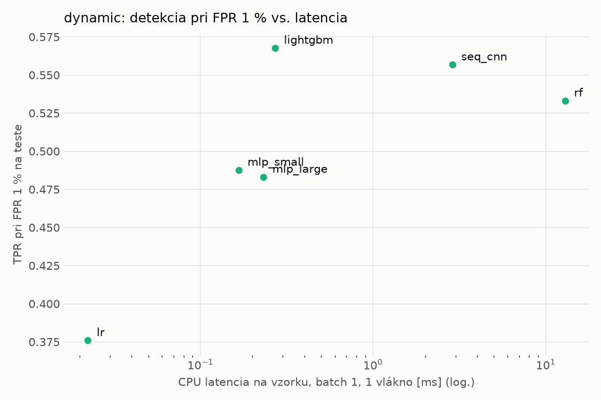
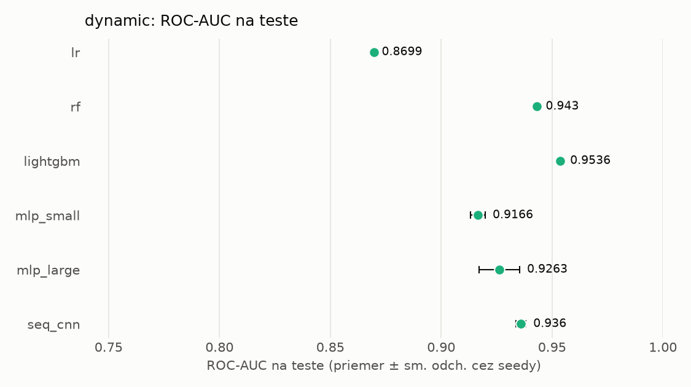
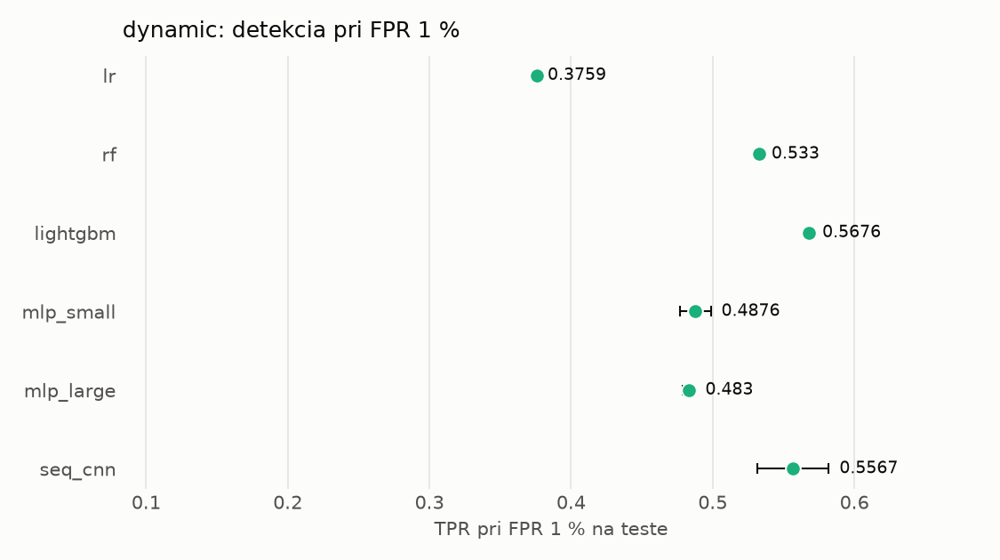

# Porovnanie modelov – dynamic

> Generované `src/evaluation/compare.py` (2026-11-04T04:28:22+01:00); použitý je posledný beh každého modelu.
> Metriky sú priemer cez seedy. \* = pri prahu určenom na validácii (FPR ≤ 1 %).
> CPU ms/vz. = medián latencie jednej vzorky na 1 vlákne vrátane transformácie vstupu (meranie hneď po tréningu,
> orientačné). Oficiálne merania spotreby sú v časti „Spotreba zdrojov pri inferencii“.

## Detekčná kvalita a orientačné časy
| model | ROC-AUC val | ROC-AUC test | TPR@FPR 1 % test | TPR@FPR 0,1 % test | F1 test* | FPR test* | gap train−val | CPU ms/vz. | CPU vz./s | GPU ms/vz. | parametre | MB | tréning s | ladenie min |
|---|---|---|---|---|---|---|---|---|---|---|---|---|---|---|
| [lr](../../dynamic/lr/20261104-040040/README.md) | 0.9955 | 0.8699 ± 0.0000 | 0.3759 | 0.2560 | 0.6483 | 0.0542 | 0.0012 | 0.022 | 335 822 | – | 2 001 | 0.06 | 5.0 | 0.0 |
| [rf](../../dynamic/rf/20261104-040102/README.md) | 0.9974 | 0.9430 ± 0.0008 | 0.5330 | 0.0000 | 0.7455 | 0.0190 | 0.0017 | 12.944 | 78 727 | – | 954 362 | 76.78 | 33.9 | 0.0 |
| [lightgbm](../../dynamic/lightgbm/20261104-040254/README.md) | 0.9977 | 0.9536 ± 0.0012 | 0.5676 | 0.3138 | 0.8216 | 0.0249 | 0.0014 | 0.271 | 54 594 | – | 683 218 | 38.86 | 26.5 | 0.0 |
| [mlp_small](../../dynamic/mlp_small/20261104-040436/README.md) | 0.9968 | 0.9166 ± 0.0033 | 0.4876 | 0.2686 | 0.6850 | 0.0129 | 0.0013 | 0.167 | 86 765 | 0.343 | 546 049 | 2.24 | 4.0 | 0.0 |
| [mlp_large](../../dynamic/mlp_large/20261104-040456/README.md) | 0.9967 | 0.9263 ± 0.0091 | 0.4830 | 0.3034 | 0.6823 | 0.0144 | 0.0010 | 0.232 | 101 825 | 0.523 | 1 190 657 | 4.83 | 10.3 | 0.0 |
| [seq_cnn](../../dynamic/seq_cnn/20261104-040535/README.md) | 0.9975 | 0.9360 ± 0.0022 | 0.5567 | 0.3178 | 0.7597 | 0.0147 | 0.0011 | 2.876 | 1 260 | 0.817 | 209 345 | 0.84 | 419.3 | 0.0 |

## Nízka prevalencia malvéru (test, prah z validácie)
| model | TPR | FPR | precision @ 1 % | falošné na 1 skutočný poplach @ 1 % | precision @ 0.1 % | falošné na 1 skutočný poplach @ 0.1 % |
|---|---|---|---|---|---|---|
| lr | 0.5015 | 0.0542 | 0.086 | 10.69 | 0.009 | 107.87 |
| rf | 0.6044 | 0.0190 | 0.243 | 3.11 | 0.031 | 31.36 |
| lightgbm | 0.7120 | 0.0249 | 0.224 | 3.46 | 0.028 | 34.93 |
| mlp_small | 0.5267 | 0.0129 | 0.292 | 2.43 | 0.039 | 24.53 |
| mlp_large | 0.5241 | 0.0144 | 0.269 | 2.72 | 0.035 | 27.45 |
| seq_cnn | 0.6202 | 0.0147 | 0.299 | 2.35 | 0.041 | 23.67 |

Prepočet: TPR a FPR nezávisia od podielu malvéru, preto sa dajú preniesť na nízku prevalenciu (v reálnej prevádzke je malvéru ~1 % alebo menej; v teste 54 %). „Falošné na 1 skutočný poplach“ = koľko neškodných súborov je označených na každý zachytený malvér.

## Spotreba zdrojov pri inferencii (benchmark, testovacia množina)
_Benchmark zatiaľ nebol spustený (`python -m src.evaluation.benchmark --approach dynamic`)._

## Grafy

