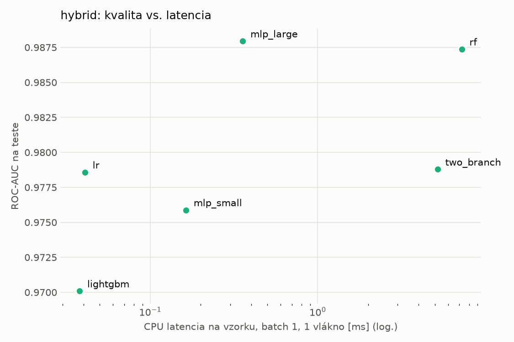
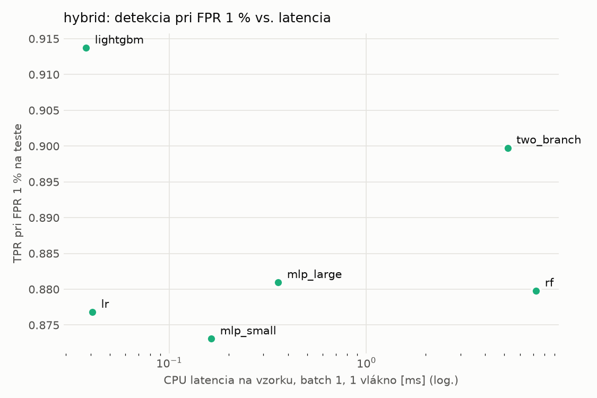
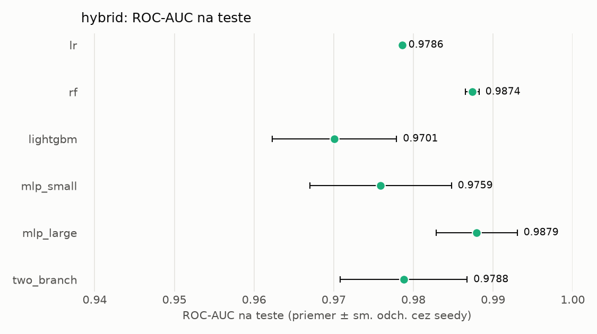
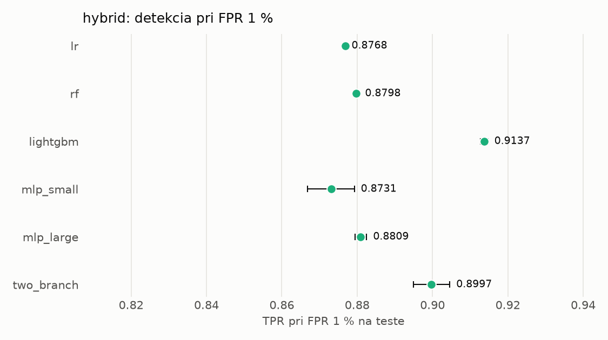

# Porovnanie modelov – hybrid

> Generované `src/evaluation/compare.py` (2026-11-04T04:56:45+01:00); použitý je posledný beh každého modelu.
> Metriky sú priemer cez seedy. \* = pri prahu určenom na validácii (FPR ≤ 1 %).
> CPU ms/vz. = medián latencie jednej vzorky na 1 vlákne vrátane transformácie vstupu (meranie hneď po tréningu,
> orientačné). Oficiálne merania spotreby sú v časti „Spotreba zdrojov pri inferencii“.

## Detekčná kvalita a orientačné časy
| model | ROC-AUC val | ROC-AUC test | TPR@FPR 1 % test | TPR@FPR 0,1 % test | F1 test* | FPR test* | gap train−val | CPU ms/vz. | CPU vz./s | GPU ms/vz. | parametre | MB | tréning s | ladenie min |
|---|---|---|---|---|---|---|---|---|---|---|---|---|---|---|
| [lr](../../hybrid/lr/20261104-042825/README.md) | 0.9992 | 0.9786 ± 0.0000 | 0.8768 | 0.6912 | 0.9285 | 0.0083 | 0.0006 | 0.041 | 158 017 | – | 4 320 | 0.13 | 4.9 | 0.0 |
| [rf](../../hybrid/rf/20261104-042855/README.md) | 0.9998 | 0.9874 ± 0.0009 | 0.8798 | 0.8304 | 0.9318 | 0.0080 | 0.0002 | 7.242 | 97 505 | – | 247 856 | 20.18 | 137.9 | 0.0 |
| [lightgbm](../../hybrid/lightgbm/20261104-043557/README.md) | 0.9998 | 0.9701 ± 0.0078 | 0.9137 | 0.8584 | 0.9331 | 0.0038 | 0.0002 | 0.038 | 254 643 | – | 19 614 | 1.16 | 14.5 | 0.0 |
| [mlp_small](../../hybrid/mlp_small/20261104-043644/README.md) | 0.9997 | 0.9759 ± 0.0089 | 0.8731 | 0.7693 | 0.9265 | 0.0079 | 0.0003 | 0.164 | 33 647 | 0.418 | 138 881 | 0.67 | 5.5 | 0.0 |
| [mlp_large](../../hybrid/mlp_large/20261104-043720/README.md) | 0.9996 | 0.9879 ± 0.0051 | 0.8809 | 0.8029 | 0.9285 | 0.0058 | 0.0004 | 0.357 | 28 807 | 0.509 | 2 386 305 | 9.67 | 6.8 | 0.0 |
| [two_branch](../../hybrid/two_branch/20261104-043800/README.md) | 0.9996 | 0.9788 ± 0.0080 | 0.8997 | 0.7450 | 0.9402 | 0.0067 | 0.0003 | 5.195 | 651 | 1.236 | 1 756 930 | 7.10 | 308.8 | 0.0 |

## Nízka prevalencia malvéru (test, prah z validácie)
| model | TPR | FPR | precision @ 1 % | falošné na 1 skutočný poplach @ 1 % | precision @ 0.1 % | falošné na 1 skutočný poplach @ 0.1 % |
|---|---|---|---|---|---|---|
| lr | 0.8725 | 0.0083 | 0.515 | 0.94 | 0.095 | 9.52 |
| rf | 0.8781 | 0.0080 | 0.527 | 0.90 | 0.099 | 9.07 |
| lightgbm | 0.8775 | 0.0038 | 0.699 | 0.43 | 0.187 | 4.35 |
| mlp_small | 0.8689 | 0.0079 | 0.525 | 0.90 | 0.099 | 9.12 |
| mlp_large | 0.8708 | 0.0058 | 0.601 | 0.66 | 0.130 | 6.69 |
| two_branch | 0.8922 | 0.0067 | 0.573 | 0.75 | 0.117 | 7.52 |

Prepočet: TPR a FPR nezávisia od podielu malvéru, preto sa dajú preniesť na nízku prevalenciu (v reálnej prevádzke je malvéru ~1 % alebo menej; v teste 54 %). „Falošné na 1 skutočný poplach“ = koľko neškodných súborov je označených na každý zachytený malvér.

## Spotreba zdrojov pri inferencii (benchmark, testovacia množina)
_Benchmark zatiaľ nebol spustený (`python -m src.evaluation.benchmark --approach hybrid`)._

## Grafy

