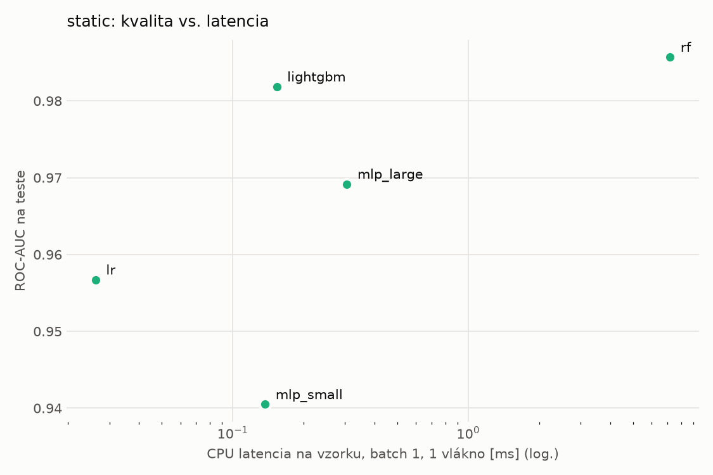
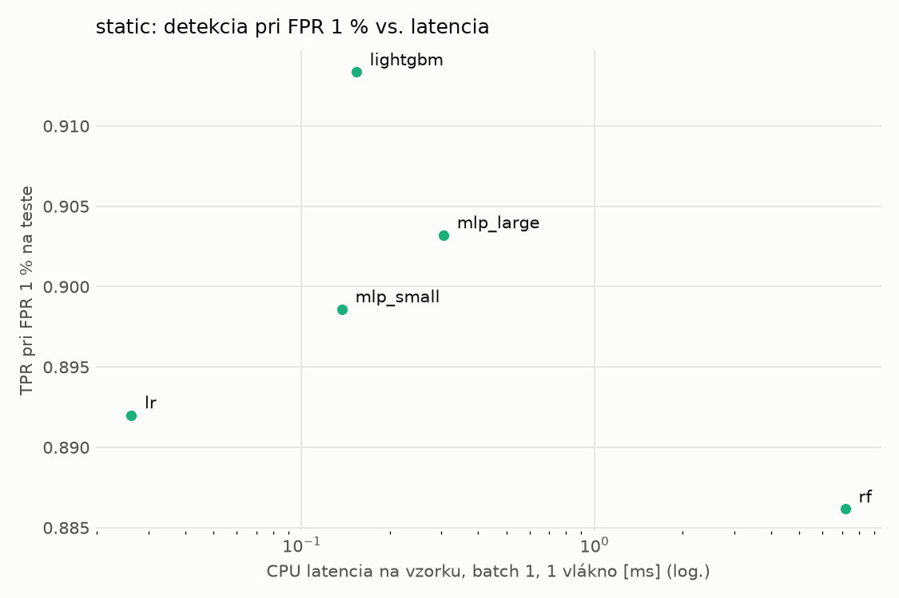
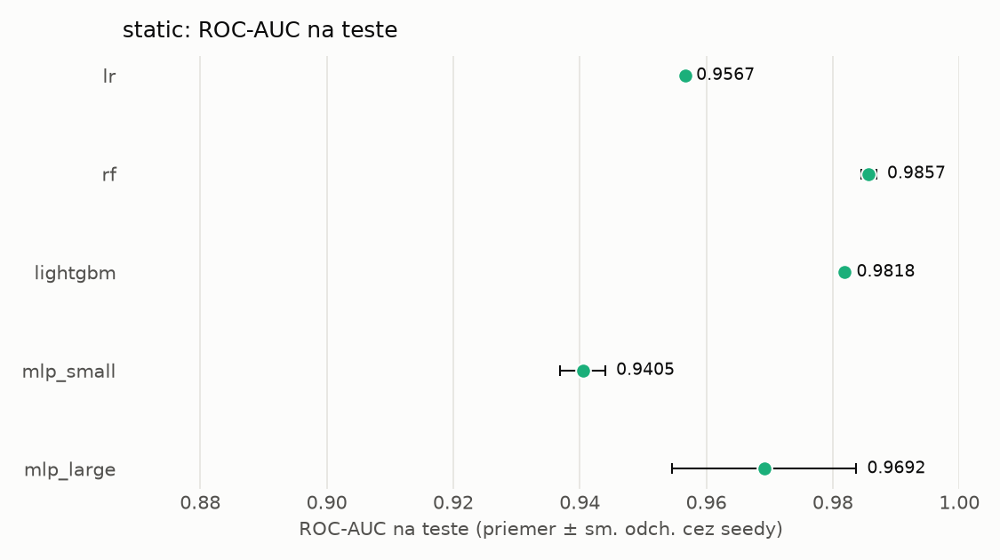
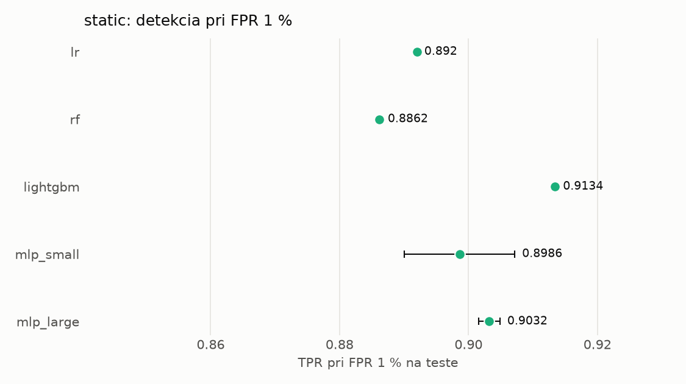

# Porovnanie modelov – static

> Generované `src/evaluation/compare.py` (2026-11-04T04:00:37+01:00); použitý je posledný beh každého modelu.
> Metriky sú priemer cez seedy. \* = pri prahu určenom na validácii (FPR ≤ 1 %).
> CPU ms/vz. = medián latencie jednej vzorky na 1 vlákne vrátane transformácie vstupu (meranie hneď po tréningu,
> orientačné). Oficiálne merania spotreby sú v časti „Spotreba zdrojov pri inferencii“.

## Detekčná kvalita a orientačné časy
| model | ROC-AUC val | ROC-AUC test | TPR@FPR 1 % test | TPR@FPR 0,1 % test | F1 test* | FPR test* | gap train−val | CPU ms/vz. | CPU vz./s | GPU ms/vz. | parametre | MB | tréning s | ladenie min |
|---|---|---|---|---|---|---|---|---|---|---|---|---|---|---|
| [lr](../../static/lr/20261104-034610/README.md) | 0.9988 | 0.9567 ± 0.0000 | 0.8920 | 0.2797 | 0.9354 | 0.0088 | 0.0009 | 0.026 | 299 192 | – | 2 320 | 0.07 | 2.1 | 0.0 |
| [rf](../../static/rf/20261104-034625/README.md) | 0.9998 | 0.9857 ± 0.0012 | 0.8862 | 0.8230 | 0.9315 | 0.0071 | 0.0002 | 7.185 | 129 432 | – | 344 892 | 27.95 | 25.3 | 0.0 |
| [lightgbm](../../static/lightgbm/20261104-034747/README.md) | 0.9998 | 0.9818 ± 0.0002 | 0.9134 | 0.8551 | 0.9489 | 0.0048 | 0.0002 | 0.154 | 95 569 | – | 239 078 | 13.90 | 232.3 | 0.0 |
| [mlp_small](../../static/mlp_small/20261104-035940/README.md) | 0.9996 | 0.9405 ± 0.0036 | 0.8986 | 0.7204 | 0.9402 | 0.0071 | 0.0003 | 0.137 | 61 087 | 0.454 | 74 881 | 0.36 | 6.3 | 0.0 |
| [mlp_large](../../static/mlp_large/20261104-040009/README.md) | 0.9997 | 0.9692 ± 0.0146 | 0.9032 | 0.8098 | 0.9437 | 0.0066 | 0.0002 | 0.306 | 82 327 | 0.603 | 1 364 417 | 5.53 | 6.0 | 0.0 |

## Nízka prevalencia malvéru (test, prah z validácie)
| model | TPR | FPR | precision @ 1 % | falošné na 1 skutočný poplach @ 1 % | precision @ 0.1 % | falošné na 1 skutočný poplach @ 0.1 % |
|---|---|---|---|---|---|---|
| lr | 0.8852 | 0.0088 | 0.504 | 0.99 | 0.091 | 9.95 |
| rf | 0.8769 | 0.0071 | 0.555 | 0.80 | 0.110 | 8.08 |
| lightgbm | 0.9065 | 0.0048 | 0.655 | 0.53 | 0.158 | 5.32 |
| mlp_small | 0.8925 | 0.0071 | 0.558 | 0.79 | 0.111 | 7.99 |
| mlp_large | 0.8983 | 0.0066 | 0.579 | 0.73 | 0.120 | 7.33 |

Prepočet: TPR a FPR nezávisia od podielu malvéru, preto sa dajú preniesť na nízku prevalenciu (v reálnej prevádzke je malvéru ~1 % alebo menej; v teste 54 %). „Falošné na 1 skutočný poplach“ = koľko neškodných súborov je označených na každý zachytený malvér.

## Spotreba zdrojov pri inferencii (benchmark, testovacia množina)
_Benchmark zatiaľ nebol spustený (`python -m src.evaluation.benchmark --approach static`)._

## Grafy

