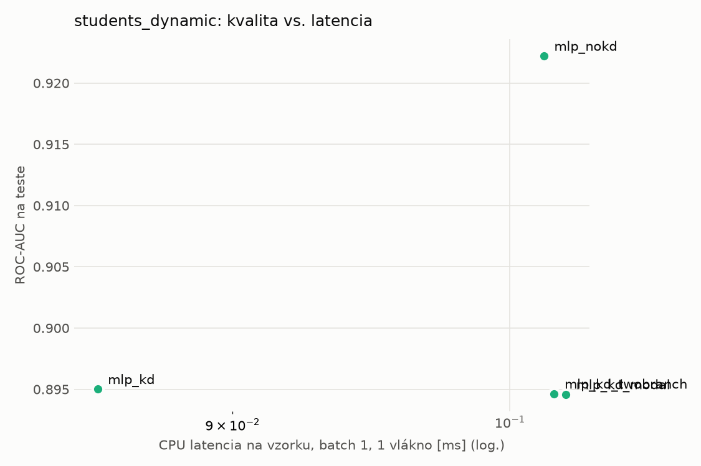
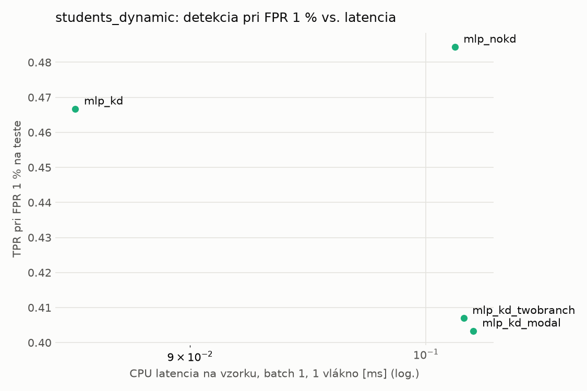
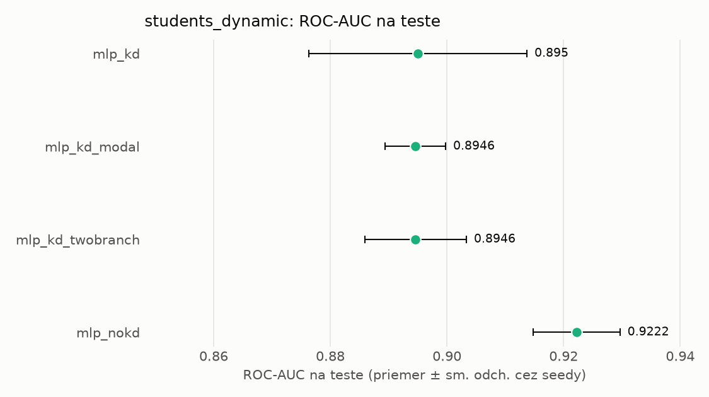
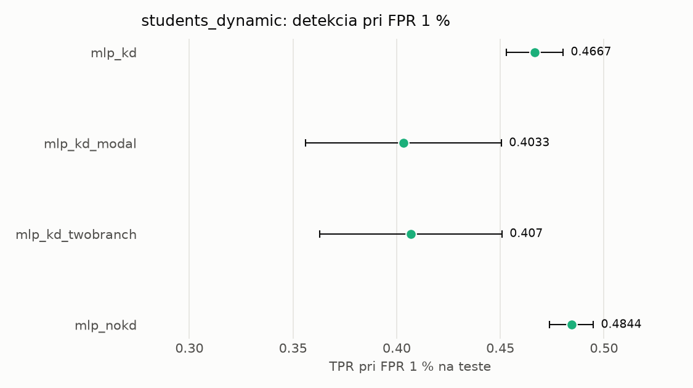

# Porovnanie modelov – students_dynamic

> Generované `src/evaluation/compare.py` (2026-11-04T05:49:46+01:00); použitý je posledný beh každého modelu.
> Metriky sú priemer cez seedy. \* = pri prahu určenom na validácii (FPR ≤ 1 %).
> CPU ms/vz. = medián latencie jednej vzorky na 1 vlákne vrátane transformácie vstupu (meranie hneď po tréningu,
> orientačné). Oficiálne merania spotreby sú v časti „Spotreba zdrojov pri inferencii“.

## Detekčná kvalita a orientačné časy
| model | ROC-AUC val | ROC-AUC test | TPR@FPR 1 % test | TPR@FPR 0,1 % test | F1 test* | FPR test* | gap train−val | CPU ms/vz. | CPU vz./s | GPU ms/vz. | parametre | MB | tréning s | ladenie min |
|---|---|---|---|---|---|---|---|---|---|---|---|---|---|---|
| [mlp_kd](../../students_dynamic/mlp_kd/20261104-054737/README.md) | 0.9969 | 0.8950 ± 0.0187 | 0.4667 | 0.2933 | 0.6704 | 0.0141 | 0.0012 | 0.086 | 141 290 | 0.292 | 64 129 | 0.31 | 9.8 | 0.0 |
| [mlp_kd_modal](../../students_dynamic/mlp_kd_modal/20261104-054838/README.md) | 0.9968 | 0.8946 ± 0.0052 | 0.4033 | 0.2775 | 0.6086 | 0.0128 | 0.0013 | 0.102 | 139 338 | 0.276 | 64 129 | 0.31 | 10.5 | 0.0 |
| [mlp_kd_twobranch](../../students_dynamic/mlp_kd_twobranch/20261104-054917/README.md) | 0.9968 | 0.8946 ± 0.0087 | 0.4070 | 0.2860 | 0.6449 | 0.0139 | 0.0012 | 0.102 | 96 174 | 0.452 | 64 129 | 0.31 | 6.7 | 0.0 |
| [mlp_nokd](../../students_dynamic/mlp_nokd/20261104-054815/README.md) | 0.9968 | 0.9222 ± 0.0074 | 0.4844 | 0.3452 | 0.6866 | 0.0156 | 0.0010 | 0.101 | 139 453 | 0.274 | 64 129 | 0.31 | 5.1 | 0.0 |

## Nízka prevalencia malvéru (test, prah z validácie)
| model | TPR | FPR | precision @ 1 % | falošné na 1 skutočný poplach @ 1 % | precision @ 0.1 % | falošné na 1 skutočný poplach @ 0.1 % |
|---|---|---|---|---|---|---|
| mlp_kd | 0.5102 | 0.0141 | 0.268 | 2.73 | 0.035 | 27.54 |
| mlp_kd_modal | 0.4430 | 0.0128 | 0.259 | 2.86 | 0.033 | 28.88 |
| mlp_kd_twobranch | 0.4830 | 0.0139 | 0.260 | 2.84 | 0.034 | 28.65 |
| mlp_nokd | 0.5297 | 0.0156 | 0.255 | 2.92 | 0.033 | 29.46 |

Prepočet: TPR a FPR nezávisia od podielu malvéru, preto sa dajú preniesť na nízku prevalenciu (v reálnej prevádzke je malvéru ~1 % alebo menej; v teste 54 %). „Falošné na 1 skutočný poplach“ = koľko neškodných súborov je označených na každý zachytený malvér.

## Spotreba zdrojov pri inferencii (benchmark, testovacia množina)
_Benchmark zatiaľ nebol spustený (`python -m src.evaluation.benchmark --approach students_dynamic`)._

## Grafy

