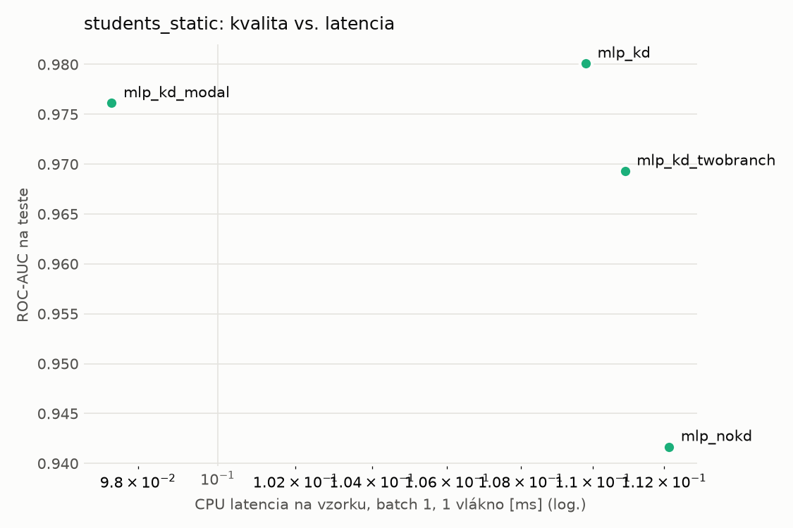
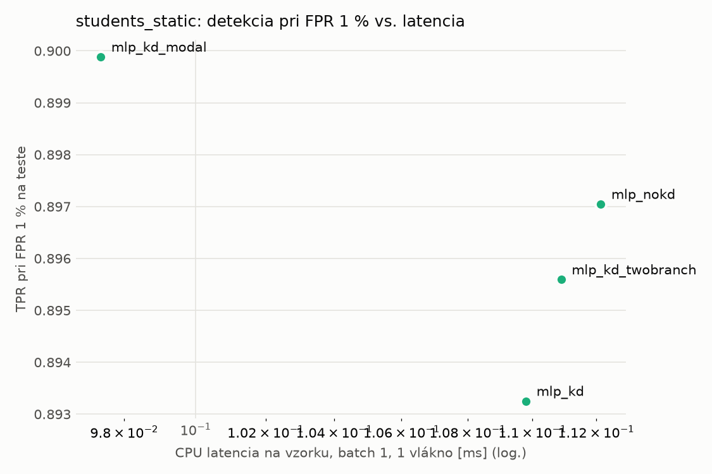
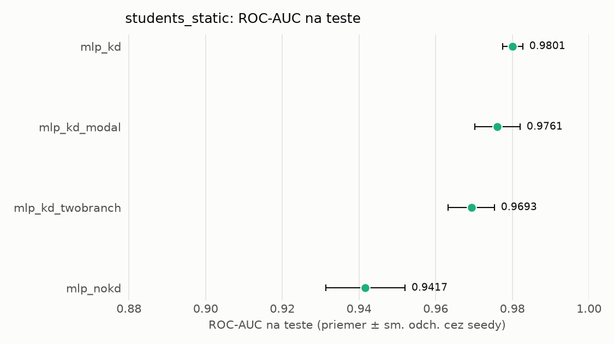
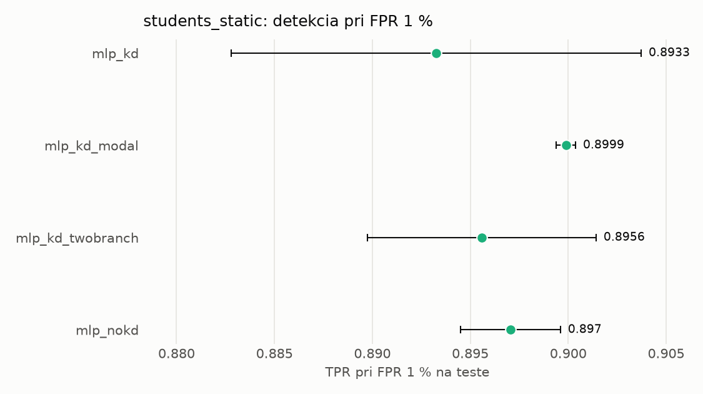

# Porovnanie modelov – students_static

> Generované `src/evaluation/compare.py` (2026-11-04T05:47:34+01:00); použitý je posledný beh každého modelu.
> Metriky sú priemer cez seedy. \* = pri prahu určenom na validácii (FPR ≤ 1 %).
> CPU ms/vz. = medián latencie jednej vzorky na 1 vlákne vrátane transformácie vstupu (meranie hneď po tréningu,
> orientačné). Oficiálne merania spotreby sú v časti „Spotreba zdrojov pri inferencii“.

## Detekčná kvalita a orientačné časy
| model | ROC-AUC val | ROC-AUC test | TPR@FPR 1 % test | TPR@FPR 0,1 % test | F1 test* | FPR test* | gap train−val | CPU ms/vz. | CPU vz./s | GPU ms/vz. | parametre | MB | tréning s | ladenie min |
|---|---|---|---|---|---|---|---|---|---|---|---|---|---|---|
| [mlp_kd](../../students_static/mlp_kd/20261104-054525/README.md) | 0.9995 | 0.9801 ± 0.0026 | 0.8933 | 0.6514 | 0.9380 | 0.0058 | 0.0003 | 0.110 | 52 927 | 0.296 | 74 337 | 0.36 | 13.7 | 0.0 |
| [mlp_kd_modal](../../students_static/mlp_kd_modal/20261104-054633/README.md) | 0.9992 | 0.9761 ± 0.0059 | 0.8999 | 0.5807 | 0.9344 | 0.0065 | 0.0007 | 0.097 | 60 994 | 0.278 | 74 337 | 0.36 | 7.5 | 0.0 |
| [mlp_kd_twobranch](../../students_static/mlp_kd_twobranch/20261104-054705/README.md) | 0.9992 | 0.9693 ± 0.0060 | 0.8956 | 0.4458 | 0.9359 | 0.0076 | 0.0007 | 0.111 | 109 382 | 0.288 | 74 337 | 0.36 | 6.6 | 0.0 |
| [mlp_nokd](../../students_static/mlp_nokd/20261104-054616/README.md) | 0.9991 | 0.9417 ± 0.0103 | 0.8970 | 0.3239 | 0.9382 | 0.0069 | 0.0008 | 0.112 | 106 450 | 0.346 | 74 337 | 0.36 | 2.8 | 0.0 |

## Nízka prevalencia malvéru (test, prah z validácie)
| model | TPR | FPR | precision @ 1 % | falošné na 1 skutočný poplach @ 1 % | precision @ 0.1 % | falošné na 1 skutočný poplach @ 0.1 % |
|---|---|---|---|---|---|---|
| mlp_kd | 0.8876 | 0.0058 | 0.607 | 0.65 | 0.133 | 6.52 |
| mlp_kd_modal | 0.8817 | 0.0065 | 0.579 | 0.73 | 0.120 | 7.33 |
| mlp_kd_twobranch | 0.8851 | 0.0076 | 0.542 | 0.85 | 0.105 | 8.53 |
| mlp_nokd | 0.8888 | 0.0069 | 0.566 | 0.77 | 0.114 | 7.74 |

Prepočet: TPR a FPR nezávisia od podielu malvéru, preto sa dajú preniesť na nízku prevalenciu (v reálnej prevádzke je malvéru ~1 % alebo menej; v teste 54 %). „Falošné na 1 skutočný poplach“ = koľko neškodných súborov je označených na každý zachytený malvér.

## Spotreba zdrojov pri inferencii (benchmark, testovacia množina)
_Benchmark zatiaľ nebol spustený (`python -m src.evaluation.benchmark --approach students_static`)._

## Grafy

