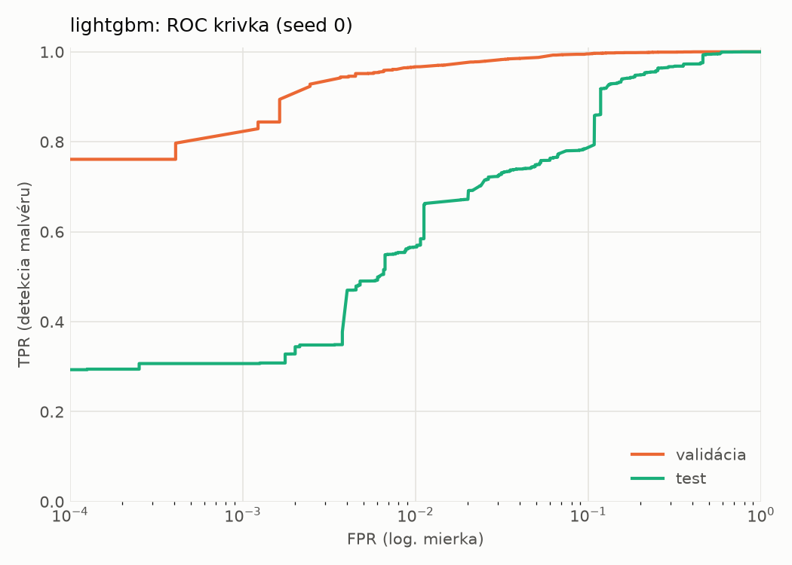
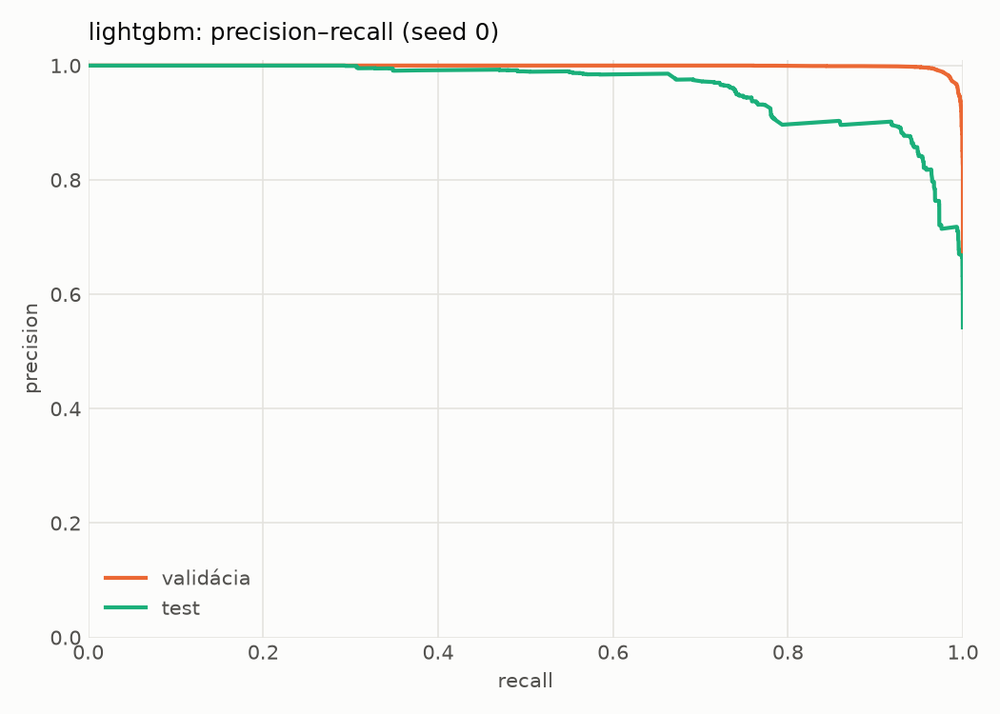
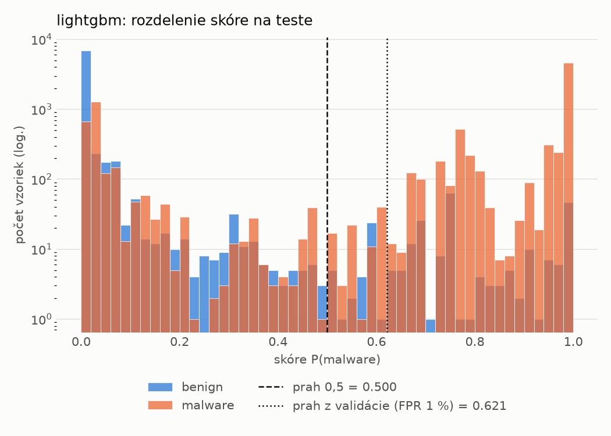
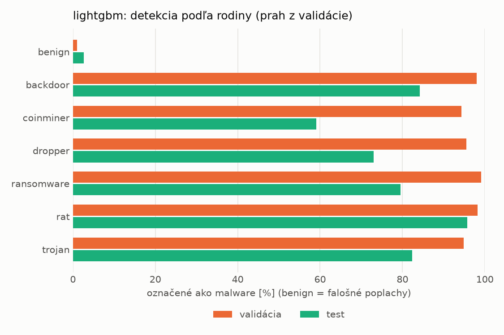
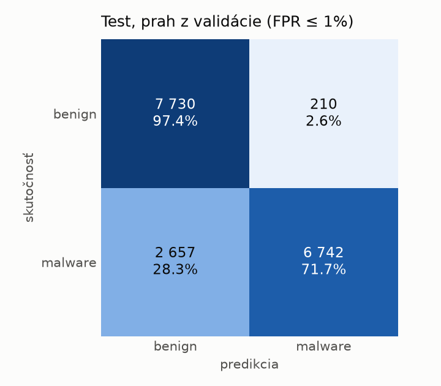
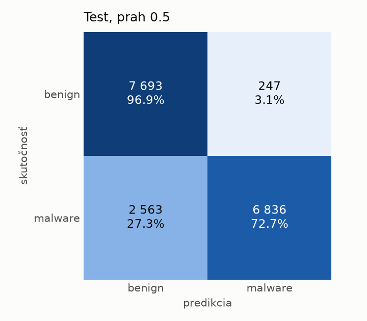
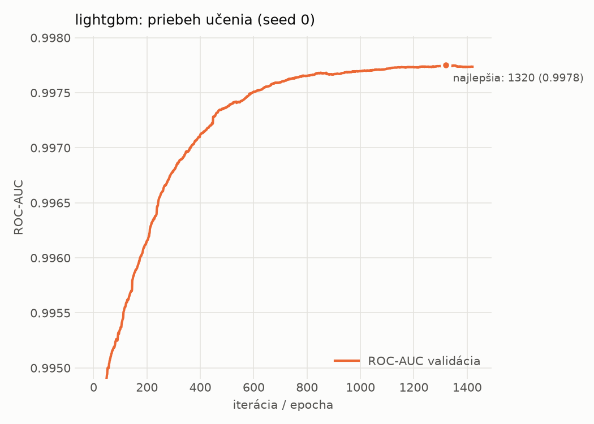

# dynamic/lightgbm – beh `20261104-040254`

> Automaticky generované (`src/training/run_tabular.py`). Konfigurácia: `config.yaml`, protokol: `protocol.yaml`.

- **Model:** `lightgbm` – LightGBM, gradient boosting stromov s early stopping na validácii (pôvodné hodnoty príznakov)
- **Ladenie:** bez ladenia – hyperparametre prevzaté z `runs_final/dynamic/lightgbm/20261102-003953`
- **Finálne modely:** seedy [0, 1, 2]; hodnoty sú priemer ± smerodajná odchýlka cez seedy
- **Najlepšie hyperparametre:** `{"num_boost_round": 5000, "early_stopping_rounds": 100, "learning_rate": 0.012600391102852807, "num_leaves": 261, "min_child_samples": 12, "feature_fraction": 0.7323605840883831, "bagging_fraction": 0.7241803281580393, "lambda_l1": 9.843384499248837e-06, "lambda_l2": 0.7301583949167907}`

## Detekčná kvalita (bez prahu)
| metrika | train (podvzorka) | validácia | test |
|---|---|---|---|
| ROC-AUC | 0.9991 ± 0.0000 | 0.9977 ± 0.0000 | 0.9536 ± 0.0012 |
| PR-AUC | 0.9995 ± 0.0000 | 0.9988 ± 0.0000 | 0.9621 ± 0.0008 |
| TPR pri FPR 1 % | 0.9775 ± 0.0002 | 0.9663 ± 0.0003 | 0.5676 ± 0.0022 |
| TPR pri FPR 0,1 % | 0.9603 ± 0.0004 | 0.7934 ± 0.0032 | 0.3138 ± 0.0063 |
| log loss | 0.0380 ± 0.0003 | 0.0595 ± 0.0001 | 0.5995 ± 0.0099 |
| Brier skóre | 0.0116 ± 0.0001 | 0.0167 ± 0.0000 | 0.1477 ± 0.0009 |

Rozdiel ROC-AUC train − validácia: **0.0014** (veľký rozdiel = preučenie).

## Pri prahu z validácie (FPR ≤ 1% na validácii)
| metrika | train (podvzorka) | validácia | test |
|---|---|---|---|
| accuracy | 0.9811 ± 0.0002 | 0.9746 ± 0.0002 | 0.8325 ± 0.0059 |
| balanced accuracy | 0.9847 ± 0.0002 | 0.9782 ± 0.0002 | 0.8435 ± 0.0052 |
| precision | 0.9981 ± 0.0000 | 0.9946 ± 0.0000 | 0.9713 ± 0.0024 |
| recall (TPR) | 0.9727 ± 0.0003 | 0.9663 ± 0.0003 | 0.7120 ± 0.0130 |
| FPR | 0.0034 ± 0.0000 | 0.0098 ± 0.0000 | 0.0249 ± 0.0026 |
| F1 | 0.9852 ± 0.0002 | 0.9803 ± 0.0002 | 0.8216 ± 0.0078 |
| MCC | 0.9597 ± 0.0004 | 0.9454 ± 0.0004 | 0.6996 ± 0.0081 |

## Pri pevnom prahu 0.5
| metrika | train (podvzorka) | validácia | test |
|---|---|---|---|
| accuracy | 0.9835 ± 0.0001 | 0.9755 ± 0.0002 | 0.8380 ± 0.0010 |
| balanced accuracy | 0.9860 ± 0.0001 | 0.9777 ± 0.0002 | 0.8482 ± 0.0009 |
| precision | 0.9970 ± 0.0000 | 0.9919 ± 0.0001 | 0.9655 ± 0.0003 |
| recall (TPR) | 0.9775 ± 0.0002 | 0.9704 ± 0.0002 | 0.7272 ± 0.0019 |
| FPR | 0.0054 ± 0.0000 | 0.0149 ± 0.0002 | 0.0308 ± 0.0003 |
| F1 | 0.9871 ± 0.0001 | 0.9810 ± 0.0002 | 0.8296 ± 0.0012 |
| MCC | 0.9645 ± 0.0002 | 0.9469 ± 0.0005 | 0.7059 ± 0.0016 |

## Výpočtové nároky (seed 0, testovacia množina)
| meranie | hodnota |
|---|---|
| tréning finálneho modelu | 26.5 s (priemer cez seedy) |
| ladenie spolu | 0 s |
| počet parametrov / uzlov | 683 218 |
| veľkosť modelu na disku | 38.86 MB |
| CPU latencia modelu (batch 1, 1 vlákno) | 0.271 ms (p95 0.333) |
| CPU priepustnosť (24 vlákien) | 54 594 vzoriek/s |

## Grafy
| | |
|---|---|
|  |  |
|  |  |
|  |  |
|  |  |

## Súbory
`metrics.json` (všetky metriky po seedoch vrátane rodín), `timing.json`, `hpo_trials.csv`,
`predictions/<časť>_seed<N>.parquet` (sha256, family, label, score), `model/seed_<N>/`, `log.txt`.
