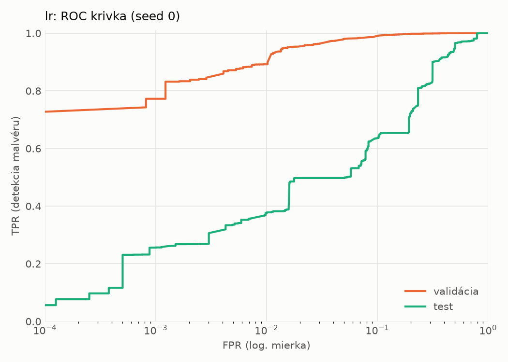
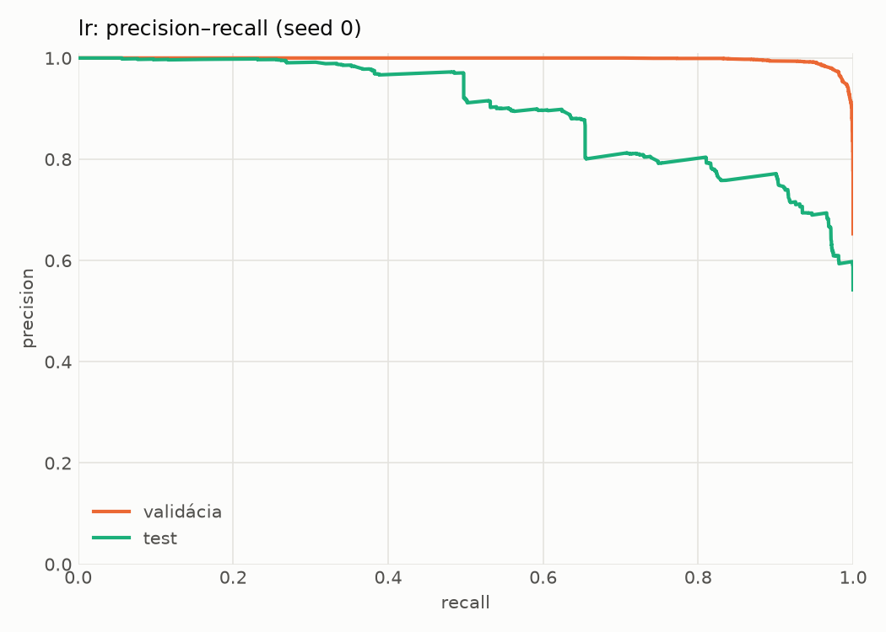
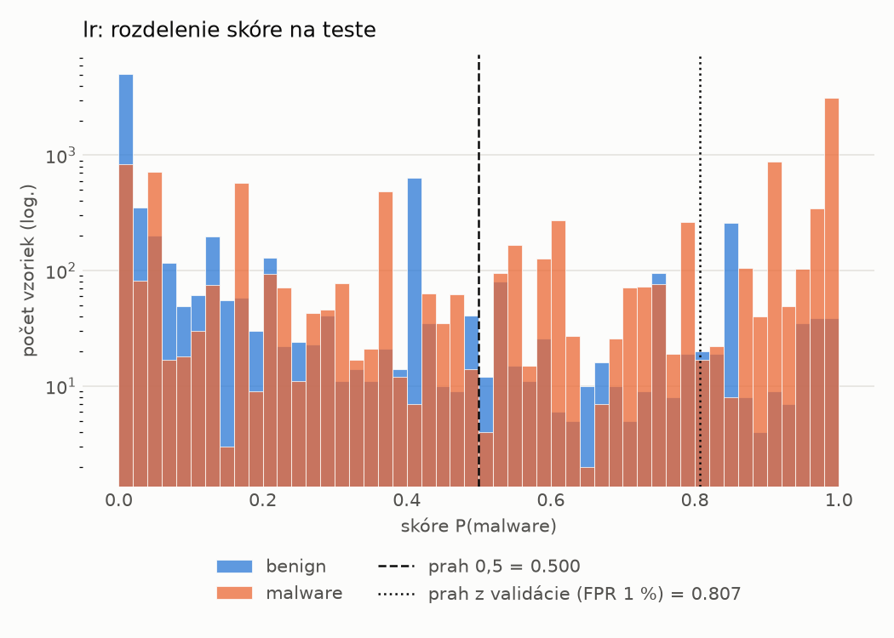
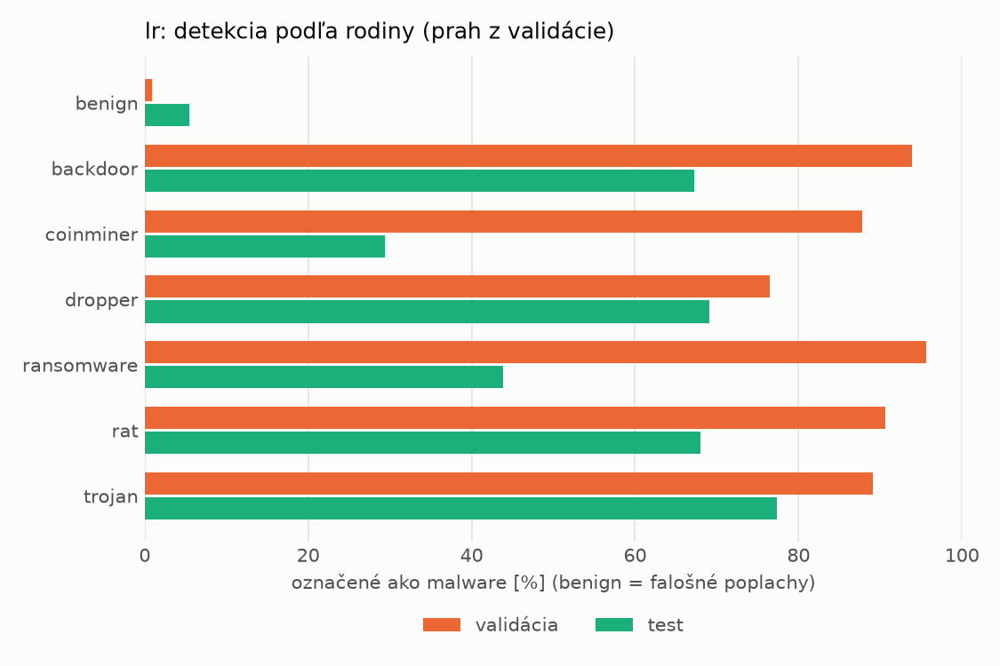
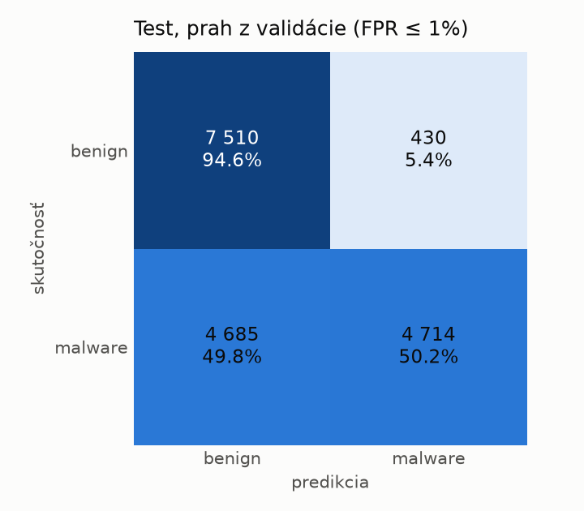
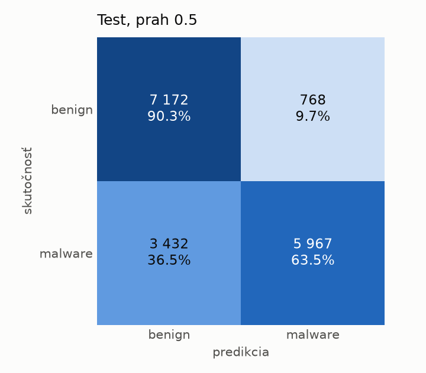

# dynamic/lr – beh `20261104-040040`

> Automaticky generované (`src/training/run_tabular.py`). Konfigurácia: `config.yaml`, protokol: `protocol.yaml`.

- **Model:** `logreg` – logistická regresia s L2 regularizáciou (vstup signed log1p + štandardizácia)
- **Ladenie:** bez ladenia – hyperparametre prevzaté z `runs_final/dynamic/lr/20261102-002602`
- **Finálne modely:** seedy [0, 1, 2]; hodnoty sú priemer ± smerodajná odchýlka cez seedy
- **Najlepšie hyperparametre:** `{"max_iter": 2000, "C": 0.04224422279858655}`

## Detekčná kvalita (bez prahu)
| metrika | train (podvzorka) | validácia | test |
|---|---|---|---|
| ROC-AUC | 0.9967 ± 0.0000 | 0.9955 ± 0.0000 | 0.8699 ± 0.0000 |
| PR-AUC | 0.9982 ± 0.0000 | 0.9976 ± 0.0000 | 0.8964 ± 0.0000 |
| TPR pri FPR 1 % | 0.9461 ± 0.0000 | 0.8922 ± 0.0000 | 0.3759 ± 0.0000 |
| TPR pri FPR 0,1 % | 0.8462 ± 0.0000 | 0.7724 ± 0.0000 | 0.2560 ± 0.0000 |
| log loss | 0.0756 ± 0.0000 | 0.0859 ± 0.0000 | 0.7753 ± 0.0000 |
| Brier skóre | 0.0223 ± 0.0000 | 0.0247 ± 0.0000 | 0.1934 ± 0.0000 |

Rozdiel ROC-AUC train − validácia: **0.0012** (veľký rozdiel = preučenie).

## Pri prahu z validácie (FPR ≤ 1% na validácii)
| metrika | train (podvzorka) | validácia | test |
|---|---|---|---|
| accuracy | 0.9286 ± 0.0000 | 0.9263 ± 0.0000 | 0.7050 ± 0.0000 |
| balanced accuracy | 0.9439 ± 0.0000 | 0.9414 ± 0.0000 | 0.7237 ± 0.0000 |
| precision | 0.9974 ± 0.0000 | 0.9944 ± 0.0000 | 0.9164 ± 0.0000 |
| recall (TPR) | 0.8921 ± 0.0000 | 0.8922 ± 0.0000 | 0.5015 ± 0.0000 |
| FPR | 0.0043 ± 0.0000 | 0.0094 ± 0.0000 | 0.0542 ± 0.0000 |
| F1 | 0.9418 ± 0.0000 | 0.9405 ± 0.0000 | 0.6483 ± 0.0000 |
| MCC | 0.8591 ± 0.0000 | 0.8532 ± 0.0000 | 0.4880 ± 0.0000 |

## Pri pevnom prahu 0.5
| metrika | train (podvzorka) | validácia | test |
|---|---|---|---|
| accuracy | 0.9696 ± 0.0000 | 0.9654 ± 0.0000 | 0.7578 ± 0.0000 |
| balanced accuracy | 0.9704 ± 0.0000 | 0.9664 ± 0.0000 | 0.7691 ± 0.0000 |
| precision | 0.9851 ± 0.0000 | 0.9835 ± 0.0000 | 0.8860 ± 0.0000 |
| recall (TPR) | 0.9677 ± 0.0000 | 0.9632 ± 0.0000 | 0.6349 ± 0.0000 |
| FPR | 0.0270 ± 0.0000 | 0.0303 ± 0.0000 | 0.0967 ± 0.0000 |
| F1 | 0.9763 ± 0.0000 | 0.9733 ± 0.0000 | 0.7397 ± 0.0000 |
| MCC | 0.9342 ± 0.0000 | 0.9249 ± 0.0000 | 0.5501 ± 0.0000 |

## Výpočtové nároky (seed 0, testovacia množina)
| meranie | hodnota |
|---|---|
| tréning finálneho modelu | 5.0 s (priemer cez seedy) |
| ladenie spolu | 0 s |
| počet parametrov / uzlov | 2 001 |
| veľkosť modelu na disku | 0.06 MB |
| transformácia vstupu – latencia (1 vlákno) | 0.017 ms |
| transformácia vstupu – priepustnosť | 50 377 vzoriek/s |
| CPU latencia modelu (batch 1, 1 vlákno) | 0.005 ms (p95 0.006) |
| CPU priepustnosť (24 vlákien) | 335 822 vzoriek/s |

## Grafy
| | |
|---|---|
|  |  |
|  |  |
|  |  |
|  |  |

## Súbory
`metrics.json` (všetky metriky po seedoch vrátane rodín), `timing.json`, `hpo_trials.csv`,
`predictions/<časť>_seed<N>.parquet` (sha256, family, label, score), `model/seed_<N>/`, `log.txt`.
