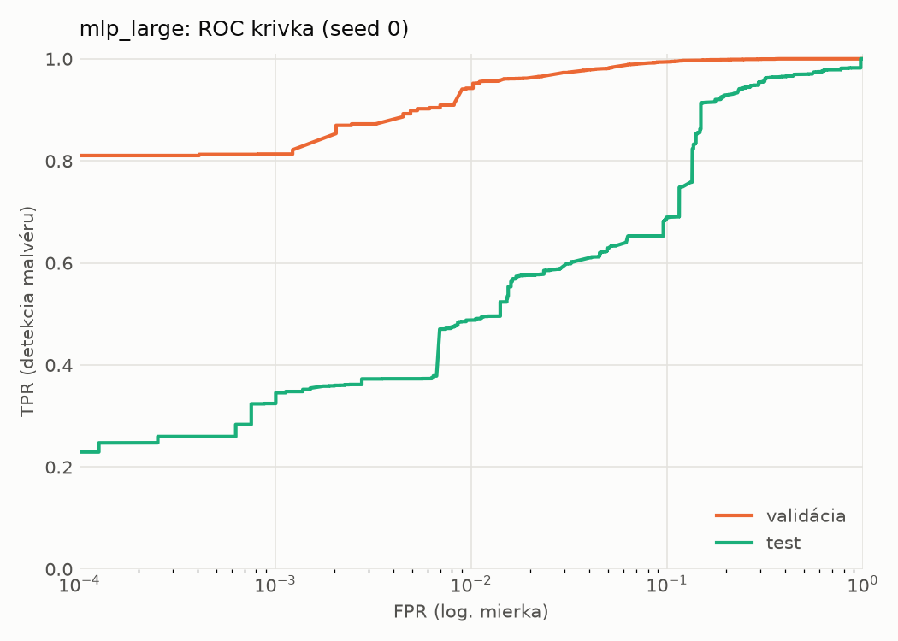
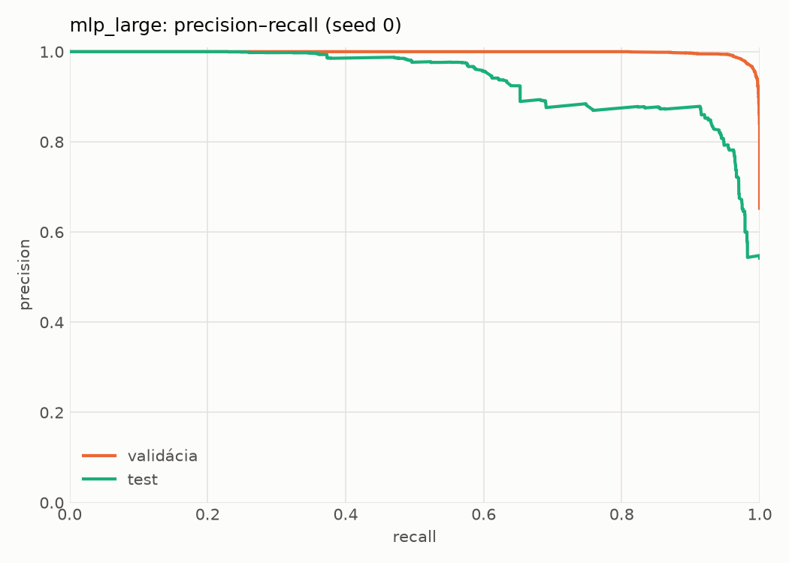
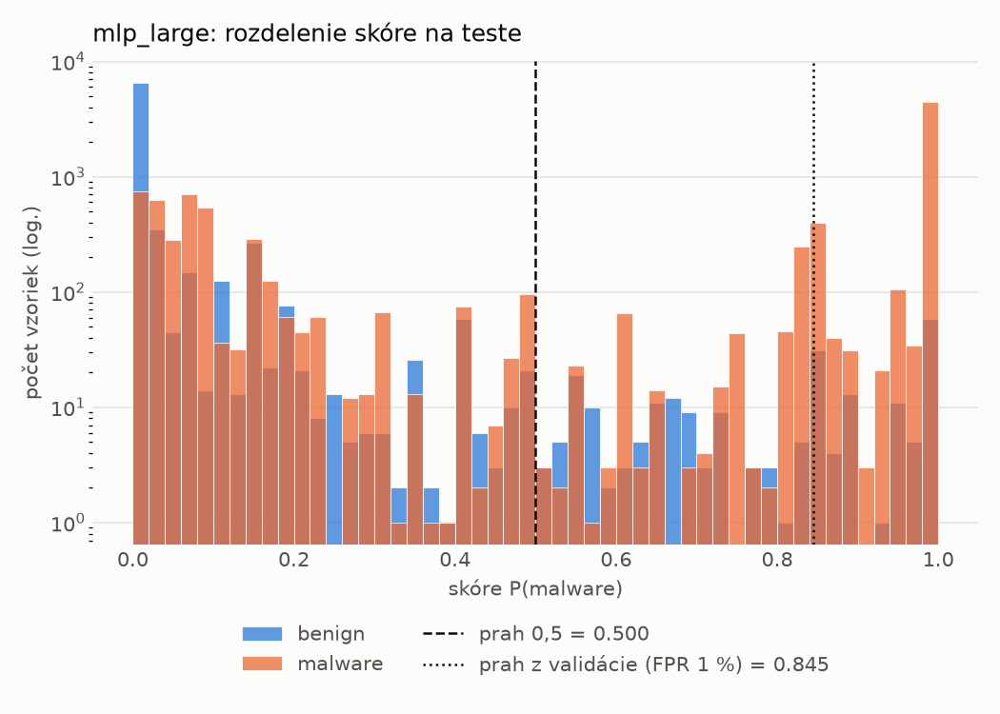
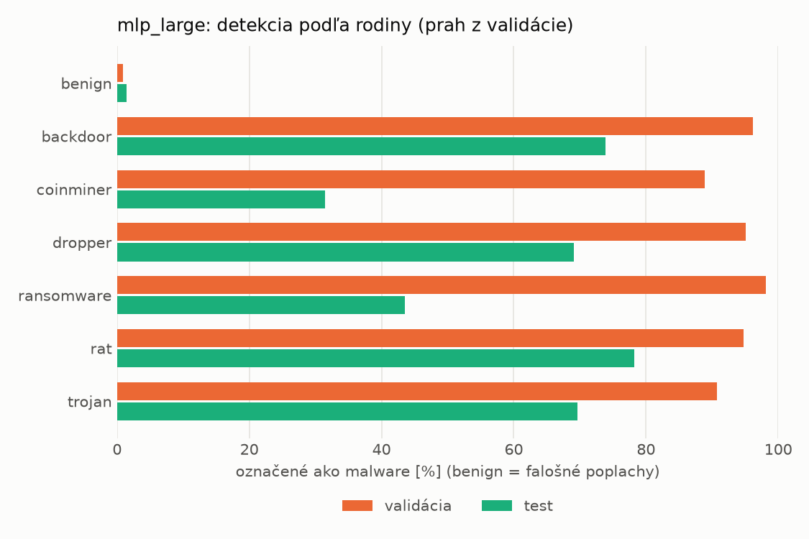
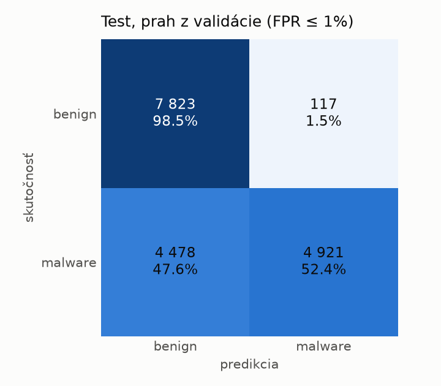
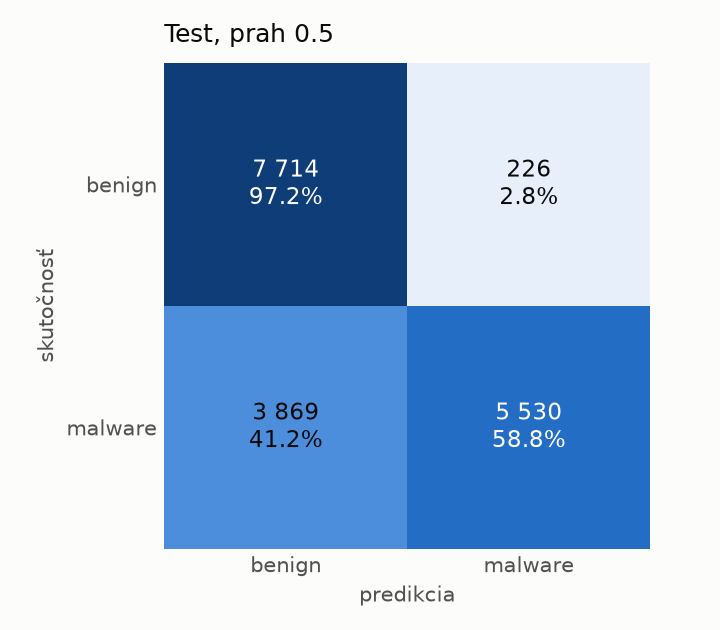
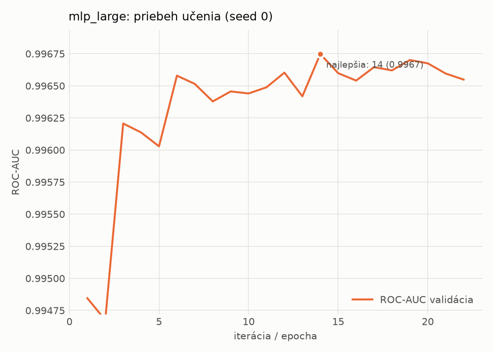

# dynamic/mlp_large – beh `20261104-040456`

> Automaticky generované (`src/training/run_tabular.py`). Konfigurácia: `config.yaml`, protokol: `protocol.yaml`.

- **Model:** `mlp` – veľká neurónová sieť (3–5 skrytých vrstiev, 512–2048 neurónov), kandidát na učiteľa
- **Ladenie:** bez ladenia – hyperparametre prevzaté z `runs_final/dynamic/mlp_large/20261102-005920`
- **Finálne modely:** seedy [0, 1, 2]; hodnoty sú priemer ± smerodajná odchýlka cez seedy
- **Najlepšie hyperparametre:** `{"max_epochs": 100, "patience": 8, "hidden_layers": 3, "hidden_width": 512, "width_decay": 0.5, "dropout": 0.3735687797102123, "lr": 0.00020669709962675654, "weight_decay": 1.4747439017290252e-05, "batch_size": 256}`

## Detekčná kvalita (bez prahu)
| metrika | train (podvzorka) | validácia | test |
|---|---|---|---|
| ROC-AUC | 0.9977 ± 0.0001 | 0.9967 ± 0.0000 | 0.9263 ± 0.0091 |
| PR-AUC | 0.9987 ± 0.0000 | 0.9982 ± 0.0000 | 0.9412 ± 0.0069 |
| TPR pri FPR 1 % | 0.9548 ± 0.0037 | 0.9436 ± 0.0025 | 0.4830 ± 0.0042 |
| TPR pri FPR 0,1 % | 0.8950 ± 0.0092 | 0.8258 ± 0.0259 | 0.3034 ± 0.0456 |
| log loss | 0.0613 ± 0.0018 | 0.0746 ± 0.0007 | 0.7411 ± 0.0726 |
| Brier skóre | 0.0190 ± 0.0005 | 0.0215 ± 0.0003 | 0.1937 ± 0.0077 |

Rozdiel ROC-AUC train − validácia: **0.0010** (veľký rozdiel = preučenie).

## Pri prahu z validácie (FPR ≤ 1% na validácii)
| metrika | train (podvzorka) | validácia | test |
|---|---|---|---|
| accuracy | 0.9618 ± 0.0011 | 0.9598 ± 0.0016 | 0.7354 ± 0.0008 |
| balanced accuracy | 0.9691 ± 0.0008 | 0.9669 ± 0.0012 | 0.7548 ± 0.0008 |
| precision | 0.9965 ± 0.0005 | 0.9946 ± 0.0001 | 0.9773 ± 0.0005 |
| recall (TPR) | 0.9443 ± 0.0021 | 0.9436 ± 0.0025 | 0.5241 ± 0.0016 |
| FPR | 0.0061 ± 0.0008 | 0.0097 ± 0.0002 | 0.0144 ± 0.0003 |
| F1 | 0.9697 ± 0.0009 | 0.9684 ± 0.0013 | 0.6823 ± 0.0013 |
| MCC | 0.9205 ± 0.0021 | 0.9157 ± 0.0031 | 0.5592 ± 0.0012 |

## Pri pevnom prahu 0.5
| metrika | train (podvzorka) | validácia | test |
|---|---|---|---|
| accuracy | 0.9732 ± 0.0007 | 0.9704 ± 0.0013 | 0.7640 ± 0.0027 |
| balanced accuracy | 0.9738 ± 0.0004 | 0.9711 ± 0.0004 | 0.7798 ± 0.0024 |
| precision | 0.9867 ± 0.0022 | 0.9857 ± 0.0012 | 0.9551 ± 0.0050 |
| recall (TPR) | 0.9718 ± 0.0033 | 0.9687 ± 0.0032 | 0.5926 ± 0.0070 |
| FPR | 0.0241 ± 0.0042 | 0.0265 ± 0.0023 | 0.0330 ± 0.0041 |
| F1 | 0.9792 ± 0.0006 | 0.9771 ± 0.0010 | 0.7313 ± 0.0044 |
| MCC | 0.9420 ± 0.0012 | 0.9354 ± 0.0025 | 0.5901 ± 0.0040 |

## Výpočtové nároky (seed 0, testovacia množina)
| meranie | hodnota |
|---|---|
| tréning finálneho modelu | 10.3 s (priemer cez seedy) |
| ladenie spolu | 0 s |
| počet parametrov / uzlov | 1 190 657 |
| veľkosť modelu na disku | 4.83 MB |
| transformácia vstupu – latencia (1 vlákno) | 0.034 ms |
| transformácia vstupu – priepustnosť | 47 918 vzoriek/s |
| CPU latencia modelu (batch 1, 1 vlákno) | 0.198 ms (p95 0.232) |
| CPU priepustnosť (24 vlákien) | 101 825 vzoriek/s |
| GPU latencia (batch 1) | 0.523 ms (p95 0.566) |
| GPU priepustnosť | 112 050 vzoriek/s |
| GPU špičková pamäť | 1324 MB |

## Grafy
| | |
|---|---|
|  |  |
|  |  |
|  |  |
|  |  |

## Súbory
`metrics.json` (všetky metriky po seedoch vrátane rodín), `timing.json`, `hpo_trials.csv`,
`predictions/<časť>_seed<N>.parquet` (sha256, family, label, score), `model/seed_<N>/`, `log.txt`.
