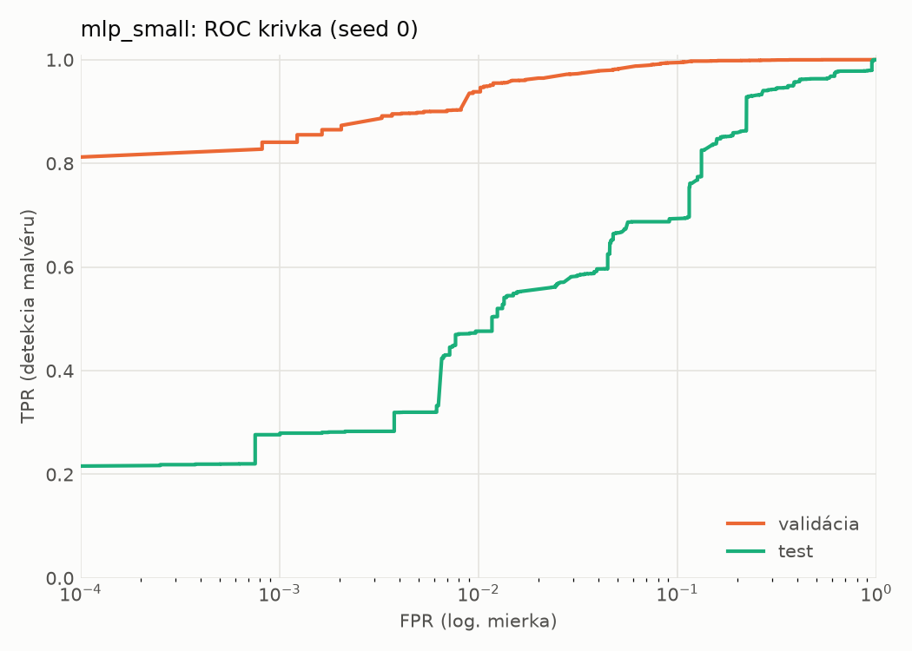
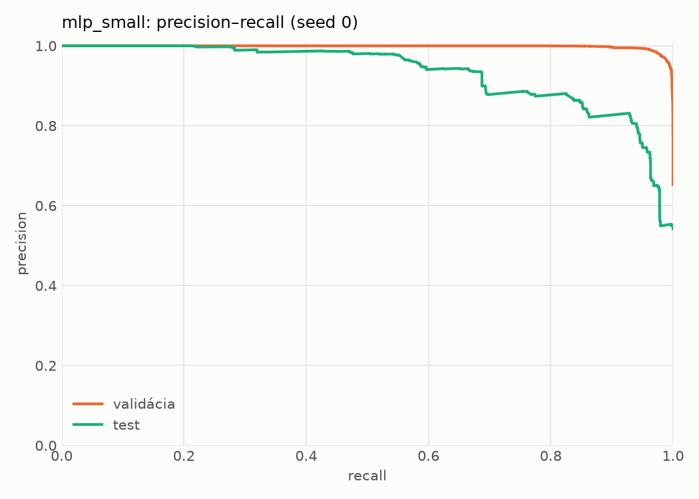
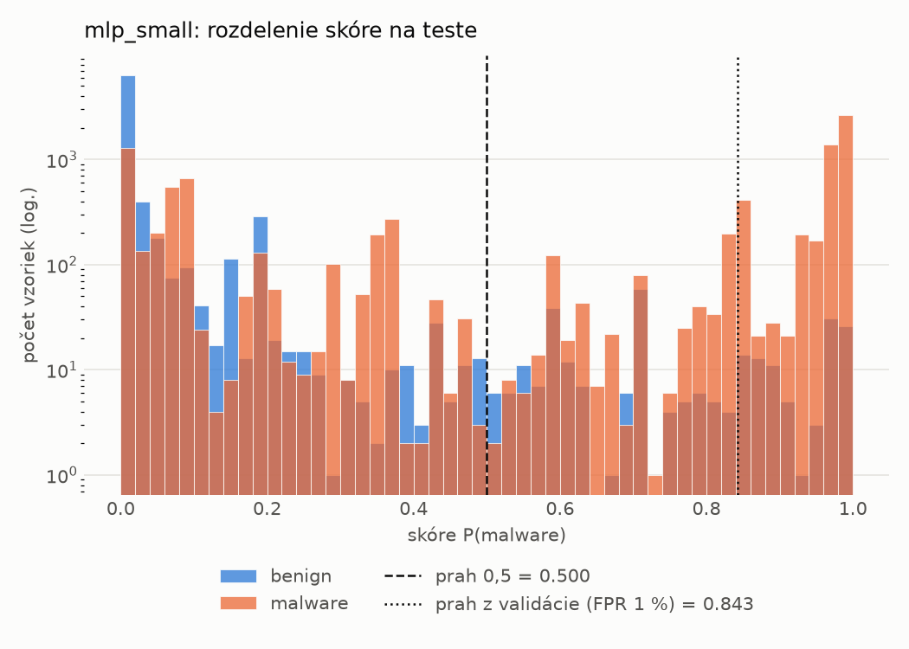
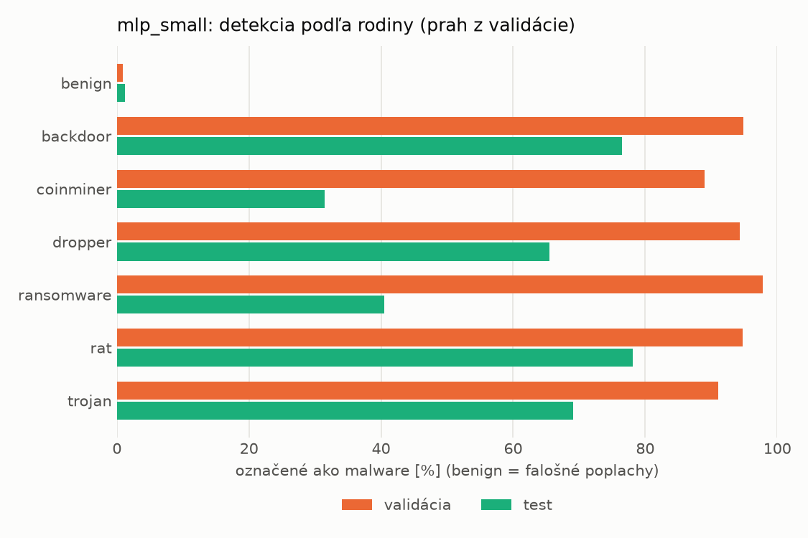
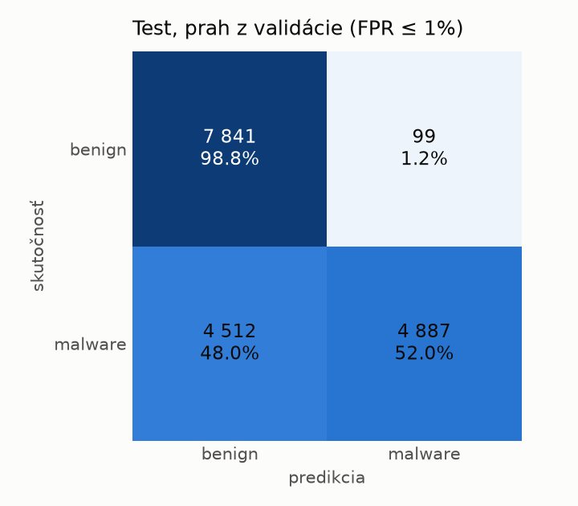
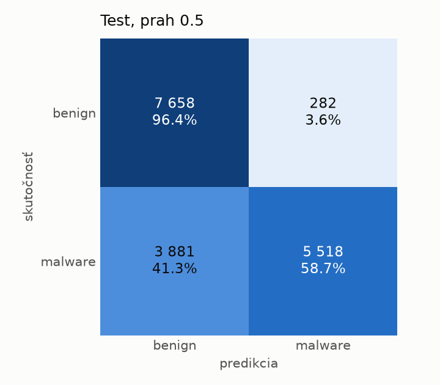
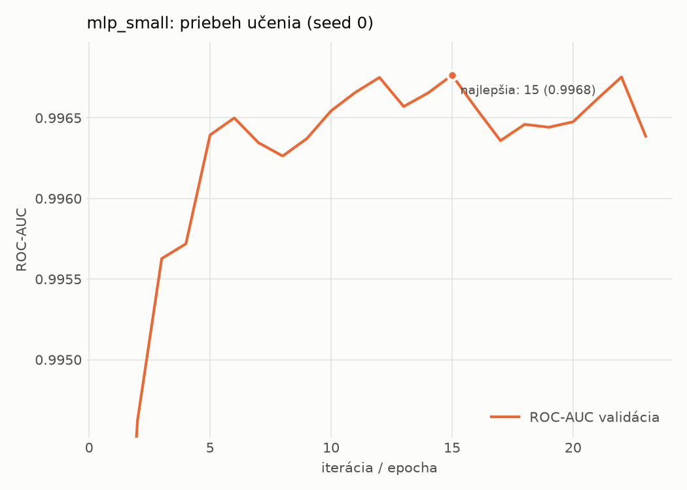

# dynamic/mlp_small – beh `20261104-040436`

> Automaticky generované (`src/training/run_tabular.py`). Konfigurácia: `config.yaml`, protokol: `protocol.yaml`.

- **Model:** `mlp` – malá neurónová sieť (1–2 skryté vrstvy), kandidát na ľahkého študenta
- **Ladenie:** bez ladenia – hyperparametre prevzaté z `runs_final/dynamic/mlp_small/20261102-005611`
- **Finálne modely:** seedy [0, 1, 2]; hodnoty sú priemer ± smerodajná odchýlka cez seedy
- **Najlepšie hyperparametre:** `{"width_decay": 0.5, "max_epochs": 100, "patience": 8, "hidden_layers": 2, "hidden_width": 256, "dropout": 0.194338644844741, "lr": 0.0002516607127550297, "weight_decay": 0.0020651425578959264, "batch_size": 1024}`

## Detekčná kvalita (bez prahu)
| metrika | train (podvzorka) | validácia | test |
|---|---|---|---|
| ROC-AUC | 0.9981 ± 0.0001 | 0.9968 ± 0.0001 | 0.9166 ± 0.0033 |
| PR-AUC | 0.9989 ± 0.0001 | 0.9983 ± 0.0000 | 0.9356 ± 0.0022 |
| TPR pri FPR 1 % | 0.9625 ± 0.0011 | 0.9418 ± 0.0033 | 0.4876 ± 0.0110 |
| TPR pri FPR 0,1 % | 0.9000 ± 0.0018 | 0.8275 ± 0.0115 | 0.2686 ± 0.0294 |
| log loss | 0.0557 ± 0.0019 | 0.0723 ± 0.0010 | 0.8121 ± 0.0208 |
| Brier skóre | 0.0169 ± 0.0006 | 0.0205 ± 0.0004 | 0.1910 ± 0.0032 |

Rozdiel ROC-AUC train − validácia: **0.0013** (veľký rozdiel = preučenie).

## Pri prahu z validácie (FPR ≤ 1% na validácii)
| metrika | train (podvzorka) | validácia | test |
|---|---|---|---|
| accuracy | 0.9617 ± 0.0027 | 0.9587 ± 0.0021 | 0.7375 ± 0.0071 |
| balanced accuracy | 0.9693 ± 0.0021 | 0.9661 ± 0.0016 | 0.7569 ± 0.0065 |
| precision | 0.9971 ± 0.0001 | 0.9946 ± 0.0001 | 0.9797 ± 0.0007 |
| recall (TPR) | 0.9436 ± 0.0043 | 0.9418 ± 0.0033 | 0.5267 ± 0.0132 |
| FPR | 0.0050 ± 0.0002 | 0.0096 ± 0.0002 | 0.0129 ± 0.0004 |
| F1 | 0.9696 ± 0.0022 | 0.9675 ± 0.0017 | 0.6850 ± 0.0112 |
| MCC | 0.9206 ± 0.0053 | 0.9135 ± 0.0041 | 0.5633 ± 0.0102 |

## Pri pevnom prahu 0.5
| metrika | train (podvzorka) | validácia | test |
|---|---|---|---|
| accuracy | 0.9764 ± 0.0009 | 0.9716 ± 0.0010 | 0.7705 ± 0.0094 |
| balanced accuracy | 0.9771 ± 0.0016 | 0.9721 ± 0.0004 | 0.7855 ± 0.0086 |
| precision | 0.9886 ± 0.0028 | 0.9858 ± 0.0017 | 0.9532 ± 0.0016 |
| recall (TPR) | 0.9747 ± 0.0025 | 0.9705 ± 0.0032 | 0.6063 ± 0.0171 |
| FPR | 0.0206 ± 0.0051 | 0.0263 ± 0.0033 | 0.0352 ± 0.0005 |
| F1 | 0.9816 ± 0.0007 | 0.9781 ± 0.0008 | 0.7411 ± 0.0133 |
| MCC | 0.9487 ± 0.0020 | 0.9380 ± 0.0019 | 0.5987 ± 0.0143 |

## Výpočtové nároky (seed 0, testovacia množina)
| meranie | hodnota |
|---|---|
| tréning finálneho modelu | 4.0 s (priemer cez seedy) |
| ladenie spolu | 0 s |
| počet parametrov / uzlov | 546 049 |
| veľkosť modelu na disku | 2.24 MB |
| transformácia vstupu – latencia (1 vlákno) | 0.034 ms |
| transformácia vstupu – priepustnosť | 48 805 vzoriek/s |
| CPU latencia modelu (batch 1, 1 vlákno) | 0.133 ms (p95 0.148) |
| CPU priepustnosť (24 vlákien) | 86 765 vzoriek/s |
| GPU latencia (batch 1) | 0.343 ms (p95 0.721) |
| GPU priepustnosť | 121 725 vzoriek/s |
| GPU špičková pamäť | 740 MB |

## Grafy
| | |
|---|---|
|  |  |
|  |  |
|  |  |
|  |  |

## Súbory
`metrics.json` (všetky metriky po seedoch vrátane rodín), `timing.json`, `hpo_trials.csv`,
`predictions/<časť>_seed<N>.parquet` (sha256, family, label, score), `model/seed_<N>/`, `log.txt`.
