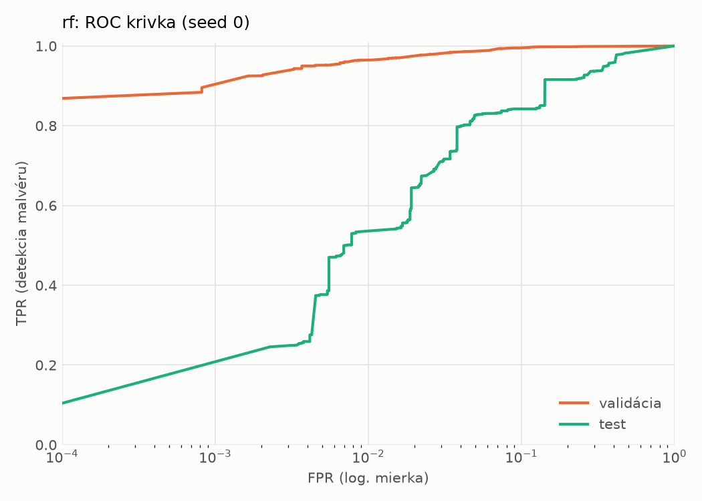
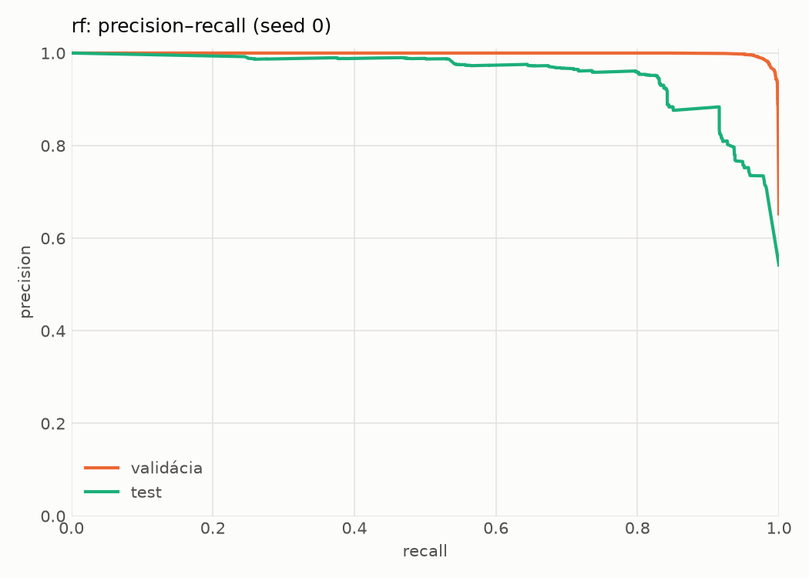
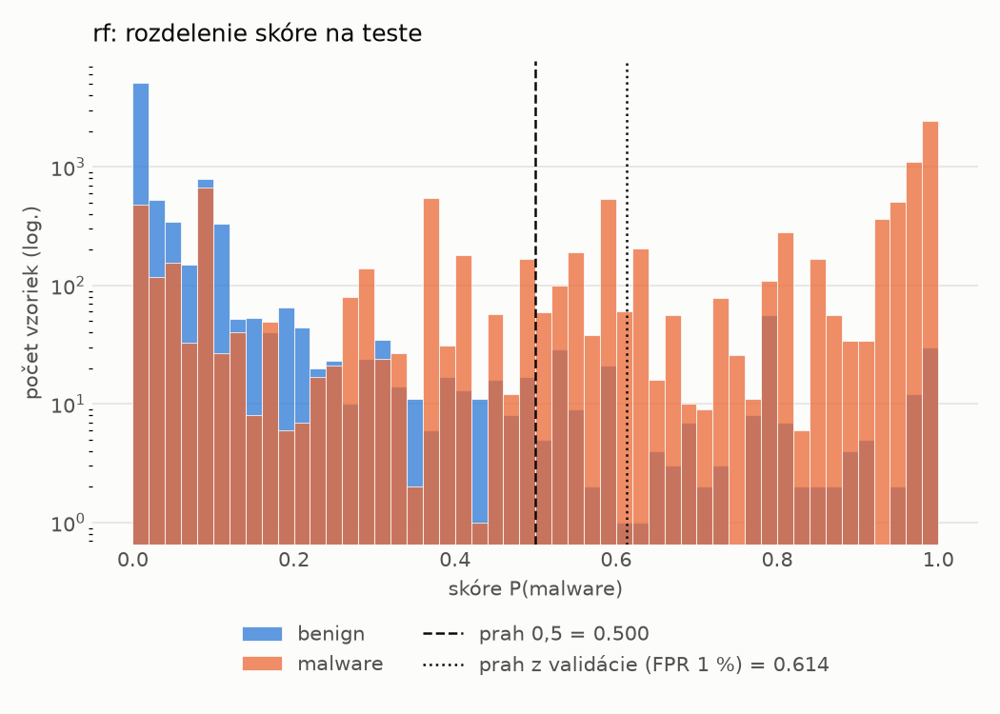
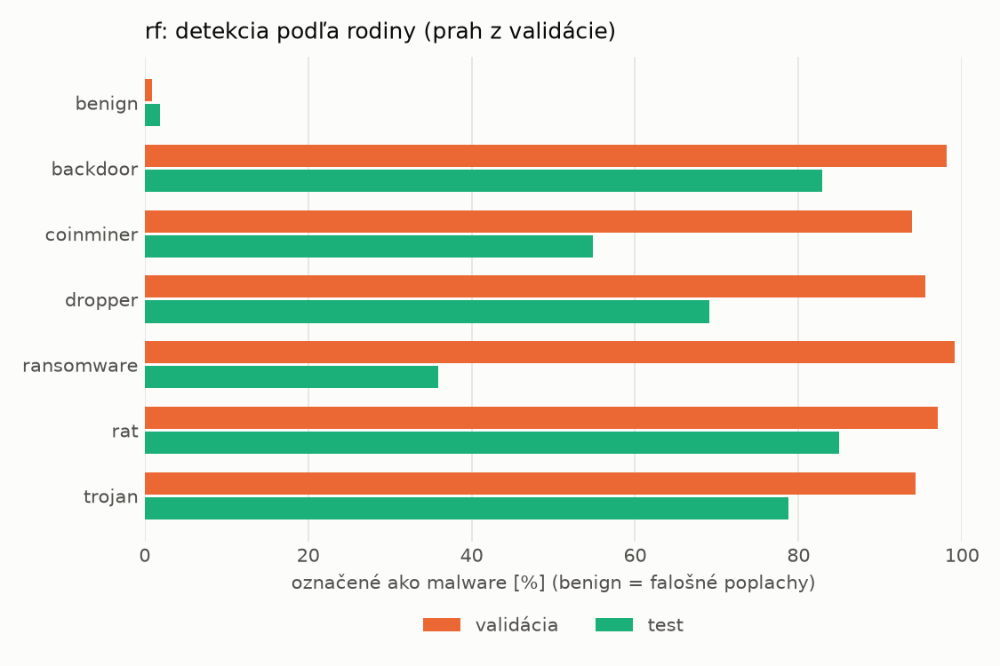
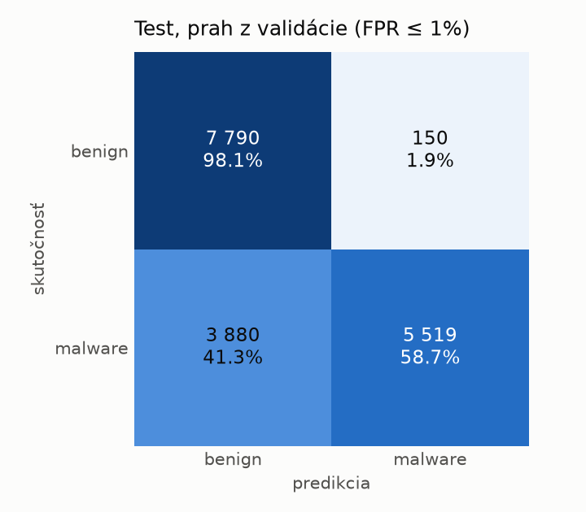
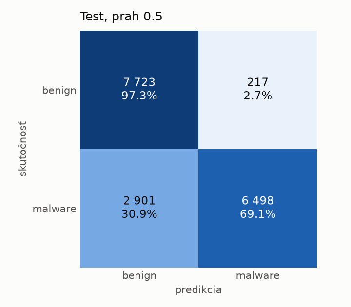

# dynamic/rf – beh `20261104-040102`

> Automaticky generované (`src/training/run_tabular.py`). Konfigurácia: `config.yaml`, protokol: `protocol.yaml`.

- **Model:** `random_forest` – Random Forest (pôvodné hodnoty príznakov)
- **Ladenie:** bez ladenia – hyperparametre prevzaté z `runs_final/dynamic/rf/20261102-003041`
- **Finálne modely:** seedy [0, 1, 2]; hodnoty sú priemer ± smerodajná odchýlka cez seedy
- **Najlepšie hyperparametre:** `{"n_estimators": 450, "max_depth": null, "min_samples_leaf": 1, "max_features": 0.05}`

## Detekčná kvalita (bez prahu)
| metrika | train (podvzorka) | validácia | test |
|---|---|---|---|
| ROC-AUC | 0.9991 ± 0.0000 | 0.9974 ± 0.0000 | 0.9430 ± 0.0008 |
| PR-AUC | 0.9995 ± 0.0000 | 0.9986 ± 0.0000 | 0.9528 ± 0.0008 |
| TPR pri FPR 1 % | 0.9782 ± 0.0002 | 0.9646 ± 0.0005 | 0.5330 ± 0.0009 |
| TPR pri FPR 0,1 % | 0.9589 ± 0.0002 | 0.8954 ± 0.0004 | 0.0000 ± 0.0000 |
| log loss | 0.0376 ± 0.0000 | 0.0652 ± 0.0008 | 0.5894 ± 0.0075 |
| Brier skóre | 0.0116 ± 0.0000 | 0.0167 ± 0.0000 | 0.1358 ± 0.0005 |

Rozdiel ROC-AUC train − validácia: **0.0017** (veľký rozdiel = preučenie).

## Pri prahu z validácie (FPR ≤ 1% na validácii)
| metrika | train (podvzorka) | validácia | test |
|---|---|---|---|
| accuracy | 0.9803 ± 0.0002 | 0.9736 ± 0.0003 | 0.7769 ± 0.0213 |
| balanced accuracy | 0.9840 ± 0.0001 | 0.9775 ± 0.0002 | 0.7927 ± 0.0196 |
| precision | 0.9981 ± 0.0000 | 0.9948 ± 0.0001 | 0.9741 ± 0.0014 |
| recall (TPR) | 0.9715 ± 0.0002 | 0.9646 ± 0.0005 | 0.6044 ± 0.0393 |
| FPR | 0.0034 ± 0.0000 | 0.0096 ± 0.0002 | 0.0190 ± 0.0001 |
| F1 | 0.9846 ± 0.0001 | 0.9795 ± 0.0002 | 0.7455 ± 0.0300 |
| MCC | 0.9581 ± 0.0003 | 0.9434 ± 0.0006 | 0.6175 ± 0.0318 |

## Pri pevnom prahu 0.5
| metrika | train (podvzorka) | validácia | test |
|---|---|---|---|
| accuracy | 0.9838 ± 0.0001 | 0.9753 ± 0.0000 | 0.8186 ± 0.0017 |
| balanced accuracy | 0.9863 ± 0.0001 | 0.9773 ± 0.0001 | 0.8306 ± 0.0016 |
| precision | 0.9970 ± 0.0000 | 0.9914 ± 0.0001 | 0.9671 ± 0.0005 |
| recall (TPR) | 0.9780 ± 0.0002 | 0.9705 ± 0.0001 | 0.6889 ± 0.0029 |
| FPR | 0.0054 ± 0.0000 | 0.0158 ± 0.0002 | 0.0277 ± 0.0004 |
| F1 | 0.9874 ± 0.0001 | 0.9808 ± 0.0000 | 0.8046 ± 0.0021 |
| MCC | 0.9652 ± 0.0002 | 0.9464 ± 0.0000 | 0.6766 ± 0.0028 |

## Výpočtové nároky (seed 0, testovacia množina)
| meranie | hodnota |
|---|---|
| tréning finálneho modelu | 33.9 s (priemer cez seedy) |
| ladenie spolu | 0 s |
| počet parametrov / uzlov | 954 362 |
| veľkosť modelu na disku | 76.78 MB |
| CPU latencia modelu (batch 1, 1 vlákno) | 12.944 ms (p95 14.008) |
| CPU priepustnosť (24 vlákien) | 78 727 vzoriek/s |

## Grafy
| | |
|---|---|
|  |  |
|  |  |
|  |  |
|  |  |

## Súbory
`metrics.json` (všetky metriky po seedoch vrátane rodín), `timing.json`, `hpo_trials.csv`,
`predictions/<časť>_seed<N>.parquet` (sha256, family, label, score), `model/seed_<N>/`, `log.txt`.
