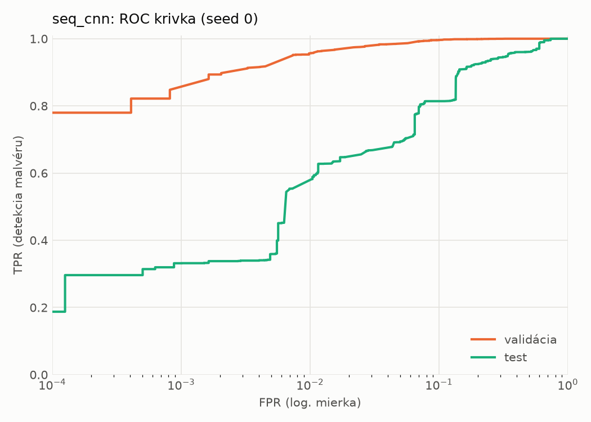
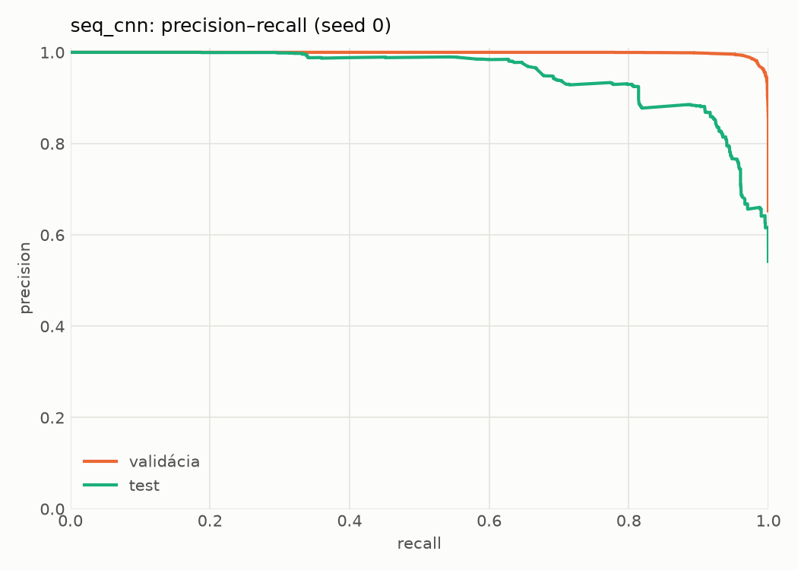
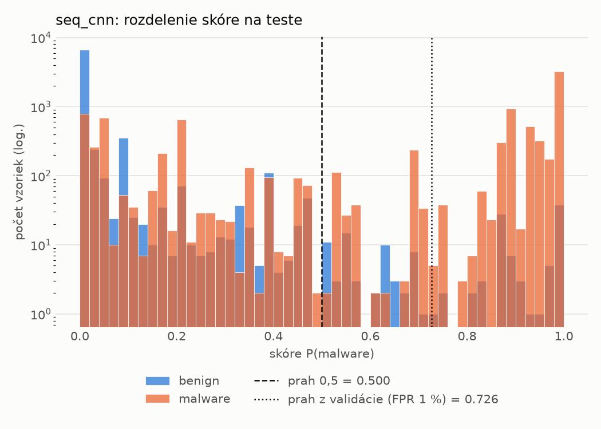
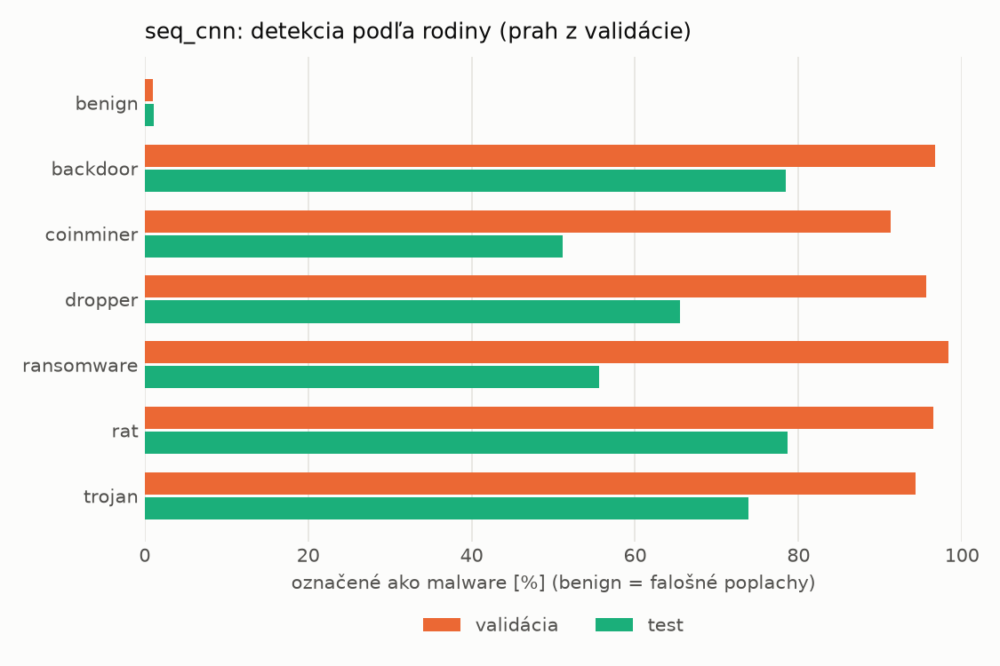
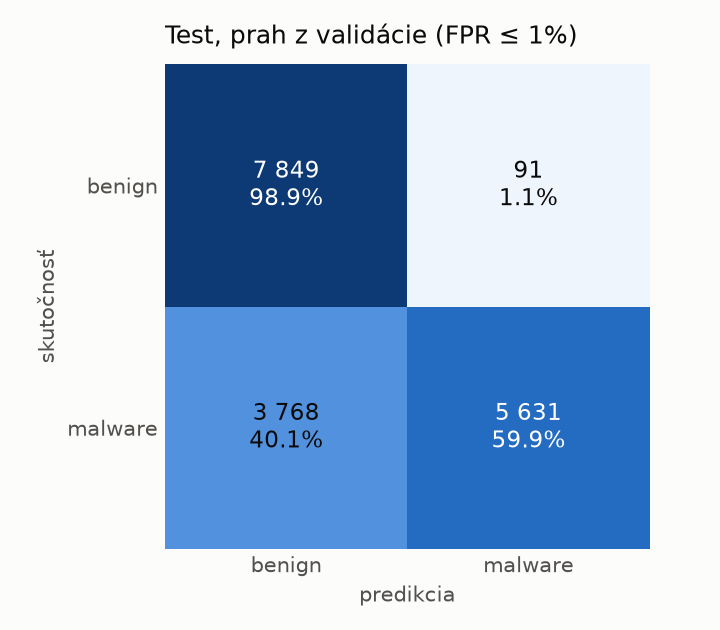
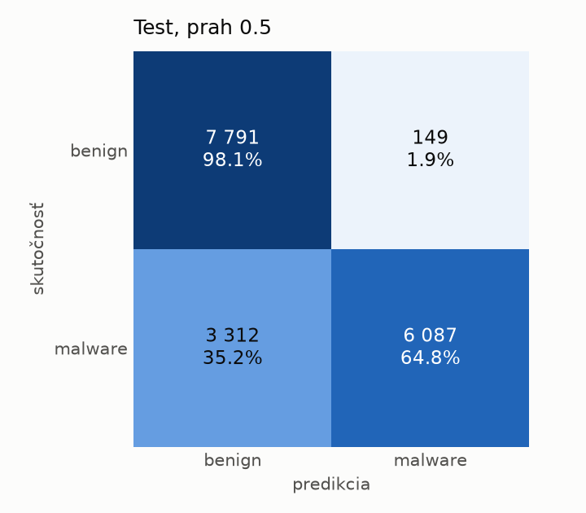
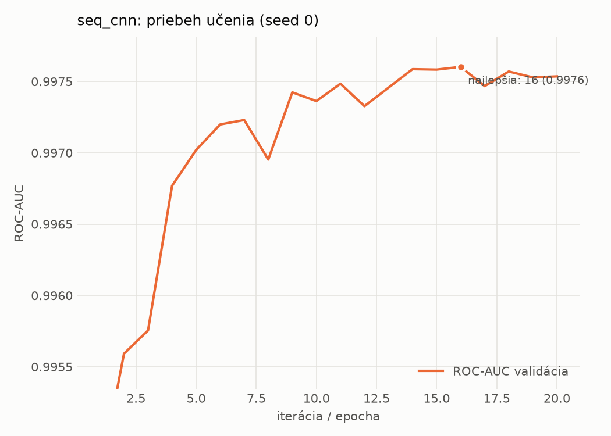

# dynamic_seq/seq_cnn – beh `20261104-040535`

> Automaticky generované (`src/training/run_tabular.py`). Konfigurácia: `config.yaml`, protokol: `protocol.yaml`.

- **Model:** `seq_cnn` – embedding API + paralelné 1D konvolúcie + maximum cez postupnosť
- **Ladenie:** bez ladenia – hyperparametre prevzaté z `runs_final/dynamic/seq_cnn/20261102-010741`
- **Finálne modely:** seedy [0, 1, 2]; hodnoty sú priemer ± smerodajná odchýlka cez seedy
- **Najlepšie hyperparametre:** `{"max_epochs": 30, "patience": 4, "emb_dim": 64, "channels": 128, "kernels": "2-4-8", "hidden": 64, "dropout": 0.19665662644598886, "lr": 0.0005755683530429188, "weight_decay": 0.0005400591881097476, "batch_size": 128}`

## Detekčná kvalita (bez prahu)
| metrika | train (podvzorka) | validácia | test |
|---|---|---|---|
| ROC-AUC | 0.9987 ± 0.0000 | 0.9975 ± 0.0001 | 0.9360 ± 0.0022 |
| PR-AUC | 0.9992 ± 0.0000 | 0.9986 ± 0.0000 | 0.9508 ± 0.0010 |
| TPR pri FPR 1 % | 0.9722 ± 0.0012 | 0.9575 ± 0.0037 | 0.5567 ± 0.0252 |
| TPR pri FPR 0,1 % | 0.9203 ± 0.0023 | 0.8397 ± 0.0151 | 0.3178 ± 0.0239 |
| log loss | 0.0481 ± 0.0011 | 0.0656 ± 0.0013 | 0.6833 ± 0.0602 |
| Brier skóre | 0.0150 ± 0.0004 | 0.0185 ± 0.0002 | 0.1496 ± 0.0105 |

Rozdiel ROC-AUC train − validácia: **0.0011** (veľký rozdiel = preučenie).

## Pri prahu z validácie (FPR ≤ 1% na validácii)
| metrika | train (podvzorka) | validácia | test |
|---|---|---|---|
| accuracy | 0.9713 ± 0.0027 | 0.9689 ± 0.0024 | 0.7874 ± 0.0088 |
| balanced accuracy | 0.9766 ± 0.0019 | 0.9738 ± 0.0018 | 0.8028 ± 0.0079 |
| precision | 0.9968 ± 0.0006 | 0.9946 ± 0.0000 | 0.9805 ± 0.0032 |
| recall (TPR) | 0.9588 ± 0.0045 | 0.9575 ± 0.0037 | 0.6202 ± 0.0186 |
| FPR | 0.0056 ± 0.0010 | 0.0098 ± 0.0000 | 0.0147 ± 0.0029 |
| F1 | 0.9774 ± 0.0021 | 0.9757 ± 0.0019 | 0.7597 ± 0.0131 |
| MCC | 0.9395 ± 0.0053 | 0.9337 ± 0.0048 | 0.6356 ± 0.0115 |

## Pri pevnom prahu 0.5
| metrika | train (podvzorka) | validácia | test |
|---|---|---|---|
| accuracy | 0.9783 ± 0.0008 | 0.9736 ± 0.0003 | 0.8158 ± 0.0198 |
| balanced accuracy | 0.9810 ± 0.0006 | 0.9761 ± 0.0002 | 0.8280 ± 0.0178 |
| precision | 0.9945 ± 0.0002 | 0.9913 ± 0.0002 | 0.9682 ± 0.0069 |
| recall (TPR) | 0.9719 ± 0.0013 | 0.9681 ± 0.0007 | 0.6829 ± 0.0414 |
| FPR | 0.0099 ± 0.0003 | 0.0160 ± 0.0004 | 0.0268 ± 0.0071 |
| F1 | 0.9831 ± 0.0006 | 0.9796 ± 0.0003 | 0.8003 ± 0.0265 |
| MCC | 0.9535 ± 0.0017 | 0.9430 ± 0.0007 | 0.6730 ± 0.0284 |

## Výpočtové nároky (seed 0, testovacia množina)
| meranie | hodnota |
|---|---|
| tréning finálneho modelu | 419.3 s (priemer cez seedy) |
| ladenie spolu | 0 s |
| počet parametrov / uzlov | 209 345 |
| veľkosť modelu na disku | 0.84 MB |
| CPU latencia modelu (batch 1, 1 vlákno) | 2.876 ms (p95 3.297) |
| CPU priepustnosť (24 vlákien) | 1 260 vzoriek/s |
| GPU latencia (batch 1) | 0.817 ms (p95 1.831) |
| GPU priepustnosť | 9 416 vzoriek/s |
| GPU špičková pamäť | 1960 MB |

## Grafy
| | |
|---|---|
|  |  |
|  |  |
|  |  |
|  |  |

## Súbory
`metrics.json` (všetky metriky po seedoch vrátane rodín), `timing.json`, `hpo_trials.csv`,
`predictions/<časť>_seed<N>.parquet` (sha256, family, label, score), `model/seed_<N>/`, `log.txt`.
