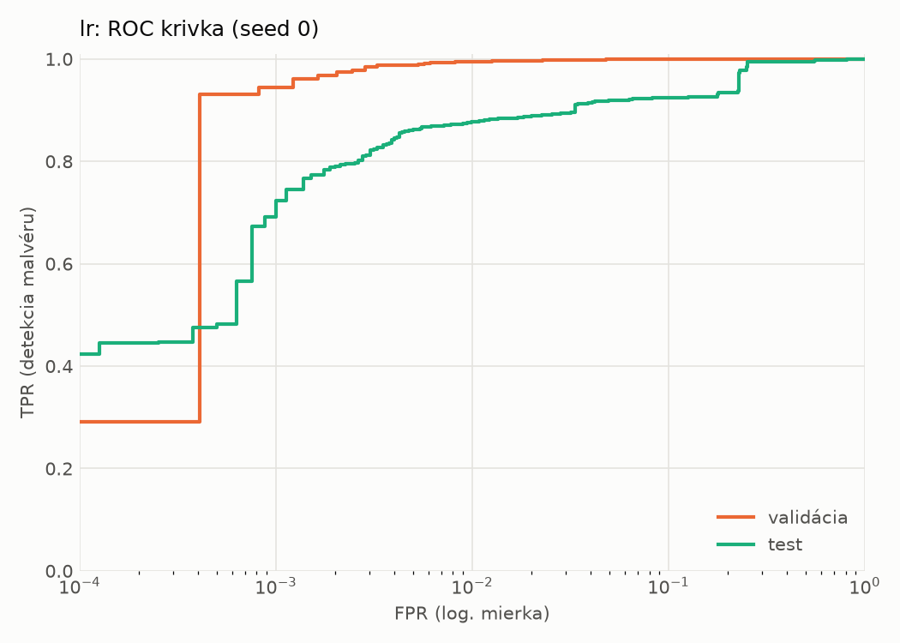
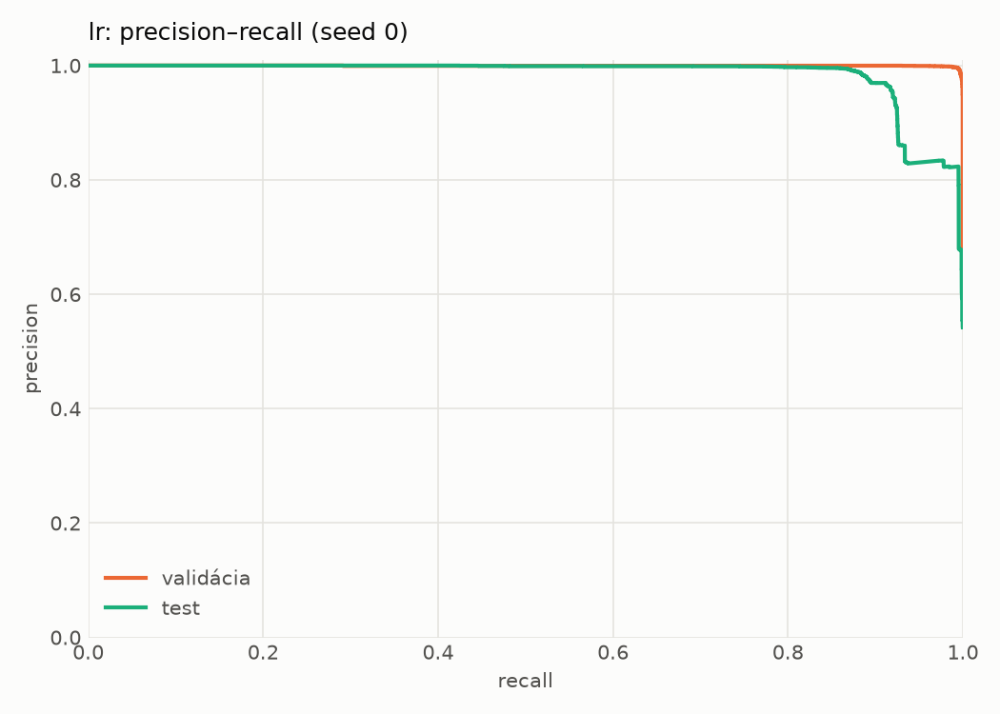
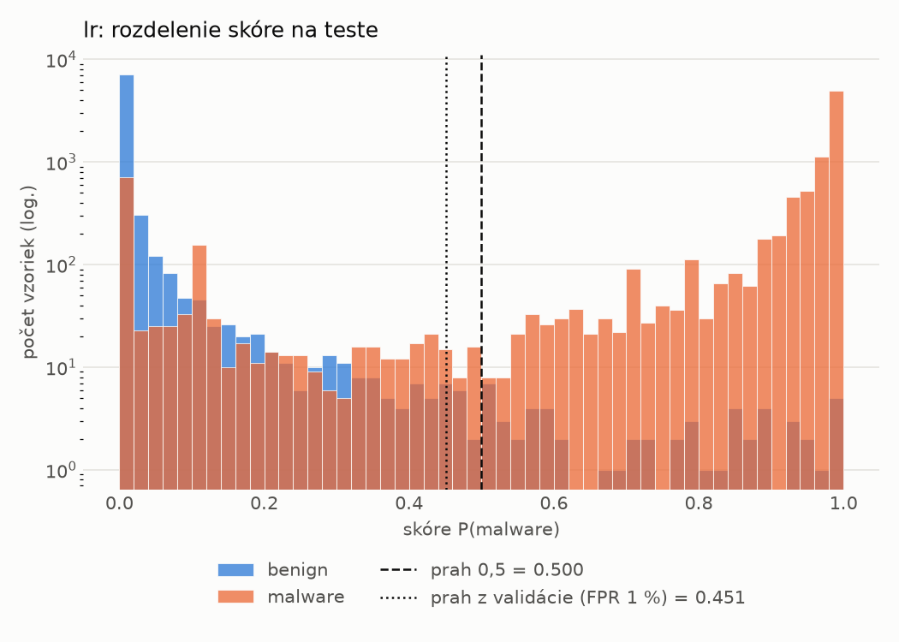
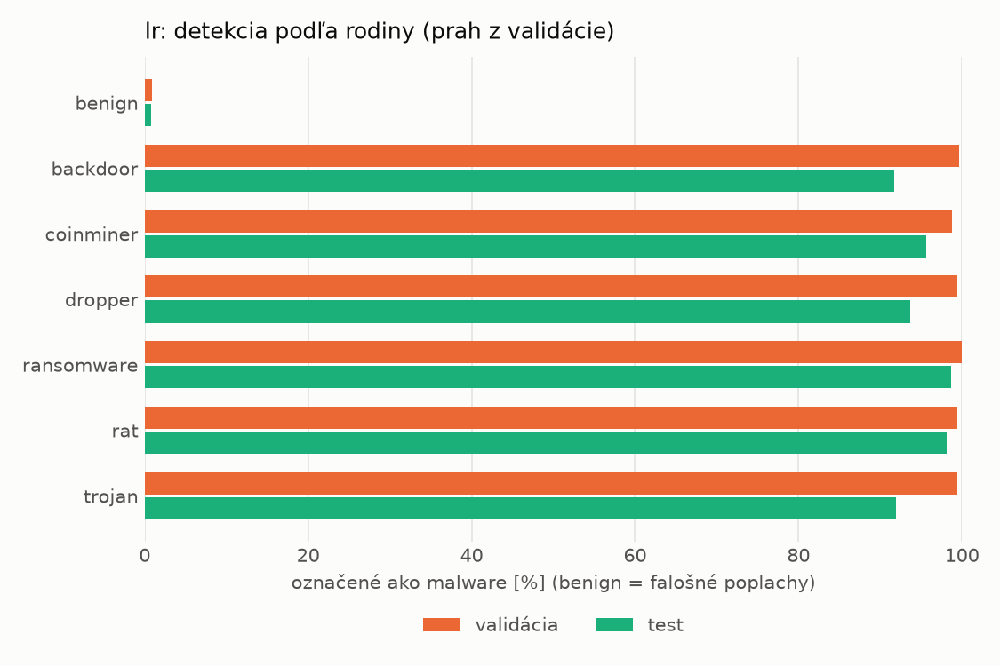
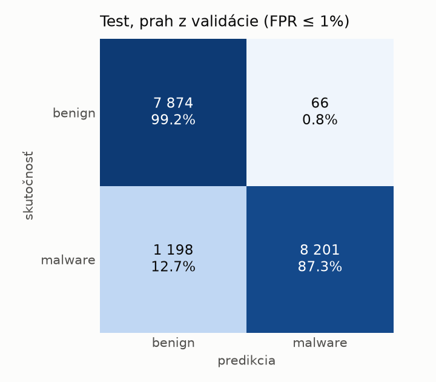
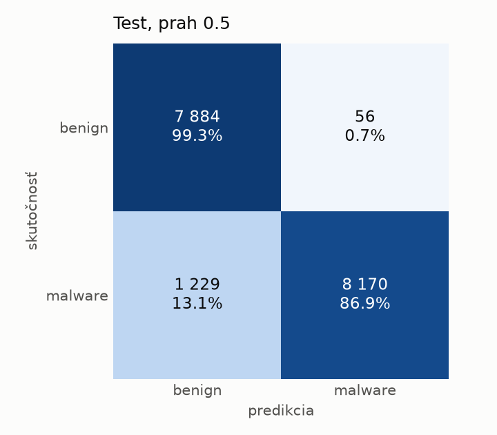

# hybrid/lr – beh `20261104-042825`

> Automaticky generované (`src/training/run_tabular.py`). Konfigurácia: `config.yaml`, protokol: `protocol.yaml`.

- **Model:** `logreg` – logistická regresia s L2 regularizáciou (vstup signed log1p + štandardizácia)
- **Ladenie:** bez ladenia – hyperparametre prevzaté z `runs_final/hybrid/lr/20261102-044357`
- **Finálne modely:** seedy [0, 1, 2]; hodnoty sú priemer ± smerodajná odchýlka cez seedy
- **Najlepšie hyperparametre:** `{"max_iter": 2000, "C": 0.0028355883180749405}`

## Detekčná kvalita (bez prahu)
| metrika | train (podvzorka) | validácia | test |
|---|---|---|---|
| ROC-AUC | 0.9998 ± 0.0000 | 0.9992 ± 0.0000 | 0.9786 ± 0.0000 |
| PR-AUC | 0.9999 ± 0.0000 | 0.9995 ± 0.0000 | 0.9844 ± 0.0000 |
| TPR pri FPR 1 % | 0.9975 ± 0.0000 | 0.9950 ± 0.0000 | 0.8768 ± 0.0000 |
| TPR pri FPR 0,1 % | 0.9901 ± 0.0000 | 0.9442 ± 0.0000 | 0.6912 ± 0.0000 |
| log loss | 0.0189 ± 0.0000 | 0.0256 ± 0.0000 | 0.3338 ± 0.0000 |
| Brier skóre | 0.0039 ± 0.0000 | 0.0057 ± 0.0000 | 0.0672 ± 0.0000 |

Rozdiel ROC-AUC train − validácia: **0.0006** (veľký rozdiel = preučenie).

## Pri prahu z validácie (FPR ≤ 1% na validácii)
| metrika | train (podvzorka) | validácia | test |
|---|---|---|---|
| accuracy | 0.9958 ± 0.0000 | 0.9936 ± 0.0000 | 0.9271 ± 0.0000 |
| balanced accuracy | 0.9958 ± 0.0000 | 0.9930 ± 0.0000 | 0.9321 ± 0.0000 |
| precision | 0.9977 ± 0.0000 | 0.9952 ± 0.0000 | 0.9920 ± 0.0000 |
| recall (TPR) | 0.9958 ± 0.0000 | 0.9950 ± 0.0000 | 0.8725 ± 0.0000 |
| FPR | 0.0043 ± 0.0000 | 0.0090 ± 0.0000 | 0.0083 ± 0.0000 |
| F1 | 0.9968 ± 0.0000 | 0.9951 ± 0.0000 | 0.9285 ± 0.0000 |
| MCC | 0.9908 ± 0.0000 | 0.9859 ± 0.0000 | 0.8621 ± 0.0000 |

## Pri pevnom prahu 0.5
| metrika | train (podvzorka) | validácia | test |
|---|---|---|---|
| accuracy | 0.9957 ± 0.0000 | 0.9933 ± 0.0000 | 0.9259 ± 0.0000 |
| balanced accuracy | 0.9959 ± 0.0000 | 0.9929 ± 0.0000 | 0.9311 ± 0.0000 |
| precision | 0.9981 ± 0.0000 | 0.9954 ± 0.0000 | 0.9932 ± 0.0000 |
| recall (TPR) | 0.9952 ± 0.0000 | 0.9943 ± 0.0000 | 0.8692 ± 0.0000 |
| FPR | 0.0034 ± 0.0000 | 0.0086 ± 0.0000 | 0.0071 ± 0.0000 |
| F1 | 0.9967 ± 0.0000 | 0.9949 ± 0.0000 | 0.9271 ± 0.0000 |
| MCC | 0.9906 ± 0.0000 | 0.9853 ± 0.0000 | 0.8603 ± 0.0000 |

## Výpočtové nároky (seed 0, testovacia množina)
| meranie | hodnota |
|---|---|
| tréning finálneho modelu | 4.9 s (priemer cez seedy) |
| ladenie spolu | 0 s |
| počet parametrov / uzlov | 4 320 |
| veľkosť modelu na disku | 0.13 MB |
| transformácia vstupu – latencia (1 vlákno) | 0.033 ms |
| transformácia vstupu – priepustnosť | 22 873 vzoriek/s |
| CPU latencia modelu (batch 1, 1 vlákno) | 0.007 ms (p95 0.008) |
| CPU priepustnosť (24 vlákien) | 158 017 vzoriek/s |

## Grafy
| | |
|---|---|
|  |  |
|  |  |
|  |  |
|  |  |

## Súbory
`metrics.json` (všetky metriky po seedoch vrátane rodín), `timing.json`, `hpo_trials.csv`,
`predictions/<časť>_seed<N>.parquet` (sha256, family, label, score), `model/seed_<N>/`, `log.txt`.
