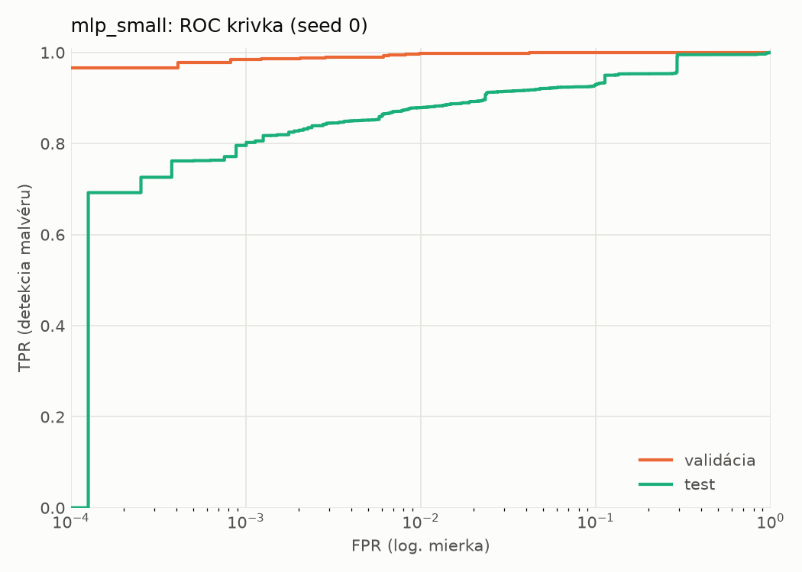
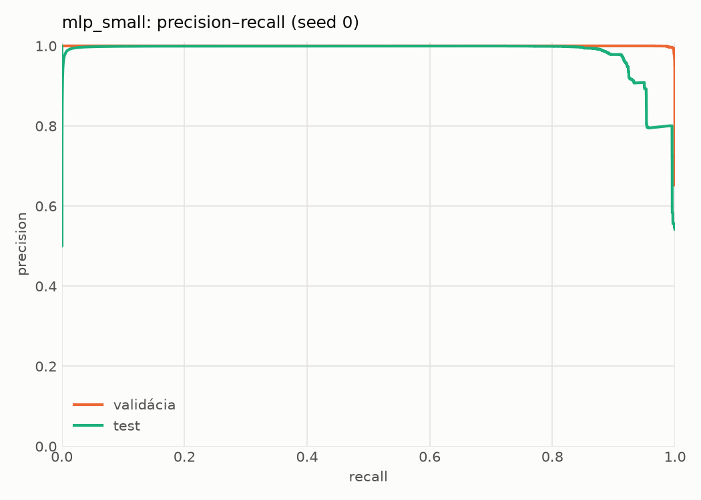
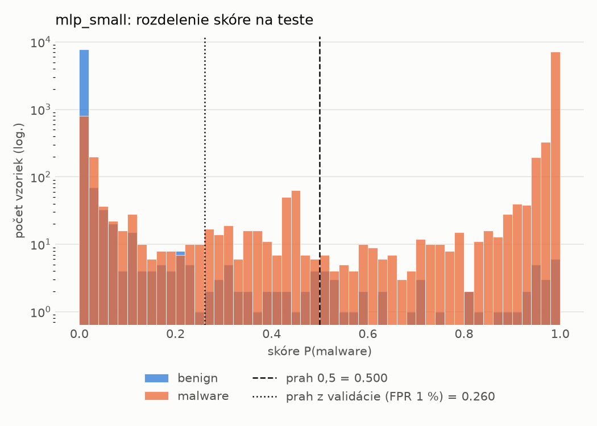
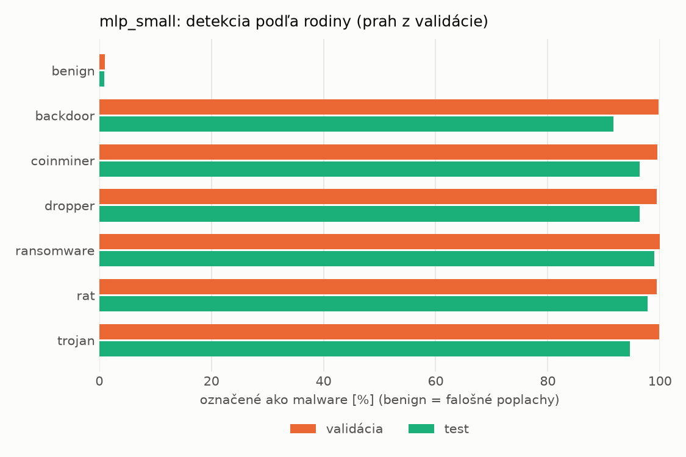
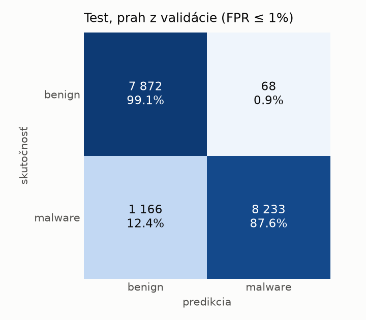
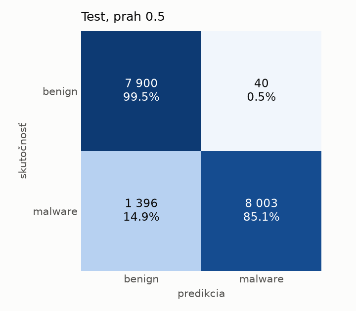
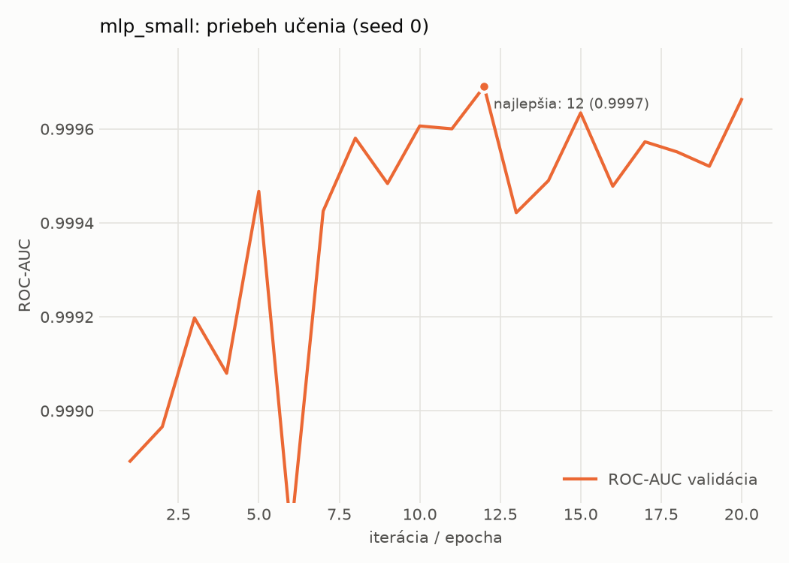

# hybrid/mlp_small – beh `20261104-043644`

> Automaticky generované (`src/training/run_tabular.py`). Konfigurácia: `config.yaml`, protokol: `protocol.yaml`.

- **Model:** `mlp` – malá neurónová sieť (1–2 skryté vrstvy), kandidát na ľahkého študenta
- **Ladenie:** bez ladenia – hyperparametre prevzaté z `runs_final/hybrid/mlp_small/20261102-063854`
- **Finálne modely:** seedy [0, 1, 2]; hodnoty sú priemer ± smerodajná odchýlka cez seedy
- **Najlepšie hyperparametre:** `{"width_decay": 0.5, "max_epochs": 100, "patience": 8, "hidden_layers": 2, "hidden_width": 32, "dropout": 0.16874195706419903, "lr": 0.0006143857735366936, "weight_decay": 0.007079811471617702, "batch_size": 512}`

## Detekčná kvalita (bez prahu)
| metrika | train (podvzorka) | validácia | test |
|---|---|---|---|
| ROC-AUC | 0.9999 ± 0.0000 | 0.9997 ± 0.0001 | 0.9759 ± 0.0089 |
| PR-AUC | 1.0000 ± 0.0000 | 0.9998 ± 0.0000 | 0.9830 ± 0.0056 |
| TPR pri FPR 1 % | 0.9993 ± 0.0004 | 0.9967 ± 0.0007 | 0.8731 ± 0.0062 |
| TPR pri FPR 0,1 % | 0.9974 ± 0.0011 | 0.9756 ± 0.0113 | 0.7693 ± 0.0232 |
| log loss | 0.0109 ± 0.0023 | 0.0208 ± 0.0012 | 0.3414 ± 0.0206 |
| Brier skóre | 0.0018 ± 0.0003 | 0.0046 ± 0.0000 | 0.0728 ± 0.0010 |

Rozdiel ROC-AUC train − validácia: **0.0003** (veľký rozdiel = preučenie).

## Pri prahu z validácie (FPR ≤ 1% na validácii)
| metrika | train (podvzorka) | validácia | test |
|---|---|---|---|
| accuracy | 0.9981 ± 0.0005 | 0.9945 ± 0.0005 | 0.9253 ± 0.0036 |
| balanced accuracy | 0.9981 ± 0.0005 | 0.9936 ± 0.0004 | 0.9305 ± 0.0033 |
| precision | 0.9991 ± 0.0003 | 0.9950 ± 0.0002 | 0.9923 ± 0.0008 |
| recall (TPR) | 0.9979 ± 0.0006 | 0.9967 ± 0.0007 | 0.8689 ± 0.0068 |
| FPR | 0.0017 ± 0.0005 | 0.0094 ± 0.0004 | 0.0079 ± 0.0009 |
| F1 | 0.9985 ± 0.0004 | 0.9958 ± 0.0004 | 0.9265 ± 0.0038 |
| MCC | 0.9958 ± 0.0011 | 0.9880 ± 0.0010 | 0.8590 ± 0.0064 |

## Pri pevnom prahu 0.5
| metrika | train (podvzorka) | validácia | test |
|---|---|---|---|
| accuracy | 0.9979 ± 0.0005 | 0.9942 ± 0.0001 | 0.9184 ± 0.0019 |
| balanced accuracy | 0.9982 ± 0.0005 | 0.9938 ± 0.0001 | 0.9244 ± 0.0018 |
| precision | 0.9996 ± 0.0003 | 0.9960 ± 0.0004 | 0.9950 ± 0.0004 |
| recall (TPR) | 0.9971 ± 0.0005 | 0.9951 ± 0.0006 | 0.8539 ± 0.0033 |
| FPR | 0.0008 ± 0.0006 | 0.0075 ± 0.0009 | 0.0051 ± 0.0004 |
| F1 | 0.9984 ± 0.0004 | 0.9955 ± 0.0001 | 0.9190 ± 0.0020 |
| MCC | 0.9953 ± 0.0011 | 0.9871 ± 0.0003 | 0.8478 ± 0.0034 |

## Výpočtové nároky (seed 0, testovacia množina)
| meranie | hodnota |
|---|---|
| tréning finálneho modelu | 5.5 s (priemer cez seedy) |
| ladenie spolu | 0 s |
| počet parametrov / uzlov | 138 881 |
| veľkosť modelu na disku | 0.67 MB |
| transformácia vstupu – latencia (1 vlákno) | 0.062 ms |
| transformácia vstupu – priepustnosť | 21 684 vzoriek/s |
| CPU latencia modelu (batch 1, 1 vlákno) | 0.102 ms (p95 0.117) |
| CPU priepustnosť (24 vlákien) | 33 647 vzoriek/s |
| GPU latencia (batch 1) | 0.418 ms (p95 0.654) |
| GPU priepustnosť | 27 352 vzoriek/s |
| GPU špičková pamäť | 1535 MB |

## Grafy
| | |
|---|---|
|  |  |
|  |  |
|  |  |
|  |  |

## Súbory
`metrics.json` (všetky metriky po seedoch vrátane rodín), `timing.json`, `hpo_trials.csv`,
`predictions/<časť>_seed<N>.parquet` (sha256, family, label, score), `model/seed_<N>/`, `log.txt`.
