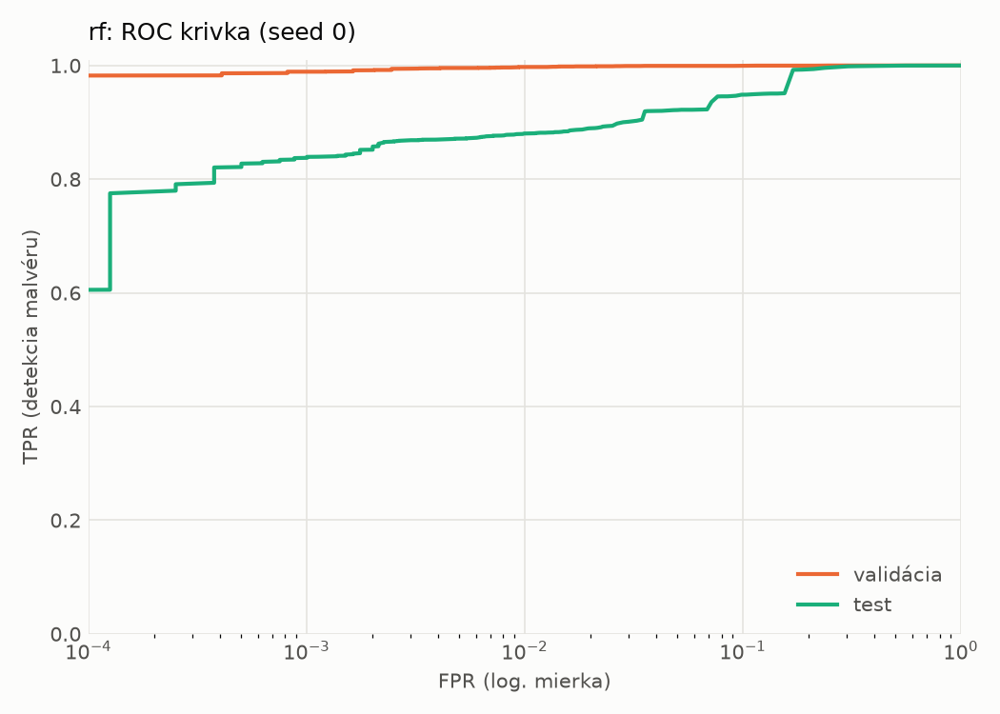
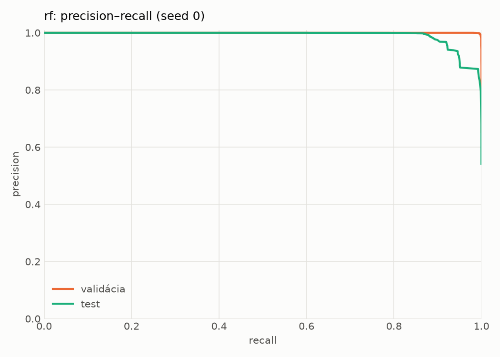
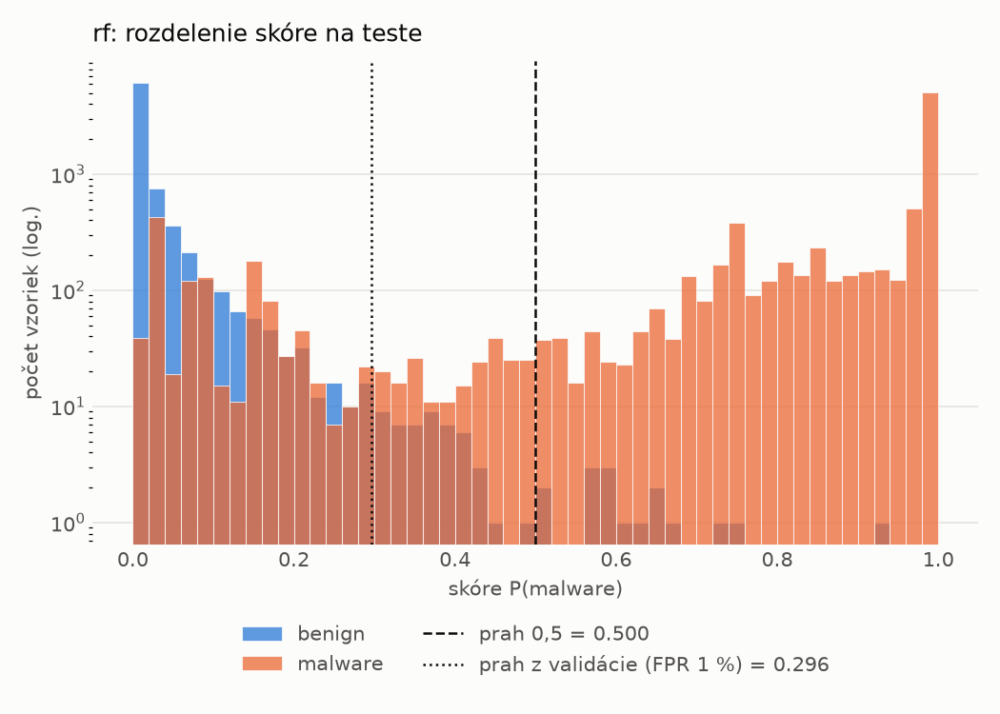
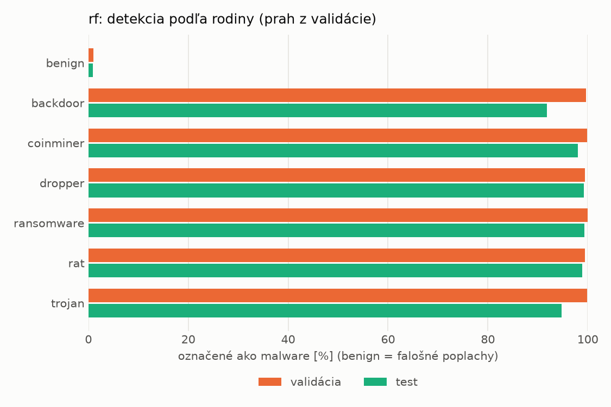
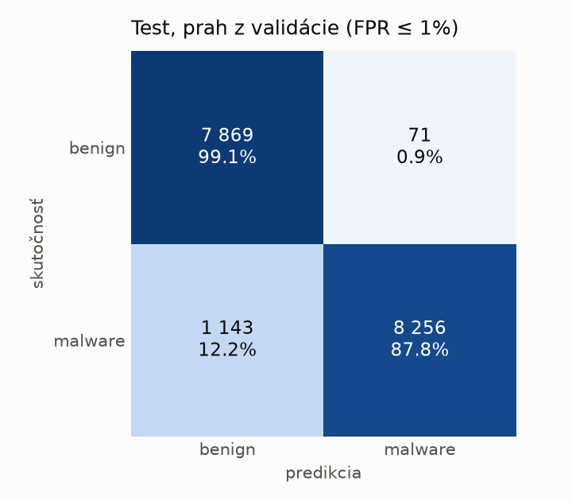
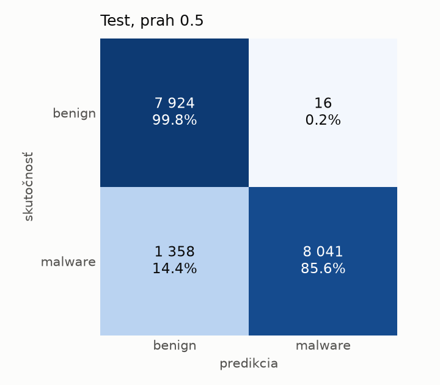

# hybrid/rf – beh `20261104-042855`

> Automaticky generované (`src/training/run_tabular.py`). Konfigurácia: `config.yaml`, protokol: `protocol.yaml`.

- **Model:** `random_forest` – Random Forest (pôvodné hodnoty príznakov)
- **Ladenie:** bez ladenia – hyperparametre prevzaté z `runs_final/hybrid/rf/20261102-044751`
- **Finálne modely:** seedy [0, 1, 2]; hodnoty sú priemer ± smerodajná odchýlka cez seedy
- **Najlepšie hyperparametre:** `{"n_estimators": 250, "max_depth": null, "min_samples_leaf": 1, "max_features": 0.05}`

## Detekčná kvalita (bez prahu)
| metrika | train (podvzorka) | validácia | test |
|---|---|---|---|
| ROC-AUC | 1.0000 ± 0.0000 | 0.9998 ± 0.0000 | 0.9874 ± 0.0009 |
| PR-AUC | 1.0000 ± 0.0000 | 0.9999 ± 0.0000 | 0.9899 ± 0.0005 |
| TPR pri FPR 1 % | 1.0000 ± 0.0000 | 0.9974 ± 0.0002 | 0.8798 ± 0.0006 |
| TPR pri FPR 0,1 % | 1.0000 ± 0.0000 | 0.9884 ± 0.0008 | 0.8304 ± 0.0059 |
| log loss | 0.0052 ± 0.0000 | 0.0182 ± 0.0002 | 0.2406 ± 0.0032 |
| Brier skóre | 0.0007 ± 0.0000 | 0.0042 ± 0.0000 | 0.0692 ± 0.0005 |

Rozdiel ROC-AUC train − validácia: **0.0002** (veľký rozdiel = preučenie).

## Pri prahu z validácie (FPR ≤ 1% na validácii)
| metrika | train (podvzorka) | validácia | test |
|---|---|---|---|
| accuracy | 1.0000 ± 0.0000 | 0.9950 ± 0.0002 | 0.9303 ± 0.0006 |
| balanced accuracy | 1.0000 ± 0.0000 | 0.9939 ± 0.0002 | 0.9351 ± 0.0006 |
| precision | 1.0000 ± 0.0000 | 0.9949 ± 0.0001 | 0.9924 ± 0.0008 |
| recall (TPR) | 1.0000 ± 0.0000 | 0.9974 ± 0.0002 | 0.8781 ± 0.0010 |
| FPR | 0.0000 ± 0.0000 | 0.0096 ± 0.0002 | 0.0080 ± 0.0008 |
| F1 | 1.0000 ± 0.0000 | 0.9962 ± 0.0001 | 0.9318 ± 0.0006 |
| MCC | 1.0000 ± 0.0000 | 0.9889 ± 0.0004 | 0.8678 ± 0.0011 |

## Pri pevnom prahu 0.5
| metrika | train (podvzorka) | validácia | test |
|---|---|---|---|
| accuracy | 1.0000 ± 0.0001 | 0.9955 ± 0.0001 | 0.9202 ± 0.0016 |
| balanced accuracy | 1.0000 ± 0.0000 | 0.9957 ± 0.0002 | 0.9262 ± 0.0014 |
| precision | 1.0000 ± 0.0000 | 0.9982 ± 0.0003 | 0.9980 ± 0.0001 |
| recall (TPR) | 0.9999 ± 0.0001 | 0.9948 ± 0.0001 | 0.8545 ± 0.0029 |
| FPR | 0.0000 ± 0.0000 | 0.0034 ± 0.0005 | 0.0021 ± 0.0001 |
| F1 | 1.0000 ± 0.0000 | 0.9965 ± 0.0001 | 0.9207 ± 0.0017 |
| MCC | 0.9999 ± 0.0001 | 0.9900 ± 0.0003 | 0.8516 ± 0.0027 |

## Výpočtové nároky (seed 0, testovacia množina)
| meranie | hodnota |
|---|---|
| tréning finálneho modelu | 137.9 s (priemer cez seedy) |
| ladenie spolu | 0 s |
| počet parametrov / uzlov | 247 856 |
| veľkosť modelu na disku | 20.18 MB |
| CPU latencia modelu (batch 1, 1 vlákno) | 7.242 ms (p95 7.646) |
| CPU priepustnosť (24 vlákien) | 97 505 vzoriek/s |

## Grafy
| | |
|---|---|
|  |  |
|  |  |
|  |  |
|  |  |

## Súbory
`metrics.json` (všetky metriky po seedoch vrátane rodín), `timing.json`, `hpo_trials.csv`,
`predictions/<časť>_seed<N>.parquet` (sha256, family, label, score), `model/seed_<N>/`, `log.txt`.
