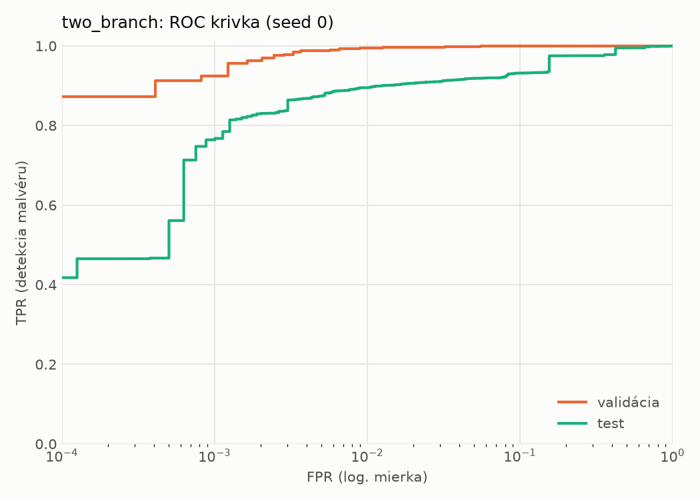
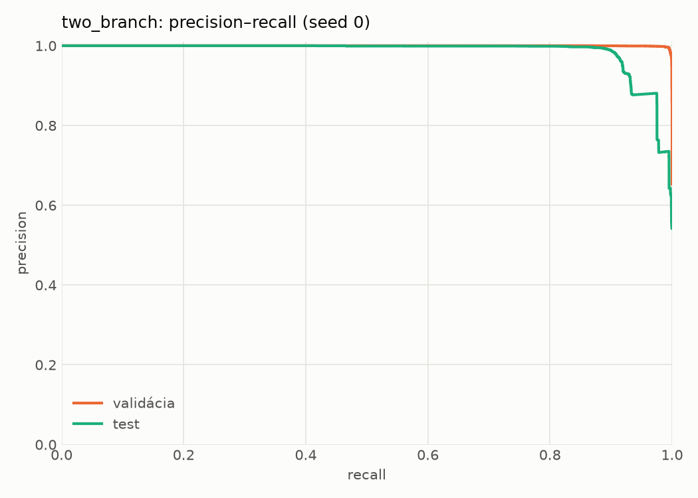
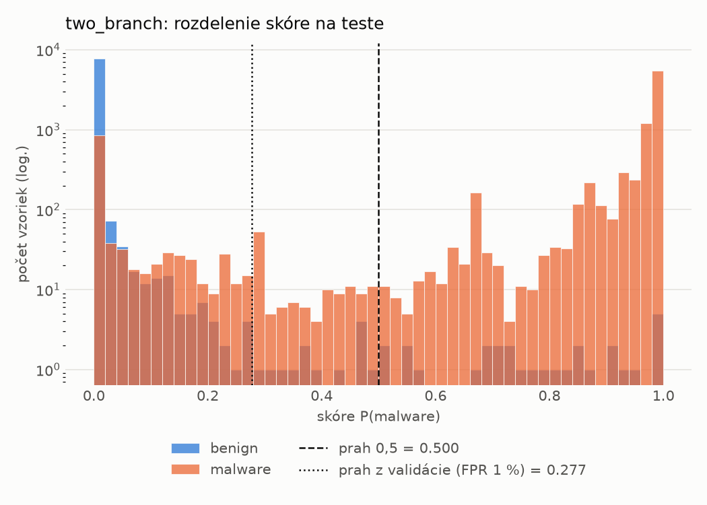
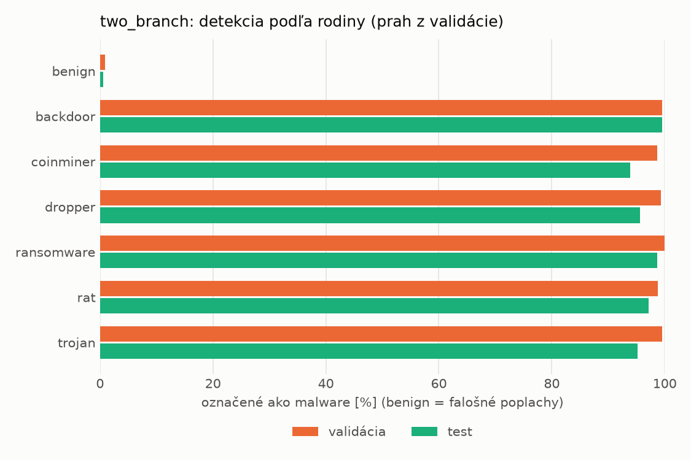
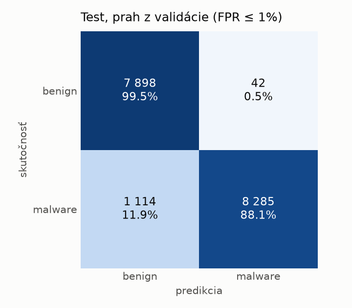
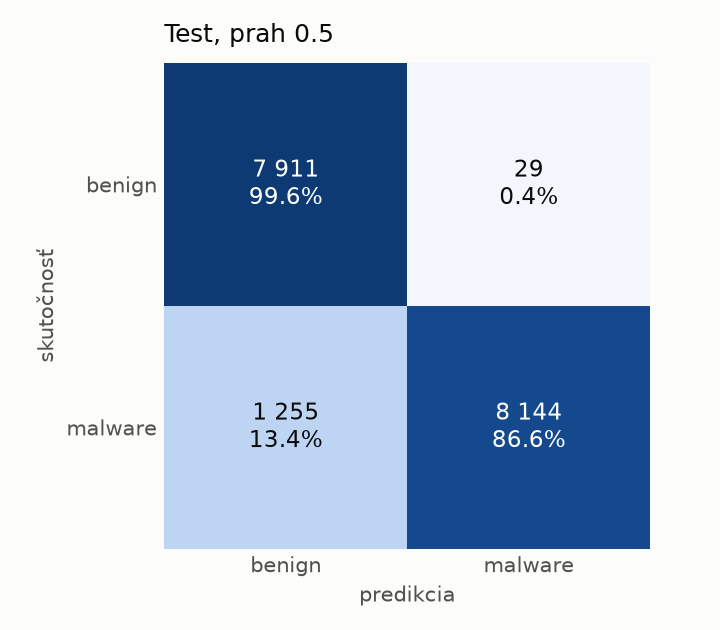
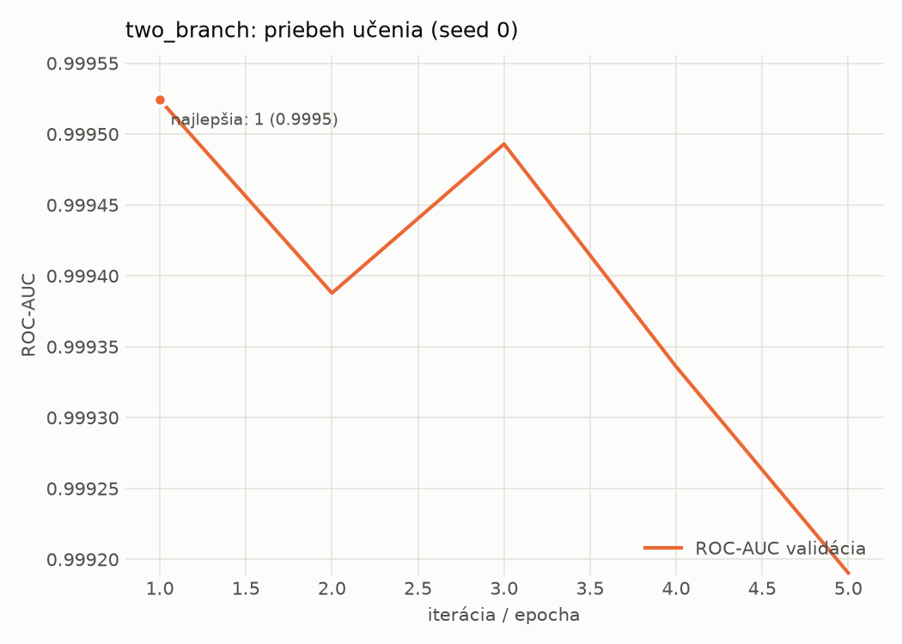

# hybrid_seq/two_branch – beh `20261104-043800`

> Automaticky generované (`src/training/run_tabular.py`). Konfigurácia: `config.yaml`, protokol: `protocol.yaml`.

- **Model:** `two_branch` – statická MLP vetva + sekvenčná CNN vetva nad API volaniami, spojené v spoločnej hlave
- **Ladenie:** bez ladenia – hyperparametre prevzaté z `runs_final/hybrid/two_branch/20261102-170657`
- **Finálne modely:** seedy [0, 1, 2]; hodnoty sú priemer ± smerodajná odchýlka cez seedy
- **Najlepšie hyperparametre:** `{"n_static": 2381, "width_decay": 0.5, "max_epochs": 30, "patience": 4, "static_layers": 3, "static_width": 256, "emb_dim": 64, "channels": 256, "kernels": "2-4-8", "hidden": 512, "dropout": 0.32477392485404594, "lr": 0.0006728393356648638, "weight_decay": 0.0003230215070317658, "batch_size": 256}`

## Detekčná kvalita (bez prahu)
| metrika | train (podvzorka) | validácia | test |
|---|---|---|---|
| ROC-AUC | 0.9999 ± 0.0001 | 0.9996 ± 0.0001 | 0.9788 ± 0.0080 |
| PR-AUC | 0.9999 ± 0.0001 | 0.9998 ± 0.0000 | 0.9856 ± 0.0045 |
| TPR pri FPR 1 % | 0.9984 ± 0.0014 | 0.9963 ± 0.0017 | 0.8997 ± 0.0048 |
| TPR pri FPR 0,1 % | 0.9932 ± 0.0051 | 0.9365 ± 0.0239 | 0.7450 ± 0.0489 |
| log loss | 0.0127 ± 0.0075 | 0.0222 ± 0.0037 | 0.4552 ± 0.0464 |
| Brier skóre | 0.0031 ± 0.0018 | 0.0047 ± 0.0013 | 0.0652 ± 0.0039 |

Rozdiel ROC-AUC train − validácia: **0.0003** (veľký rozdiel = preučenie).

## Pri prahu z validácie (FPR ≤ 1% na validácii)
| metrika | train (podvzorka) | validácia | test |
|---|---|---|---|
| accuracy | 0.9966 ± 0.0020 | 0.9945 ± 0.0012 | 0.9385 ± 0.0046 |
| balanced accuracy | 0.9966 ± 0.0018 | 0.9937 ± 0.0009 | 0.9428 ± 0.0042 |
| precision | 0.9982 ± 0.0005 | 0.9953 ± 0.0001 | 0.9937 ± 0.0011 |
| recall (TPR) | 0.9966 ± 0.0027 | 0.9963 ± 0.0017 | 0.8922 ± 0.0096 |
| FPR | 0.0033 ± 0.0010 | 0.0089 ± 0.0002 | 0.0067 ± 0.0012 |
| F1 | 0.9974 ± 0.0016 | 0.9958 ± 0.0009 | 0.9402 ± 0.0049 |
| MCC | 0.9926 ± 0.0045 | 0.9879 ± 0.0025 | 0.8827 ± 0.0081 |

## Pri pevnom prahu 0.5
| metrika | train (podvzorka) | validácia | test |
|---|---|---|---|
| accuracy | 0.9962 ± 0.0023 | 0.9945 ± 0.0016 | 0.9295 ± 0.0050 |
| balanced accuracy | 0.9967 ± 0.0020 | 0.9945 ± 0.0014 | 0.9347 ± 0.0046 |
| precision | 0.9991 ± 0.0006 | 0.9970 ± 0.0006 | 0.9964 ± 0.0002 |
| recall (TPR) | 0.9950 ± 0.0030 | 0.9946 ± 0.0020 | 0.8731 ± 0.0094 |
| FPR | 0.0016 ± 0.0011 | 0.0056 ± 0.0010 | 0.0038 ± 0.0002 |
| F1 | 0.9970 ± 0.0018 | 0.9958 ± 0.0012 | 0.9307 ± 0.0053 |
| MCC | 0.9916 ± 0.0050 | 0.9880 ± 0.0035 | 0.8674 ± 0.0088 |

## Výpočtové nároky (seed 0, testovacia množina)
| meranie | hodnota |
|---|---|
| tréning finálneho modelu | 308.8 s (priemer cez seedy) |
| ladenie spolu | 0 s |
| počet parametrov / uzlov | 1 756 930 |
| veľkosť modelu na disku | 7.10 MB |
| CPU latencia modelu (batch 1, 1 vlákno) | 5.195 ms (p95 5.618) |
| CPU priepustnosť (24 vlákien) | 651 vzoriek/s |
| GPU latencia (batch 1) | 1.236 ms (p95 2.811) |
| GPU priepustnosť | 4 417 vzoriek/s |
| GPU špičková pamäť | 3907 MB |

## Grafy
| | |
|---|---|
|  |  |
|  |  |
|  |  |
|  |  |

## Súbory
`metrics.json` (všetky metriky po seedoch vrátane rodín), `timing.json`, `hpo_trials.csv`,
`predictions/<časť>_seed<N>.parquet` (sha256, family, label, score), `model/seed_<N>/`, `log.txt`.
