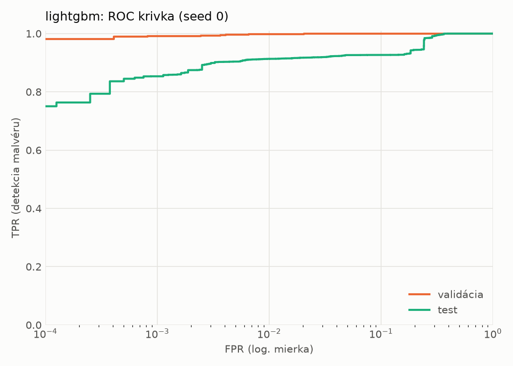
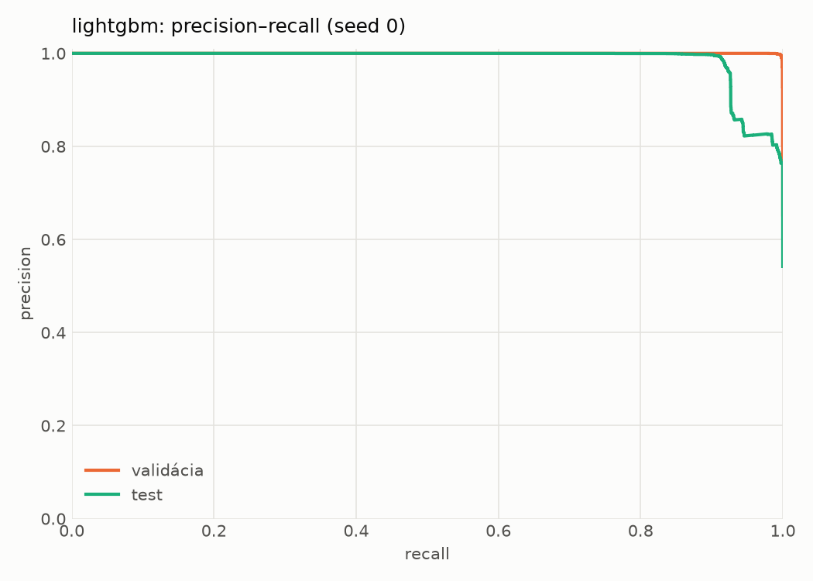
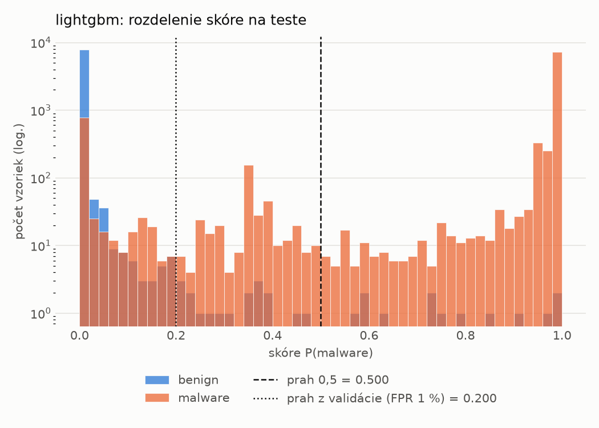
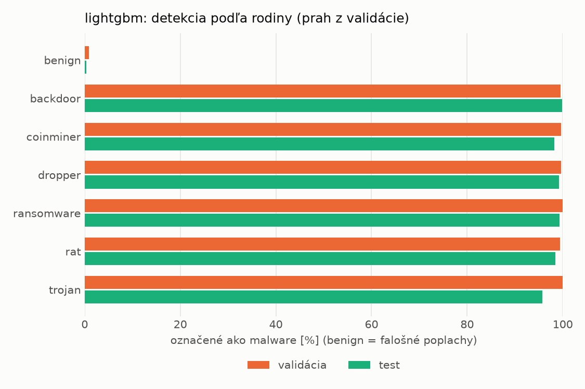
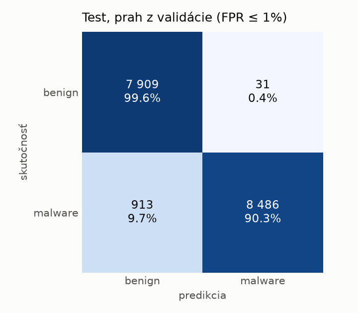
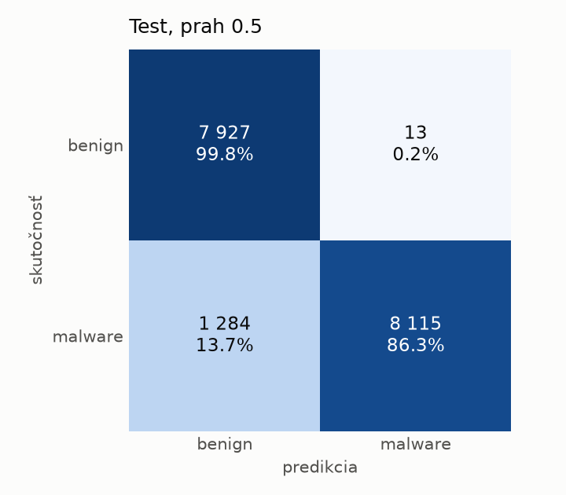
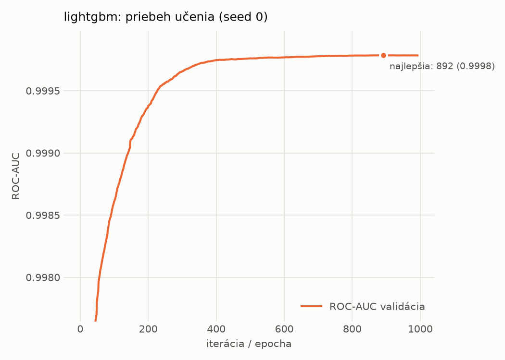

# static/lightgbm – beh `20261104-034747`

> Automaticky generované (`src/training/run_tabular.py`). Konfigurácia: `config.yaml`, protokol: `protocol.yaml`.

- **Model:** `lightgbm` – LightGBM, gradient boosting stromov s early stopping na validácii (pôvodné hodnoty príznakov)
- **Ladenie:** bez ladenia – hyperparametre prevzaté z `runs_final/static/lightgbm/20261101-215345`
- **Finálne modely:** seedy [0, 1, 2]; hodnoty sú priemer ± smerodajná odchýlka cez seedy
- **Najlepšie hyperparametre:** `{"num_boost_round": 5000, "early_stopping_rounds": 100, "learning_rate": 0.017398074711291726, "num_leaves": 461, "min_child_samples": 101, "feature_fraction": 0.9576492590949324, "bagging_fraction": 0.9474136752138245, "lambda_l1": 0.002404915432737351, "lambda_l2": 1.9809253750493907}`

## Detekčná kvalita (bez prahu)
| metrika | train (podvzorka) | validácia | test |
|---|---|---|---|
| ROC-AUC | 1.0000 ± 0.0000 | 0.9998 ± 0.0000 | 0.9818 ± 0.0002 |
| PR-AUC | 1.0000 ± 0.0000 | 0.9999 ± 0.0000 | 0.9869 ± 0.0001 |
| TPR pri FPR 1 % | 1.0000 ± 0.0000 | 0.9978 ± 0.0002 | 0.9134 ± 0.0002 |
| TPR pri FPR 0,1 % | 1.0000 ± 0.0000 | 0.9914 ± 0.0005 | 0.8551 ± 0.0018 |
| log loss | 0.0003 ± 0.0002 | 0.0136 ± 0.0003 | 0.4475 ± 0.0457 |
| Brier skóre | 0.0000 ± 0.0000 | 0.0032 ± 0.0002 | 0.0621 ± 0.0003 |

Rozdiel ROC-AUC train − validácia: **0.0002** (veľký rozdiel = preučenie).

## Pri prahu z validácie (FPR ≤ 1% na validácii)
| metrika | train (podvzorka) | validácia | test |
|---|---|---|---|
| accuracy | 1.0000 ± 0.0000 | 0.9954 ± 0.0002 | 0.9471 ± 0.0013 |
| balanced accuracy | 1.0000 ± 0.0000 | 0.9943 ± 0.0003 | 0.9508 ± 0.0012 |
| precision | 1.0000 ± 0.0000 | 0.9951 ± 0.0003 | 0.9955 ± 0.0008 |
| recall (TPR) | 1.0000 ± 0.0000 | 0.9978 ± 0.0002 | 0.9065 ± 0.0031 |
| FPR | 0.0000 ± 0.0000 | 0.0093 ± 0.0006 | 0.0048 ± 0.0008 |
| F1 | 1.0000 ± 0.0000 | 0.9964 ± 0.0001 | 0.9489 ± 0.0014 |
| MCC | 1.0000 ± 0.0000 | 0.9897 ± 0.0004 | 0.8985 ± 0.0023 |

## Pri pevnom prahu 0.5
| metrika | train (podvzorka) | validácia | test |
|---|---|---|---|
| accuracy | 1.0000 ± 0.0000 | 0.9960 ± 0.0002 | 0.9257 ± 0.0004 |
| balanced accuracy | 1.0000 ± 0.0000 | 0.9960 ± 0.0002 | 0.9313 ± 0.0004 |
| precision | 1.0000 ± 0.0000 | 0.9977 ± 0.0001 | 0.9984 ± 0.0001 |
| recall (TPR) | 1.0000 ± 0.0000 | 0.9962 ± 0.0003 | 0.8642 ± 0.0007 |
| FPR | 0.0000 ± 0.0000 | 0.0042 ± 0.0002 | 0.0016 ± 0.0001 |
| F1 | 1.0000 ± 0.0000 | 0.9969 ± 0.0002 | 0.9265 ± 0.0004 |
| MCC | 1.0000 ± 0.0000 | 0.9912 ± 0.0005 | 0.8612 ± 0.0007 |

## Výpočtové nároky (seed 0, testovacia množina)
| meranie | hodnota |
|---|---|
| tréning finálneho modelu | 232.3 s (priemer cez seedy) |
| ladenie spolu | 0 s |
| počet parametrov / uzlov | 239 078 |
| veľkosť modelu na disku | 13.90 MB |
| CPU latencia modelu (batch 1, 1 vlákno) | 0.154 ms (p95 0.206) |
| CPU priepustnosť (24 vlákien) | 95 569 vzoriek/s |

## Grafy
| | |
|---|---|
|  |  |
|  |  |
|  |  |
|  |  |

## Súbory
`metrics.json` (všetky metriky po seedoch vrátane rodín), `timing.json`, `hpo_trials.csv`,
`predictions/<časť>_seed<N>.parquet` (sha256, family, label, score), `model/seed_<N>/`, `log.txt`.
