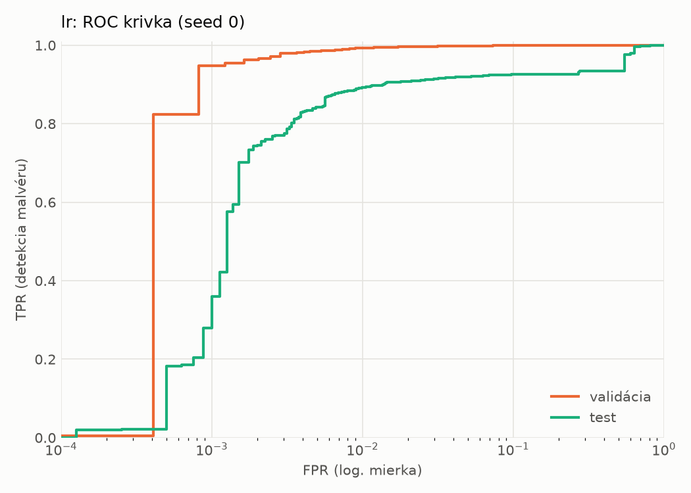
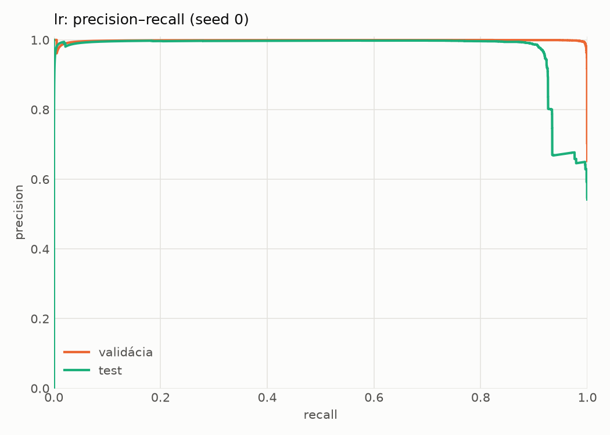
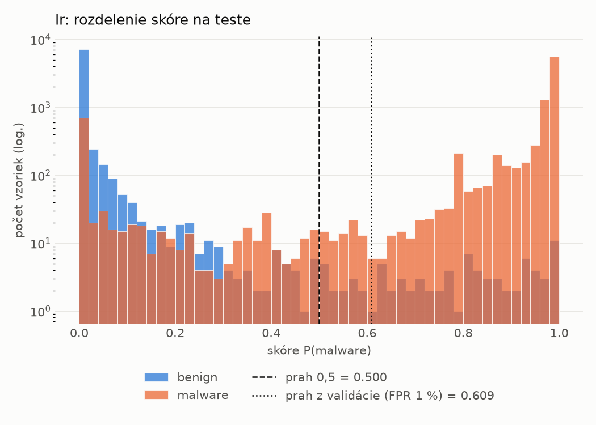
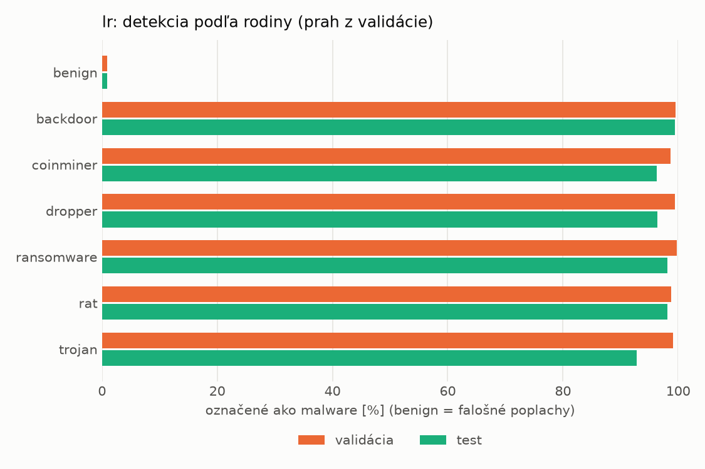
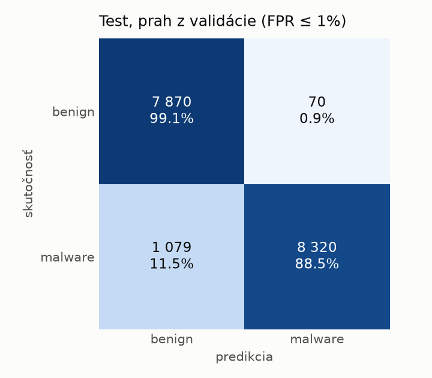
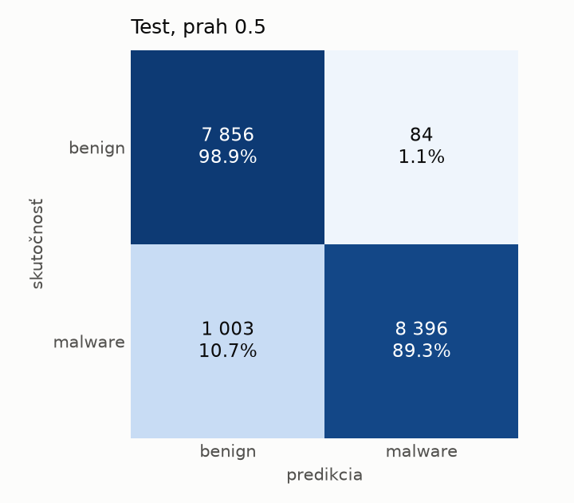

# static/lr – beh `20261104-034610`

> Automaticky generované (`src/training/run_tabular.py`). Konfigurácia: `config.yaml`, protokol: `protocol.yaml`.

- **Model:** `logreg` – logistická regresia s L2 regularizáciou (vstup signed log1p + štandardizácia)
- **Ladenie:** bez ladenia – hyperparametre prevzaté z `runs_final/static/lr/20261101-213555`
- **Finálne modely:** seedy [0, 1, 2]; hodnoty sú priemer ± smerodajná odchýlka cez seedy
- **Najlepšie hyperparametre:** `{"max_iter": 2000, "C": 0.00515917154582608}`

## Detekčná kvalita (bez prahu)
| metrika | train (podvzorka) | validácia | test |
|---|---|---|---|
| ROC-AUC | 0.9997 ± 0.0000 | 0.9988 ± 0.0000 | 0.9567 ± 0.0000 |
| PR-AUC | 0.9998 ± 0.0000 | 0.9985 ± 0.0000 | 0.9718 ± 0.0000 |
| TPR pri FPR 1 % | 0.9960 ± 0.0000 | 0.9932 ± 0.0000 | 0.8920 ± 0.0000 |
| TPR pri FPR 0,1 % | 0.9866 ± 0.0000 | 0.9477 ± 0.0000 | 0.2797 ± 0.0000 |
| log loss | 0.0235 ± 0.0000 | 0.0315 ± 0.0000 | 0.4085 ± 0.0000 |
| Brier skóre | 0.0049 ± 0.0000 | 0.0068 ± 0.0000 | 0.0579 ± 0.0000 |

Rozdiel ROC-AUC train − validácia: **0.0009** (veľký rozdiel = preučenie).

## Pri prahu z validácie (FPR ≤ 1% na validácii)
| metrika | train (podvzorka) | validácia | test |
|---|---|---|---|
| accuracy | 0.9953 ± 0.0000 | 0.9925 ± 0.0000 | 0.9337 ± 0.0000 |
| balanced accuracy | 0.9957 ± 0.0000 | 0.9921 ± 0.0000 | 0.9382 ± 0.0000 |
| precision | 0.9984 ± 0.0000 | 0.9952 ± 0.0000 | 0.9917 ± 0.0000 |
| recall (TPR) | 0.9943 ± 0.0000 | 0.9932 ± 0.0000 | 0.8852 ± 0.0000 |
| FPR | 0.0028 ± 0.0000 | 0.0090 ± 0.0000 | 0.0088 ± 0.0000 |
| F1 | 0.9964 ± 0.0000 | 0.9942 ± 0.0000 | 0.9354 ± 0.0000 |
| MCC | 0.9897 ± 0.0000 | 0.9834 ± 0.0000 | 0.8737 ± 0.0000 |

## Pri pevnom prahu 0.5
| metrika | train (podvzorka) | validácia | test |
|---|---|---|---|
| accuracy | 0.9949 ± 0.0000 | 0.9916 ± 0.0000 | 0.9373 ± 0.0000 |
| balanced accuracy | 0.9947 ± 0.0000 | 0.9903 ± 0.0000 | 0.9414 ± 0.0000 |
| precision | 0.9968 ± 0.0000 | 0.9926 ± 0.0000 | 0.9901 ± 0.0000 |
| recall (TPR) | 0.9954 ± 0.0000 | 0.9946 ± 0.0000 | 0.8933 ± 0.0000 |
| FPR | 0.0060 ± 0.0000 | 0.0139 ± 0.0000 | 0.0106 ± 0.0000 |
| F1 | 0.9961 ± 0.0000 | 0.9936 ± 0.0000 | 0.9392 ± 0.0000 |
| MCC | 0.9888 ± 0.0000 | 0.9815 ± 0.0000 | 0.8798 ± 0.0000 |

## Výpočtové nároky (seed 0, testovacia množina)
| meranie | hodnota |
|---|---|
| tréning finálneho modelu | 2.1 s (priemer cez seedy) |
| ladenie spolu | 0 s |
| počet parametrov / uzlov | 2 320 |
| veľkosť modelu na disku | 0.07 MB |
| transformácia vstupu – latencia (1 vlákno) | 0.021 ms |
| transformácia vstupu – priepustnosť | 45 204 vzoriek/s |
| CPU latencia modelu (batch 1, 1 vlákno) | 0.006 ms (p95 0.006) |
| CPU priepustnosť (24 vlákien) | 299 192 vzoriek/s |

## Grafy
| | |
|---|---|
|  |  |
|  |  |
|  |  |
|  |  |

## Súbory
`metrics.json` (všetky metriky po seedoch vrátane rodín), `timing.json`, `hpo_trials.csv`,
`predictions/<časť>_seed<N>.parquet` (sha256, family, label, score), `model/seed_<N>/`, `log.txt`.
