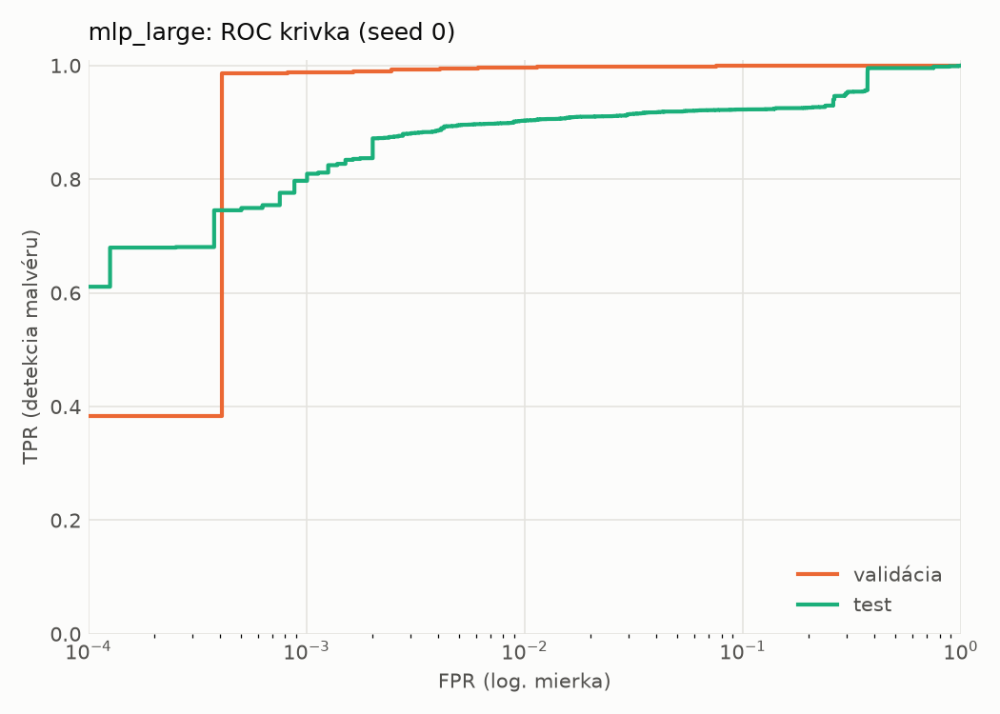
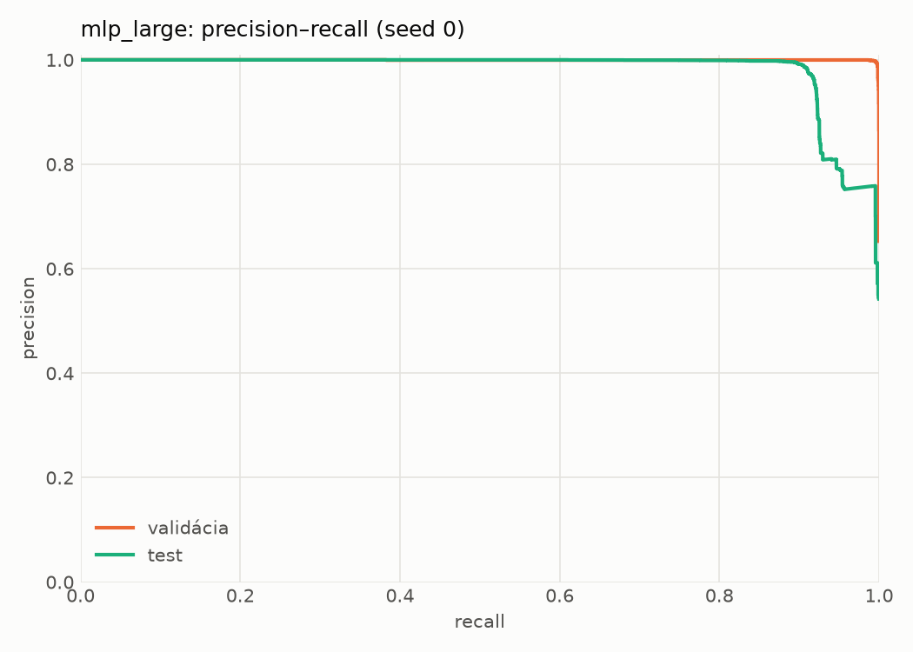
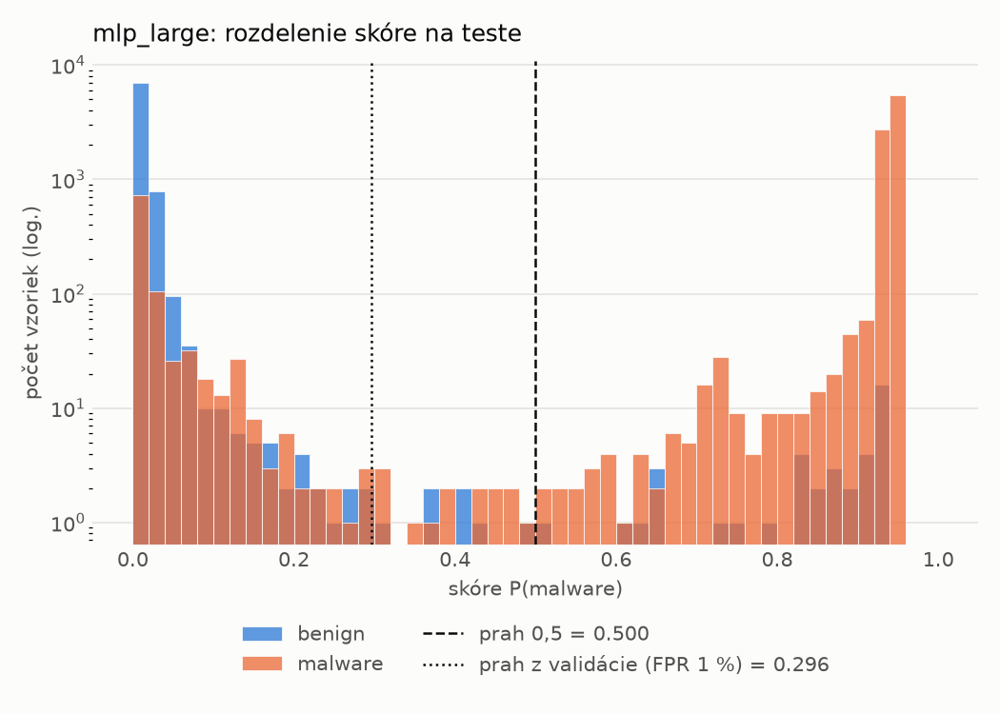
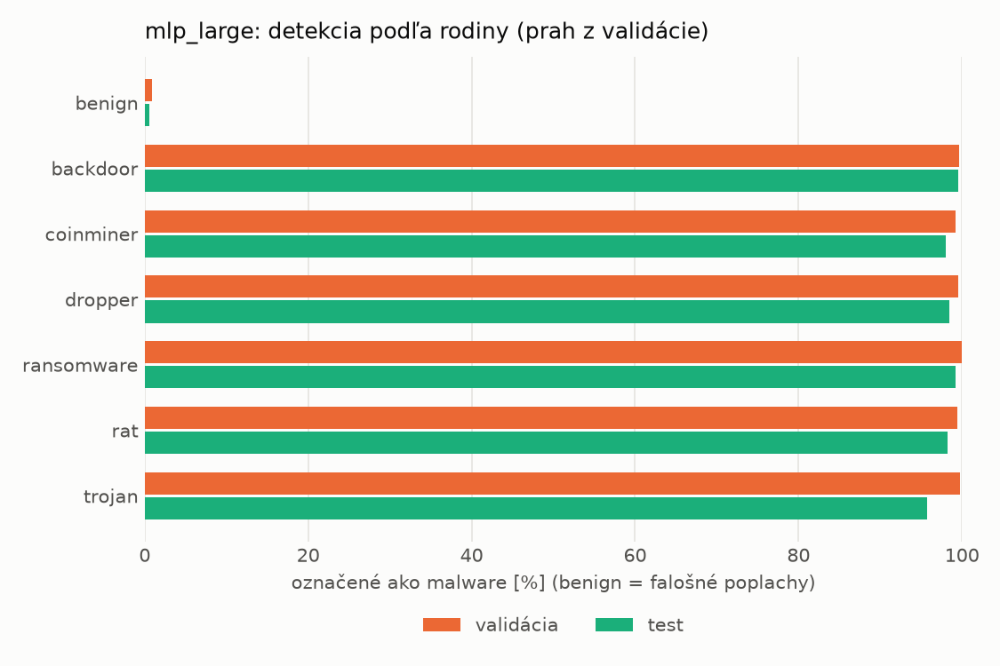
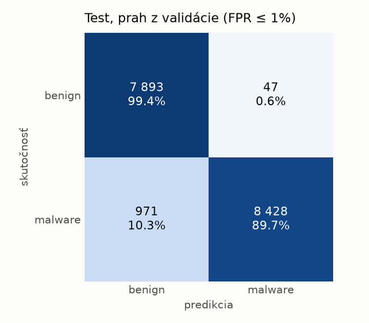
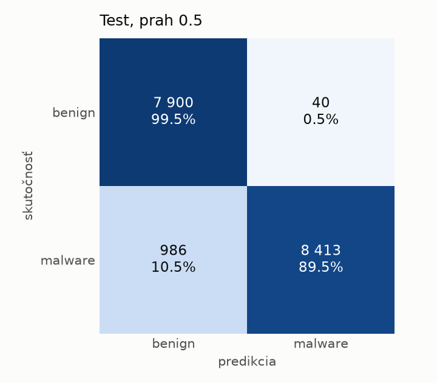
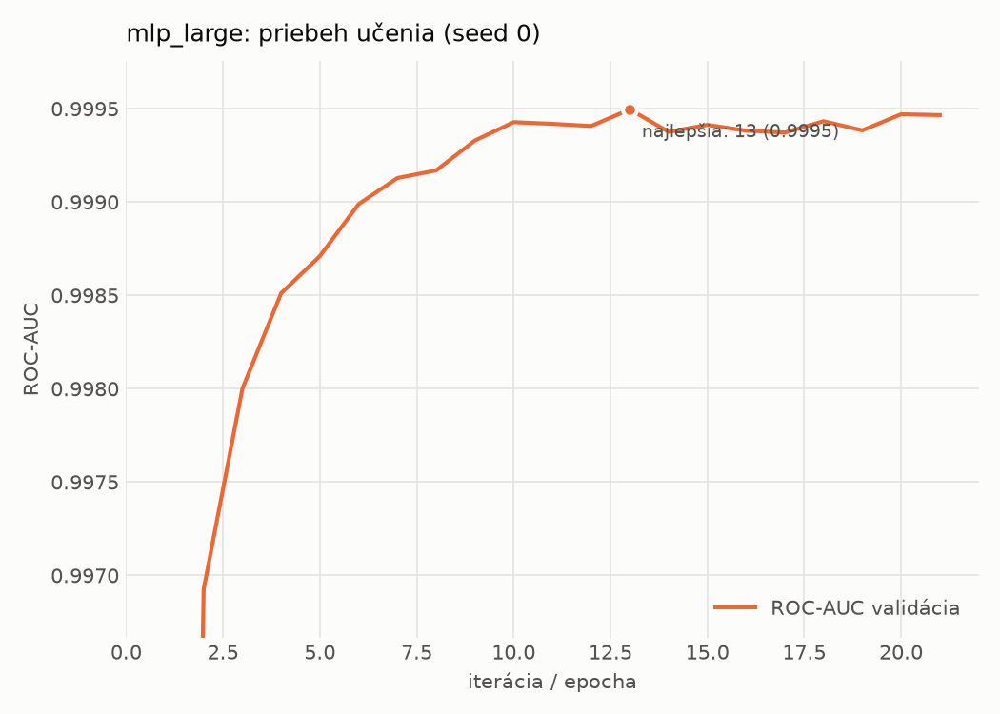

# static/mlp_large – beh `20261104-040009`

> Automaticky generované (`src/training/run_tabular.py`). Konfigurácia: `config.yaml`, protokol: `protocol.yaml`.

- **Model:** `mlp` – veľká neurónová sieť (3–5 skrytých vrstiev, 512–2048 neurónov), kandidát na učiteľa
- **Ladenie:** bez ladenia – hyperparametre prevzaté z `runs_final/static/mlp_large/20261101-235239`
- **Finálne modely:** seedy [0, 1, 2]; hodnoty sú priemer ± smerodajná odchýlka cez seedy
- **Najlepšie hyperparametre:** `{"max_epochs": 100, "patience": 8, "hidden_layers": 5, "hidden_width": 512, "width_decay": 0.5, "dropout": 0.4556986332296347, "lr": 0.00015070674125138616, "weight_decay": 0.0036646034219705954, "batch_size": 1024}`

## Detekčná kvalita (bez prahu)
| metrika | train (podvzorka) | validácia | test |
|---|---|---|---|
| ROC-AUC | 0.9999 ± 0.0000 | 0.9997 ± 0.0002 | 0.9692 ± 0.0146 |
| PR-AUC | 1.0000 ± 0.0000 | 0.9998 ± 0.0001 | 0.9808 ± 0.0067 |
| TPR pri FPR 1 % | 0.9990 ± 0.0005 | 0.9969 ± 0.0003 | 0.9032 ± 0.0017 |
| TPR pri FPR 0,1 % | 0.9980 ± 0.0009 | 0.9885 ± 0.0024 | 0.8098 ± 0.0112 |
| log loss | 0.0356 ± 0.0135 | 0.0444 ± 0.0119 | 0.2751 ± 0.0091 |
| Brier skóre | 0.0029 ± 0.0013 | 0.0054 ± 0.0010 | 0.0590 ± 0.0013 |

Rozdiel ROC-AUC train − validácia: **0.0002** (veľký rozdiel = preučenie).

## Pri prahu z validácie (FPR ≤ 1% na validácii)
| metrika | train (podvzorka) | validácia | test |
|---|---|---|---|
| accuracy | 0.9983 ± 0.0006 | 0.9947 ± 0.0000 | 0.9418 ± 0.0005 |
| balanced accuracy | 0.9985 ± 0.0005 | 0.9938 ± 0.0001 | 0.9458 ± 0.0004 |
| precision | 0.9995 ± 0.0001 | 0.9951 ± 0.0003 | 0.9938 ± 0.0009 |
| recall (TPR) | 0.9979 ± 0.0008 | 0.9969 ± 0.0003 | 0.8983 ± 0.0017 |
| FPR | 0.0009 ± 0.0002 | 0.0093 ± 0.0006 | 0.0066 ± 0.0010 |
| F1 | 0.9987 ± 0.0004 | 0.9960 ± 0.0000 | 0.9437 ± 0.0006 |
| MCC | 0.9964 ± 0.0012 | 0.9884 ± 0.0000 | 0.8887 ± 0.0008 |

## Pri pevnom prahu 0.5
| metrika | train (podvzorka) | validácia | test |
|---|---|---|---|
| accuracy | 0.9981 ± 0.0003 | 0.9952 ± 0.0004 | 0.9377 ± 0.0027 |
| balanced accuracy | 0.9983 ± 0.0002 | 0.9948 ± 0.0006 | 0.9422 ± 0.0024 |
| precision | 0.9995 ± 0.0000 | 0.9965 ± 0.0006 | 0.9957 ± 0.0004 |
| recall (TPR) | 0.9975 ± 0.0005 | 0.9961 ± 0.0002 | 0.8890 ± 0.0053 |
| FPR | 0.0009 ± 0.0000 | 0.0066 ± 0.0011 | 0.0045 ± 0.0005 |
| F1 | 0.9985 ± 0.0002 | 0.9963 ± 0.0003 | 0.9393 ± 0.0028 |
| MCC | 0.9958 ± 0.0007 | 0.9893 ± 0.0009 | 0.8818 ± 0.0047 |

## Výpočtové nároky (seed 0, testovacia množina)
| meranie | hodnota |
|---|---|
| tréning finálneho modelu | 6.0 s (priemer cez seedy) |
| ladenie spolu | 0 s |
| počet parametrov / uzlov | 1 364 417 |
| veľkosť modelu na disku | 5.53 MB |
| transformácia vstupu – latencia (1 vlákno) | 0.042 ms |
| transformácia vstupu – priepustnosť | 40 130 vzoriek/s |
| CPU latencia modelu (batch 1, 1 vlákno) | 0.264 ms (p95 0.300) |
| CPU priepustnosť (24 vlákien) | 82 327 vzoriek/s |
| GPU latencia (batch 1) | 0.603 ms (p95 0.777) |
| GPU priepustnosť | 85 622 vzoriek/s |
| GPU špičková pamäť | 1528 MB |

## Grafy
| | |
|---|---|
|  |  |
|  |  |
|  |  |
|  |  |

## Súbory
`metrics.json` (všetky metriky po seedoch vrátane rodín), `timing.json`, `hpo_trials.csv`,
`predictions/<časť>_seed<N>.parquet` (sha256, family, label, score), `model/seed_<N>/`, `log.txt`.
