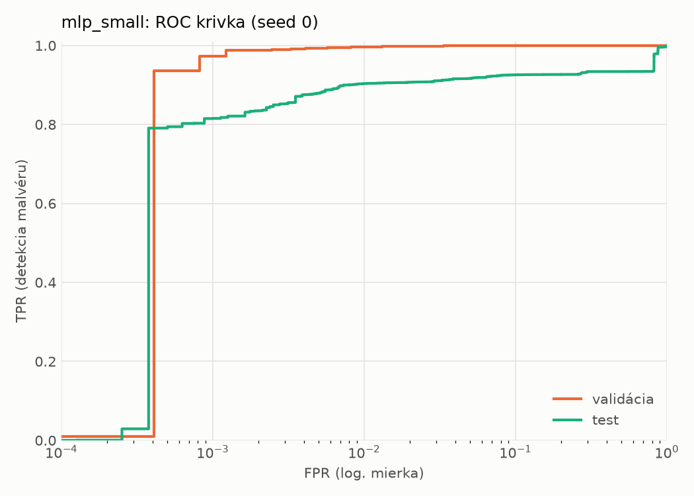
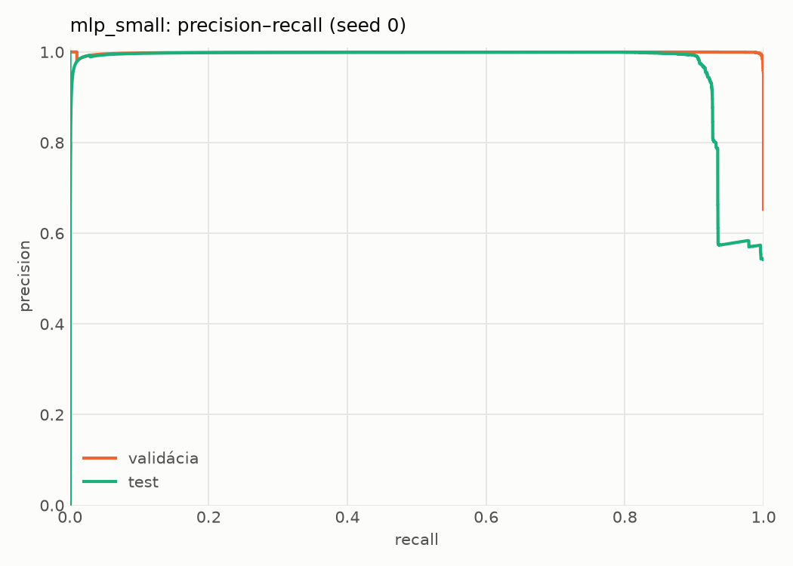
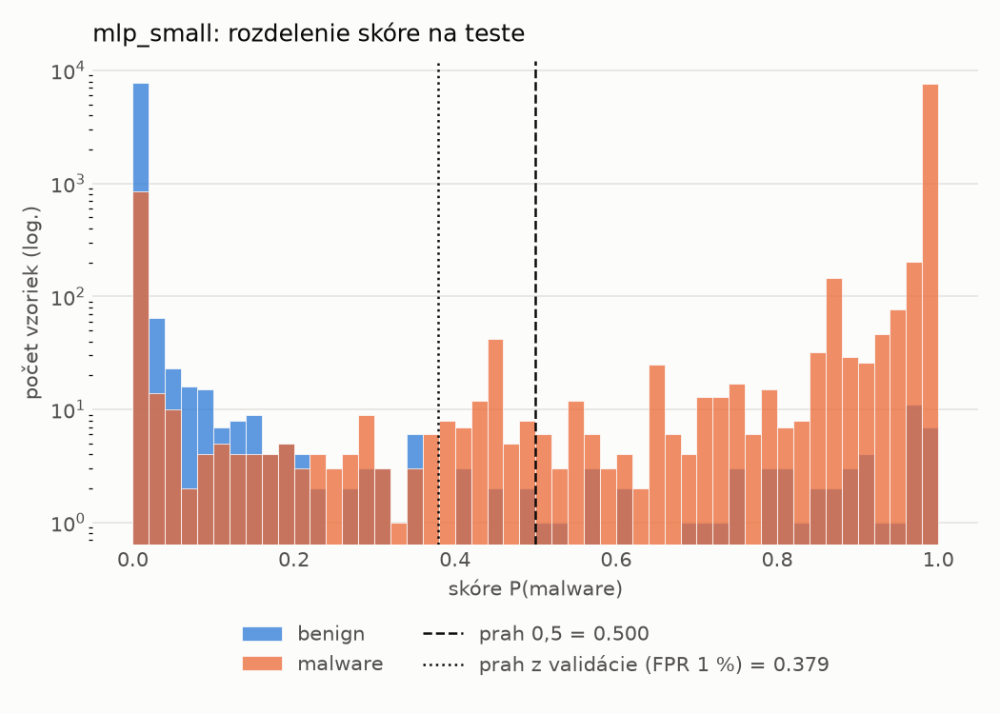
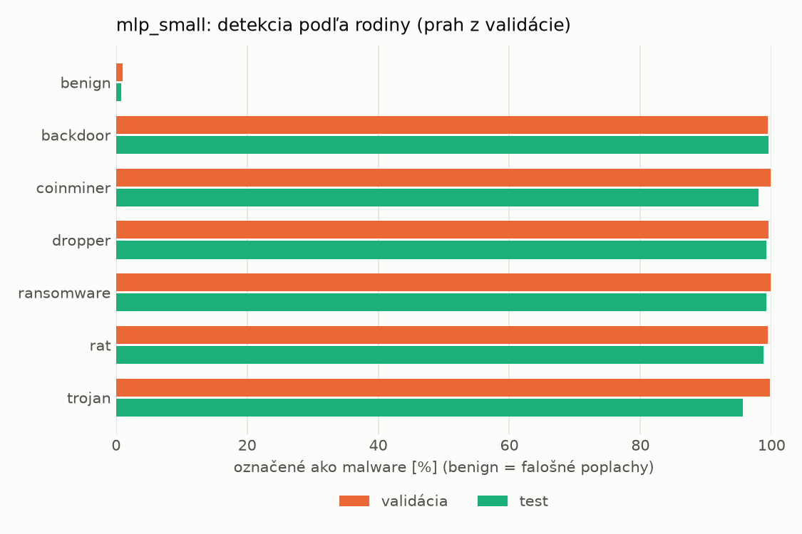
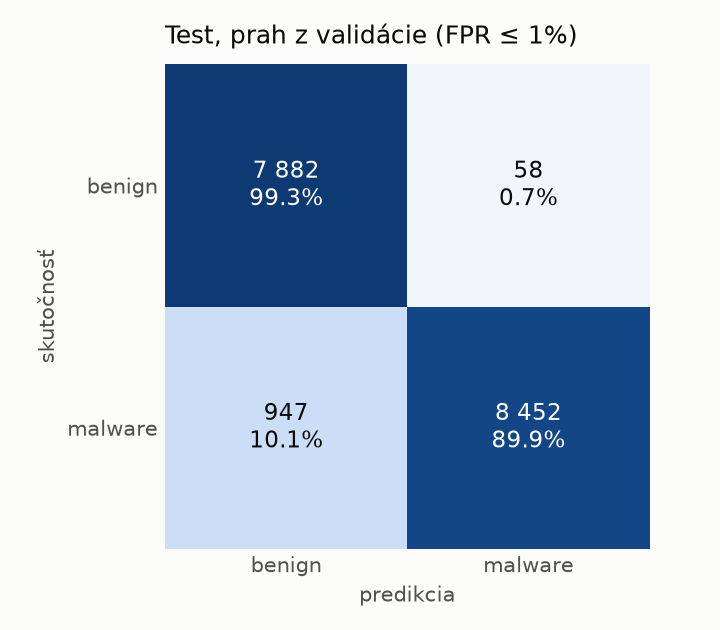
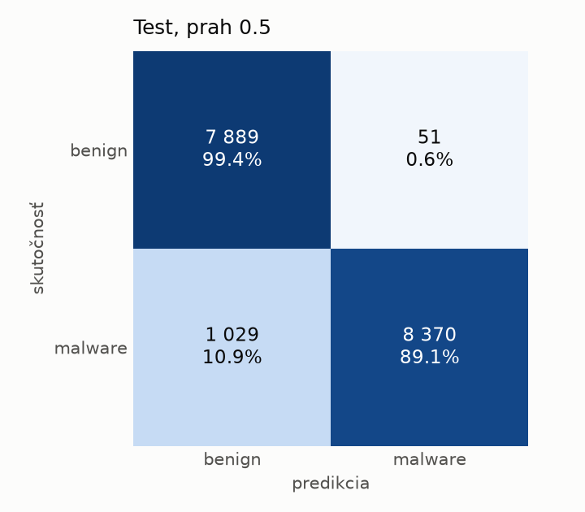
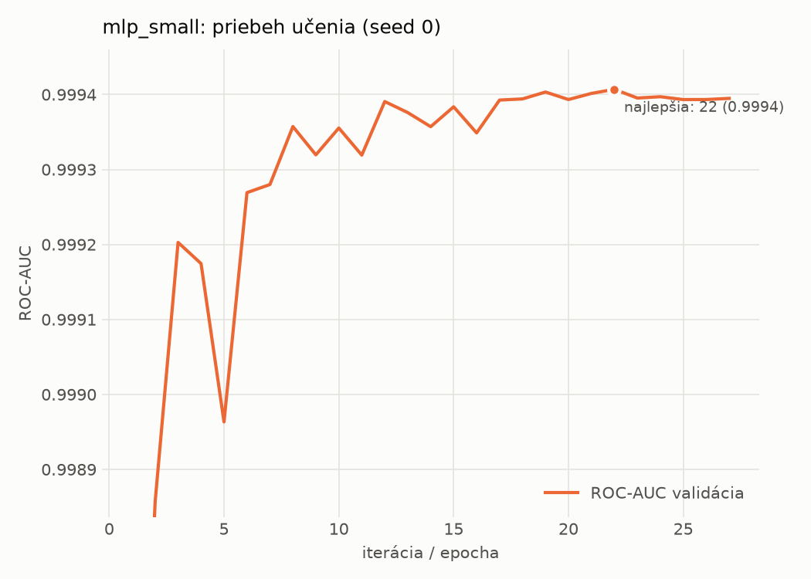

# static/mlp_small – beh `20261104-035940`

> Automaticky generované (`src/training/run_tabular.py`). Konfigurácia: `config.yaml`, protokol: `protocol.yaml`.

- **Model:** `mlp` – malá neurónová sieť (1–2 skryté vrstvy), kandidát na ľahkého študenta
- **Ladenie:** bez ladenia – hyperparametre prevzaté z `runs_final/static/mlp_small/20261101-235005`
- **Finálne modely:** seedy [0, 1, 2]; hodnoty sú priemer ± smerodajná odchýlka cez seedy
- **Najlepšie hyperparametre:** `{"width_decay": 0.5, "max_epochs": 100, "patience": 8, "hidden_layers": 2, "hidden_width": 32, "dropout": 0.15212112147976886, "lr": 0.0005958389350068958, "weight_decay": 5.34293726127978e-05, "batch_size": 512}`

## Detekčná kvalita (bez prahu)
| metrika | train (podvzorka) | validácia | test |
|---|---|---|---|
| ROC-AUC | 0.9999 ± 0.0001 | 0.9996 ± 0.0002 | 0.9405 ± 0.0036 |
| PR-AUC | 1.0000 ± 0.0001 | 0.9995 ± 0.0005 | 0.9680 ± 0.0025 |
| TPR pri FPR 1 % | 0.9989 ± 0.0013 | 0.9962 ± 0.0010 | 0.8986 ± 0.0086 |
| TPR pri FPR 0,1 % | 0.9982 ± 0.0017 | 0.9755 ± 0.0104 | 0.7204 ± 0.1246 |
| log loss | 0.0173 ± 0.0180 | 0.0279 ± 0.0138 | 0.3572 ± 0.0668 |
| Brier skóre | 0.0020 ± 0.0017 | 0.0050 ± 0.0007 | 0.0593 ± 0.0026 |

Rozdiel ROC-AUC train − validácia: **0.0003** (veľký rozdiel = preučenie).

## Pri prahu z validácie (FPR ≤ 1% na validácii)
| metrika | train (podvzorka) | validácia | test |
|---|---|---|---|
| accuracy | 0.9983 ± 0.0010 | 0.9943 ± 0.0005 | 0.9385 ± 0.0037 |
| balanced accuracy | 0.9985 ± 0.0008 | 0.9934 ± 0.0002 | 0.9427 ± 0.0034 |
| precision | 0.9995 ± 0.0000 | 0.9951 ± 0.0003 | 0.9933 ± 0.0003 |
| recall (TPR) | 0.9978 ± 0.0016 | 0.9962 ± 0.0010 | 0.8925 ± 0.0068 |
| FPR | 0.0009 ± 0.0000 | 0.0093 ± 0.0006 | 0.0071 ± 0.0003 |
| F1 | 0.9987 ± 0.0008 | 0.9956 ± 0.0004 | 0.9402 ± 0.0038 |
| MCC | 0.9962 ± 0.0022 | 0.9873 ± 0.0010 | 0.8826 ± 0.0066 |

## Pri pevnom prahu 0.5
| metrika | train (podvzorka) | validácia | test |
|---|---|---|---|
| accuracy | 0.9980 ± 0.0012 | 0.9941 ± 0.0005 | 0.9365 ± 0.0033 |
| balanced accuracy | 0.9983 ± 0.0009 | 0.9935 ± 0.0002 | 0.9409 ± 0.0030 |
| precision | 0.9995 ± 0.0000 | 0.9954 ± 0.0004 | 0.9941 ± 0.0007 |
| recall (TPR) | 0.9974 ± 0.0018 | 0.9956 ± 0.0012 | 0.8881 ± 0.0068 |
| FPR | 0.0009 ± 0.0000 | 0.0087 ± 0.0009 | 0.0063 ± 0.0008 |
| F1 | 0.9985 ± 0.0009 | 0.9955 ± 0.0004 | 0.9381 ± 0.0035 |
| MCC | 0.9956 ± 0.0026 | 0.9870 ± 0.0011 | 0.8792 ± 0.0058 |

## Výpočtové nároky (seed 0, testovacia množina)
| meranie | hodnota |
|---|---|
| tréning finálneho modelu | 6.3 s (priemer cez seedy) |
| ladenie spolu | 0 s |
| počet parametrov / uzlov | 74 881 |
| veľkosť modelu na disku | 0.36 MB |
| transformácia vstupu – latencia (1 vlákno) | 0.041 ms |
| transformácia vstupu – priepustnosť | 40 720 vzoriek/s |
| CPU latencia modelu (batch 1, 1 vlákno) | 0.097 ms (p95 0.132) |
| CPU priepustnosť (24 vlákien) | 61 087 vzoriek/s |
| GPU latencia (batch 1) | 0.454 ms (p95 0.676) |
| GPU priepustnosť | 60 051 vzoriek/s |
| GPU špičková pamäť | 834 MB |

## Grafy
| | |
|---|---|
|  |  |
|  |  |
|  |  |
|  |  |

## Súbory
`metrics.json` (všetky metriky po seedoch vrátane rodín), `timing.json`, `hpo_trials.csv`,
`predictions/<časť>_seed<N>.parquet` (sha256, family, label, score), `model/seed_<N>/`, `log.txt`.
