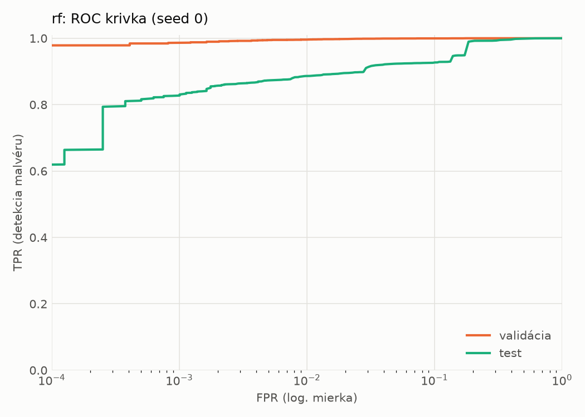
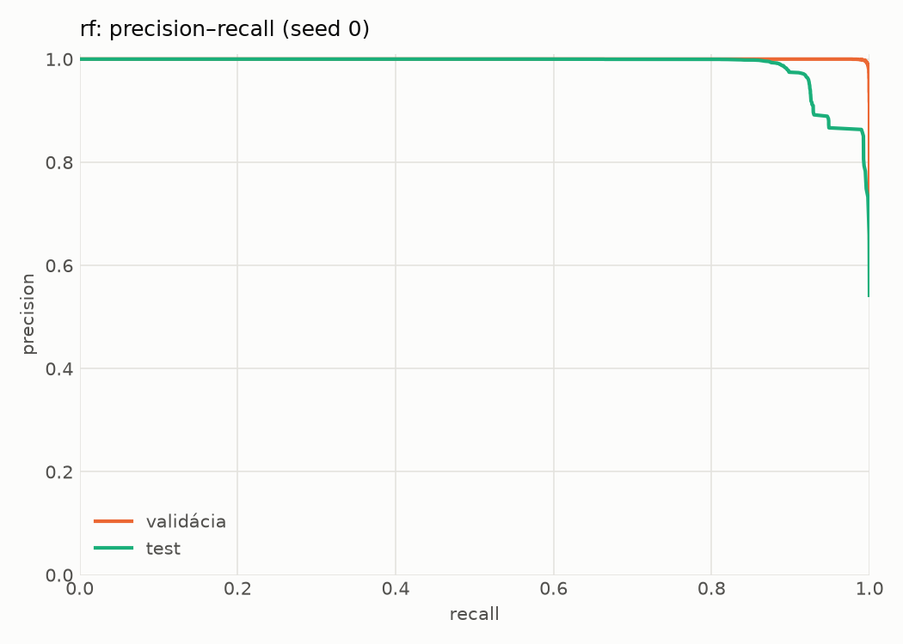
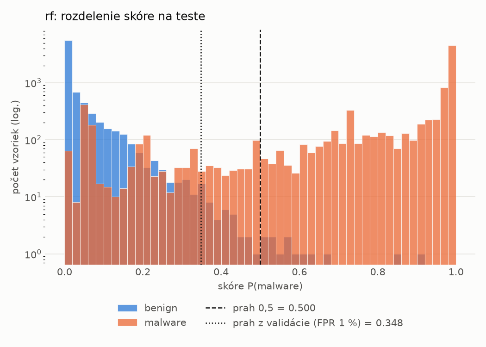
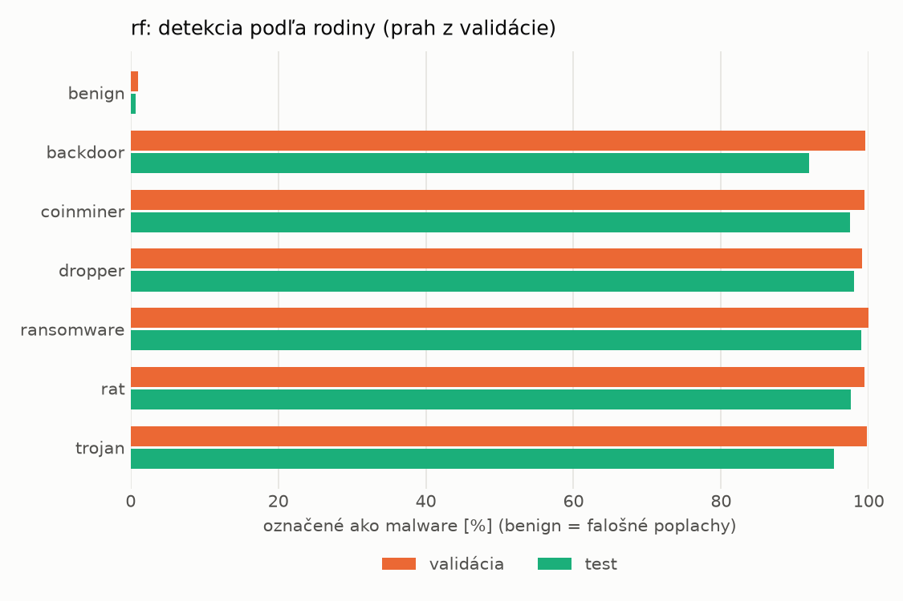
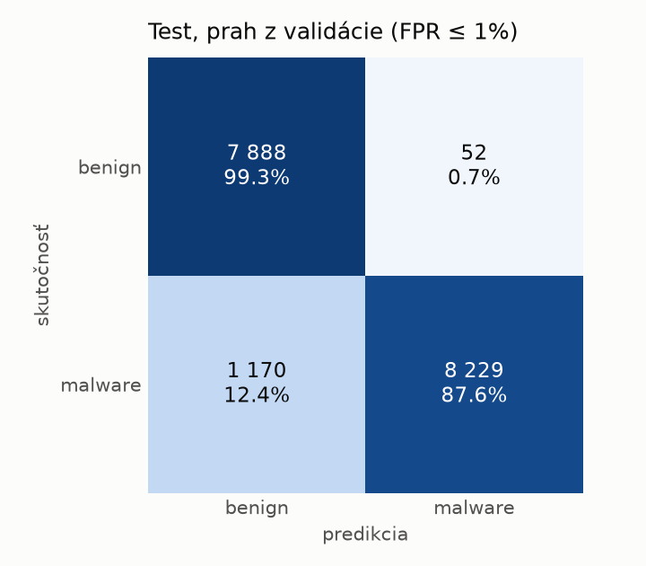
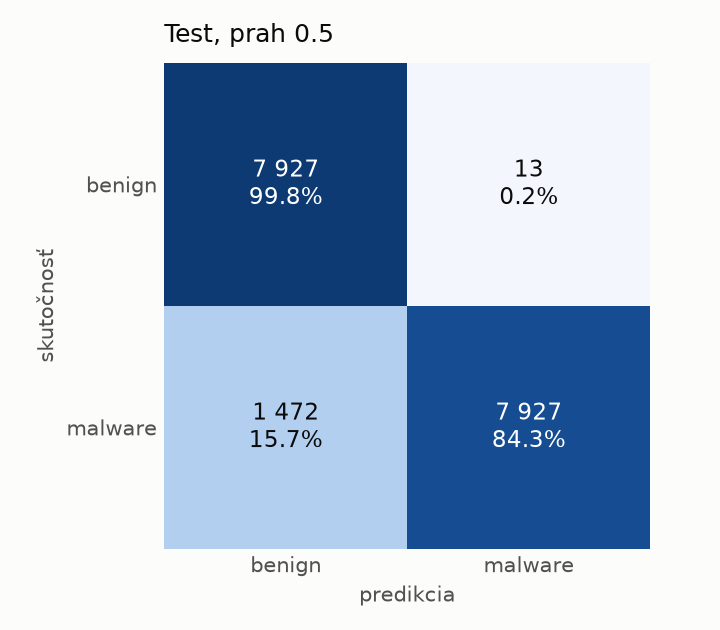

# static/rf – beh `20261104-034625`

> Automaticky generované (`src/training/run_tabular.py`). Konfigurácia: `config.yaml`, protokol: `protocol.yaml`.

- **Model:** `random_forest` – Random Forest (pôvodné hodnoty príznakov)
- **Ladenie:** bez ladenia – hyperparametre prevzaté z `runs_final/static/rf/20261101-213728`
- **Finálne modely:** seedy [0, 1, 2]; hodnoty sú priemer ± smerodajná odchýlka cez seedy
- **Najlepšie hyperparametre:** `{"n_estimators": 250, "max_depth": null, "min_samples_leaf": 1, "max_features": "sqrt"}`

## Detekčná kvalita (bez prahu)
| metrika | train (podvzorka) | validácia | test |
|---|---|---|---|
| ROC-AUC | 1.0000 ± 0.0000 | 0.9998 ± 0.0000 | 0.9857 ± 0.0012 |
| PR-AUC | 1.0000 ± 0.0000 | 0.9999 ± 0.0000 | 0.9889 ± 0.0008 |
| TPR pri FPR 1 % | 1.0000 ± 0.0000 | 0.9959 ± 0.0001 | 0.8862 ± 0.0002 |
| TPR pri FPR 0,1 % | 1.0000 ± 0.0000 | 0.9868 ± 0.0007 | 0.8230 ± 0.0043 |
| log loss | 0.0067 ± 0.0000 | 0.0229 ± 0.0003 | 0.2286 ± 0.0063 |
| Brier skóre | 0.0008 ± 0.0000 | 0.0052 ± 0.0001 | 0.0686 ± 0.0008 |

Rozdiel ROC-AUC train − validácia: **0.0002** (veľký rozdiel = preučenie).

## Pri prahu z validácie (FPR ≤ 1% na validácii)
| metrika | train (podvzorka) | validácia | test |
|---|---|---|---|
| accuracy | 1.0000 ± 0.0000 | 0.9940 ± 0.0001 | 0.9300 ± 0.0012 |
| balanced accuracy | 1.0000 ± 0.0000 | 0.9931 ± 0.0001 | 0.9349 ± 0.0011 |
| precision | 1.0000 ± 0.0000 | 0.9949 ± 0.0001 | 0.9932 ± 0.0004 |
| recall (TPR) | 1.0000 ± 0.0000 | 0.9959 ± 0.0001 | 0.8769 ± 0.0024 |
| FPR | 0.0000 ± 0.0000 | 0.0097 ± 0.0002 | 0.0071 ± 0.0005 |
| F1 | 1.0000 ± 0.0000 | 0.9954 ± 0.0001 | 0.9315 ± 0.0013 |
| MCC | 1.0000 ± 0.0000 | 0.9867 ± 0.0002 | 0.8676 ± 0.0021 |

## Pri pevnom prahu 0.5
| metrika | train (podvzorka) | validácia | test |
|---|---|---|---|
| accuracy | 1.0000 ± 0.0000 | 0.9946 ± 0.0004 | 0.9149 ± 0.0020 |
| balanced accuracy | 1.0000 ± 0.0000 | 0.9950 ± 0.0003 | 0.9213 ± 0.0018 |
| precision | 1.0000 ± 0.0000 | 0.9980 ± 0.0003 | 0.9984 ± 0.0002 |
| recall (TPR) | 1.0000 ± 0.0000 | 0.9938 ± 0.0007 | 0.8443 ± 0.0039 |
| FPR | 0.0000 ± 0.0000 | 0.0038 ± 0.0005 | 0.0016 ± 0.0002 |
| F1 | 1.0000 ± 0.0000 | 0.9959 ± 0.0003 | 0.9149 ± 0.0022 |
| MCC | 1.0000 ± 0.0000 | 0.9881 ± 0.0008 | 0.8426 ± 0.0034 |

## Výpočtové nároky (seed 0, testovacia množina)
| meranie | hodnota |
|---|---|
| tréning finálneho modelu | 25.3 s (priemer cez seedy) |
| ladenie spolu | 0 s |
| počet parametrov / uzlov | 344 892 |
| veľkosť modelu na disku | 27.95 MB |
| CPU latencia modelu (batch 1, 1 vlákno) | 7.185 ms (p95 7.483) |
| CPU priepustnosť (24 vlákien) | 129 432 vzoriek/s |

## Grafy
| | |
|---|---|
|  |  |
|  |  |
|  |  |
|  |  |

## Súbory
`metrics.json` (všetky metriky po seedoch vrátane rodín), `timing.json`, `hpo_trials.csv`,
`predictions/<časť>_seed<N>.parquet` (sha256, family, label, score), `model/seed_<N>/`, `log.txt`.
