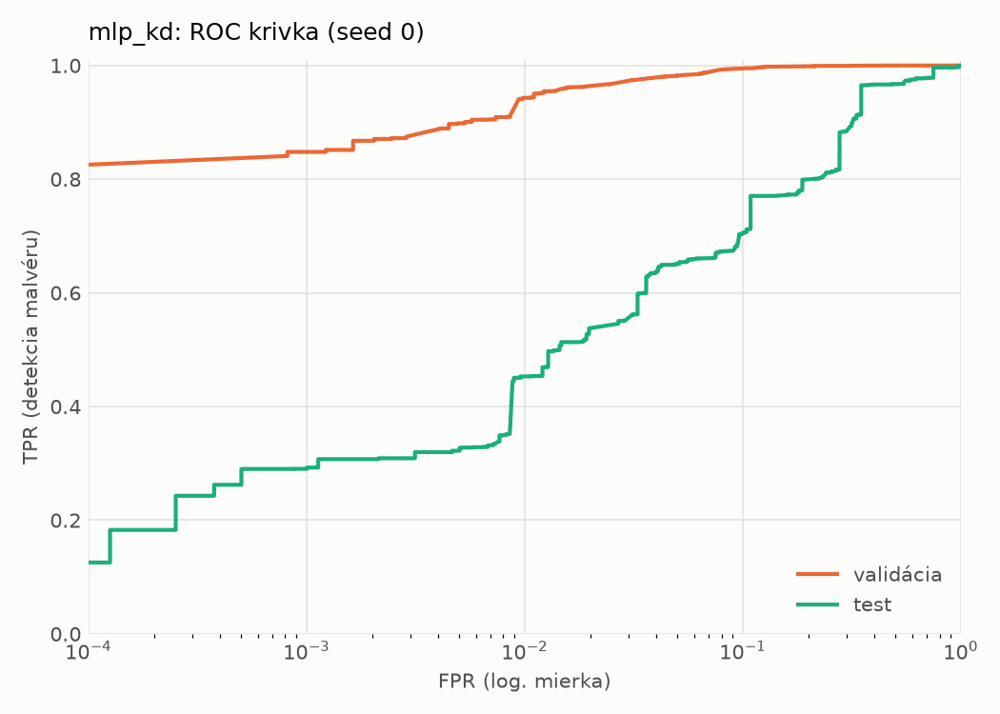
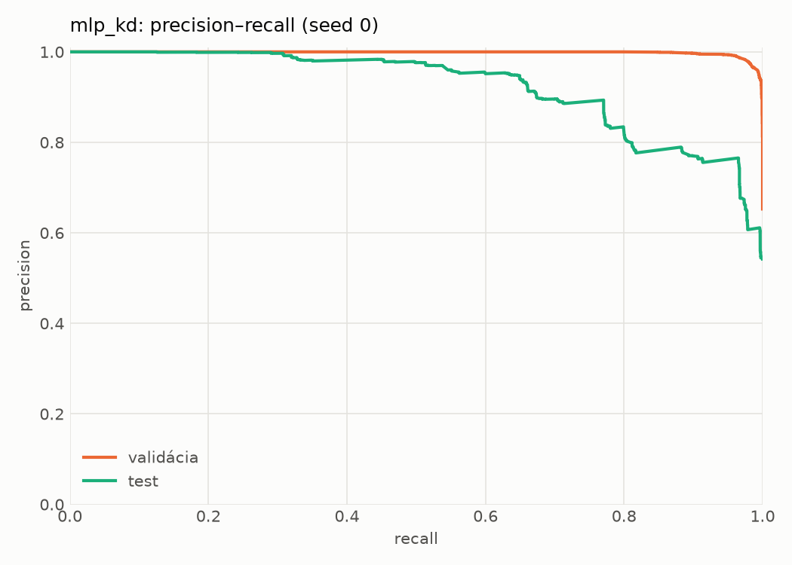
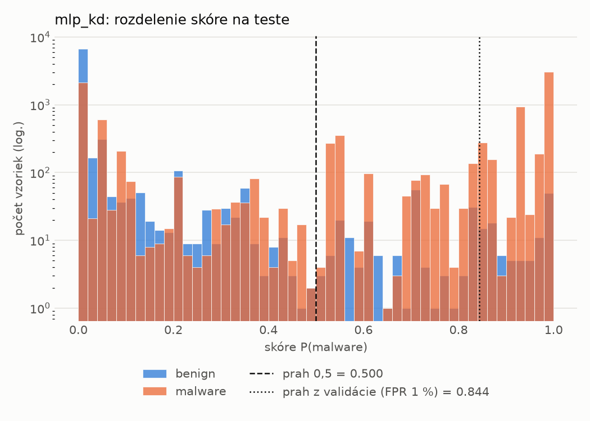
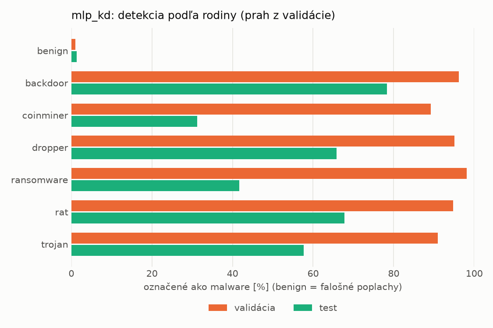
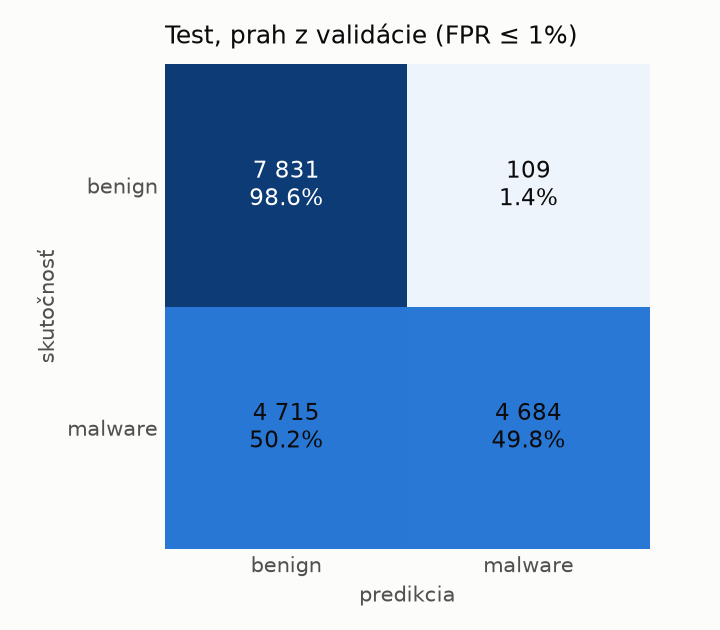
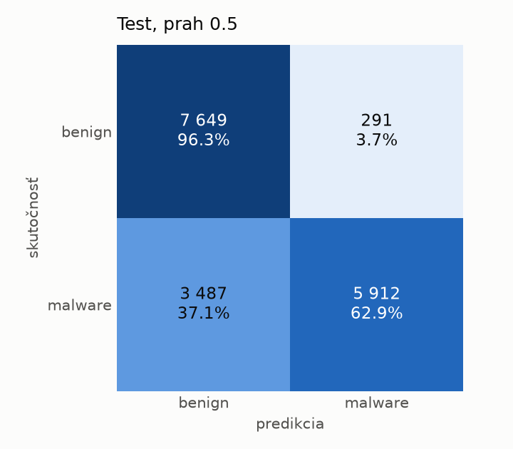
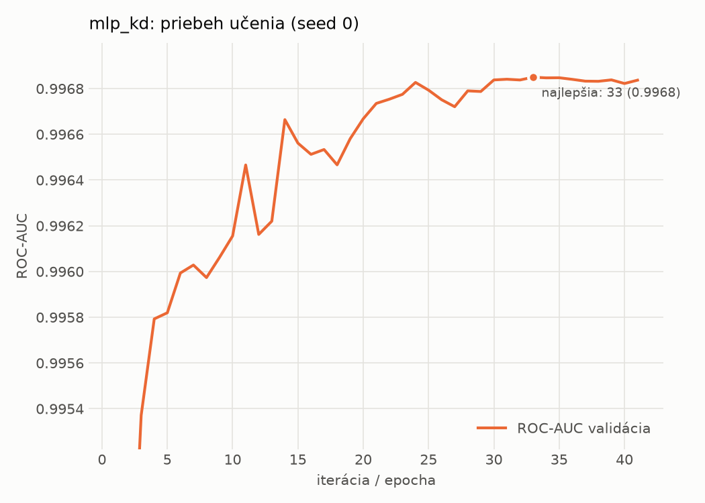

# dynamic/mlp_kd – beh `20261104-054737`

> Automaticky generované (`src/training/run_tabular.py`). Konfigurácia: `config.yaml`, protokol: `protocol.yaml`.

- **Model:** `mlp` – študent – malé MLP učené destiláciou z hybridného učiteľa
- **Ladenie:** bez ladenia – hyperparametre prevzaté z `runs_final/students_dynamic/mlp_kd/20261102-212132`
- **Finálne modely:** seedy [0, 1, 2]; hodnoty sú priemer ± smerodajná odchýlka cez seedy
- **Najlepšie hyperparametre:** `{"hidden_layers": 1, "max_epochs": 100, "patience": 8, "hidden_width": 32, "dropout": 0.14978534481914754, "lr": 0.0015794492400712224, "weight_decay": 1.2553588001973222e-06, "batch_size": 512, "kd_alpha": 0.7118939371172979, "kd_temperature": 1.298431487079528}`

## Detekčná kvalita (bez prahu)
| metrika | train (podvzorka) | validácia | test |
|---|---|---|---|
| ROC-AUC | 0.9981 ± 0.0001 | 0.9969 ± 0.0001 | 0.8950 ± 0.0187 |
| PR-AUC | 0.9989 ± 0.0001 | 0.9983 ± 0.0000 | 0.9216 ± 0.0100 |
| TPR pri FPR 1 % | 0.9632 ± 0.0014 | 0.9443 ± 0.0032 | 0.4667 ± 0.0137 |
| TPR pri FPR 0,1 % | 0.8968 ± 0.0050 | 0.8502 ± 0.0032 | 0.2933 ± 0.0302 |
| log loss | 0.0565 ± 0.0024 | 0.0734 ± 0.0008 | 1.0486 ± 0.1211 |
| Brier skóre | 0.0172 ± 0.0006 | 0.0209 ± 0.0004 | 0.1996 ± 0.0045 |

Rozdiel ROC-AUC train − validácia: **0.0012** (veľký rozdiel = preučenie).

## Pri prahu z validácie (FPR ≤ 1% na validácii)
| metrika | train (podvzorka) | validácia | test |
|---|---|---|---|
| accuracy | 0.9634 ± 0.0022 | 0.9602 ± 0.0021 | 0.7281 ± 0.0056 |
| balanced accuracy | 0.9705 ± 0.0013 | 0.9672 ± 0.0016 | 0.7481 ± 0.0051 |
| precision | 0.9970 ± 0.0010 | 0.9945 ± 0.0000 | 0.9772 ± 0.0009 |
| recall (TPR) | 0.9463 ± 0.0044 | 0.9443 ± 0.0032 | 0.5102 ± 0.0105 |
| FPR | 0.0053 ± 0.0017 | 0.0098 ± 0.0000 | 0.0141 ± 0.0006 |
| F1 | 0.9710 ± 0.0018 | 0.9688 ± 0.0017 | 0.6704 ± 0.0091 |
| MCC | 0.9237 ± 0.0042 | 0.9165 ± 0.0041 | 0.5487 ± 0.0080 |

## Pri pevnom prahu 0.5
| metrika | train (podvzorka) | validácia | test |
|---|---|---|---|
| accuracy | 0.9770 ± 0.0003 | 0.9711 ± 0.0013 | 0.7750 ± 0.0088 |
| balanced accuracy | 0.9783 ± 0.0013 | 0.9721 ± 0.0007 | 0.7897 ± 0.0078 |
| precision | 0.9904 ± 0.0024 | 0.9868 ± 0.0015 | 0.9532 ± 0.0041 |
| recall (TPR) | 0.9739 ± 0.0019 | 0.9687 ± 0.0033 | 0.6152 ± 0.0192 |
| FPR | 0.0173 ± 0.0045 | 0.0244 ± 0.0029 | 0.0359 ± 0.0042 |
| F1 | 0.9821 ± 0.0002 | 0.9776 ± 0.0011 | 0.7476 ± 0.0133 |
| MCC | 0.9502 ± 0.0010 | 0.9371 ± 0.0026 | 0.6053 ± 0.0116 |

## Výpočtové nároky (seed 0, testovacia množina)
| meranie | hodnota |
|---|---|
| tréning finálneho modelu | 9.8 s (priemer cez seedy) |
| ladenie spolu | 0 s |
| počet parametrov / uzlov | 64 129 |
| veľkosť modelu na disku | 0.31 MB |
| transformácia vstupu – latencia (1 vlákno) | 0.018 ms |
| transformácia vstupu – priepustnosť | 46 675 vzoriek/s |
| CPU latencia modelu (batch 1, 1 vlákno) | 0.067 ms (p95 0.075) |
| CPU priepustnosť (24 vlákien) | 141 290 vzoriek/s |
| GPU latencia (batch 1) | 0.292 ms (p95 0.325) |
| GPU priepustnosť | 101 512 vzoriek/s |
| GPU špičková pamäť | 721 MB |

## Grafy
| | |
|---|---|
|  |  |
|  |  |
|  |  |
|  |  |

## Súbory
`metrics.json` (všetky metriky po seedoch vrátane rodín), `timing.json`, `hpo_trials.csv`,
`predictions/<časť>_seed<N>.parquet` (sha256, family, label, score), `model/seed_<N>/`, `log.txt`.
