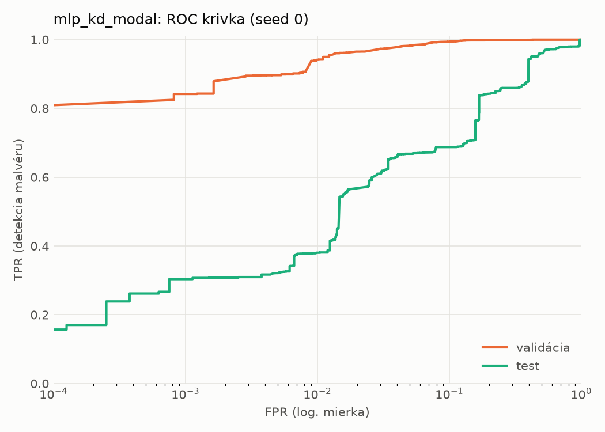
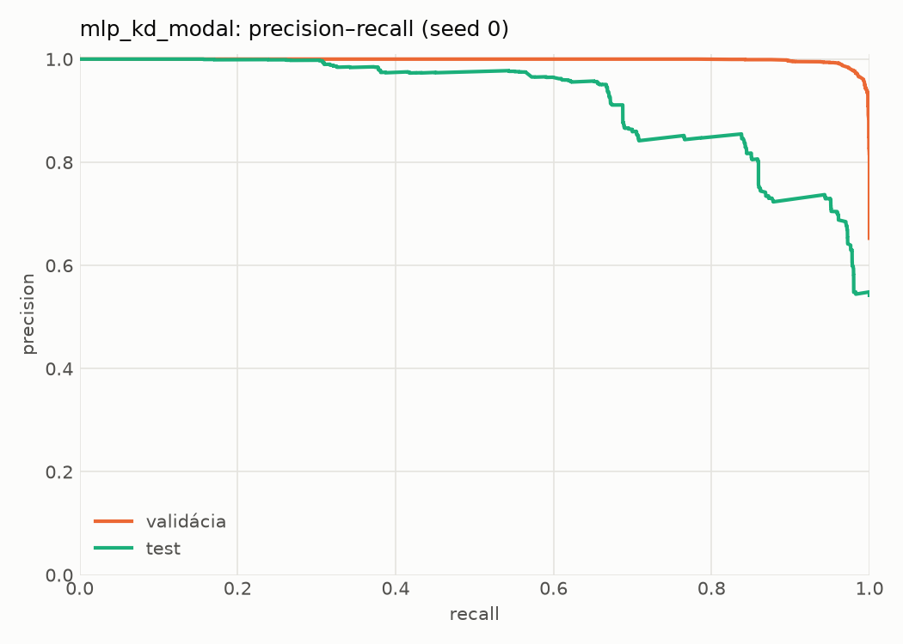
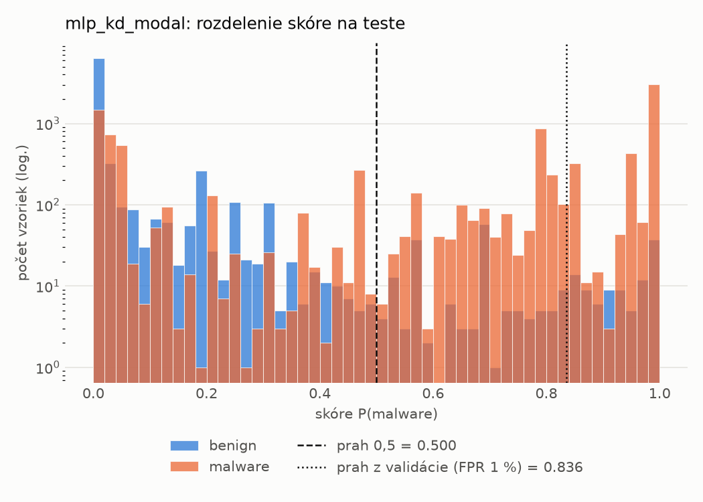
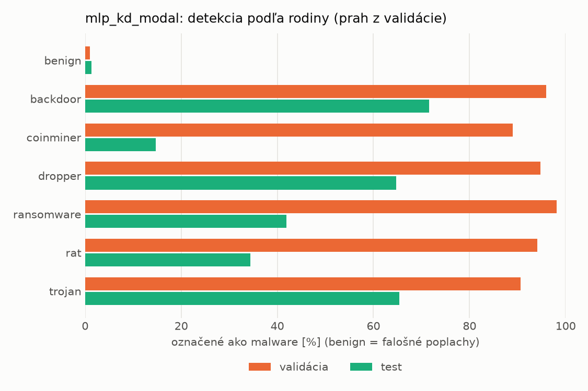
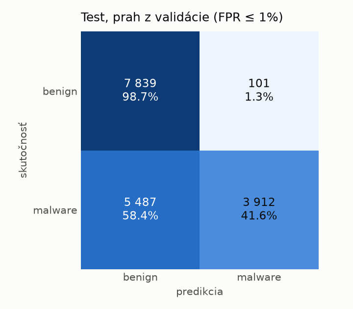
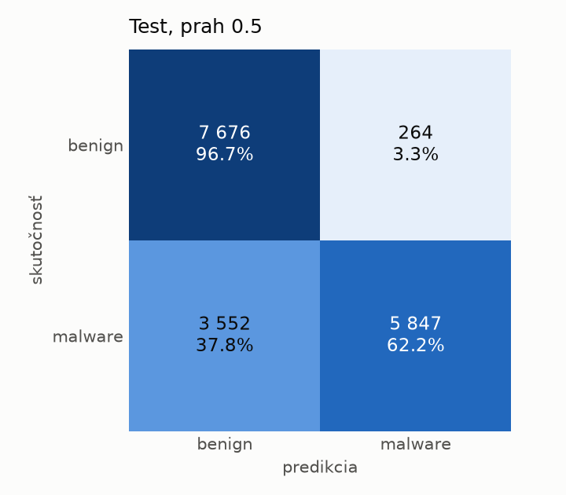
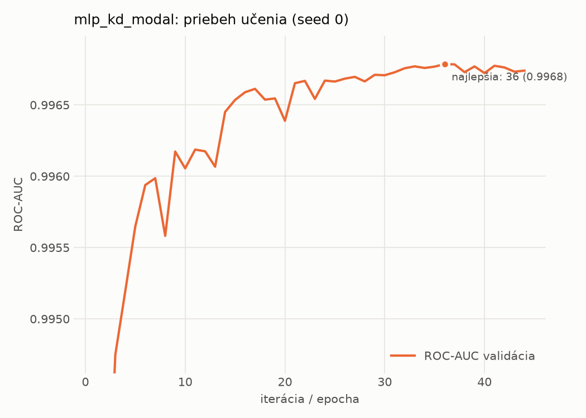

# dynamic/mlp_kd_modal – beh `20261104-054838`

> Automaticky generované (`src/training/run_tabular.py`). Konfigurácia: `config.yaml`, protokol: `protocol.yaml`.

- **Model:** `mlp` – študent – malé MLP učené destiláciou z učiteľa rovnakej modality (variant A)
- **Ladenie:** bez ladenia – hyperparametre prevzaté z `runs_final/students_dynamic/mlp_kd_modal/20261102-212954`
- **Finálne modely:** seedy [0, 1, 2]; hodnoty sú priemer ± smerodajná odchýlka cez seedy
- **Najlepšie hyperparametre:** `{"hidden_layers": 1, "max_epochs": 100, "patience": 8, "hidden_width": 32, "dropout": 0.14040860994340293, "lr": 0.00037778352941027736, "weight_decay": 1.149514965975221e-06, "batch_size": 512, "kd_alpha": 0.8818461482523741, "kd_temperature": 1.583698009756735}`

## Detekčná kvalita (bez prahu)
| metrika | train (podvzorka) | validácia | test |
|---|---|---|---|
| ROC-AUC | 0.9981 ± 0.0000 | 0.9968 ± 0.0000 | 0.8946 ± 0.0052 |
| PR-AUC | 0.9989 ± 0.0000 | 0.9983 ± 0.0000 | 0.9201 ± 0.0037 |
| TPR pri FPR 1 % | 0.9648 ± 0.0007 | 0.9311 ± 0.0173 | 0.4033 ± 0.0473 |
| TPR pri FPR 0,1 % | 0.8950 ± 0.0024 | 0.8226 ± 0.0252 | 0.2775 ± 0.0491 |
| log loss | 0.0565 ± 0.0006 | 0.0720 ± 0.0006 | 0.8705 ± 0.0568 |
| Brier skóre | 0.0170 ± 0.0001 | 0.0207 ± 0.0001 | 0.1937 ± 0.0048 |

Rozdiel ROC-AUC train − validácia: **0.0013** (veľký rozdiel = preučenie).

## Pri prahu z validácie (FPR ≤ 1% na validácii)
| metrika | train (podvzorka) | validácia | test |
|---|---|---|---|
| accuracy | 0.9560 ± 0.0099 | 0.9516 ± 0.0113 | 0.6922 ± 0.0244 |
| balanced accuracy | 0.9651 ± 0.0075 | 0.9606 ± 0.0086 | 0.7151 ± 0.0226 |
| precision | 0.9977 ± 0.0004 | 0.9944 ± 0.0001 | 0.9760 ± 0.0032 |
| recall (TPR) | 0.9342 ± 0.0155 | 0.9311 ± 0.0173 | 0.4430 ± 0.0446 |
| FPR | 0.0040 ± 0.0008 | 0.0098 ± 0.0000 | 0.0128 ± 0.0006 |
| F1 | 0.9649 ± 0.0082 | 0.9617 ± 0.0093 | 0.6086 ± 0.0422 |
| MCC | 0.9098 ± 0.0187 | 0.9000 ± 0.0214 | 0.4976 ± 0.0359 |

## Pri pevnom prahu 0.5
| metrika | train (podvzorka) | validácia | test |
|---|---|---|---|
| accuracy | 0.9767 ± 0.0002 | 0.9705 ± 0.0010 | 0.7734 ± 0.0057 |
| balanced accuracy | 0.9782 ± 0.0011 | 0.9716 ± 0.0001 | 0.7881 ± 0.0055 |
| precision | 0.9907 ± 0.0023 | 0.9865 ± 0.0019 | 0.9503 ± 0.0073 |
| recall (TPR) | 0.9731 ± 0.0021 | 0.9681 ± 0.0035 | 0.6141 ± 0.0083 |
| FPR | 0.0167 ± 0.0042 | 0.0248 ± 0.0037 | 0.0380 ± 0.0058 |
| F1 | 0.9818 ± 0.0001 | 0.9772 ± 0.0009 | 0.7461 ± 0.0071 |
| MCC | 0.9496 ± 0.0006 | 0.9359 ± 0.0019 | 0.6017 ± 0.0108 |

## Výpočtové nároky (seed 0, testovacia množina)
| meranie | hodnota |
|---|---|
| tréning finálneho modelu | 10.5 s (priemer cez seedy) |
| ladenie spolu | 0 s |
| počet parametrov / uzlov | 64 129 |
| veľkosť modelu na disku | 0.31 MB |
| transformácia vstupu – latencia (1 vlákno) | 0.034 ms |
| transformácia vstupu – priepustnosť | 46 471 vzoriek/s |
| CPU latencia modelu (batch 1, 1 vlákno) | 0.068 ms (p95 0.079) |
| CPU priepustnosť (24 vlákien) | 139 338 vzoriek/s |
| GPU latencia (batch 1) | 0.276 ms (p95 0.313) |
| GPU priepustnosť | 100 813 vzoriek/s |
| GPU špičková pamäť | 721 MB |

## Grafy
| | |
|---|---|
|  |  |
|  |  |
|  |  |
|  |  |

## Súbory
`metrics.json` (všetky metriky po seedoch vrátane rodín), `timing.json`, `hpo_trials.csv`,
`predictions/<časť>_seed<N>.parquet` (sha256, family, label, score), `model/seed_<N>/`, `log.txt`.
