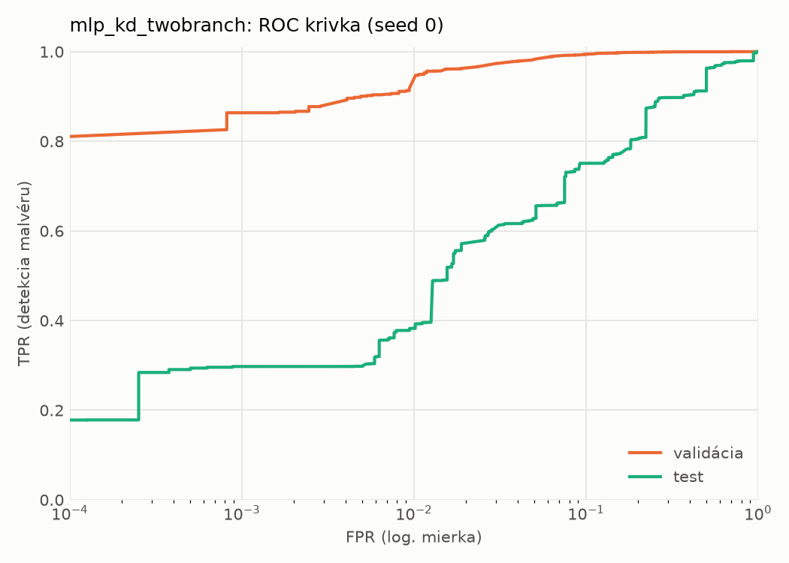
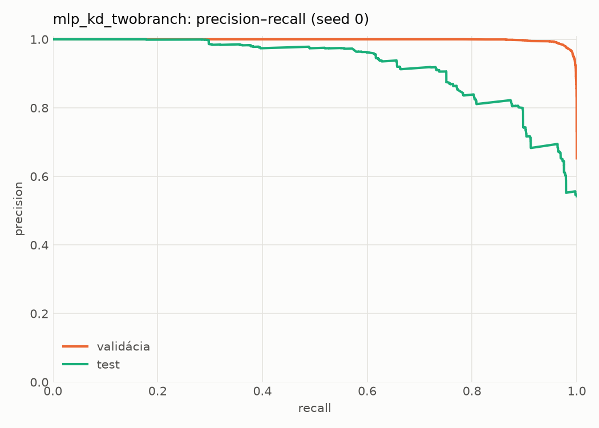
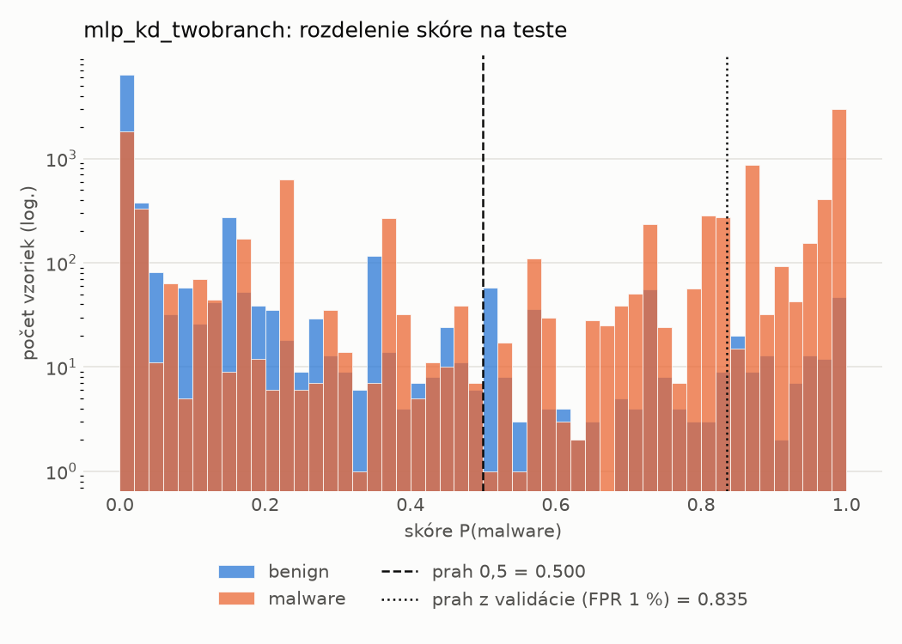
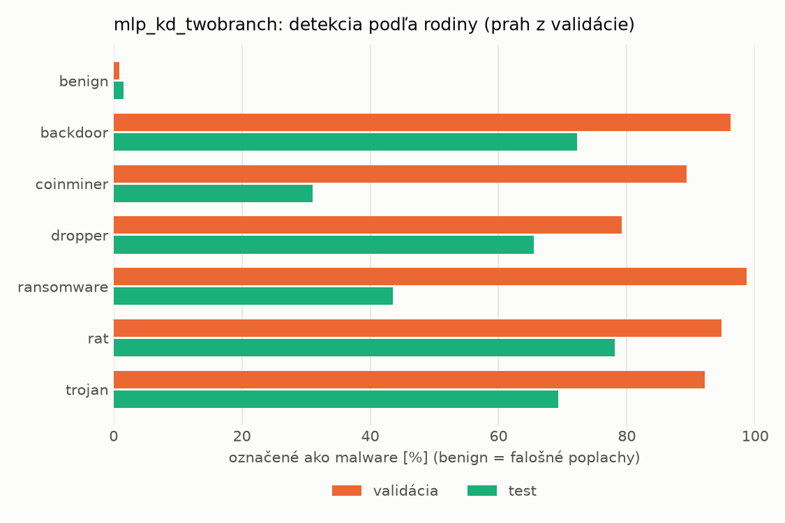
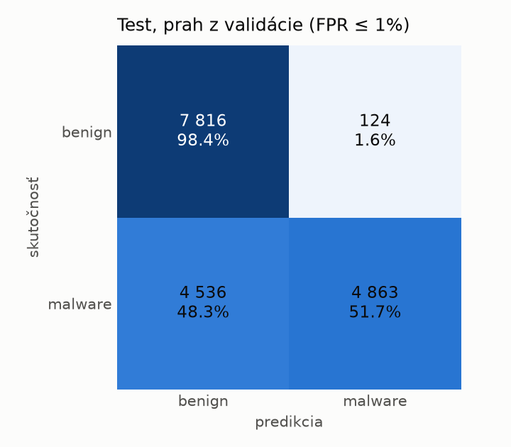
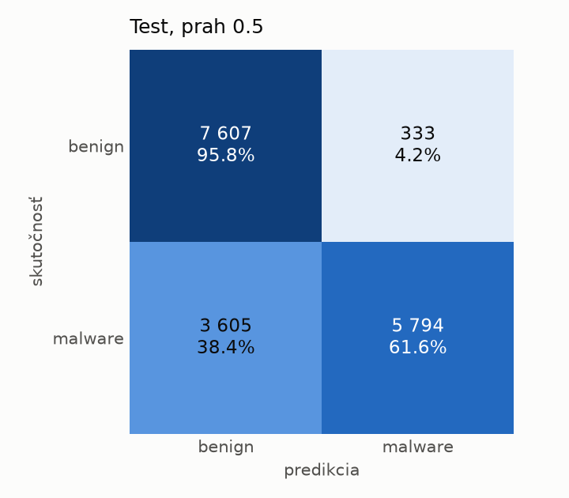
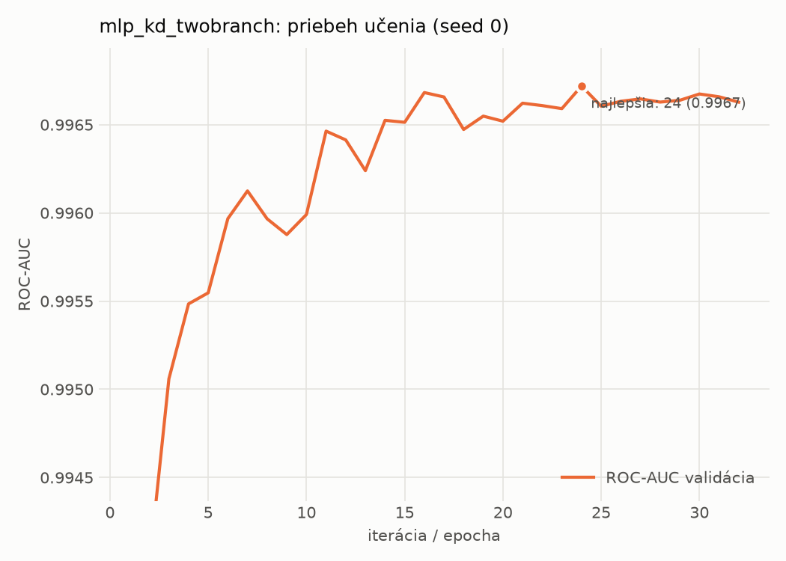

# dynamic/mlp_kd_twobranch – beh `20261104-054917`

> Automaticky generované (`src/training/run_tabular.py`). Konfigurácia: `config.yaml`, protokol: `protocol.yaml`.

- **Model:** `mlp` – študent – malé MLP učené destiláciou z dvojvetvovej siete (V2)
- **Ladenie:** bez ladenia – hyperparametre prevzaté z `runs_v2/full/students_dynamic/mlp_kd_twobranch/20261103-210509`
- **Finálne modely:** seedy [0, 1, 2]; hodnoty sú priemer ± smerodajná odchýlka cez seedy
- **Najlepšie hyperparametre:** `{"hidden_layers": 1, "max_epochs": 100, "patience": 8, "hidden_width": 32, "dropout": 0.20072105080128874, "lr": 0.0007693195243892695, "weight_decay": 5.480532660403751e-05, "batch_size": 512, "kd_alpha": 0.8408369066096718, "kd_temperature": 1.578549465607724}`

## Detekčná kvalita (bez prahu)
| metrika | train (podvzorka) | validácia | test |
|---|---|---|---|
| ROC-AUC | 0.9980 ± 0.0001 | 0.9968 ± 0.0001 | 0.8946 ± 0.0087 |
| PR-AUC | 0.9989 ± 0.0001 | 0.9983 ± 0.0000 | 0.9211 ± 0.0067 |
| TPR pri FPR 1 % | 0.9618 ± 0.0027 | 0.9346 ± 0.0142 | 0.4070 ± 0.0440 |
| TPR pri FPR 0,1 % | 0.8841 ± 0.0039 | 0.8528 ± 0.0114 | 0.2860 ± 0.0126 |
| log loss | 0.0571 ± 0.0009 | 0.0734 ± 0.0007 | 0.9875 ± 0.0622 |
| Brier skóre | 0.0173 ± 0.0002 | 0.0207 ± 0.0001 | 0.1954 ± 0.0087 |

Rozdiel ROC-AUC train − validácia: **0.0012** (veľký rozdiel = preučenie).

## Pri prahu z validácie (FPR ≤ 1% na validácii)
| metrika | train (podvzorka) | validácia | test |
|---|---|---|---|
| accuracy | 0.9571 ± 0.0074 | 0.9539 ± 0.0092 | 0.7134 ± 0.0308 |
| balanced accuracy | 0.9656 ± 0.0058 | 0.9624 ± 0.0070 | 0.7346 ± 0.0283 |
| precision | 0.9969 ± 0.0010 | 0.9945 ± 0.0001 | 0.9763 ± 0.0022 |
| recall (TPR) | 0.9367 ± 0.0115 | 0.9346 ± 0.0142 | 0.4830 ± 0.0576 |
| FPR | 0.0054 ± 0.0017 | 0.0097 ± 0.0002 | 0.0139 ± 0.0015 |
| F1 | 0.9658 ± 0.0062 | 0.9636 ± 0.0076 | 0.6449 ± 0.0530 |
| MCC | 0.9116 ± 0.0143 | 0.9044 ± 0.0176 | 0.5277 ± 0.0440 |

## Pri pevnom prahu 0.5
| metrika | train (podvzorka) | validácia | test |
|---|---|---|---|
| accuracy | 0.9764 ± 0.0003 | 0.9707 ± 0.0011 | 0.7708 ± 0.0035 |
| balanced accuracy | 0.9776 ± 0.0017 | 0.9716 ± 0.0002 | 0.7856 ± 0.0031 |
| precision | 0.9898 ± 0.0036 | 0.9862 ± 0.0022 | 0.9502 ± 0.0040 |
| recall (TPR) | 0.9736 ± 0.0032 | 0.9687 ± 0.0039 | 0.6091 ± 0.0087 |
| FPR | 0.0184 ± 0.0066 | 0.0255 ± 0.0042 | 0.0378 ± 0.0036 |
| F1 | 0.9817 ± 0.0002 | 0.9774 ± 0.0009 | 0.7423 ± 0.0057 |
| MCC | 0.9490 ± 0.0010 | 0.9362 ± 0.0021 | 0.5978 ± 0.0045 |

## Výpočtové nároky (seed 0, testovacia množina)
| meranie | hodnota |
|---|---|
| tréning finálneho modelu | 6.7 s (priemer cez seedy) |
| ladenie spolu | 0 s |
| počet parametrov / uzlov | 64 129 |
| veľkosť modelu na disku | 0.31 MB |
| transformácia vstupu – latencia (1 vlákno) | 0.035 ms |
| transformácia vstupu – priepustnosť | 45 277 vzoriek/s |
| CPU latencia modelu (batch 1, 1 vlákno) | 0.067 ms (p95 0.075) |
| CPU priepustnosť (24 vlákien) | 96 174 vzoriek/s |
| GPU latencia (batch 1) | 0.452 ms (p95 0.480) |
| GPU priepustnosť | 100 853 vzoriek/s |
| GPU špičková pamäť | 1284 MB |

## Grafy
| | |
|---|---|
|  |  |
|  |  |
|  |  |
|  |  |

## Súbory
`metrics.json` (všetky metriky po seedoch vrátane rodín), `timing.json`, `hpo_trials.csv`,
`predictions/<časť>_seed<N>.parquet` (sha256, family, label, score), `model/seed_<N>/`, `log.txt`.
