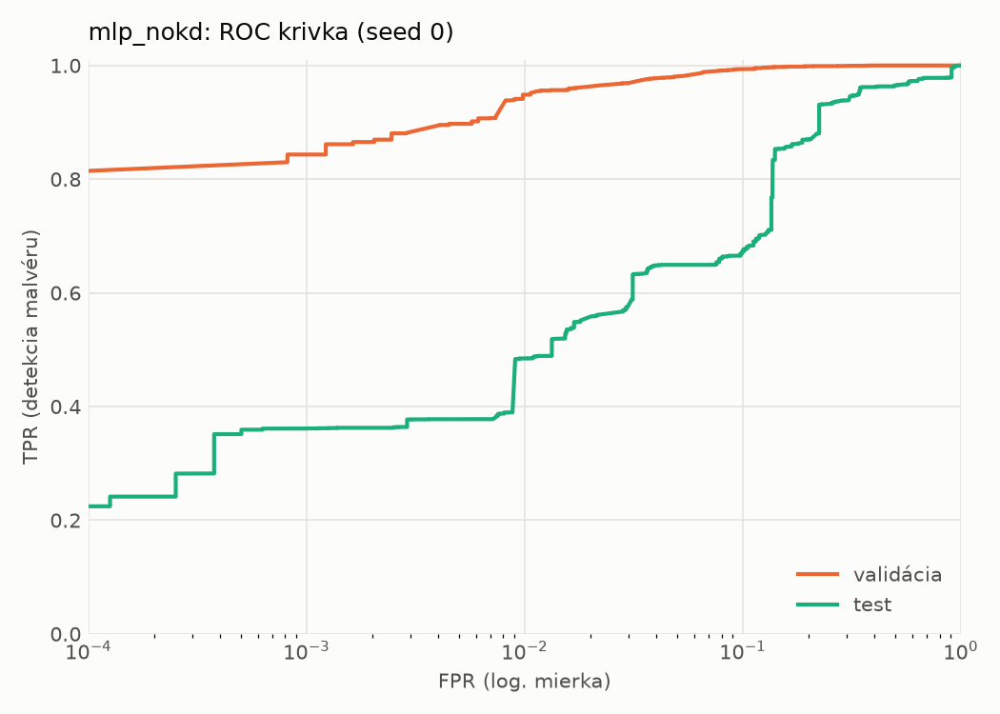
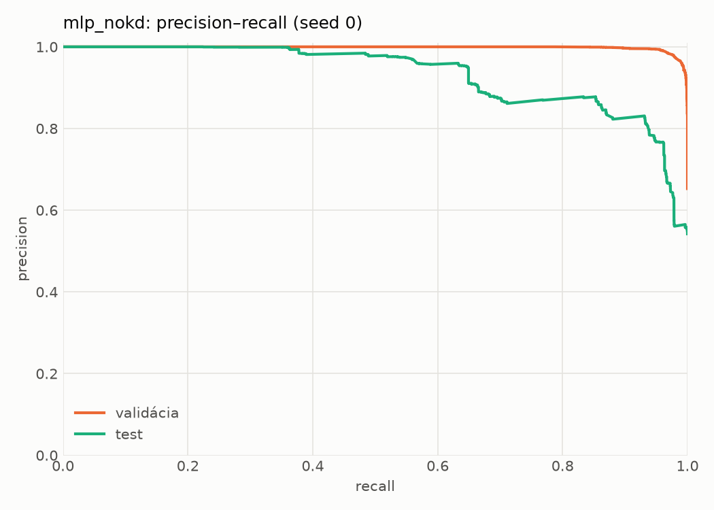
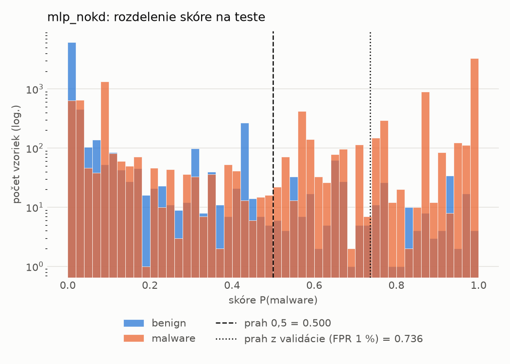
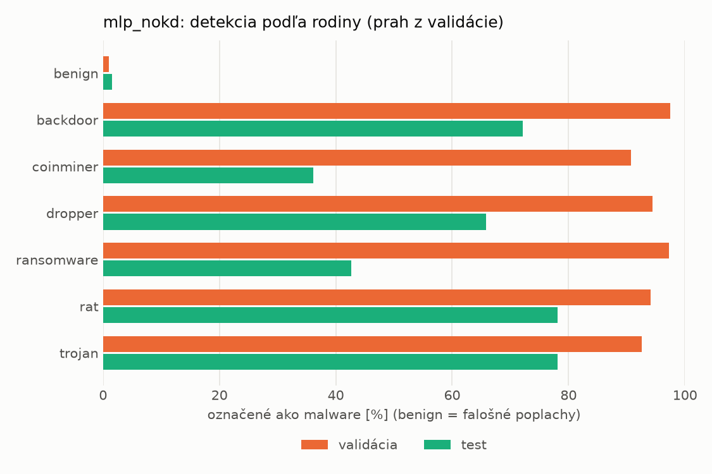
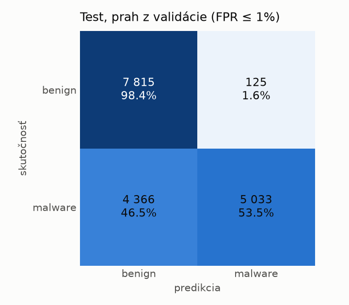
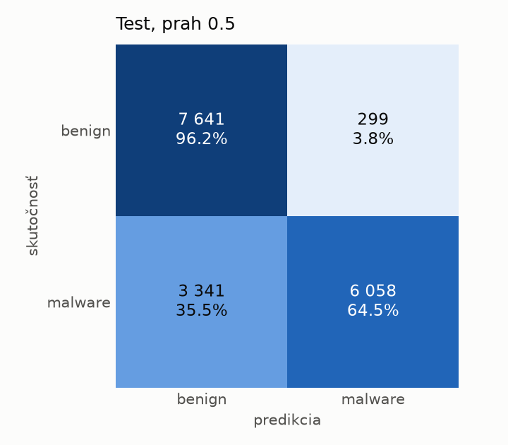
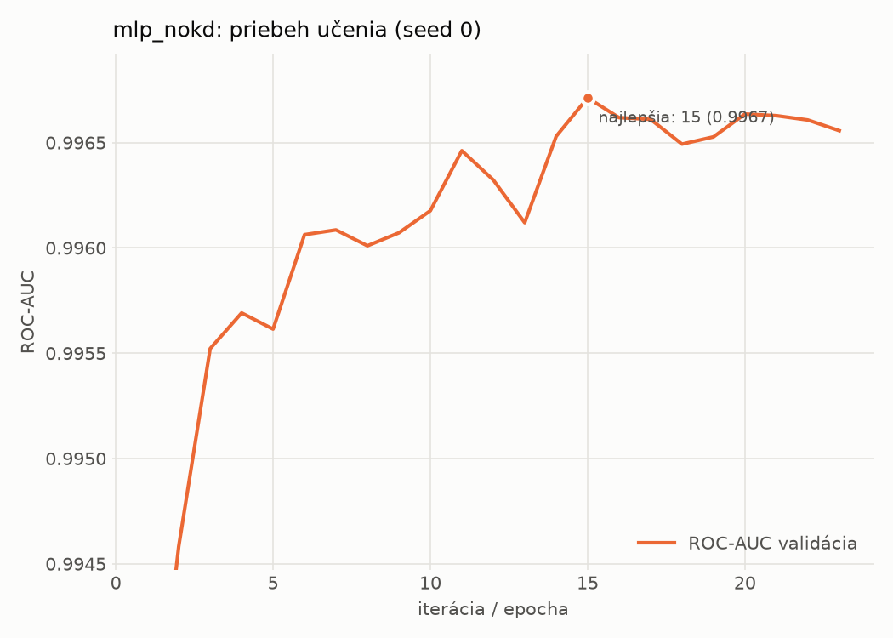

# dynamic/mlp_nokd – beh `20261104-054815`

> Automaticky generované (`src/training/run_tabular.py`). Konfigurácia: `config.yaml`, protokol: `protocol.yaml`.

- **Model:** `mlp` – kontrola – rovnaké malé MLP bez destilácie (iba skutočné označenia)
- **Ladenie:** bez ladenia – hyperparametre prevzaté z `runs_final/students_dynamic/mlp_nokd/20261102-212647`
- **Finálne modely:** seedy [0, 1, 2]; hodnoty sú priemer ± smerodajná odchýlka cez seedy
- **Najlepšie hyperparametre:** `{"hidden_layers": 1, "max_epochs": 100, "patience": 8, "hidden_width": 32, "dropout": 0.27854460554056926, "lr": 0.002048574130711367, "weight_decay": 5.911733622585913e-06, "batch_size": 512}`

## Detekčná kvalita (bez prahu)
| metrika | train (podvzorka) | validácia | test |
|---|---|---|---|
| ROC-AUC | 0.9978 ± 0.0001 | 0.9968 ± 0.0000 | 0.9222 ± 0.0074 |
| PR-AUC | 0.9987 ± 0.0001 | 0.9982 ± 0.0000 | 0.9402 ± 0.0060 |
| TPR pri FPR 1 % | 0.9579 ± 0.0014 | 0.9455 ± 0.0027 | 0.4844 ± 0.0106 |
| TPR pri FPR 0,1 % | 0.8925 ± 0.0074 | 0.8088 ± 0.0307 | 0.3452 ± 0.0141 |
| log loss | 0.0618 ± 0.0029 | 0.0758 ± 0.0007 | 0.7684 ± 0.0151 |
| Brier skóre | 0.0190 ± 0.0009 | 0.0214 ± 0.0006 | 0.1801 ± 0.0085 |

Rozdiel ROC-AUC train − validácia: **0.0010** (veľký rozdiel = preučenie).

## Pri prahu z validácie (FPR ≤ 1% na validácii)
| metrika | train (podvzorka) | validácia | test |
|---|---|---|---|
| accuracy | 0.9631 ± 0.0009 | 0.9611 ± 0.0017 | 0.7379 ± 0.0053 |
| balanced accuracy | 0.9700 ± 0.0004 | 0.9680 ± 0.0012 | 0.7570 ± 0.0049 |
| precision | 0.9960 ± 0.0005 | 0.9947 ± 0.0001 | 0.9757 ± 0.0012 |
| recall (TPR) | 0.9468 ± 0.0018 | 0.9455 ± 0.0027 | 0.5297 ± 0.0093 |
| FPR | 0.0069 ± 0.0009 | 0.0096 ± 0.0002 | 0.0156 ± 0.0006 |
| F1 | 0.9708 ± 0.0007 | 0.9695 ± 0.0014 | 0.6866 ± 0.0081 |
| MCC | 0.9230 ± 0.0016 | 0.9183 ± 0.0033 | 0.5620 ± 0.0080 |

## Pri pevnom prahu 0.5
| metrika | train (podvzorka) | validácia | test |
|---|---|---|---|
| accuracy | 0.9747 ± 0.0014 | 0.9715 ± 0.0018 | 0.7772 ± 0.0111 |
| balanced accuracy | 0.9745 ± 0.0008 | 0.9712 ± 0.0014 | 0.7917 ± 0.0102 |
| precision | 0.9857 ± 0.0009 | 0.9841 ± 0.0006 | 0.9524 ± 0.0005 |
| recall (TPR) | 0.9750 ± 0.0030 | 0.9720 ± 0.0027 | 0.6200 ± 0.0213 |
| FPR | 0.0259 ± 0.0017 | 0.0295 ± 0.0011 | 0.0366 ± 0.0009 |
| F1 | 0.9803 ± 0.0011 | 0.9780 ± 0.0014 | 0.7509 ± 0.0156 |
| MCC | 0.9449 ± 0.0028 | 0.9376 ± 0.0038 | 0.6083 ± 0.0166 |

## Výpočtové nároky (seed 0, testovacia množina)
| meranie | hodnota |
|---|---|
| tréning finálneho modelu | 5.1 s (priemer cez seedy) |
| ladenie spolu | 0 s |
| počet parametrov / uzlov | 64 129 |
| veľkosť modelu na disku | 0.31 MB |
| transformácia vstupu – latencia (1 vlákno) | 0.034 ms |
| transformácia vstupu – priepustnosť | 45 631 vzoriek/s |
| CPU latencia modelu (batch 1, 1 vlákno) | 0.067 ms (p95 0.077) |
| CPU priepustnosť (24 vlákien) | 139 453 vzoriek/s |
| GPU latencia (batch 1) | 0.274 ms (p95 0.320) |
| GPU priepustnosť | 99 927 vzoriek/s |
| GPU špičková pamäť | 1284 MB |

## Grafy
| | |
|---|---|
|  |  |
|  |  |
|  |  |
|  |  |

## Súbory
`metrics.json` (všetky metriky po seedoch vrátane rodín), `timing.json`, `hpo_trials.csv`,
`predictions/<časť>_seed<N>.parquet` (sha256, family, label, score), `model/seed_<N>/`, `log.txt`.
