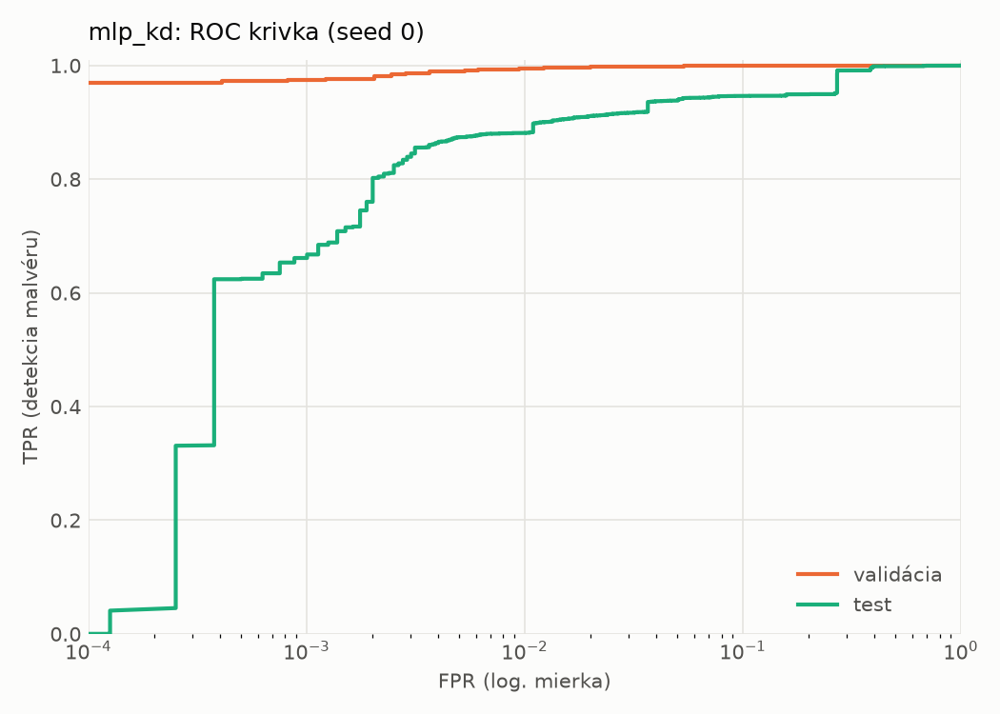
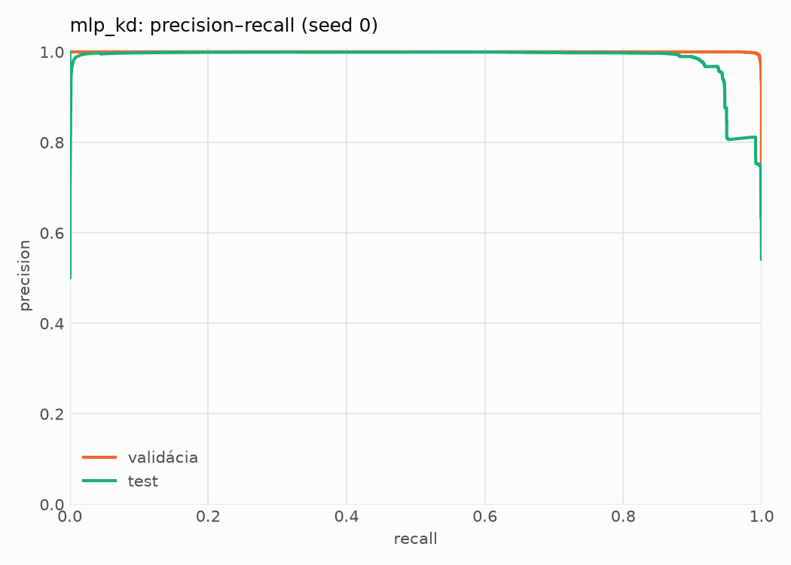
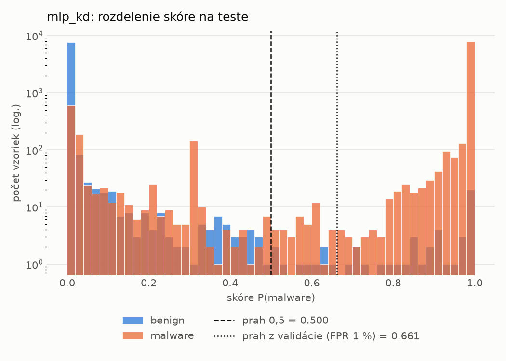
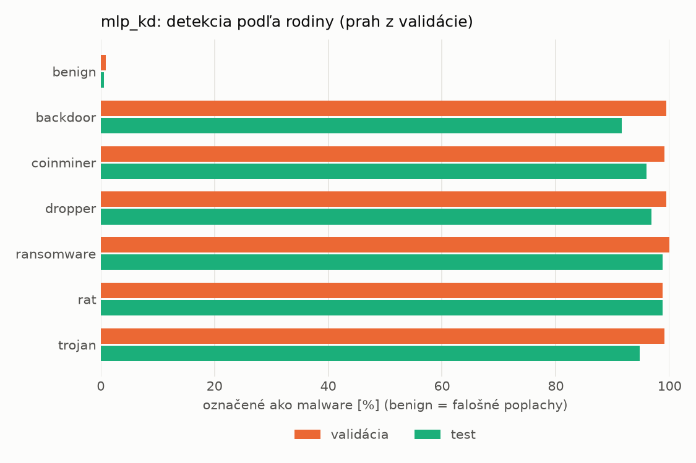
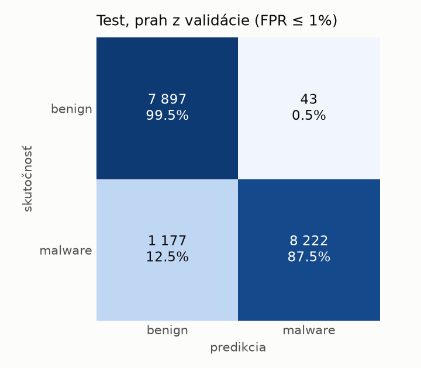
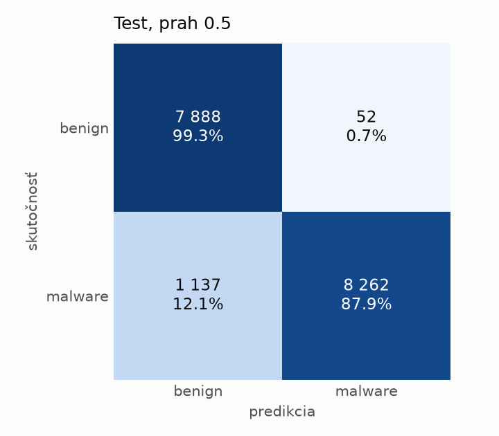
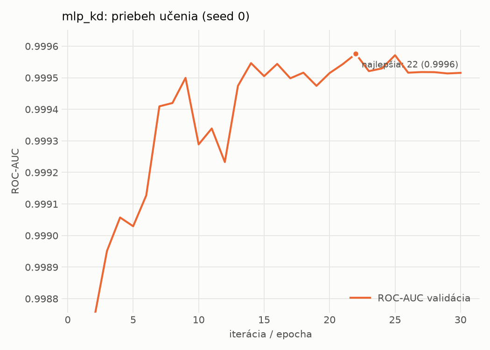

# static/mlp_kd – beh `20261104-054525`

> Automaticky generované (`src/training/run_tabular.py`). Konfigurácia: `config.yaml`, protokol: `protocol.yaml`.

- **Model:** `mlp` – študent – malé MLP učené destiláciou z hybridného učiteľa
- **Ladenie:** bez ladenia – hyperparametre prevzaté z `runs_final/students_static/mlp_kd/20261102-211333`
- **Finálne modely:** seedy [0, 1, 2]; hodnoty sú priemer ± smerodajná odchýlka cez seedy
- **Najlepšie hyperparametre:** `{"hidden_layers": 1, "max_epochs": 100, "patience": 8, "hidden_width": 32, "dropout": 0.0997633477545663, "lr": 0.0015427581570995174, "weight_decay": 0.00017559733451057006, "batch_size": 256, "kd_alpha": 0.604033962068706, "kd_temperature": 6.472658522077935}`

## Detekčná kvalita (bez prahu)
| metrika | train (podvzorka) | validácia | test |
|---|---|---|---|
| ROC-AUC | 0.9999 ± 0.0000 | 0.9995 ± 0.0000 | 0.9801 ± 0.0026 |
| PR-AUC | 0.9999 ± 0.0000 | 0.9998 ± 0.0000 | 0.9848 ± 0.0012 |
| TPR pri FPR 1 % | 0.9978 ± 0.0003 | 0.9942 ± 0.0001 | 0.8933 ± 0.0105 |
| TPR pri FPR 0,1 % | 0.9924 ± 0.0009 | 0.9687 ± 0.0056 | 0.6514 ± 0.0215 |
| log loss | 0.0115 ± 0.0005 | 0.0249 ± 0.0014 | 0.3940 ± 0.0307 |
| Brier skóre | 0.0029 ± 0.0001 | 0.0060 ± 0.0003 | 0.0582 ± 0.0020 |

Rozdiel ROC-AUC train − validácia: **0.0003** (veľký rozdiel = preučenie).

## Pri prahu z validácie (FPR ≤ 1% na validácii)
| metrika | train (podvzorka) | validácia | test |
|---|---|---|---|
| accuracy | 0.9960 ± 0.0005 | 0.9929 ± 0.0001 | 0.9364 ± 0.0059 |
| balanced accuracy | 0.9966 ± 0.0004 | 0.9923 ± 0.0002 | 0.9409 ± 0.0054 |
| precision | 0.9992 ± 0.0002 | 0.9949 ± 0.0001 | 0.9945 ± 0.0006 |
| recall (TPR) | 0.9945 ± 0.0006 | 0.9942 ± 0.0001 | 0.8876 ± 0.0111 |
| FPR | 0.0014 ± 0.0003 | 0.0096 ± 0.0002 | 0.0058 ± 0.0007 |
| F1 | 0.9969 ± 0.0004 | 0.9946 ± 0.0001 | 0.9380 ± 0.0061 |
| MCC | 0.9912 ± 0.0010 | 0.9843 ± 0.0003 | 0.8792 ± 0.0104 |

## Pri pevnom prahu 0.5
| metrika | train (podvzorka) | validácia | test |
|---|---|---|---|
| accuracy | 0.9964 ± 0.0003 | 0.9926 ± 0.0004 | 0.9373 ± 0.0050 |
| balanced accuracy | 0.9966 ± 0.0003 | 0.9915 ± 0.0005 | 0.9416 ± 0.0046 |
| precision | 0.9986 ± 0.0003 | 0.9935 ± 0.0003 | 0.9932 ± 0.0005 |
| recall (TPR) | 0.9958 ± 0.0004 | 0.9951 ± 0.0003 | 0.8904 ± 0.0098 |
| FPR | 0.0026 ± 0.0005 | 0.0121 ± 0.0006 | 0.0073 ± 0.0006 |
| F1 | 0.9972 ± 0.0002 | 0.9943 ± 0.0003 | 0.9389 ± 0.0053 |
| MCC | 0.9921 ± 0.0006 | 0.9836 ± 0.0009 | 0.8804 ± 0.0089 |

## Výpočtové nároky (seed 0, testovacia množina)
| meranie | hodnota |
|---|---|
| tréning finálneho modelu | 13.7 s (priemer cez seedy) |
| ladenie spolu | 0 s |
| počet parametrov / uzlov | 74 337 |
| veľkosť modelu na disku | 0.36 MB |
| transformácia vstupu – latencia (1 vlákno) | 0.041 ms |
| transformácia vstupu – priepustnosť | 40 392 vzoriek/s |
| CPU latencia modelu (batch 1, 1 vlákno) | 0.068 ms (p95 0.078) |
| CPU priepustnosť (24 vlákien) | 52 927 vzoriek/s |
| GPU latencia (batch 1) | 0.296 ms (p95 0.331) |
| GPU priepustnosť | 72 423 vzoriek/s |
| GPU špičková pamäť | 834 MB |

## Grafy
| | |
|---|---|
|  |  |
|  |  |
|  |  |
|  |  |

## Súbory
`metrics.json` (všetky metriky po seedoch vrátane rodín), `timing.json`, `hpo_trials.csv`,
`predictions/<časť>_seed<N>.parquet` (sha256, family, label, score), `model/seed_<N>/`, `log.txt`.
