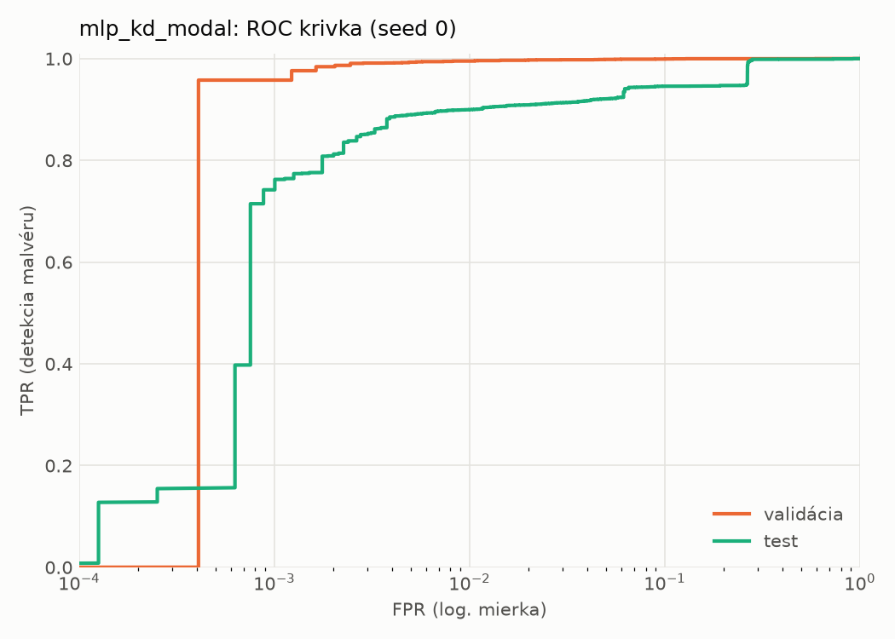
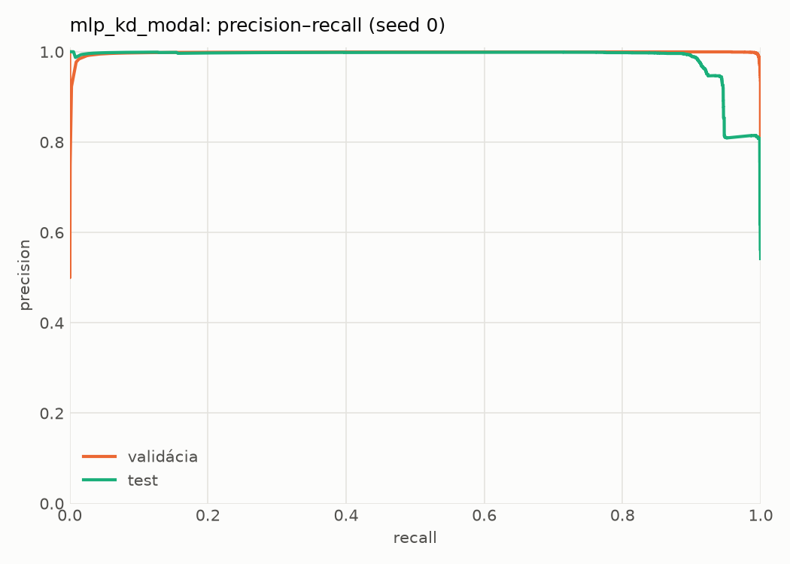
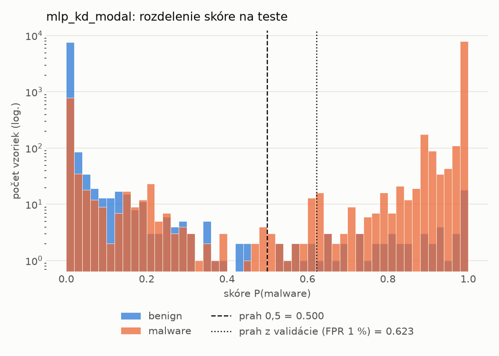
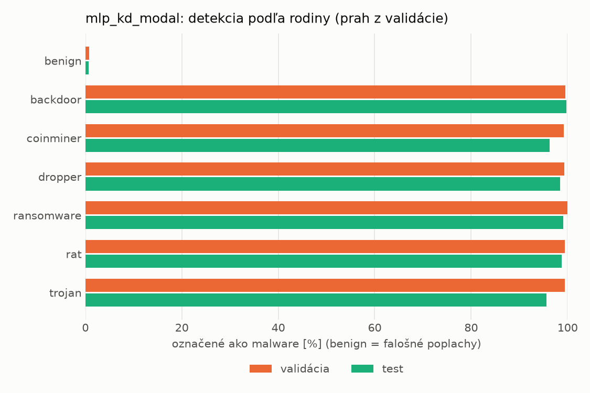
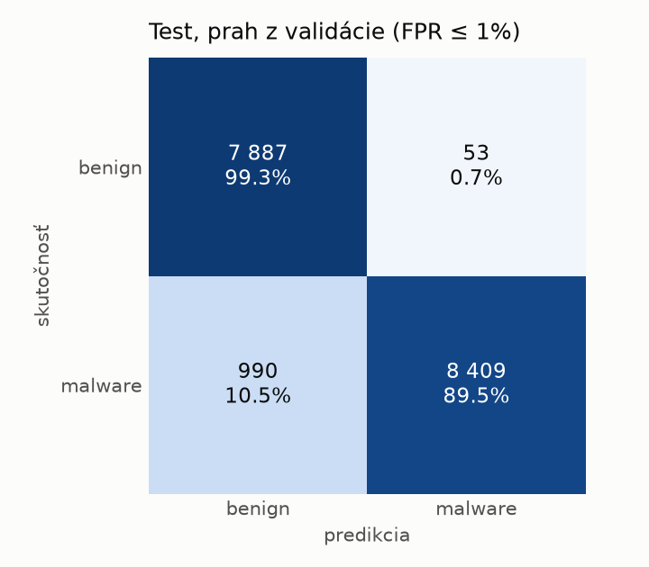
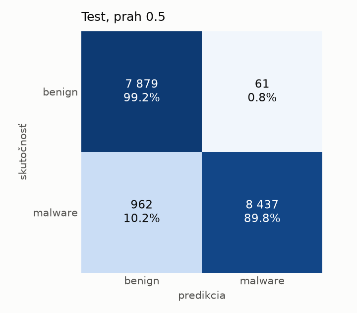
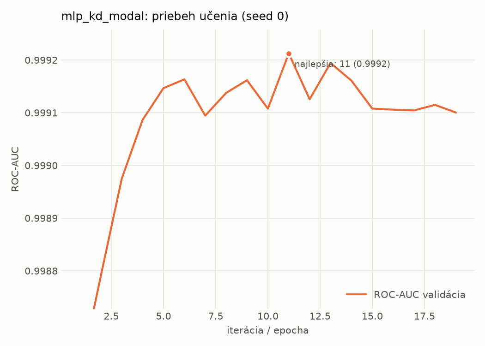

# static/mlp_kd_modal – beh `20261104-054633`

> Automaticky generované (`src/training/run_tabular.py`). Konfigurácia: `config.yaml`, protokol: `protocol.yaml`.

- **Model:** `mlp` – študent – malé MLP učené destiláciou z učiteľa rovnakej modality (variant A)
- **Ladenie:** bez ladenia – hyperparametre prevzaté z `runs_final/students_static/mlp_kd_modal/20261102-211832`
- **Finálne modely:** seedy [0, 1, 2]; hodnoty sú priemer ± smerodajná odchýlka cez seedy
- **Najlepšie hyperparametre:** `{"hidden_layers": 1, "max_epochs": 100, "patience": 8, "hidden_width": 32, "dropout": 0.15602040635334324, "lr": 0.00105640764164036, "weight_decay": 3.5856126103453987e-06, "batch_size": 256, "kd_alpha": 0.815861880342119, "kd_temperature": 5.185299851677596}`

## Detekčná kvalita (bez prahu)
| metrika | train (podvzorka) | validácia | test |
|---|---|---|---|
| ROC-AUC | 0.9999 ± 0.0000 | 0.9992 ± 0.0000 | 0.9761 ± 0.0059 |
| PR-AUC | 0.9999 ± 0.0000 | 0.9984 ± 0.0001 | 0.9826 ± 0.0039 |
| TPR pri FPR 1 % | 0.9976 ± 0.0008 | 0.9942 ± 0.0011 | 0.8999 ± 0.0005 |
| TPR pri FPR 0,1 % | 0.9908 ± 0.0015 | 0.9512 ± 0.0061 | 0.5807 ± 0.2429 |
| log loss | 0.0122 ± 0.0017 | 0.0259 ± 0.0017 | 0.4328 ± 0.0383 |
| Brier skóre | 0.0031 ± 0.0004 | 0.0059 ± 0.0005 | 0.0578 ± 0.0015 |

Rozdiel ROC-AUC train − validácia: **0.0007** (veľký rozdiel = preučenie).

## Pri prahu z validácie (FPR ≤ 1% na validácii)
| metrika | train (podvzorka) | validácia | test |
|---|---|---|---|
| accuracy | 0.9961 ± 0.0004 | 0.9930 ± 0.0010 | 0.9329 ± 0.0061 |
| balanced accuracy | 0.9965 ± 0.0004 | 0.9925 ± 0.0010 | 0.9376 ± 0.0056 |
| precision | 0.9990 ± 0.0004 | 0.9951 ± 0.0005 | 0.9938 ± 0.0008 |
| recall (TPR) | 0.9950 ± 0.0005 | 0.9942 ± 0.0011 | 0.8817 ± 0.0113 |
| FPR | 0.0019 ± 0.0008 | 0.0093 ± 0.0009 | 0.0065 ± 0.0008 |
| F1 | 0.9970 ± 0.0003 | 0.9946 ± 0.0008 | 0.9344 ± 0.0063 |
| MCC | 0.9914 ± 0.0008 | 0.9845 ± 0.0022 | 0.8728 ± 0.0108 |

## Pri pevnom prahu 0.5
| metrika | train (podvzorka) | validácia | test |
|---|---|---|---|
| accuracy | 0.9963 ± 0.0007 | 0.9929 ± 0.0007 | 0.9374 ± 0.0059 |
| balanced accuracy | 0.9965 ± 0.0007 | 0.9918 ± 0.0007 | 0.9416 ± 0.0054 |
| precision | 0.9985 ± 0.0006 | 0.9938 ± 0.0005 | 0.9926 ± 0.0005 |
| recall (TPR) | 0.9959 ± 0.0005 | 0.9953 ± 0.0005 | 0.8911 ± 0.0105 |
| FPR | 0.0028 ± 0.0010 | 0.0116 ± 0.0010 | 0.0078 ± 0.0005 |
| F1 | 0.9972 ± 0.0005 | 0.9946 ± 0.0005 | 0.9391 ± 0.0060 |
| MCC | 0.9920 ± 0.0015 | 0.9843 ± 0.0014 | 0.8805 ± 0.0106 |

## Výpočtové nároky (seed 0, testovacia množina)
| meranie | hodnota |
|---|---|
| tréning finálneho modelu | 7.5 s (priemer cez seedy) |
| ladenie spolu | 0 s |
| počet parametrov / uzlov | 74 337 |
| veľkosť modelu na disku | 0.36 MB |
| transformácia vstupu – latencia (1 vlákno) | 0.028 ms |
| transformácia vstupu – priepustnosť | 47 243 vzoriek/s |
| CPU latencia modelu (batch 1, 1 vlákno) | 0.070 ms (p95 0.077) |
| CPU priepustnosť (24 vlákien) | 60 994 vzoriek/s |
| GPU latencia (batch 1) | 0.278 ms (p95 0.329) |
| GPU priepustnosť | 79 510 vzoriek/s |
| GPU špičková pamäť | 834 MB |

## Grafy
| | |
|---|---|
|  |  |
|  |  |
|  |  |
|  |  |

## Súbory
`metrics.json` (všetky metriky po seedoch vrátane rodín), `timing.json`, `hpo_trials.csv`,
`predictions/<časť>_seed<N>.parquet` (sha256, family, label, score), `model/seed_<N>/`, `log.txt`.
