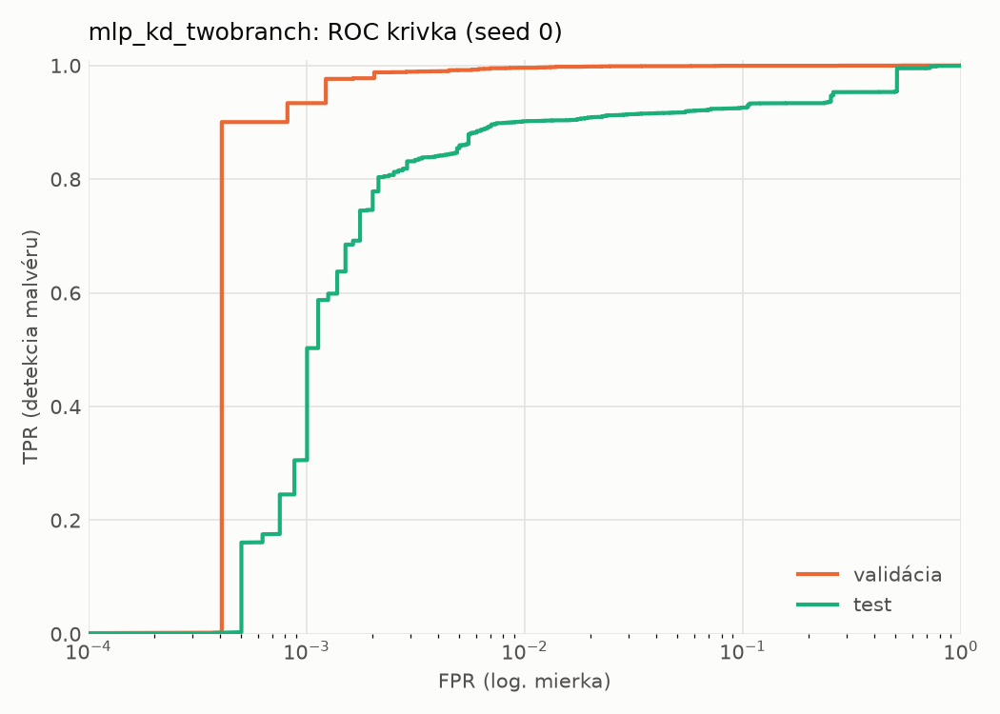
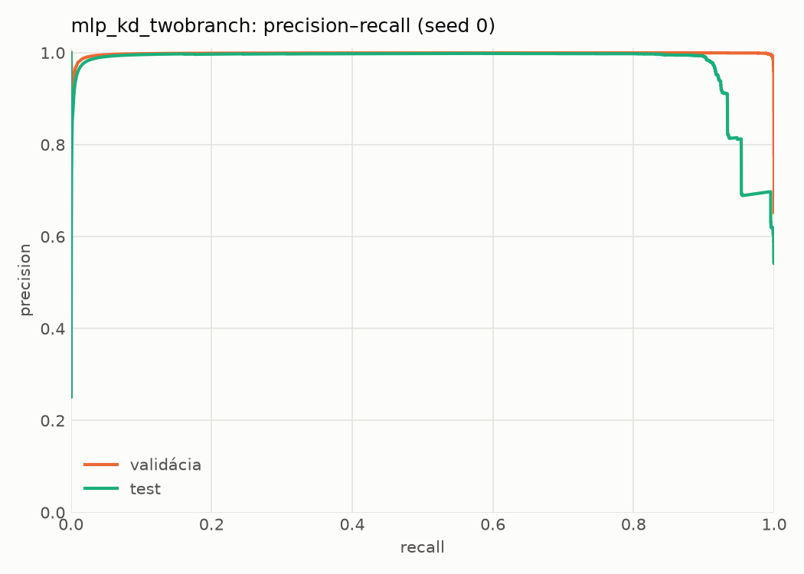
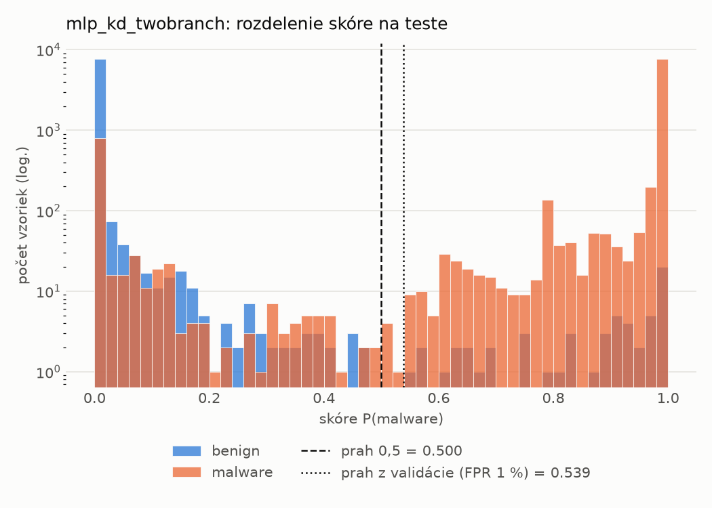
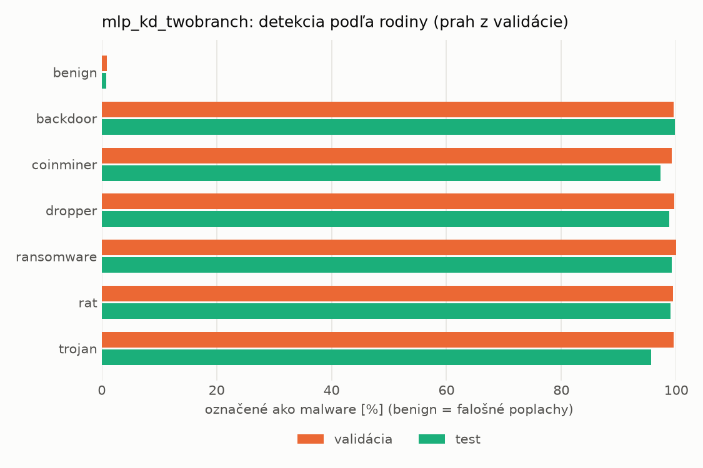
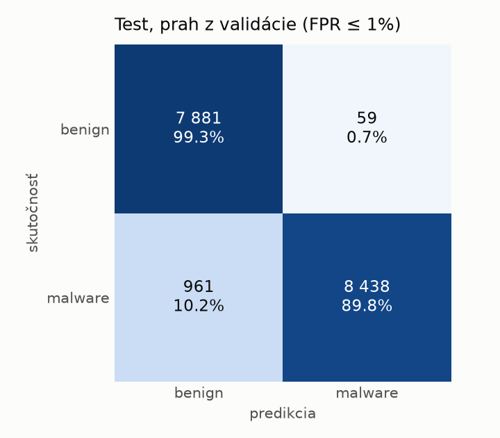
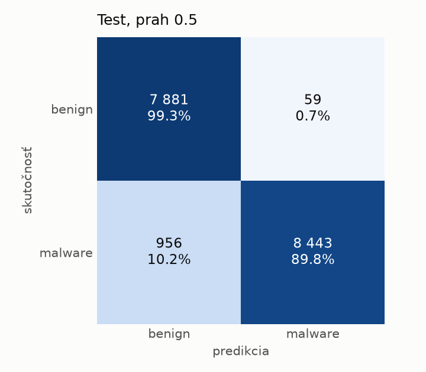
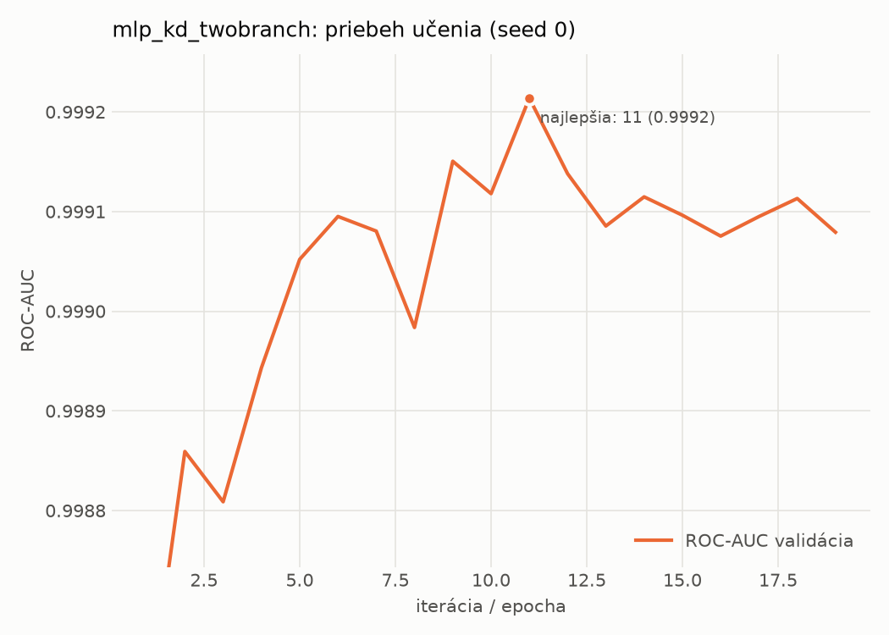

# static/mlp_kd_twobranch – beh `20261104-054705`

> Automaticky generované (`src/training/run_tabular.py`). Konfigurácia: `config.yaml`, protokol: `protocol.yaml`.

- **Model:** `mlp` – študent – malé MLP učené destiláciou z dvojvetvovej siete (V2)
- **Ladenie:** bez ladenia – hyperparametre prevzaté z `runs_v2/full/students_static/mlp_kd_twobranch/20261103-210128`
- **Finálne modely:** seedy [0, 1, 2]; hodnoty sú priemer ± smerodajná odchýlka cez seedy
- **Najlepšie hyperparametre:** `{"hidden_layers": 1, "max_epochs": 100, "patience": 8, "hidden_width": 32, "dropout": 0.11907530604839062, "lr": 0.0013122016832935236, "weight_decay": 1.6321051677063922e-05, "batch_size": 256, "kd_alpha": 0.8749635763069835, "kd_temperature": 3.9893325789148495}`

## Detekčná kvalita (bez prahu)
| metrika | train (podvzorka) | validácia | test |
|---|---|---|---|
| ROC-AUC | 0.9999 ± 0.0000 | 0.9992 ± 0.0000 | 0.9693 ± 0.0060 |
| PR-AUC | 1.0000 ± 0.0000 | 0.9986 ± 0.0000 | 0.9773 ± 0.0037 |
| TPR pri FPR 1 % | 0.9984 ± 0.0004 | 0.9954 ± 0.0006 | 0.8956 ± 0.0058 |
| TPR pri FPR 0,1 % | 0.9943 ± 0.0017 | 0.9581 ± 0.0212 | 0.4458 ± 0.1240 |
| log loss | 0.0099 ± 0.0022 | 0.0221 ± 0.0012 | 0.4599 ± 0.0180 |
| Brier skóre | 0.0025 ± 0.0005 | 0.0052 ± 0.0005 | 0.0599 ± 0.0024 |

Rozdiel ROC-AUC train − validácia: **0.0007** (veľký rozdiel = preučenie).

## Pri prahu z validácie (FPR ≤ 1% na validácii)
| metrika | train (podvzorka) | validácia | test |
|---|---|---|---|
| accuracy | 0.9969 ± 0.0007 | 0.9938 ± 0.0004 | 0.9343 ± 0.0078 |
| balanced accuracy | 0.9972 ± 0.0006 | 0.9931 ± 0.0003 | 0.9388 ± 0.0072 |
| precision | 0.9992 ± 0.0002 | 0.9951 ± 0.0003 | 0.9928 ± 0.0002 |
| recall (TPR) | 0.9960 ± 0.0010 | 0.9954 ± 0.0006 | 0.8851 ± 0.0143 |
| FPR | 0.0015 ± 0.0003 | 0.0093 ± 0.0006 | 0.0076 ± 0.0001 |
| F1 | 0.9976 ± 0.0005 | 0.9952 ± 0.0003 | 0.9359 ± 0.0081 |
| MCC | 0.9932 ± 0.0015 | 0.9863 ± 0.0008 | 0.8750 ± 0.0139 |

## Pri pevnom prahu 0.5
| metrika | train (podvzorka) | validácia | test |
|---|---|---|---|
| accuracy | 0.9969 ± 0.0006 | 0.9932 ± 0.0008 | 0.9377 ± 0.0033 |
| balanced accuracy | 0.9971 ± 0.0005 | 0.9922 ± 0.0009 | 0.9419 ± 0.0031 |
| precision | 0.9988 ± 0.0002 | 0.9940 ± 0.0008 | 0.9922 ± 0.0007 |
| recall (TPR) | 0.9964 ± 0.0008 | 0.9956 ± 0.0004 | 0.8920 ± 0.0055 |
| FPR | 0.0023 ± 0.0003 | 0.0113 ± 0.0014 | 0.0083 ± 0.0007 |
| F1 | 0.9976 ± 0.0005 | 0.9948 ± 0.0006 | 0.9394 ± 0.0034 |
| MCC | 0.9931 ± 0.0013 | 0.9850 ± 0.0017 | 0.8809 ± 0.0061 |

## Výpočtové nároky (seed 0, testovacia množina)
| meranie | hodnota |
|---|---|
| tréning finálneho modelu | 6.6 s (priemer cez seedy) |
| ladenie spolu | 0 s |
| počet parametrov / uzlov | 74 337 |
| veľkosť modelu na disku | 0.36 MB |
| transformácia vstupu – latencia (1 vlákno) | 0.042 ms |
| transformácia vstupu – priepustnosť | 35 783 vzoriek/s |
| CPU latencia modelu (batch 1, 1 vlákno) | 0.069 ms (p95 0.077) |
| CPU priepustnosť (24 vlákien) | 109 382 vzoriek/s |
| GPU latencia (batch 1) | 0.288 ms (p95 0.309) |
| GPU priepustnosť | 74 917 vzoriek/s |
| GPU špičková pamäť | 1486 MB |

## Grafy
| | |
|---|---|
|  |  |
|  |  |
|  |  |
|  |  |

## Súbory
`metrics.json` (všetky metriky po seedoch vrátane rodín), `timing.json`, `hpo_trials.csv`,
`predictions/<časť>_seed<N>.parquet` (sha256, family, label, score), `model/seed_<N>/`, `log.txt`.
