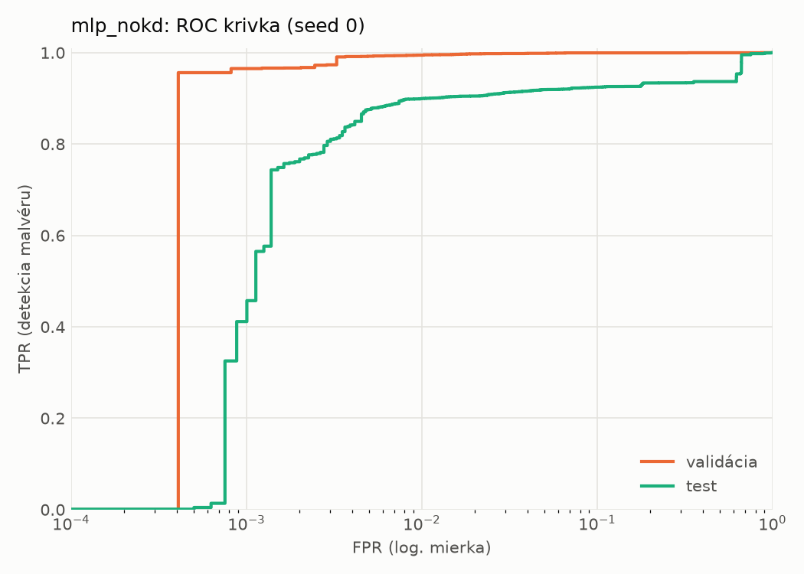
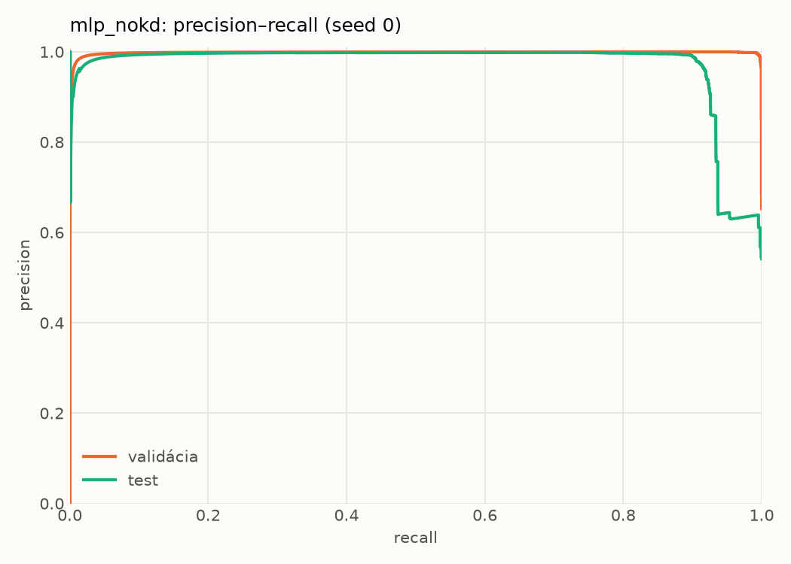
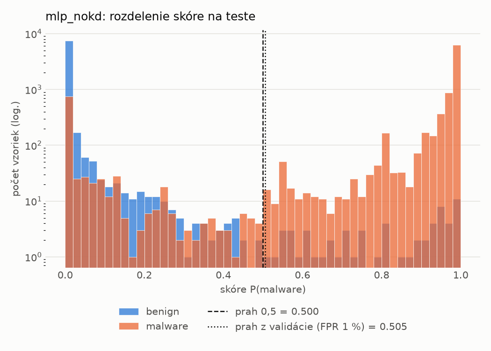
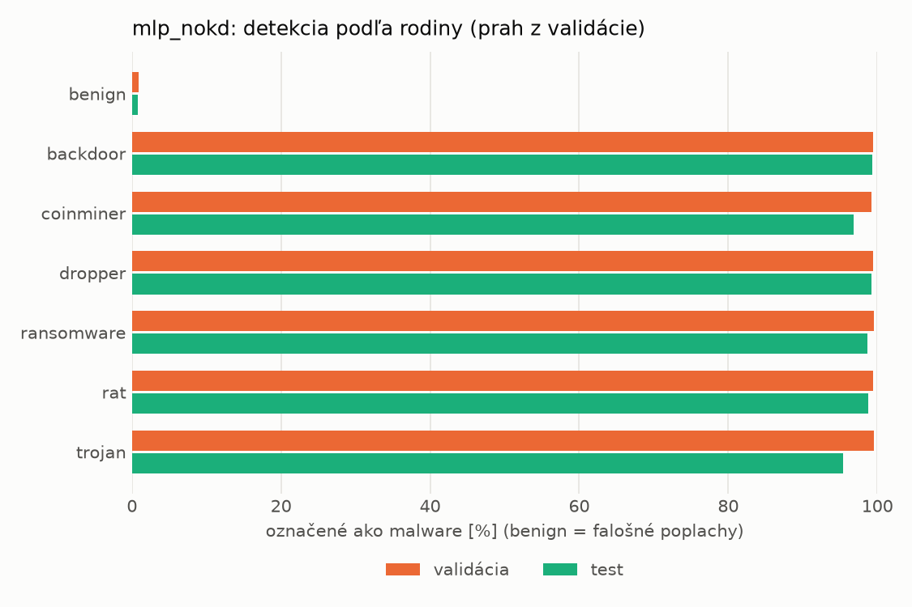
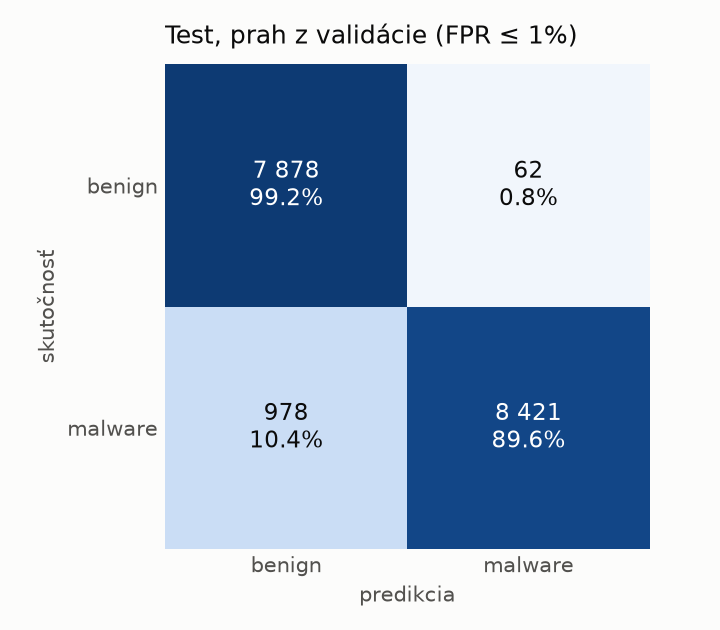
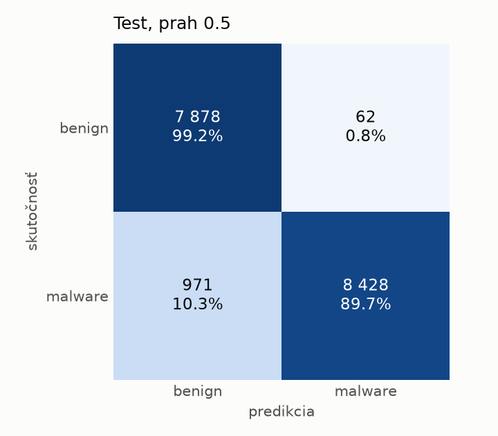
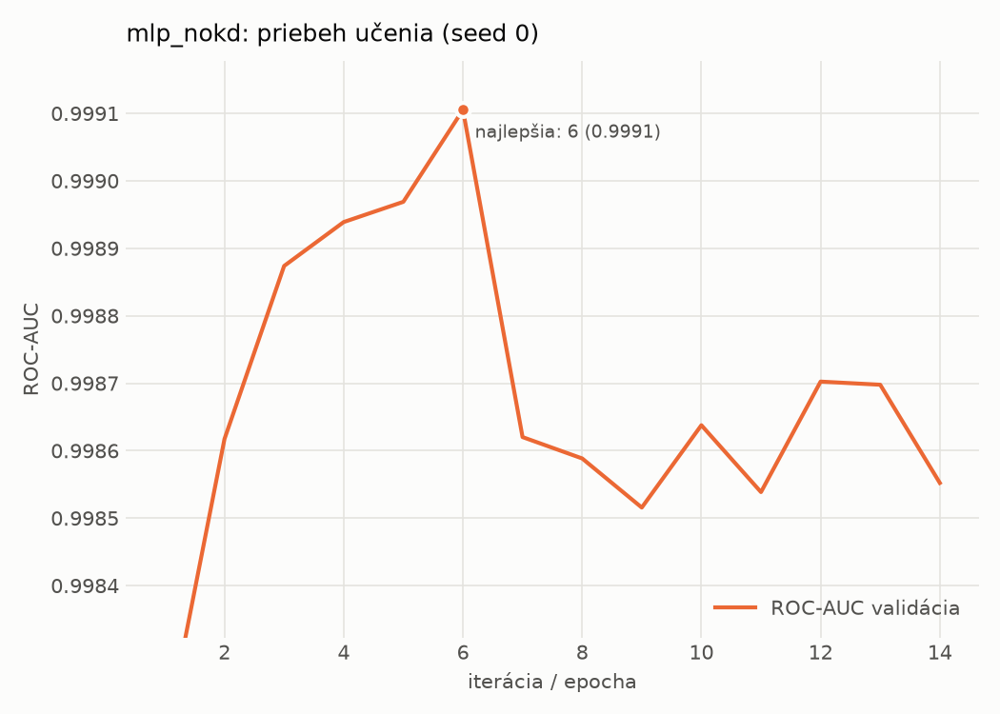

# static/mlp_nokd – beh `20261104-054616`

> Automaticky generované (`src/training/run_tabular.py`). Konfigurácia: `config.yaml`, protokol: `protocol.yaml`.

- **Model:** `mlp` – kontrola – rovnaké malé MLP bez destilácie (iba skutočné označenia)
- **Ladenie:** bez ladenia – hyperparametre prevzaté z `runs_final/students_static/mlp_nokd/20261102-211710`
- **Finálne modely:** seedy [0, 1, 2]; hodnoty sú priemer ± smerodajná odchýlka cez seedy
- **Najlepšie hyperparametre:** `{"hidden_layers": 1, "max_epochs": 100, "patience": 8, "hidden_width": 32, "dropout": 0.137657909519708, "lr": 0.0007042503153050794, "weight_decay": 1.207246112223234e-05, "batch_size": 512}`

## Detekčná kvalita (bez prahu)
| metrika | train (podvzorka) | validácia | test |
|---|---|---|---|
| ROC-AUC | 0.9999 ± 0.0000 | 0.9991 ± 0.0000 | 0.9417 ± 0.0103 |
| PR-AUC | 0.9999 ± 0.0000 | 0.9980 ± 0.0000 | 0.9652 ± 0.0037 |
| TPR pri FPR 1 % | 0.9984 ± 0.0004 | 0.9939 ± 0.0006 | 0.8970 ± 0.0026 |
| TPR pri FPR 0,1 % | 0.9938 ± 0.0022 | 0.9539 ± 0.0097 | 0.3239 ± 0.2869 |
| log loss | 0.0156 ± 0.0022 | 0.0271 ± 0.0010 | 0.4062 ± 0.0456 |
| Brier skóre | 0.0029 ± 0.0005 | 0.0058 ± 0.0004 | 0.0584 ± 0.0004 |

Rozdiel ROC-AUC train − validácia: **0.0008** (veľký rozdiel = preučenie).

## Pri prahu z validácie (FPR ≤ 1% na validácii)
| metrika | train (podvzorka) | validácia | test |
|---|---|---|---|
| accuracy | 0.9965 ± 0.0009 | 0.9929 ± 0.0002 | 0.9366 ± 0.0030 |
| balanced accuracy | 0.9970 ± 0.0008 | 0.9924 ± 0.0001 | 0.9409 ± 0.0027 |
| precision | 0.9993 ± 0.0002 | 0.9952 ± 0.0002 | 0.9935 ± 0.0008 |
| recall (TPR) | 0.9952 ± 0.0012 | 0.9939 ± 0.0006 | 0.8888 ± 0.0062 |
| FPR | 0.0012 ± 0.0004 | 0.0090 ± 0.0004 | 0.0069 ± 0.0009 |
| F1 | 0.9973 ± 0.0007 | 0.9946 ± 0.0002 | 0.9382 ± 0.0031 |
| MCC | 0.9923 ± 0.0019 | 0.9843 ± 0.0005 | 0.8792 ± 0.0052 |

## Pri pevnom prahu 0.5
| metrika | train (podvzorka) | validácia | test |
|---|---|---|---|
| accuracy | 0.9969 ± 0.0007 | 0.9925 ± 0.0006 | 0.9384 ± 0.0017 |
| balanced accuracy | 0.9972 ± 0.0007 | 0.9917 ± 0.0008 | 0.9426 ± 0.0016 |
| precision | 0.9992 ± 0.0005 | 0.9943 ± 0.0008 | 0.9926 ± 0.0008 |
| recall (TPR) | 0.9960 ± 0.0006 | 0.9942 ± 0.0005 | 0.8931 ± 0.0032 |
| FPR | 0.0015 ± 0.0009 | 0.0108 ± 0.0014 | 0.0079 ± 0.0009 |
| F1 | 0.9976 ± 0.0005 | 0.9942 ± 0.0005 | 0.9402 ± 0.0018 |
| MCC | 0.9932 ± 0.0015 | 0.9834 ± 0.0014 | 0.8823 ± 0.0031 |

## Výpočtové nároky (seed 0, testovacia množina)
| meranie | hodnota |
|---|---|
| tréning finálneho modelu | 2.8 s (priemer cez seedy) |
| ladenie spolu | 0 s |
| počet parametrov / uzlov | 74 337 |
| veľkosť modelu na disku | 0.36 MB |
| transformácia vstupu – latencia (1 vlákno) | 0.042 ms |
| transformácia vstupu – priepustnosť | 38 354 vzoriek/s |
| CPU latencia modelu (batch 1, 1 vlákno) | 0.070 ms (p95 0.079) |
| CPU priepustnosť (24 vlákien) | 106 450 vzoriek/s |
| GPU latencia (batch 1) | 0.346 ms (p95 0.371) |
| GPU priepustnosť | 78 748 vzoriek/s |
| GPU špičková pamäť | 1486 MB |

## Grafy
| | |
|---|---|
|  |  |
|  |  |
|  |  |
|  |  |

## Súbory
`metrics.json` (všetky metriky po seedoch vrátane rodín), `timing.json`, `hpo_trials.csv`,
`predictions/<časť>_seed<N>.parquet` (sha256, family, label, score), `model/seed_<N>/`, `log.txt`.
