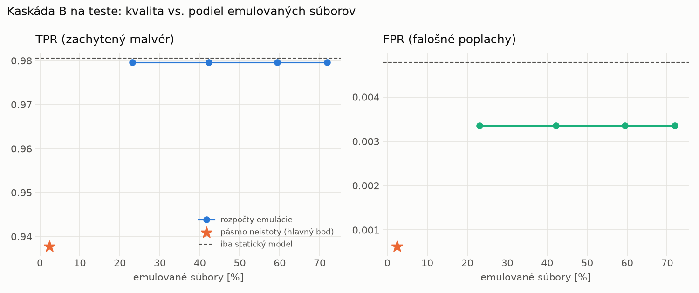

# Kaskáda B `b_baselines` – beh `20261104-080059`

> Generované `src/cascade/evaluate_b.py` (2026-11-04T08:01:00+01:00). Seedy: [0, 1, 2]; hodnoty = priemer ± sm. odchýlka.
> Všetky prahy a pásmo neistoty sú z validácie; test sa na nič nenastavuje. Postup: `docs/09_plan_v2.md`.

| rola | beh |
|---|---|
| static | `runs_v2/lofo/ransomware/static/lightgbm/20261104-055157` |
| dynamic | `runs_v2/lofo/ransomware/dynamic/lightgbm/20261104-060251` |
| hybrid | `runs_v2/lofo/ransomware/hybrid/lightgbm/20261104-063626` |

Druhý stupeň: **dynamic**. Pásmo neistoty statického modelu: FPR ≤ 0.1% nad `hi`,
najviac 1% malvéru validácie pod `lo` (seed 0: lo = 0.8524, hi = 0.9510, seed 1: lo = 0.8904, hi = 0.9825, seed 2: lo = 0.8154, hi = 0.9592).

## Test
| prístup | accuracy | balanced_accuracy | precision | recall_tpr | fpr | f1 | mcc |
|---|---|---|---|---|---|---|---|
| kaskáda B | 0.9660 ± 0.0009 | 0.9686 ± 0.0009 | 0.9994 ± 0.0000 | 0.9378 ± 0.0017 | 0.0006 ± 0.0000 | 0.9676 ± 0.0009 | 0.9339 ± 0.0018 |
| statický | 0.9873 ± 0.0010 | 0.9879 ± 0.0009 | 0.9959 ± 0.0002 | 0.9805 ± 0.0020 | 0.0048 ± 0.0003 | 0.9882 ± 0.0009 | 0.9745 ± 0.0020 |
| dynamický | 0.7734 ± 0.0067 | 0.7900 ± 0.0062 | 0.9820 ± 0.0004 | 0.5928 ± 0.0124 | 0.0128 ± 0.0000 | 0.7393 ± 0.0097 | 0.6158 ± 0.0099 |
| hybrid (každá vzorka) | 0.9893 ± 0.0008 | 0.9898 ± 0.0007 | 0.9965 ± 0.0008 | 0.9836 ± 0.0017 | 0.0041 ± 0.0009 | 0.9900 ± 0.0007 | 0.9785 ± 0.0015 |

- **emulované súbory: 2.39%** (ostatné rozhodne iba statický model); na hybrid ide 1.40% súborov
- chyby pri istom rozhodnutí statického modelu (seed 0): 607
- validácia: emulované 0.30%, na hybrid 0.14%

## Validácia
| prístup | accuracy | balanced_accuracy | precision | recall_tpr | fpr | f1 | mcc |
|---|---|---|---|---|---|---|---|
| kaskáda B | 0.9930 ± 0.0003 | 0.9940 ± 0.0004 | 0.9987 ± 0.0004 | 0.9901 ± 0.0000 | 0.0020 ± 0.0007 | 0.9944 ± 0.0002 | 0.9853 ± 0.0006 |
| statický | 0.9945 ± 0.0004 | 0.9938 ± 0.0004 | 0.9945 ± 0.0004 | 0.9968 ± 0.0004 | 0.0091 ± 0.0006 | 0.9956 ± 0.0003 | 0.9884 ± 0.0008 |
| dynamický | 0.9646 ± 0.0006 | 0.9697 ± 0.0005 | 0.9938 ± 0.0002 | 0.9490 ± 0.0009 | 0.0097 ± 0.0002 | 0.9709 ± 0.0005 | 0.9274 ± 0.0012 |
| hybrid (každá vzorka) | 0.9942 ± 0.0006 | 0.9934 ± 0.0005 | 0.9942 ± 0.0001 | 0.9964 ± 0.0009 | 0.0096 ± 0.0002 | 0.9953 ± 0.0005 | 0.9876 ± 0.0013 |

## Januárové vzorky vynechanej rodiny (iba malvér → TPR)
| prístup | TPR |
|---|---|
| kaskáda B | 0.9133 ± 0.0125 |
| statický | 0.9950 ± 0.0011 |
| dynamický | 0.0833 ± 0.0012 |
| hybrid (každá vzorka) | 0.9969 ± 0.0002 |

Podiel emulovaných: 19.19%

## Krivka rozpočtu emulácie (test, priemer cez seedy)
| budget_val | emulation_rate | hybrid_rate | recall_tpr | fpr | f1 |
|---|---|---|---|---|---|
| 0.1000 | 0.2312 | 0.0656 | 0.9796 | 0.0034 | 0.9883 |
| 0.2000 | 0.4220 | 0.1444 | 0.9796 | 0.0034 | 0.9883 |
| 0.3000 | 0.5943 | 0.1672 | 0.9796 | 0.0034 | 0.9883 |
| 0.4000 | 0.7189 | 0.1861 | 0.9796 | 0.0034 | 0.9883 |

## Výpočtové nároky
Emulácia (Speakeasy) sa nedá zmerať (dataset neobsahuje PE súbory). **Predpoklad** 60 s na súbor
(limit z `speakeasy-config.json`): kaskáda B ≈ 1.4 s na súbor v priemere, dynamický/hybridný model
a kaskáda A 60 s (emulujú každý súbor).

_Chýba benchmark niektorého komponentu (v zero-day behoch sa nemeria)._

