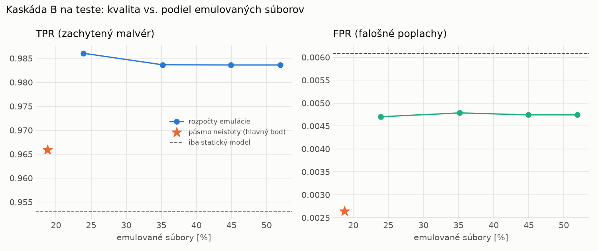

# Kaskáda B `b_direct` – beh `20261104-080055`

> Generované `src/cascade/evaluate_b.py` (2026-11-04T08:00:56+01:00). Seedy: [0, 1, 2]; hodnoty = priemer ± sm. odchýlka.
> Všetky prahy a pásmo neistoty sú z validácie; test sa na nič nenastavuje. Postup: `docs/09_plan_v2.md`.

| rola | beh |
|---|---|
| static | `runs_v2/lofo/ransomware/students_static/mlp_kd/20261104-075704` |
| hybrid | `runs_v2/lofo/ransomware/hybrid/lightgbm/20261104-063626` |

Druhý stupeň: **hybrid**. Pásmo neistoty statického modelu: FPR ≤ 0.1% nad `hi`,
najviac 1% malvéru validácie pod `lo` (seed 0: lo = 0.6042, hi = 0.9995, seed 1: lo = 0.5553, hi = 0.9997, seed 2: lo = 0.4972, hi = 0.9997).

## Test
| prístup | accuracy | balanced_accuracy | precision | recall_tpr | fpr | f1 | mcc |
|---|---|---|---|---|---|---|---|
| kaskáda B | 0.9803 ± 0.0025 | 0.9816 ± 0.0023 | 0.9977 ± 0.0003 | 0.9659 ± 0.0043 | 0.0026 ± 0.0004 | 0.9815 ± 0.0024 | 0.9610 ± 0.0049 |
| statický | 0.9718 ± 0.0031 | 0.9735 ± 0.0029 | 0.9946 ± 0.0001 | 0.9531 ± 0.0058 | 0.0061 ± 0.0001 | 0.9734 ± 0.0030 | 0.9444 ± 0.0059 |
| hybrid (každá vzorka) | 0.9893 ± 0.0008 | 0.9898 ± 0.0007 | 0.9965 ± 0.0008 | 0.9836 ± 0.0017 | 0.0041 ± 0.0009 | 0.9900 ± 0.0007 | 0.9785 ± 0.0015 |

- **emulované súbory: 18.78%** (ostatné rozhodne iba statický model); na hybrid ide 18.78% súborov
- chyby pri istom rozhodnutí statického modelu (seed 0): 302
- validácia: emulované 7.26%, na hybrid 7.26%

## Validácia
| prístup | accuracy | balanced_accuracy | precision | recall_tpr | fpr | f1 | mcc |
|---|---|---|---|---|---|---|---|
| kaskáda B | 0.9914 ± 0.0001 | 0.9920 ± 0.0001 | 0.9967 ± 0.0004 | 0.9896 ± 0.0004 | 0.0055 ± 0.0006 | 0.9931 ± 0.0001 | 0.9819 ± 0.0002 |
| statický | 0.9875 ± 0.0006 | 0.9880 ± 0.0005 | 0.9940 ± 0.0000 | 0.9859 ± 0.0010 | 0.0098 ± 0.0000 | 0.9899 ± 0.0005 | 0.9736 ± 0.0013 |
| hybrid (každá vzorka) | 0.9942 ± 0.0006 | 0.9934 ± 0.0005 | 0.9942 ± 0.0001 | 0.9964 ± 0.0009 | 0.0096 ± 0.0002 | 0.9953 ± 0.0005 | 0.9876 ± 0.0013 |

## Januárové vzorky vynechanej rodiny (iba malvér → TPR)
| prístup | TPR |
|---|---|
| kaskáda B | 0.9053 ± 0.0213 |
| statický | 0.8520 ± 0.0484 |
| hybrid (každá vzorka) | 0.9969 ± 0.0002 |

Podiel emulovaných: 82.92%

## Krivka rozpočtu emulácie (test, priemer cez seedy)
| budget_val | emulation_rate | hybrid_rate | recall_tpr | fpr | f1 |
|---|---|---|---|---|---|
| 0.1000 | 0.2389 | 0.2389 | 0.9861 | 0.0047 | 0.9910 |
| 0.2000 | 0.3517 | 0.3517 | 0.9837 | 0.0048 | 0.9897 |
| 0.3000 | 0.4491 | 0.4491 | 0.9836 | 0.0047 | 0.9897 |
| 0.4000 | 0.5193 | 0.5193 | 0.9836 | 0.0047 | 0.9897 |

## Výpočtové nároky
Emulácia (Speakeasy) sa nedá zmerať (dataset neobsahuje PE súbory). **Predpoklad** 60 s na súbor
(limit z `speakeasy-config.json`): kaskáda B ≈ 11.3 s na súbor v priemere, dynamický/hybridný model
a kaskáda A 60 s (emulujú každý súbor).

_Chýba benchmark niektorého komponentu (v zero-day behoch sa nemeria)._

