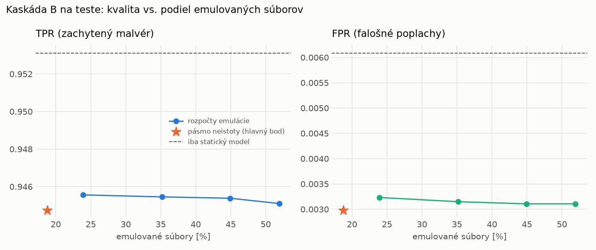

# Kaskáda B `b_heavy` – beh `20261104-080057`

> Generované `src/cascade/evaluate_b.py` (2026-11-04T08:00:58+01:00). Seedy: [0, 1, 2]; hodnoty = priemer ± sm. odchýlka.
> Všetky prahy a pásmo neistoty sú z validácie; test sa na nič nenastavuje. Postup: `docs/09_plan_v2.md`.

| rola | beh |
|---|---|
| static | `runs_v2/lofo/ransomware/students_static/mlp_kd/20261104-075704` |
| dynamic | `runs_v2/lofo/ransomware/students_dynamic/mlp_kd/20261104-075845` |
| hybrid | `runs_v2/lofo/ransomware/hybrid/two_branch/20261104-063823` |

Druhý stupeň: **dynamic**. Pásmo neistoty statického modelu: FPR ≤ 0.1% nad `hi`,
najviac 1% malvéru validácie pod `lo` (seed 0: lo = 0.6042, hi = 0.9995, seed 1: lo = 0.5553, hi = 0.9997, seed 2: lo = 0.4972, hi = 0.9997).

## Test
| prístup | accuracy | balanced_accuracy | precision | recall_tpr | fpr | f1 | mcc |
|---|---|---|---|---|---|---|---|
| kaskáda B | 0.9687 ± 0.0007 | 0.9709 ± 0.0007 | 0.9973 ± 0.0002 | 0.9447 ± 0.0015 | 0.0030 ± 0.0002 | 0.9703 ± 0.0007 | 0.9388 ± 0.0013 |
| statický | 0.9718 ± 0.0031 | 0.9735 ± 0.0029 | 0.9946 ± 0.0001 | 0.9531 ± 0.0058 | 0.0061 ± 0.0001 | 0.9734 ± 0.0030 | 0.9444 ± 0.0059 |
| dynamický | 0.7005 ± 0.0047 | 0.7228 ± 0.0043 | 0.9780 ± 0.0003 | 0.4578 ± 0.0087 | 0.0122 ± 0.0002 | 0.6237 ± 0.0081 | 0.5102 ± 0.0067 |
| hybrid (každá vzorka) | 0.9739 ± 0.0022 | 0.9754 ± 0.0020 | 0.9936 ± 0.0010 | 0.9581 ± 0.0049 | 0.0073 ± 0.0012 | 0.9755 ± 0.0022 | 0.9484 ± 0.0042 |

- **emulované súbory: 18.78%** (ostatné rozhodne iba statický model); na hybrid ide 12.88% súborov
- chyby pri istom rozhodnutí statického modelu (seed 0): 302
- validácia: emulované 7.26%, na hybrid 2.69%

## Validácia
| prístup | accuracy | balanced_accuracy | precision | recall_tpr | fpr | f1 | mcc |
|---|---|---|---|---|---|---|---|
| kaskáda B | 0.9889 ± 0.0002 | 0.9899 ± 0.0002 | 0.9961 ± 0.0003 | 0.9860 ± 0.0005 | 0.0063 ± 0.0005 | 0.9910 ± 0.0002 | 0.9766 ± 0.0005 |
| statický | 0.9875 ± 0.0006 | 0.9880 ± 0.0005 | 0.9940 ± 0.0000 | 0.9859 ± 0.0010 | 0.0098 ± 0.0000 | 0.9899 ± 0.0005 | 0.9736 ± 0.0013 |
| dynamický | 0.9486 ± 0.0012 | 0.9568 ± 0.0010 | 0.9936 ± 0.0000 | 0.9233 ± 0.0019 | 0.0098 ± 0.0000 | 0.9572 ± 0.0010 | 0.8968 ± 0.0022 |
| hybrid (každá vzorka) | 0.9930 ± 0.0002 | 0.9925 ± 0.0001 | 0.9943 ± 0.0002 | 0.9944 ± 0.0006 | 0.0094 ± 0.0004 | 0.9944 ± 0.0002 | 0.9851 ± 0.0005 |

## Januárové vzorky vynechanej rodiny (iba malvér → TPR)
| prístup | TPR |
|---|---|
| kaskáda B | 0.7271 ± 0.0361 |
| statický | 0.8520 ± 0.0484 |
| dynamický | 0.1290 ± 0.0281 |
| hybrid (každá vzorka) | 0.7448 ± 0.0564 |

Podiel emulovaných: 82.92%

## Krivka rozpočtu emulácie (test, priemer cez seedy)
| budget_val | emulation_rate | hybrid_rate | recall_tpr | fpr | f1 |
|---|---|---|---|---|---|
| 0.1000 | 0.2389 | 0.1393 | 0.9456 | 0.0032 | 0.9707 |
| 0.2000 | 0.3517 | 0.1826 | 0.9455 | 0.0031 | 0.9706 |
| 0.3000 | 0.4491 | 0.2263 | 0.9454 | 0.0031 | 0.9706 |
| 0.4000 | 0.5193 | 0.2424 | 0.9451 | 0.0031 | 0.9705 |

## Výpočtové nároky
Emulácia (Speakeasy) sa nedá zmerať (dataset neobsahuje PE súbory). **Predpoklad** 60 s na súbor
(limit z `speakeasy-config.json`): kaskáda B ≈ 11.3 s na súbor v priemere, dynamický/hybridný model
a kaskáda A 60 s (emulujú každý súbor).

_Chýba benchmark niektorého komponentu (v zero-day behoch sa nemeria)._

