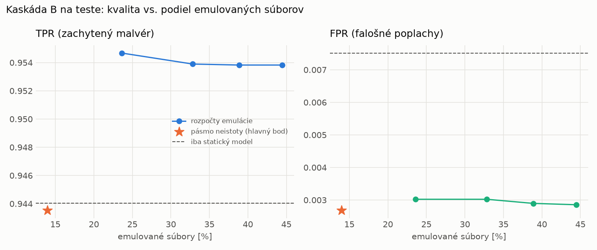

# Kaskáda B `b_nokd` – beh `20261104-080101`

> Generované `src/cascade/evaluate_b.py` (2026-11-04T08:01:02+01:00). Seedy: [0, 1, 2]; hodnoty = priemer ± sm. odchýlka.
> Všetky prahy a pásmo neistoty sú z validácie; test sa na nič nenastavuje. Postup: `docs/09_plan_v2.md`.

| rola | beh |
|---|---|
| static | `runs_v2/lofo/ransomware/students_static/mlp_nokd/20261104-075733` |
| dynamic | `runs_v2/lofo/ransomware/students_dynamic/mlp_nokd/20261104-075916` |
| hybrid | `runs_v2/lofo/ransomware/hybrid/lightgbm/20261104-063626` |

Druhý stupeň: **dynamic**. Pásmo neistoty statického modelu: FPR ≤ 0.1% nad `hi`,
najviac 1% malvéru validácie pod `lo` (seed 0: lo = 0.5564, hi = 0.9381, seed 1: lo = 0.5322, hi = 0.9701, seed 2: lo = 0.5308, hi = 0.9599).

## Test
| prístup | accuracy | balanced_accuracy | precision | recall_tpr | fpr | f1 | mcc |
|---|---|---|---|---|---|---|---|
| kaskáda B | 0.9682 ± 0.0008 | 0.9704 ± 0.0007 | 0.9976 ± 0.0001 | 0.9435 ± 0.0015 | 0.0027 ± 0.0001 | 0.9698 ± 0.0008 | 0.9378 ± 0.0015 |
| statický | 0.9662 ± 0.0006 | 0.9683 ± 0.0005 | 0.9933 ± 0.0006 | 0.9440 ± 0.0018 | 0.0075 ± 0.0007 | 0.9681 ± 0.0006 | 0.9336 ± 0.0011 |
| dynamický | 0.7139 ± 0.0075 | 0.7353 ± 0.0069 | 0.9809 ± 0.0011 | 0.4817 ± 0.0142 | 0.0111 ± 0.0008 | 0.6460 ± 0.0128 | 0.5305 ± 0.0105 |
| hybrid (každá vzorka) | 0.9893 ± 0.0008 | 0.9898 ± 0.0007 | 0.9965 ± 0.0008 | 0.9836 ± 0.0017 | 0.0041 ± 0.0009 | 0.9900 ± 0.0007 | 0.9785 ± 0.0015 |

- **emulované súbory: 13.97%** (ostatné rozhodne iba statický model); na hybrid ide 10.56% súborov
- chyby pri istom rozhodnutí statického modelu (seed 0): 473
- validácia: emulované 4.47%, na hybrid 1.88%

## Validácia
| prístup | accuracy | balanced_accuracy | precision | recall_tpr | fpr | f1 | mcc |
|---|---|---|---|---|---|---|---|
| kaskáda B | 0.9891 ± 0.0012 | 0.9903 ± 0.0010 | 0.9969 ± 0.0003 | 0.9856 ± 0.0018 | 0.0051 ± 0.0005 | 0.9912 ± 0.0010 | 0.9771 ± 0.0024 |
| statický | 0.9874 ± 0.0014 | 0.9881 ± 0.0012 | 0.9945 ± 0.0002 | 0.9852 ± 0.0023 | 0.0090 ± 0.0004 | 0.9898 ± 0.0012 | 0.9734 ± 0.0030 |
| dynamický | 0.9414 ± 0.0123 | 0.9511 ± 0.0097 | 0.9939 ± 0.0003 | 0.9115 ± 0.0201 | 0.0093 ± 0.0006 | 0.9508 ± 0.0109 | 0.8840 ± 0.0221 |
| hybrid (každá vzorka) | 0.9942 ± 0.0006 | 0.9934 ± 0.0005 | 0.9942 ± 0.0001 | 0.9964 ± 0.0009 | 0.0096 ± 0.0002 | 0.9953 ± 0.0005 | 0.9876 ± 0.0013 |

## Januárové vzorky vynechanej rodiny (iba malvér → TPR)
| prístup | TPR |
|---|---|
| kaskáda B | 0.8591 ± 0.0280 |
| statický | 0.8572 ± 0.0268 |
| dynamický | 0.1337 ± 0.0145 |
| hybrid (každá vzorka) | 0.9969 ± 0.0002 |

Podiel emulovaných: 40.16%

## Krivka rozpočtu emulácie (test, priemer cez seedy)
| budget_val | emulation_rate | hybrid_rate | recall_tpr | fpr | f1 |
|---|---|---|---|---|---|
| 0.1000 | 0.2360 | 0.1577 | 0.9547 | 0.0030 | 0.9755 |
| 0.2000 | 0.3284 | 0.2113 | 0.9539 | 0.0030 | 0.9751 |
| 0.3000 | 0.3886 | 0.2304 | 0.9538 | 0.0029 | 0.9751 |
| 0.4000 | 0.4446 | 0.2496 | 0.9538 | 0.0029 | 0.9752 |

## Výpočtové nároky
Emulácia (Speakeasy) sa nedá zmerať (dataset neobsahuje PE súbory). **Predpoklad** 60 s na súbor
(limit z `speakeasy-config.json`): kaskáda B ≈ 8.4 s na súbor v priemere, dynamický/hybridný model
a kaskáda A 60 s (emulujú každý súbor).

_Chýba benchmark niektorého komponentu (v zero-day behoch sa nemeria)._

