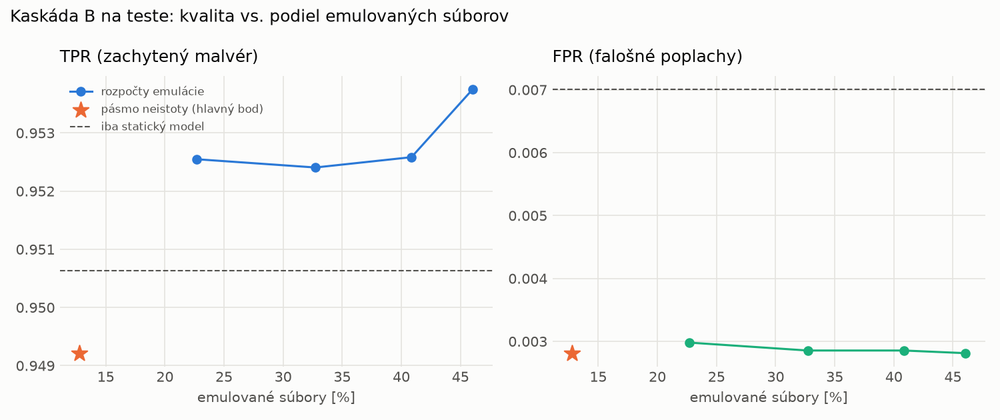

# Kaskáda B `b_twobranch` – beh `20261104-080103`

> Generované `src/cascade/evaluate_b.py` (2026-11-04T08:01:04+01:00). Seedy: [0, 1, 2]; hodnoty = priemer ± sm. odchýlka.
> Všetky prahy a pásmo neistoty sú z validácie; test sa na nič nenastavuje. Postup: `docs/09_plan_v2.md`.

| rola | beh |
|---|---|
| static | `runs_v2/lofo/ransomware/students_static/mlp_kd_twobranch/20261104-075815` |
| dynamic | `runs_v2/lofo/ransomware/students_dynamic/mlp_kd_twobranch/20261104-080011` |
| hybrid | `runs_v2/lofo/ransomware/hybrid/lightgbm/20261104-063626` |

Druhý stupeň: **dynamic**. Pásmo neistoty statického modelu: FPR ≤ 0.1% nad `hi`,
najviac 1% malvéru validácie pod `lo` (seed 0: lo = 0.5714, hi = 0.9971, seed 1: lo = 0.5497, hi = 0.9960, seed 2: lo = 0.5321, hi = 0.9959).

## Test
| prístup | accuracy | balanced_accuracy | precision | recall_tpr | fpr | f1 | mcc |
|---|---|---|---|---|---|---|---|
| kaskáda B | 0.9712 ± 0.0018 | 0.9732 ± 0.0016 | 0.9975 ± 0.0002 | 0.9492 ± 0.0033 | 0.0028 ± 0.0002 | 0.9728 ± 0.0017 | 0.9435 ± 0.0034 |
| statický | 0.9700 ± 0.0020 | 0.9718 ± 0.0018 | 0.9938 ± 0.0005 | 0.9506 ± 0.0042 | 0.0070 ± 0.0006 | 0.9717 ± 0.0019 | 0.9409 ± 0.0037 |
| dynamický | 0.7060 ± 0.0151 | 0.7280 ± 0.0138 | 0.9798 ± 0.0006 | 0.4673 ± 0.0283 | 0.0114 ± 0.0007 | 0.6325 ± 0.0257 | 0.5188 ± 0.0213 |
| hybrid (každá vzorka) | 0.9893 ± 0.0008 | 0.9898 ± 0.0007 | 0.9965 ± 0.0008 | 0.9836 ± 0.0017 | 0.0041 ± 0.0009 | 0.9900 ± 0.0007 | 0.9785 ± 0.0015 |

- **emulované súbory: 12.78%** (ostatné rozhodne iba statický model); na hybrid ide 10.37% súborov
- chyby pri istom rozhodnutí statického modelu (seed 0): 426
- validácia: emulované 4.18%, na hybrid 1.99%

## Validácia
| prístup | accuracy | balanced_accuracy | precision | recall_tpr | fpr | f1 | mcc |
|---|---|---|---|---|---|---|---|
| kaskáda B | 0.9903 ± 0.0011 | 0.9911 ± 0.0009 | 0.9968 ± 0.0003 | 0.9875 ± 0.0016 | 0.0052 ± 0.0005 | 0.9921 ± 0.0009 | 0.9794 ± 0.0022 |
| statický | 0.9888 ± 0.0008 | 0.9891 ± 0.0006 | 0.9940 ± 0.0000 | 0.9880 ± 0.0013 | 0.0098 ± 0.0000 | 0.9910 ± 0.0006 | 0.9763 ± 0.0016 |
| dynamický | 0.9479 ± 0.0011 | 0.9562 ± 0.0008 | 0.9937 ± 0.0001 | 0.9221 ± 0.0019 | 0.0097 ± 0.0002 | 0.9565 ± 0.0009 | 0.8955 ± 0.0020 |
| hybrid (každá vzorka) | 0.9942 ± 0.0006 | 0.9934 ± 0.0005 | 0.9942 ± 0.0001 | 0.9964 ± 0.0009 | 0.0096 ± 0.0002 | 0.9953 ± 0.0005 | 0.9876 ± 0.0013 |

## Januárové vzorky vynechanej rodiny (iba malvér → TPR)
| prístup | TPR |
|---|---|
| kaskáda B | 0.8714 ± 0.0266 |
| statický | 0.8703 ± 0.0293 |
| dynamický | 0.1071 ± 0.0135 |
| hybrid (každá vzorka) | 0.9969 ± 0.0002 |

Podiel emulovaných: 38.44%

## Krivka rozpočtu emulácie (test, priemer cez seedy)
| budget_val | emulation_rate | hybrid_rate | recall_tpr | fpr | f1 |
|---|---|---|---|---|---|
| 0.1000 | 0.2270 | 0.1473 | 0.9525 | 0.0030 | 0.9744 |
| 0.2000 | 0.3273 | 0.1820 | 0.9524 | 0.0029 | 0.9744 |
| 0.3000 | 0.4086 | 0.2164 | 0.9526 | 0.0029 | 0.9745 |
| 0.4000 | 0.4604 | 0.2328 | 0.9538 | 0.0028 | 0.9751 |

## Výpočtové nároky
Emulácia (Speakeasy) sa nedá zmerať (dataset neobsahuje PE súbory). **Predpoklad** 60 s na súbor
(limit z `speakeasy-config.json`): kaskáda B ≈ 7.7 s na súbor v priemere, dynamický/hybridný model
a kaskáda A 60 s (emulujú každý súbor).

_Chýba benchmark niektorého komponentu (v zero-day behoch sa nemeria)._

